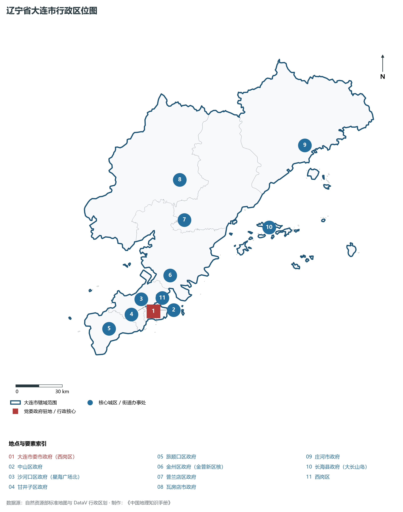
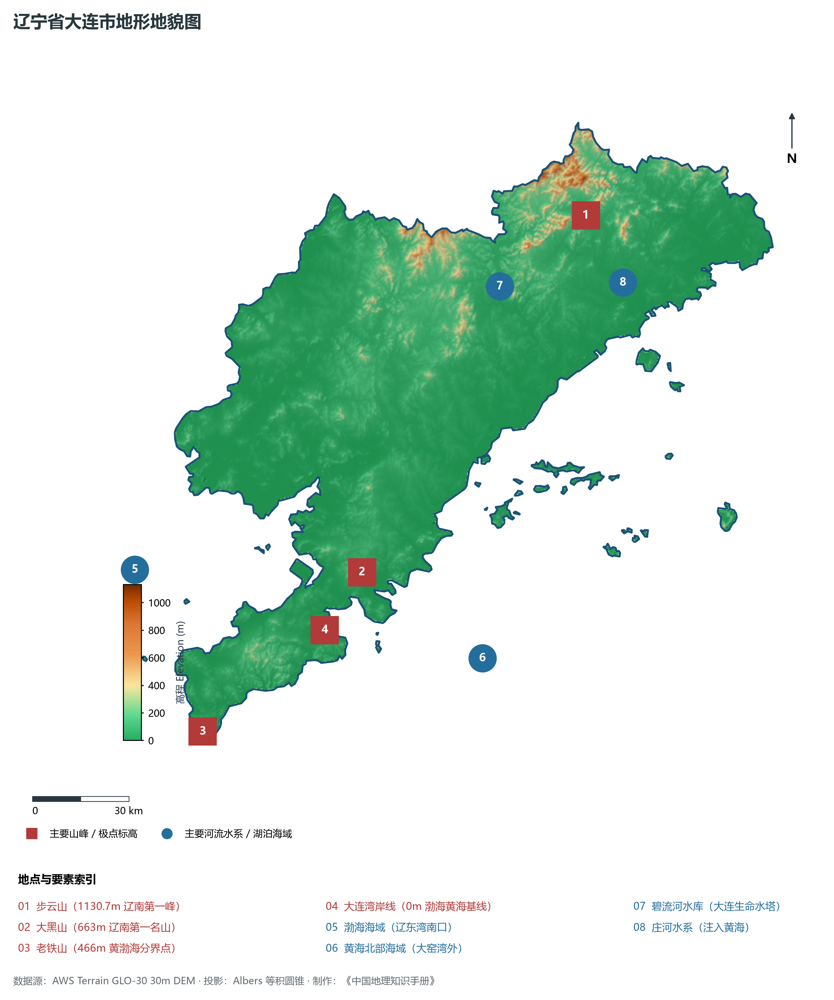
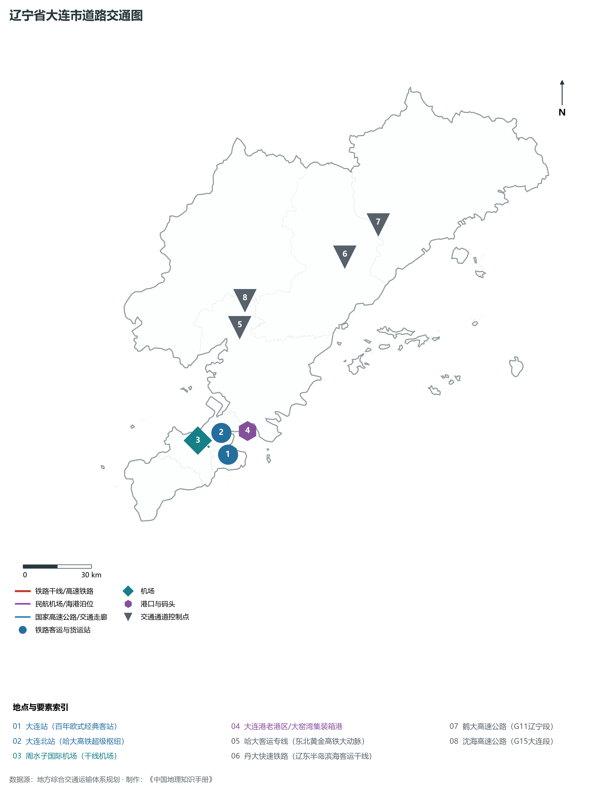
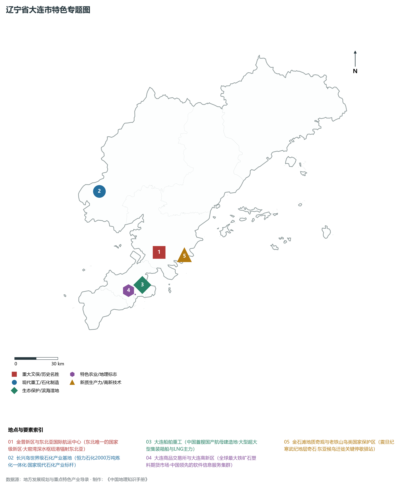
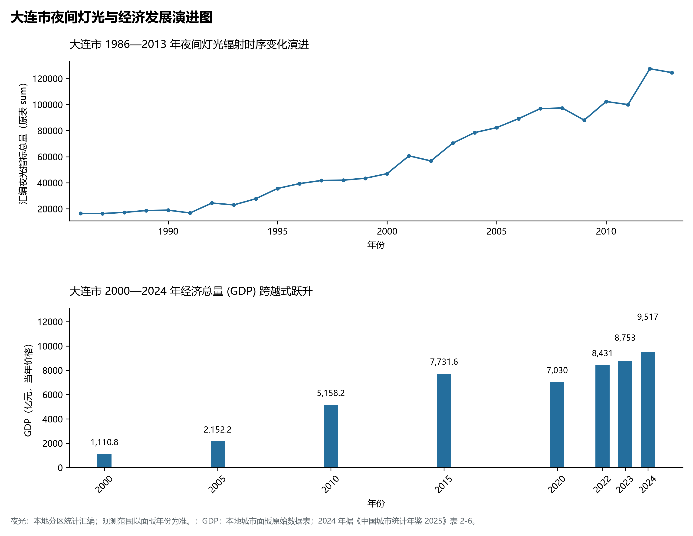

# 5.2 大连市
大连市，位于辽宁省，其战略定位与特色概括为：**副省级市·计划单列市·特大城市·东北亚国际航运中心与绿色石化高端造船基地**。辖区土地。2024 年常住人口 **754 万人**，常住人口城镇化率 **83.04%**，地区生产总值 **9,517 亿元**（当年价格），人均地区生产总值 **126,185 元**，三次产业构成为 **6.15 : 35.19 : 58.66**。

---
## 一、自然地理底盘与地貌水系机理
大连市在地质构造演化史上隶属于中朝准地台东北缘，基底古老深厚，经中生代燕山造山运动与新生代断裂下陷改造，形成了山脉雄峙、水网环绕、冲积阶地发育的优越自然地理底盘。全境地表高程最低为 **0.0 m**，最高隆起峰顶海拔达 **1130.7 m**，地势落差与微地貌分异造就了多层次的生物多样性与空间资源承载力。

区域主要控制性山脉与地形极点包括：

- **步云山 (1130.7m 辽南第一峰)**（坐标约东经 122.860°、北纬 39.950°，高程约 1130.7 m）；
- **大黑山 (663m 辽南第一名山)**（坐标约东经 121.820°、北纬 39.090°，高程约 663.0 m）；
- **老铁山 (466m 黄渤海分界点)**（坐标约东经 121.150°、北纬 38.730°，高程约 466.0 m）；
- **大连湾岸线 (0m 渤海黄海基线)**（坐标约东经 121.650°、北纬 38.950°，高程约 0.0 m）；

水系与水文网络方面，大连市地表水资源丰富，骨干河流纵横穿流：

- **渤海海域 (辽东湾南口)**（流经约东经 121.000°、北纬 39.200° 水域）：对全市农业灌溉、城市工业供水及生态水网维持发挥核心调蓄作用；
- **黄海北部海域 (大窑湾外)**（流经约东经 122.200°、北纬 38.800° 水域）：对全市农业灌溉、城市工业供水及生态水网维持发挥核心调蓄作用；
- **碧流河水库 (大连生命水塔)**（流经约东经 122.500°、北纬 39.800° 水域）：对全市农业灌溉、城市工业供水及生态水网维持发挥核心调蓄作用；
- **庄河水系 (注入黄海)**（流经约东经 122.950°、北纬 39.750° 水域）：对全市农业灌溉、城市工业供水及生态水网维持发挥核心调蓄作用；

---
## 二、行政区划沿革与城镇空间体系
大连市历史文脉源远流长，自先秦置郡以来行政建置历经变迁演进。新中国成立后，伴随老工业基地大规模建设与现代化城镇化推进，形成了结构完备、产城紧密融合的市辖区与县级行政单元空间组织体系：

- **大连市委市政府 (西岗区)**（驻地坐标：121.615°E, 38.914°N）：承担区域行政综合治理、公共资源配置与核心城镇组团功能；
- **中山区政府**（驻地坐标：121.644°E, 38.918°N）：承担区域行政综合治理、公共资源配置与核心城镇组团功能；
- **沙河口区政府 (星海广场北)**（驻地坐标：121.583°E, 38.905°N）：承担区域行政综合治理、公共资源配置与核心城镇组团功能；
- **甘井子区政府**（驻地坐标：121.565°E, 38.950°N）：承担区域行政综合治理、公共资源配置与核心城镇组团功能；
- **旅顺口区政府**（驻地坐标：121.262°E, 38.858°N）：承担区域行政综合治理、公共资源配置与核心城镇组团功能；
- **金州区政府 (金普新区核)**（驻地坐标：121.785°E, 39.100°N）：承担区域行政综合治理、公共资源配置与核心城镇组团功能；
- **普兰店区政府**（驻地坐标：121.963°E, 39.398°N）：承担区域行政综合治理、公共资源配置与核心城镇组团功能；
- **瓦房店市政府**（驻地坐标：121.980°E, 39.628°N）：承担区域行政综合治理、公共资源配置与核心城镇组团功能；
- **庄河市政府**（驻地坐标：122.967°E, 39.697°N）：承担区域行政综合治理、公共资源配置与核心城镇组团功能；
- **长海县政府 (大长山岛)**（驻地坐标：122.588°E, 39.272°N）：承担区域行政综合治理、公共资源配置与核心城镇组团功能；

在城镇空间发展战略上，大连市依托国土空间总体规划，聚力构建“极核集聚、多组团协同、轴带串联、生态穿插”的现代城镇空间体系，全力推进产城融合与区域一体化协同发展。

---
## 三、综合立体交通网络与交通走廊
大连市地处东北内陆与沿海交通关键走廊之上，依托高速铁路、干线普铁、国家高速公路与沿海航空/海港码头，构筑了现代化立体综合交通运输骨架：

**主要综合交通客运与货运物流枢纽节点：**

- **大连站 (百年欧式经典客站)**（位置坐标：121.630°E, 38.922°N）：区域客货运流量集散分拨中心；
- **大连北站 (哈大高铁超级枢纽)**（位置坐标：121.615°E, 39.010°N）：区域客货运流量集散分拨中心；
- **周水子国际机场 (干线机场)**（位置坐标：121.538°E, 38.965°N）：区域客货运流量集散分拨中心；
- **大连港老港区/大窑湾集装箱港**（位置坐标：121.750°E, 39.000°N）：区域客货运流量集散分拨中心；

**核心干线铁路与高等级公路交通走廊：**

- **哈大客运专线 (东北黄金高铁大动脉)**（廊道控制点：121.800°E, 39.400°N）：实现城市对外快速互联互通的高速客货运通道；
- **丹大快速铁路 (辽东半岛滨海客运干线)**（廊道控制点：122.400°E, 39.600°N）：实现城市对外快速互联互通的高速客货运通道；
- **鹤大高速公路 (G11辽宁段)**（廊道控制点：122.600°E, 39.700°N）：实现城市对外快速互联互通的高速客货运通道；
- **沈海高速公路 (G15大连段)**（廊道控制点：121.850°E, 39.500°N）：实现城市对外快速互联互通的高速客货运通道；

---
## 四、现代重点产业布局与特色功能组团
在新时代东北全面振兴指引下，大连市坚持高端化、智能化、绿色化发展方向，加快改造升级传统优势工业，积极培育壮大新兴未来产业，打造特色现代化产业集群：

**重点园区与现代化产业基地：**

- **大连金普新区 (国家级新区)**（空间分布：121.800°E, 39.120°N）；
- **大连长兴岛恒力石化炼化一体化基地**（空间分布：121.400°E, 39.550°N）；
- **大连造船重工基地 (航母建造母港)**（空间分布：121.620°E, 38.940°N）；
- **大连高新技术产业园区 (软件外包基地)**（空间分布：121.520°E, 38.870°N）；

**代表性特色地标与战略支撑维度：**

- **金普新区与东北亚国际航运中心**（121.800°E, 39.120°N）：东北唯一的国家级新区·大窑湾深水枢纽港辐射东北亚；
- **长兴岛世界级石化产业基地**（121.400°E, 39.550°N）：恒力石化2000万吨炼化一体化·国家现代石化产业标杆；
- **大连船舶重工 (大坞船台与大国重器)**（121.620°E, 38.940°N）：中国首艘国产航母建造地·大型超大型集装箱船与LNG主力；
- **大连商品交易所与大连高新区**（121.550°E, 38.890°N）：全球最大铁矿石塑料期货市场·中国领先的软件信息服务集群；
- **金石滩地质奇观与老铁山鸟类国家保护区**（122.000°E, 39.080°N）：震旦纪寒武纪地层奇石·东亚候鸟迁徙关键停歇驿站；

---
## 五、1986—2013年夜间灯光演变与经济变化分析

本节夜光图的观测年份为 1986—2013 年，指标为行政区汇总值（原表 sum）。

- **1996 年空间发展说明**：中山区与西岗区核心半岛灯火璀璨；大连港老港区吞吐繁茂；
- **2007 年空间发展说明**：大开发向金州新区与大窑湾挺进；大连高新区与旅顺南路软件带成型；
- **2021 年空间发展说明**：长兴岛恒力石化超级石化基地投产；金普新区陆海统筹两翼齐飞；

| 年份 | 地区生产总值（亿元，当年价格） |
|:---|---:|
| 2000 年 | 1,110.8 |
| 2005 年 | 2,152.2 |
| 2010 年 | 5,158.2 |
| 2015 年 | 7,731.6 |
| 2020 年 | 7,030 |
| 2022 年 | 8,431 |
| 2023 年 | 8,753 |
| 2024 年 | 9,517 |

---
## 六、文化旅游名胜、生态屏障与可持续人地共生
大连市高度注重统筹经济高质量发展与高水平生态环境保护，筑牢绿色生态底盘，弘扬优秀历史文化：

- **金石滩国家级旅游度假区 (5A)**（位置坐标：122.000°E, 39.080°N）；
- **星海广场 (亚洲最大城市广场景观)**（位置坐标：121.583°E, 38.883°N）；
- **旅顺军港与东鸡冠山日俄战争遗址**（位置坐标：121.240°E, 38.805°N）；
- **棒棰岛风景区与滨海路**（位置坐标：121.685°E, 38.890°N）；

在人地协调机制方面，大连市统筹推进山水林田湖草沙海一体化保护与系统治理，坚决打好蓝天、碧水、净土保卫战，推进传统工矿区生态恢复治理，打造人与自然和谐共生的生态宜居美丽家园。

---
## 七、大连市关键地理统计指标速查矩阵

| 统计指标项 | 统计数值 / 口径标准 | 空间特征与全省位次说明 |
|:---|:---|:---|
| **行政区划代码** | `210200` | 国家民政部标准行政区划编号 |
| **辖区陆地面积** | **12,574.0** km² | 土地利用类型兼具山地、丘陵、平原与城镇工矿 |
| **常住人口规模** | 754 万人 | 2024 年，全市；年鉴公布口径 |
| **常住人口城镇化率** | 83.04% | 2024 年，全市；年鉴公布口径 |
| **地区生产总值 (2024)** | 9,517 亿元 | 2024 年，全市；年鉴公布口径 |
| **人均 GDP 水平** | 126,185 元/人 | 2024 年，全市；年鉴公布口径 |
| **三次产业结构比** | 6.15 : 35.19 : 58.66 | 2024 年，全市；年鉴公布口径 |
| **地表极限高程** | **0.0 m ～ 1130.7 m** | 形成极具特色的立体地貌剖面格局 |

2024 年统计来源：《中国城市统计年鉴 2025》表 2-1、2-6、2-7（2024 年，全市）。其他年份 GDP 据本地城市面板“原始数据”表，单位为亿元、当年价格。
