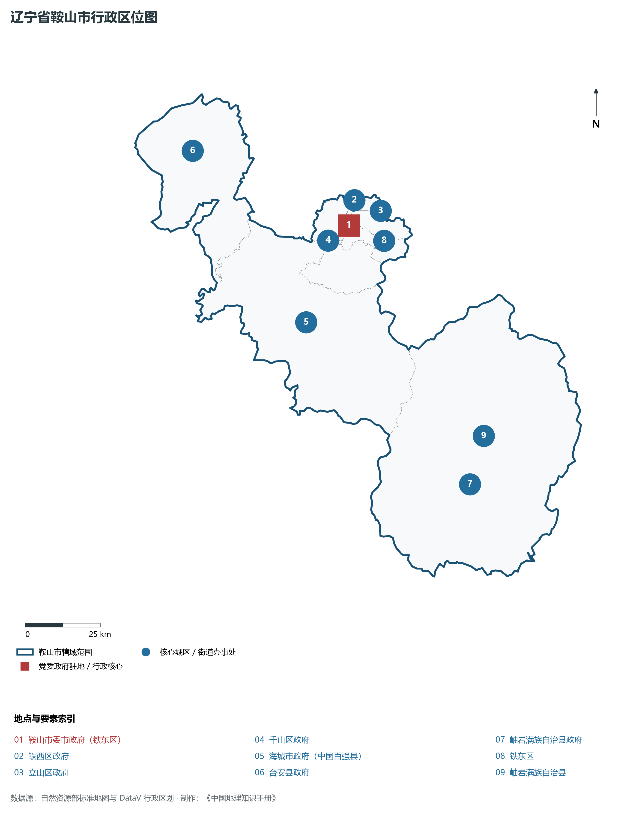
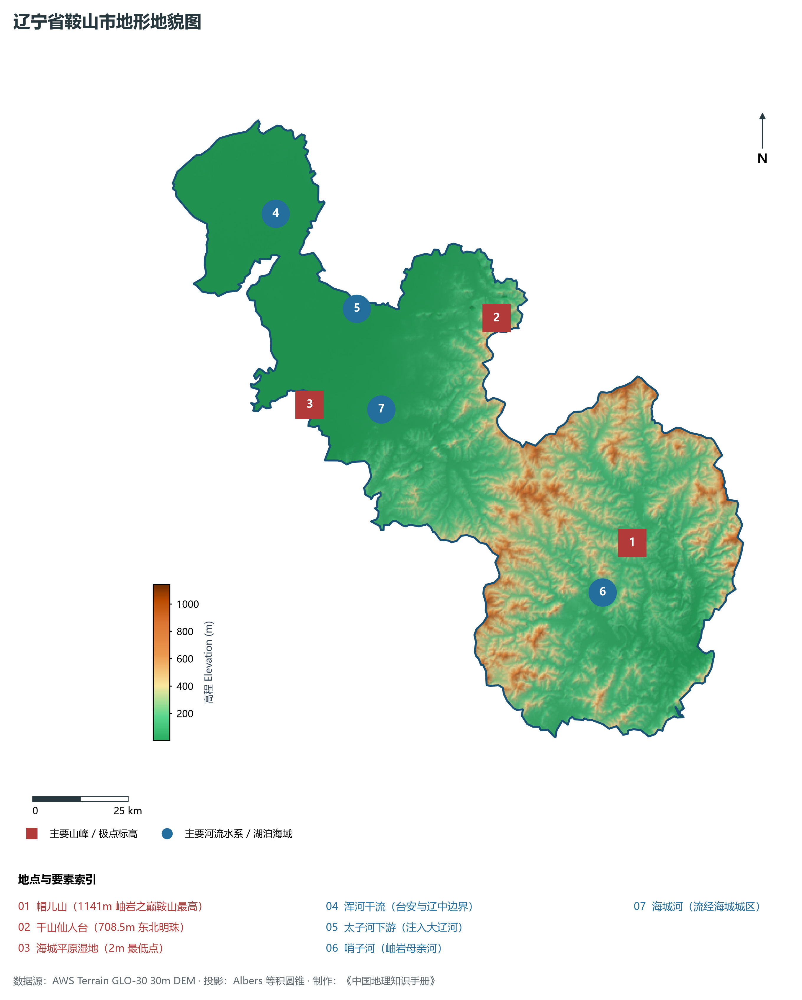
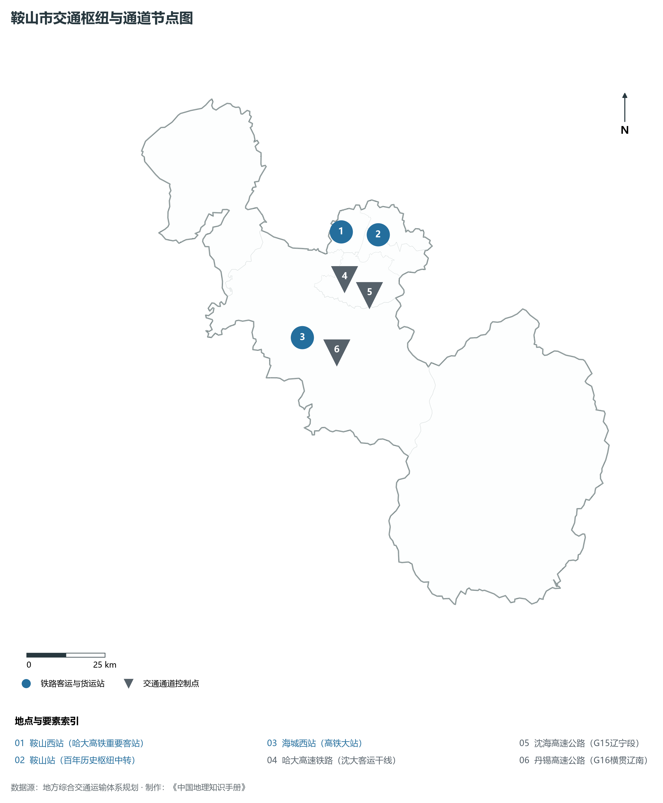
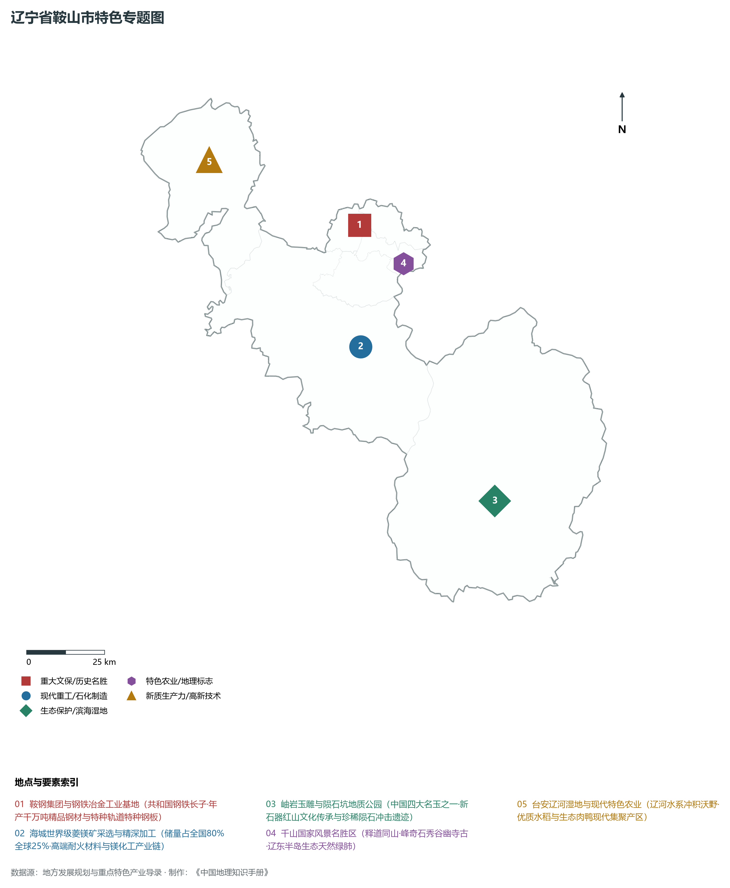
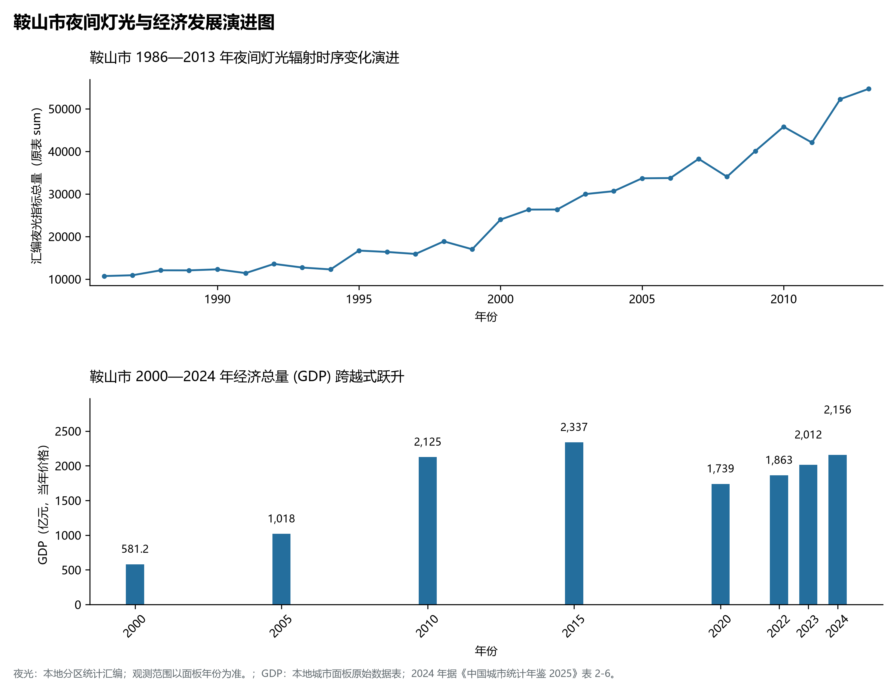

# 5.3 鞍山市
鞍山市，位于辽宁省，其战略定位与特色概括为：**中国钢都·鞍钢集团大本营·千山国家级风景名胜区·世界菱镁之都与岫岩玉之乡**。辖区土地。2024 年常住人口 **319 万人**，常住人口城镇化率 **76.67%**，地区生产总值 **2,156 亿元**（当年价格），人均地区生产总值 **67,238 元**，三次产业构成为 **5.63 : 34.35 : 60.01**。

---
## 一、自然地理底盘与地貌水系机理
鞍山市在地质构造演化史上隶属于中朝准地台东北缘，基底古老深厚，经中生代燕山造山运动与新生代断裂下陷改造，形成了山脉雄峙、水网环绕、冲积阶地发育的优越自然地理底盘。全境地表高程最低为 **2.0 m**，最高隆起峰顶海拔达 **1141.0 m**，地势落差与微地貌分异造就了多层次的生物多样性与空间资源承载力。

区域主要控制性山脉与地形极点包括：

- **帽儿山 (1141m 岫岩之巅鞍山最高)**（坐标约东经 123.420°、北纬 40.450°，高程约 1141.0 m）；
- **千山仙人台 (708.5m 东北明珠)**（坐标约东经 123.130°、北纬 41.020°，高程约 708.5 m）；
- **海城平原湿地 (2m 最低点)**（坐标约东经 122.500°、北纬 40.900°，高程约 2.0 m）；

水系与水文网络方面，鞍山市地表水资源丰富，骨干河流纵横穿流：

- **浑河干流 (台安与辽中边界)**（流经约东经 122.500°、北纬 41.350° 水域）：对全市农业灌溉、城市工业供水及生态水网维持发挥核心调蓄作用；
- **太子河下游 (注入大辽河)**（流经约东经 122.700°、北纬 41.100° 水域）：对全市农业灌溉、城市工业供水及生态水网维持发挥核心调蓄作用；
- **哨子河 (岫岩母亲河)**（流经约东经 123.300°、北纬 40.350° 水域）：对全市农业灌溉、城市工业供水及生态水网维持发挥核心调蓄作用；
- **海城河 (流经海城城区)**（流经约东经 122.720°、北纬 40.860° 水域）：对全市农业灌溉、城市工业供水及生态水网维持发挥核心调蓄作用；

---
## 二、行政区划沿革与城镇空间体系
鞍山市历史文脉源远流长，自先秦置郡以来行政建置历经变迁演进。新中国成立后，伴随老工业基地大规模建设与现代化城镇化推进，形成了结构完备、产城紧密融合的市辖区与县级行政单元空间组织体系：

- **鞍山市委市政府 (铁东区)**（驻地坐标：122.990°E, 41.110°N）：承担区域行政综合治理、公共资源配置与核心城镇组团功能；
- **铁西区政府**（驻地坐标：122.960°E, 41.120°N）：承担区域行政综合治理、公共资源配置与核心城镇组团功能；
- **立山区政府**（驻地坐标：123.020°E, 41.150°N）：承担区域行政综合治理、公共资源配置与核心城镇组团功能；
- **千山区政府**（驻地坐标：122.950°E, 41.070°N）：承担区域行政综合治理、公共资源配置与核心城镇组团功能；
- **海城市政府 (中国百强县)**（驻地坐标：122.750°E, 40.850°N）：承担区域行政综合治理、公共资源配置与核心城镇组团功能；
- **台安县政府**（驻地坐标：122.420°E, 41.410°N）：承担区域行政综合治理、公共资源配置与核心城镇组团功能；
- **岫岩满族自治县政府**（驻地坐标：123.280°E, 40.290°N）：承担区域行政综合治理、公共资源配置与核心城镇组团功能；

在城镇空间发展战略上，鞍山市依托国土空间总体规划，聚力构建“极核集聚、多组团协同、轴带串联、生态穿插”的现代城镇空间体系，全力推进产城融合与区域一体化协同发展。

---
## 三、综合立体交通网络与交通走廊
鞍山市地处东北内陆与沿海交通关键走廊之上，依托高速铁路、干线普铁、国家高速公路与沿海航空/海港码头，构筑了现代化立体综合交通运输骨架：

**主要综合交通客运与货运物流枢纽节点：**

- **鞍山西站 (哈大高铁重要客站)**（位置坐标：122.900°E, 41.135°N）：区域客货运流量集散分拨中心；
- **鞍山站 (百年历史枢纽中转)**（位置坐标：122.985°E, 41.115°N）：区域客货运流量集散分拨中心；
- **海城西站 (高铁大站)**（位置坐标：122.680°E, 40.860°N）：区域客货运流量集散分拨中心；

**核心干线铁路与高等级公路交通走廊：**

- **哈大高速铁路 (沈大客运干线)**（廊道控制点：122.880°E, 41.000°N）：实现城市对外快速互联互通的高速客货运通道；
- **沈海高速公路 (G15辽宁段)**（廊道控制点：122.910°E, 40.950°N）：实现城市对外快速互联互通的高速客货运通道；
- **丹锡高速公路 (G16横贯辽南)**（廊道控制点：122.800°E, 40.800°N）：实现城市对外快速互联互通的高速客货运通道；

---
## 四、现代重点产业布局与特色功能组团
在新时代东北全面振兴指引下，鞍山市坚持高端化、智能化、绿色化发展方向，加快改造升级传统优势工业，积极培育壮大新兴未来产业，打造特色现代化产业集群：

**重点园区与现代化产业基地：**

- **鞍钢集团鞍山钢铁本部生产基地**（空间分布：122.980°E, 41.140°N）；
- **海城菱镁新材料产业园区 (牌楼)**（空间分布：122.900°E, 40.800°N）；
- **岫岩玉文化产业园区 (中国玉都)**（空间分布：123.270°E, 40.280°N）；
- **鞍山高新技术产业开发区**（空间分布：123.050°E, 41.090°N）；

**代表性特色地标与战略支撑维度：**

- **鞍钢集团与钢铁冶金工业基地**（122.980°E, 41.140°N）：共和国钢铁长子·年产千万吨精品钢材与特种轨道特种钢板；
- **海城世界级菱镁矿采选与精深加工**（122.900°E, 40.800°N）：储量占全国80%全球25%·高端耐火材料与镁化工产业链；
- **岫岩玉雕与陨石坑地质公园**（123.300°E, 40.300°N）：中国四大名玉之一·新石器红山文化传承与珍稀陨石冲击遗迹；
- **千山国家风景名胜区 (东北名岳)**（123.120°E, 41.010°N）：释道同山·峰奇石秀谷幽寺古·辽东半岛生态天然绿肺；
- **台安辽河湿地与现代特色农业**（122.450°E, 41.400°N）：辽河水系冲积沃野·优质水稻与生态肉鸭现代集聚产区；

---
## 五、1986—2013年夜间灯光演变与经济变化分析

本节夜光图的观测年份为 1986—2013 年，指标为行政区汇总值（原表 sum）。

- **1996 年空间发展说明**：铁东铁西双核辉映；鞍钢厂区钢花飞溅夜间高强度生产；
- **2008 年空间发展说明**：海城牌楼菱镁产业与南台箱包市场扩张；腾鳌经济开发区灯火通明；
- **2021 年空间发展说明**：千山文旅康养与岫岩玉产业带繁盛；鞍钢绿色低碳转型打造现代新钢都；

| 年份 | 地区生产总值（亿元，当年价格） |
|:---|---:|
| 2000 年 | 581.2 |
| 2005 年 | 1,018 |
| 2010 年 | 2,125 |
| 2015 年 | 2,337 |
| 2020 年 | 1,739 |
| 2022 年 | 1,863 |
| 2023 年 | 2,012 |
| 2024 年 | 2,156 |

---
## 六、文化旅游名胜、生态屏障与可持续人地共生
鞍山市高度注重统筹经济高质量发展与高水平生态环境保护，筑牢绿色生态底盘，弘扬优秀历史文化：

- **千山风景名胜区 (5A·无峰不奇)**（位置坐标：123.120°E, 41.010°N）；
- **玉佛苑 (世界最大玉佛吉尼斯纪录)**（位置坐标：123.010°E, 41.100°N）；
- **汤岗子温泉 (全国四大温泉康复中心)**（位置坐标：122.950°E, 41.020°N）；
- **岫岩陨石坑 (中国首个证实陨石坑)**（位置坐标：123.450°E, 40.360°N）；

在人地协调机制方面，鞍山市统筹推进山水林田湖草沙海一体化保护与系统治理，坚决打好蓝天、碧水、净土保卫战，推进传统工矿区生态恢复治理，打造人与自然和谐共生的生态宜居美丽家园。

---
## 七、鞍山市关键地理统计指标速查矩阵

| 统计指标项 | 统计数值 / 口径标准 | 空间特征与全省位次说明 |
|:---|:---|:---|
| **行政区划代码** | `210300` | 国家民政部标准行政区划编号 |
| **辖区陆地面积** | **9,255.0** km² | 土地利用类型兼具山地、丘陵、平原与城镇工矿 |
| **常住人口规模** | 319 万人 | 2024 年，全市；年鉴公布口径 |
| **常住人口城镇化率** | 76.67% | 2024 年，全市；年鉴公布口径 |
| **地区生产总值 (2024)** | 2,156 亿元 | 2024 年，全市；年鉴公布口径 |
| **人均 GDP 水平** | 67,238 元/人 | 2024 年，全市；年鉴公布口径 |
| **三次产业结构比** | 5.63 : 34.35 : 60.01 | 2024 年，全市；年鉴公布口径 |
| **地表极限高程** | **2.0 m ～ 1141.0 m** | 形成极具特色的立体地貌剖面格局 |

2024 年统计来源：《中国城市统计年鉴 2025》表 2-1、2-6、2-7（2024 年，全市）。其他年份 GDP 据本地城市面板“原始数据”表，单位为亿元、当年价格。
