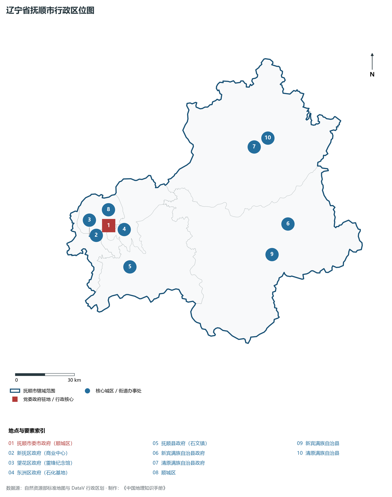
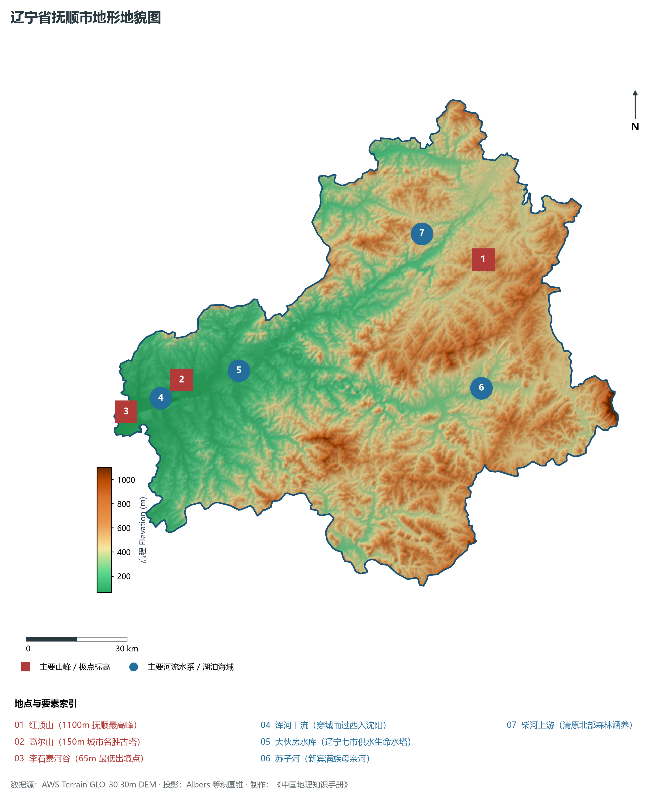
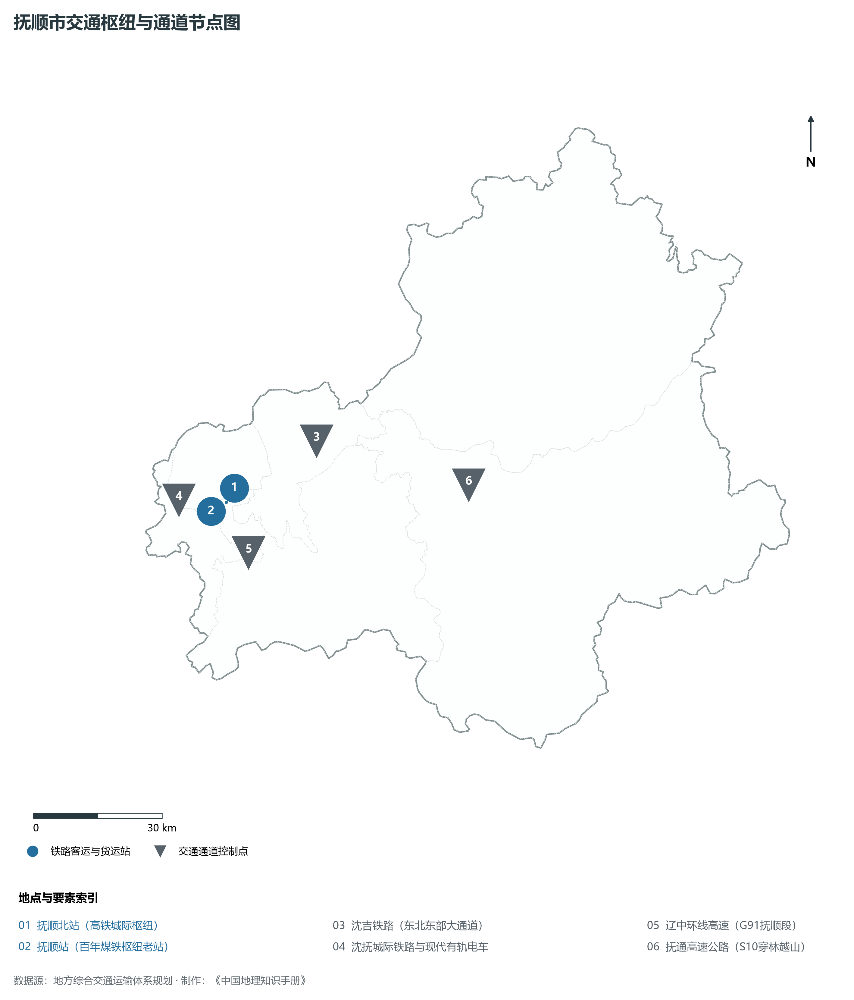
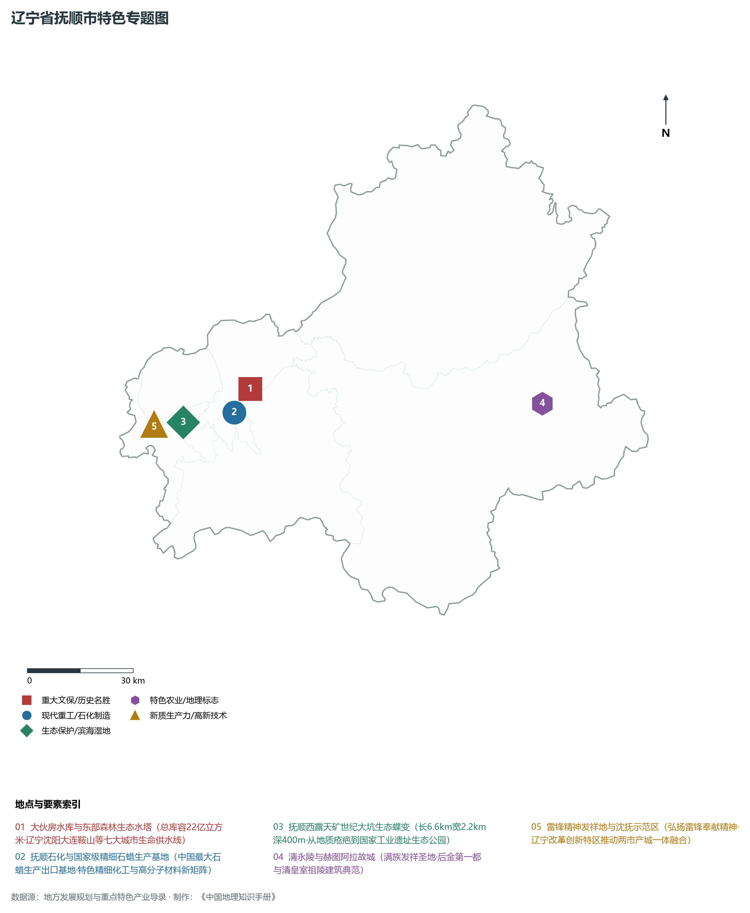
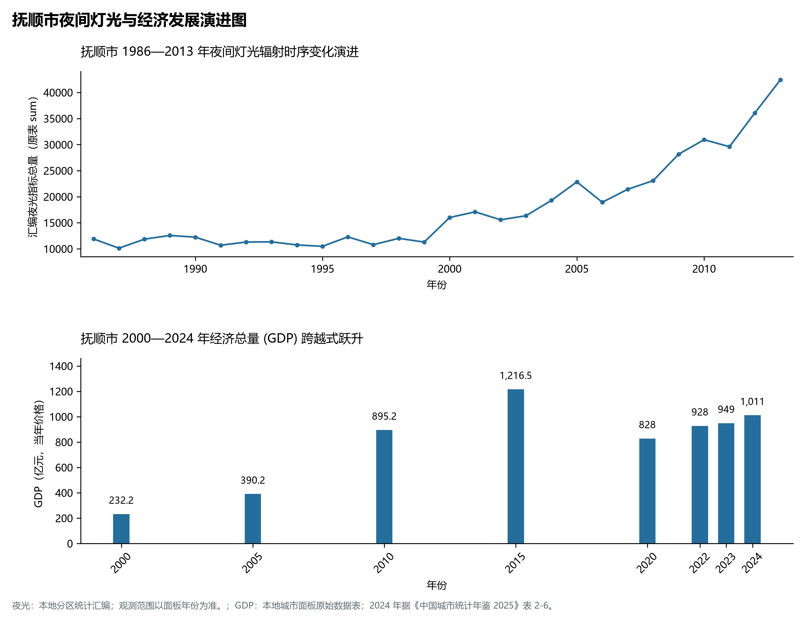

# 5.4 抚顺市
抚顺市，位于辽宁省，其战略定位与特色概括为：**百年煤都转型·浑河源头大伙房水源地·雷锋精神发祥地与国家石蜡精细化工基地**。辖区土地。2024 年常住人口 **171 万人**，常住人口城镇化率 **80.43%**，地区生产总值 **1,011 亿元**（当年价格），人均地区生产总值 **58,468 元**，三次产业构成为 **5.88 : 42.28 : 51.84**。

---
## 一、自然地理底盘与地貌水系机理
抚顺市在地质构造演化史上隶属于中朝准地台东北缘，基底古老深厚，经中生代燕山造山运动与新生代断裂下陷改造，形成了山脉雄峙、水网环绕、冲积阶地发育的优越自然地理底盘。全境地表高程最低为 **65.0 m**，最高隆起峰顶海拔达 **1100.0 m**，地势落差与微地貌分异造就了多层次的生物多样性与空间资源承载力。

区域主要控制性山脉与地形极点包括：

- **红顶山 (1100m 抚顺最高峰)**（坐标约东经 125.100°、北纬 42.050°，高程约 1100.0 m）；
- **高尔山 (150m 城市名胜古塔)**（坐标约东经 123.940°、北纬 41.895°，高程约 150.0 m）；
- **李石寨河谷 (65m 最低出境点)**（坐标约东经 123.720°、北纬 41.840°，高程约 65.0 m）；

水系与水文网络方面，抚顺市地表水资源丰富，骨干河流纵横穿流：

- **浑河干流 (穿城而过西入沈阳)**（流经约东经 123.900°、北纬 41.870° 水域）：对全市农业灌溉、城市工业供水及生态水网维持发挥核心调蓄作用；
- **大伙房水库 (辽宁七市供水生命水塔)**（流经约东经 124.150°、北纬 41.890° 水域）：对全市农业灌溉、城市工业供水及生态水网维持发挥核心调蓄作用；
- **苏子河 (新宾满族母亲河)**（流经约东经 125.000°、北纬 41.720° 水域）：对全市农业灌溉、城市工业供水及生态水网维持发挥核心调蓄作用；
- **柴河上游 (清原北部森林涵养)**（流经约东经 124.900°、北纬 42.150° 水域）：对全市农业灌溉、城市工业供水及生态水网维持发挥核心调蓄作用；

---
## 二、行政区划沿革与城镇空间体系
抚顺市历史文脉源远流长，自先秦置郡以来行政建置历经变迁演进。新中国成立后，伴随老工业基地大规模建设与现代化城镇化推进，形成了结构完备、产城紧密融合的市辖区与县级行政单元空间组织体系：

- **抚顺市委市政府 (顺城区)**（驻地坐标：123.950°E, 41.880°N）：承担区域行政综合治理、公共资源配置与核心城镇组团功能；
- **新抚区政府 (商业中心)**（驻地坐标：123.910°E, 41.860°N）：承担区域行政综合治理、公共资源配置与核心城镇组团功能；
- **望花区政府 (雷锋纪念馆)**（驻地坐标：123.820°E, 41.850°N）：承担区域行政综合治理、公共资源配置与核心城镇组团功能；
- **东洲区政府 (石化基地)**（驻地坐标：124.040°E, 41.850°N）：承担区域行政综合治理、公共资源配置与核心城镇组团功能；
- **抚顺县政府 (石文镇)**（驻地坐标：124.030°E, 41.680°N）：承担区域行政综合治理、公共资源配置与核心城镇组团功能；
- **新宾满族自治县政府**（驻地坐标：125.040°E, 41.730°N）：承担区域行政综合治理、公共资源配置与核心城镇组团功能；
- **清原满族自治县政府**（驻地坐标：124.930°E, 42.100°N）：承担区域行政综合治理、公共资源配置与核心城镇组团功能；

在城镇空间发展战略上，抚顺市依托国土空间总体规划，聚力构建“极核集聚、多组团协同、轴带串联、生态穿插”的现代城镇空间体系，全力推进产城融合与区域一体化协同发展。

---
## 三、综合立体交通网络与交通走廊
抚顺市地处东北内陆与沿海交通关键走廊之上，依托高速铁路、干线普铁、国家高速公路与沿海航空/海港码头，构筑了现代化立体综合交通运输骨架：

**主要综合交通客运与货运物流枢纽节点：**

- **抚顺北站 (高铁城际枢纽)**（位置坐标：123.945°E, 41.888°N）：区域客货运流量集散分拨中心；
- **抚顺站 (百年煤铁枢纽老站)**（位置坐标：123.915°E, 41.862°N）：区域客货运流量集散分拨中心；

**核心干线铁路与高等级公路交通走廊：**

- **沈吉铁路 (东北东部大通道)**（廊道控制点：124.200°E, 41.950°N）：实现城市对外快速互联互通的高速客货运通道；
- **沈抚城际铁路与现代有轨电车**（廊道控制点：123.800°E, 41.850°N）：实现城市对外快速互联互通的高速客货运通道；
- **辽中环线高速 (G91抚顺段)**（廊道控制点：123.950°E, 41.750°N）：实现城市对外快速互联互通的高速客货运通道；
- **抚通高速公路 (S10穿林越山)**（廊道控制点：124.600°E, 41.800°N）：实现城市对外快速互联互通的高速客货运通道；

---
## 四、现代重点产业布局与特色功能组团
在新时代东北全面振兴指引下，抚顺市坚持高端化、智能化、绿色化发展方向，加快改造升级传统优势工业，积极培育壮大新兴未来产业，打造特色现代化产业集群：

**重点园区与现代化产业基地：**

- **抚顺石化公司 (千万吨炼油百万吨乙烯)**（空间分布：124.080°E, 41.840°N）；
- **抚顺特殊钢股份公司 (国防特钢基石)**（空间分布：123.830°E, 41.860°N）；
- **西露天矿综合治理与生态公园**（空间分布：123.900°E, 41.840°N）；
- **沈抚改革创新示范区 (抚顺片区)**（空间分布：123.750°E, 41.840°N）；

**代表性特色地标与战略支撑维度：**

- **大伙房水库与东部森林生态水塔**（124.150°E, 41.890°N）：总库容22亿立方米·辽宁沈阳大连鞍山等七大城市生命供水线；
- **抚顺石化与国家级精细石蜡生产基地**（124.080°E, 41.840°N）：中国最大石蜡生产出口基地·特色精细化工与高分子材料新矩阵；
- **抚顺西露天矿世纪大坑生态蝶变**（123.900°E, 41.840°N）：长6.6km宽2.2km深400m·从地质疮疤到国家工业遗址生态公园；
- **清永陵与赫图阿拉故城 (世界遗产风采)**（125.130°E, 41.710°N）：满族发祥圣地·后金第一都与清皇室祖陵建筑典范；
- **雷锋精神发祥地与沈抚示范区**（123.800°E, 41.850°N）：弘扬雷锋奉献精神·辽宁改革创新特区推动两市产城一体融合；

---
## 五、1986—2013年夜间灯光演变与经济变化分析

本节夜光图的观测年份为 1986—2013 年，指标为行政区汇总值（原表 sum）。

- **1996 年空间发展说明**：沿浑河南岸十里煤城与石化厂区夜火长明；
- **2008 年空间发展说明**：沈抚同城化启动·沈抚改革创新示范区初具雏形；
- **2021 年空间发展说明**：西露天矿综合地质灾害治理与绿色蝶变；生态大水库与绿色高端化工共融；

| 年份 | 地区生产总值（亿元，当年价格） |
|:---|---:|
| 2000 年 | 232.2 |
| 2005 年 | 390.2 |
| 2010 年 | 895.2 |
| 2015 年 | 1,216.5 |
| 2020 年 | 828 |
| 2022 年 | 928 |
| 2023 年 | 949 |
| 2024 年 | 1,011 |

---
## 六、文化旅游名胜、生态屏障与可持续人地共生
抚顺市高度注重统筹经济高质量发展与高水平生态环境保护，筑牢绿色生态底盘，弘扬优秀历史文化：

- **雷锋纪念馆 (全国爱国主义教育示范基地)**（位置坐标：123.815°E, 41.855°N）；
- **清永陵 (世界文化遗产·后金第一陵)**（位置坐标：125.130°E, 41.710°N）；
- **赫图阿拉城 (清代兴京·努尔哈赤建国地)**（位置坐标：125.150°E, 41.730°N）；
- **萨尔浒风景名胜区 (大伙房水库畔)**（位置坐标：124.200°E, 41.880°N）；

在人地协调机制方面，抚顺市统筹推进山水林田湖草沙海一体化保护与系统治理，坚决打好蓝天、碧水、净土保卫战，推进传统工矿区生态恢复治理，打造人与自然和谐共生的生态宜居美丽家园。

---
## 七、抚顺市关键地理统计指标速查矩阵

| 统计指标项 | 统计数值 / 口径标准 | 空间特征与全省位次说明 |
|:---|:---|:---|
| **行政区划代码** | `210400` | 国家民政部标准行政区划编号 |
| **辖区陆地面积** | **11,272.0** km² | 土地利用类型兼具山地、丘陵、平原与城镇工矿 |
| **常住人口规模** | 171 万人 | 2024 年，全市；年鉴公布口径 |
| **常住人口城镇化率** | 80.43% | 2024 年，全市；年鉴公布口径 |
| **地区生产总值 (2024)** | 1,011 亿元 | 2024 年，全市；年鉴公布口径 |
| **人均 GDP 水平** | 58,468 元/人 | 2024 年，全市；年鉴公布口径 |
| **三次产业结构比** | 5.88 : 42.28 : 51.84 | 2024 年，全市；年鉴公布口径 |
| **地表极限高程** | **65.0 m ～ 1100.0 m** | 形成极具特色的立体地貌剖面格局 |

2024 年统计来源：《中国城市统计年鉴 2025》表 2-1、2-6、2-7（2024 年，全市）。其他年份 GDP 据本地城市面板“原始数据”表，单位为亿元、当年价格。
