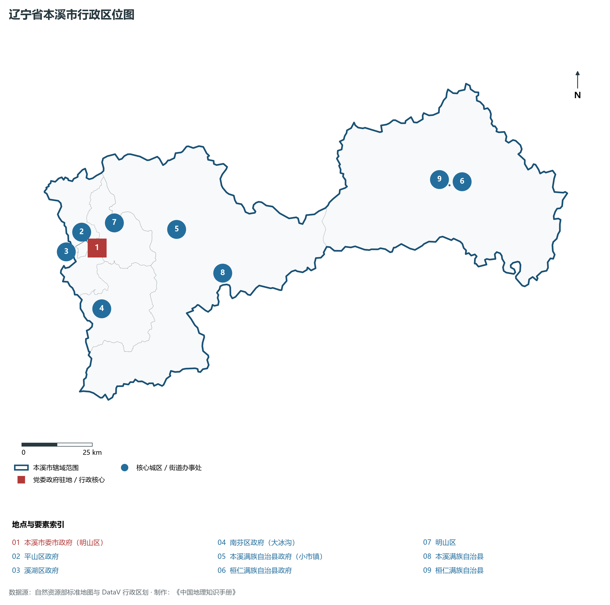
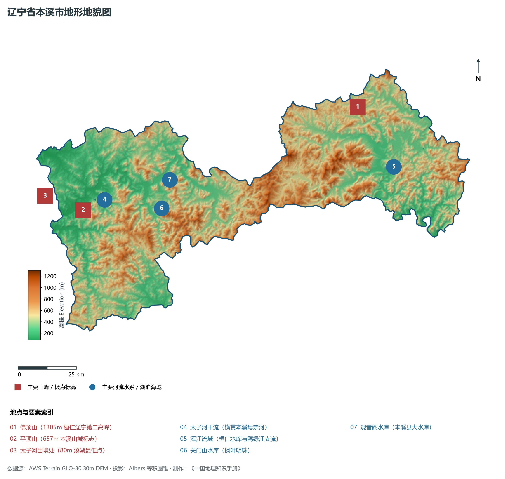
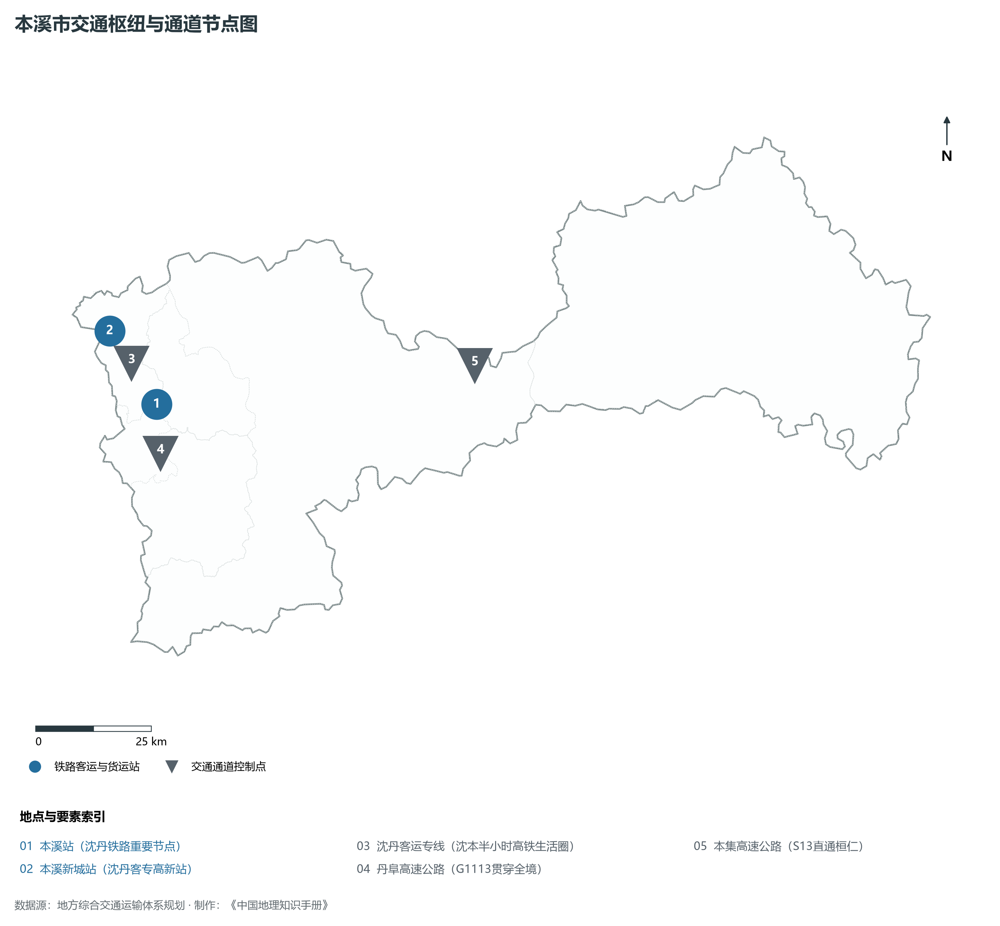
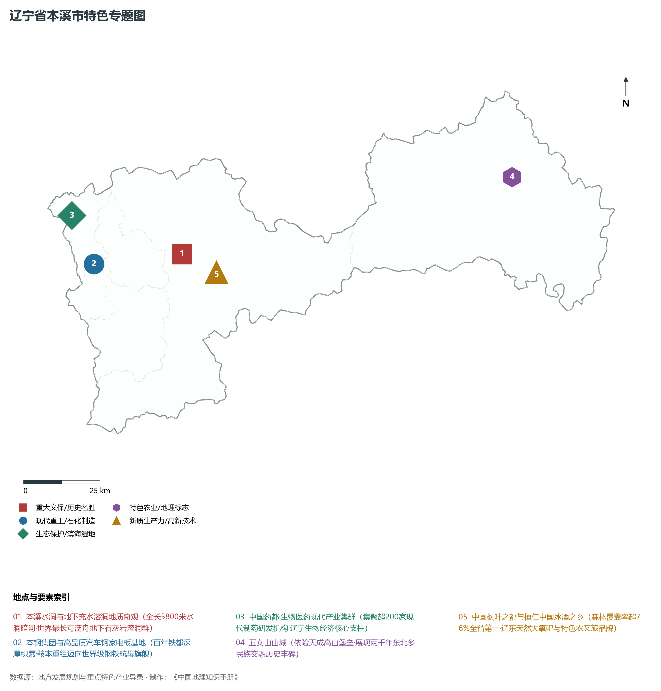
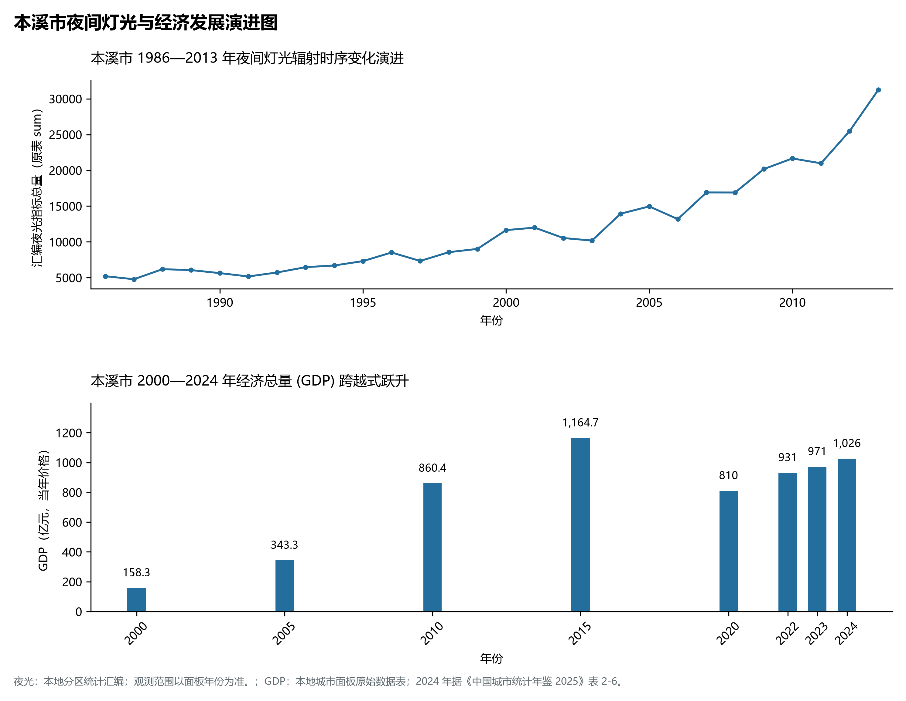

# 5.5 本溪市
本溪市，位于辽宁省，其战略定位与特色概括为：**山城铁都·本溪水洞地质奇观·太子河流域中国药都与枫叶之都**。辖区土地。2024 年常住人口 **123 万人**，常住人口城镇化率 **80.7%**，地区生产总值 **1,026 亿元**（当年价格），人均地区生产总值 **83,108 元**，三次产业构成为 **5.63 : 41.97 : 52.39**。

---
## 一、自然地理底盘与地貌水系机理
本溪市在地质构造演化史上隶属于中朝准地台东北缘，基底古老深厚，经中生代燕山造山运动与新生代断裂下陷改造，形成了山脉雄峙、水网环绕、冲积阶地发育的优越自然地理底盘。全境地表高程最低为 **80.0 m**，最高隆起峰顶海拔达 **1305.0 m**，地势落差与微地貌分异造就了多层次的生物多样性与空间资源承载力。

区域主要控制性山脉与地形极点包括：

- **佛顶山 (1305m 桓仁辽宁第二高峰)**（坐标约东经 125.280°、北纬 41.450°，高程约 1305.0 m）；
- **平顶山 (657m 本溪山城标志)**（坐标约东经 123.780°、北纬 41.270°，高程约 657.0 m）；
- **太子河出境处 (80m 溪湖最低点)**（坐标约东经 123.600°、北纬 41.350°，高程约 80.0 m）；

水系与水文网络方面，本溪市地表水资源丰富，骨干河流纵横穿流：

- **太子河干流 (横贯本溪母亲河)**（流经约东经 123.850°、北纬 41.300° 水域）：对全市农业灌溉、城市工业供水及生态水网维持发挥核心调蓄作用；
- **浑江流域 (桓仁水库与鸭绿江支流)**（流经约东经 125.400°、北纬 41.200° 水域）：对全市农业灌溉、城市工业供水及生态水网维持发挥核心调蓄作用；
- **关门山水库 (枫叶明珠)**（流经约东经 124.180°、北纬 41.220° 水域）：对全市农业灌溉、城市工业供水及生态水网维持发挥核心调蓄作用；
- **观音阁水库 (本溪县大水库)**（流经约东经 124.250°、北纬 41.320° 水域）：对全市农业灌溉、城市工业供水及生态水网维持发挥核心调蓄作用；

---
## 二、行政区划沿革与城镇空间体系
本溪市历史文脉源远流长，自先秦置郡以来行政建置历经变迁演进。新中国成立后，伴随老工业基地大规模建设与现代化城镇化推进，形成了结构完备、产城紧密融合的市辖区与县级行政单元空间组织体系：

- **本溪市委市政府 (明山区)**（驻地坐标：123.770°E, 41.290°N）：承担区域行政综合治理、公共资源配置与核心城镇组团功能；
- **平山区政府**（驻地坐标：123.750°E, 41.280°N）：承担区域行政综合治理、公共资源配置与核心城镇组团功能；
- **溪湖区政府**（驻地坐标：123.730°E, 41.320°N）：承担区域行政综合治理、公共资源配置与核心城镇组团功能；
- **南芬区政府 (大冰沟)**（驻地坐标：123.740°E, 41.100°N）：承担区域行政综合治理、公共资源配置与核心城镇组团功能；
- **本溪满族自治县政府 (小市镇)**（驻地坐标：124.120°E, 41.300°N）：承担区域行政综合治理、公共资源配置与核心城镇组团功能；
- **桓仁满族自治县政府**（驻地坐标：125.360°E, 41.270°N）：承担区域行政综合治理、公共资源配置与核心城镇组团功能；

在城镇空间发展战略上，本溪市依托国土空间总体规划，聚力构建“极核集聚、多组团协同、轴带串联、生态穿插”的现代城镇空间体系，全力推进产城融合与区域一体化协同发展。

---
## 三、综合立体交通网络与交通走廊
本溪市地处东北内陆与沿海交通关键走廊之上，依托高速铁路、干线普铁、国家高速公路与沿海航空/海港码头，构筑了现代化立体综合交通运输骨架：

**主要综合交通客运与货运物流枢纽节点：**

- **本溪站 (沈丹铁路重要节点)**（位置坐标：123.765°E, 41.295°N）：区域客货运流量集散分拨中心；
- **本溪新城站 (沈丹客专高新站)**（位置坐标：123.680°E, 41.450°N）：区域客货运流量集散分拨中心；

**核心干线铁路与高等级公路交通走廊：**

- **沈丹客运专线 (沈本半小时高铁生活圈)**（廊道控制点：123.720°E, 41.380°N）：实现城市对外快速互联互通的高速客货运通道；
- **丹阜高速公路 (G1113贯穿全境)**（廊道控制点：123.750°E, 41.200°N）：实现城市对外快速互联互通的高速客货运通道；
- **本集高速公路 (S13直通桓仁)**（廊道控制点：124.600°E, 41.250°N）：实现城市对外快速互联互通的高速客货运通道；

---
## 四、现代重点产业布局与特色功能组团
在新时代东北全面振兴指引下，本溪市坚持高端化、智能化、绿色化发展方向，加快改造升级传统优势工业，积极培育壮大新兴未来产业，打造特色现代化产业集群：

**重点园区与现代化产业基地：**

- **本溪钢铁(集团)本部特钢生产基地**（空间分布：123.730°E, 41.310°N）；
- **中国药都 (本溪高新技术产业开发区)**（空间分布：123.680°E, 41.460°N）；
- **桓仁冰酒产业基地 (东方波尔多)**（空间分布：125.320°E, 41.250°N）；
- **南芬特大型铁矿开采基地**（空间分布：123.730°E, 41.080°N）；

**代表性特色地标与战略支撑维度：**

- **本溪水洞与地下充水溶洞地质奇观**（124.080°E, 41.290°N）：全长5800米水洞暗河·世界最长可泛舟地下石灰岩溶洞群；
- **本钢集团与高品质汽车钢家电板基地**（123.730°E, 41.310°N）：百年铁都深厚积累·鞍本重组迈向世界级钢铁航母旗舰；
- **中国药都·生物医药现代产业集群**（123.680°E, 41.460°N）：集聚超200家现代制药研发机构·辽宁生物经济核心支柱；
- **五女山山城 (高句丽开国都城世界遗产)**（125.420°E, 41.320°N）：依险天成高山堡垒·展现两千年东北多民族交融历史丰碑；
- **中国枫叶之都与桓仁中国冰酒之乡**（124.200°E, 41.220°N）：森林覆盖率超76%全省第一·辽东天然大氧吧与特色农文旅品牌；

---
## 五、1986—2013年夜间灯光演变与经济变化分析

本节夜光图的观测年份为 1986—2013 年，指标为行政区汇总值（原表 sum）。

- **2008 年空间发展说明**：中国药都石桥子高新区从零崛起迅速拓展；
- **2021 年空间发展说明**：绿色低碳转型与文旅枫叶红遍全境；生态环境质量稳居辽宁首位；

| 年份 | 地区生产总值（亿元，当年价格） |
|:---|---:|
| 2000 年 | 158.3 |
| 2005 年 | 343.3 |
| 2010 年 | 860.4 |
| 2015 年 | 1,164.7 |
| 2020 年 | 810 |
| 2022 年 | 931 |
| 2023 年 | 971 |
| 2024 年 | 1,026 |

---
## 六、文化旅游名胜、生态屏障与可持续人地共生
本溪市高度注重统筹经济高质量发展与高水平生态环境保护，筑牢绿色生态底盘，弘扬优秀历史文化：

- **本溪水洞风景名胜区 (5A·地下暗河奇观)**（位置坐标：124.080°E, 41.290°N）；
- **五女山山城 (世界文化遗产·高句丽第一王城)**（位置坐标：125.420°E, 41.320°N）；
- **关门山国家森林公园 (中国枫叶之都标志)**（位置坐标：124.160°E, 41.210°N）；
- **大石湖·老边沟地质生态风景区**（位置坐标：124.420°E, 41.180°N）；

在人地协调机制方面，本溪市统筹推进山水林田湖草沙海一体化保护与系统治理，坚决打好蓝天、碧水、净土保卫战，推进传统工矿区生态恢复治理，打造人与自然和谐共生的生态宜居美丽家园。

---
## 七、本溪市关键地理统计指标速查矩阵

| 统计指标项 | 统计数值 / 口径标准 | 空间特征与全省位次说明 |
|:---|:---|:---|
| **行政区划代码** | `210500` | 国家民政部标准行政区划编号 |
| **辖区陆地面积** | **8,411.0** km² | 土地利用类型兼具山地、丘陵、平原与城镇工矿 |
| **常住人口规模** | 123 万人 | 2024 年，全市；年鉴公布口径 |
| **常住人口城镇化率** | 80.7% | 2024 年，全市；年鉴公布口径 |
| **地区生产总值 (2024)** | 1,026 亿元 | 2024 年，全市；年鉴公布口径 |
| **人均 GDP 水平** | 83,108 元/人 | 2024 年，全市；年鉴公布口径 |
| **三次产业结构比** | 5.63 : 41.97 : 52.39 | 2024 年，全市；年鉴公布口径 |
| **地表极限高程** | **80.0 m ～ 1305.0 m** | 形成极具特色的立体地貌剖面格局 |

2024 年统计来源：《中国城市统计年鉴 2025》表 2-1、2-6、2-7（2024 年，全市）。其他年份 GDP 据本地城市面板“原始数据”表，单位为亿元、当年价格。
