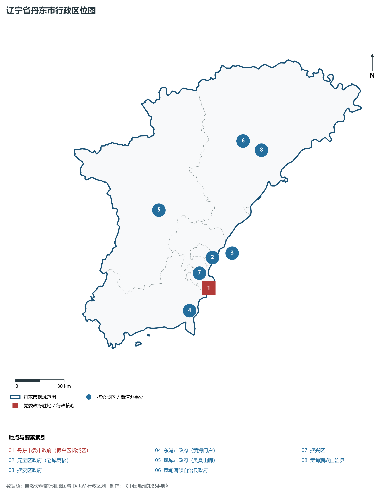
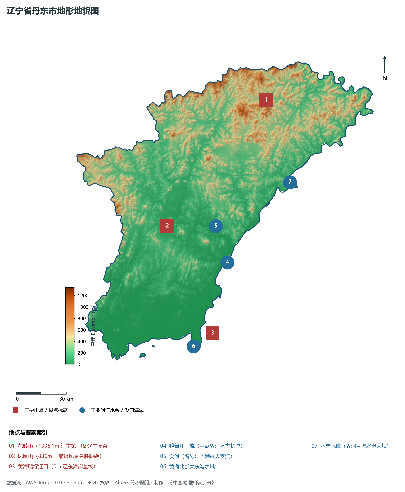
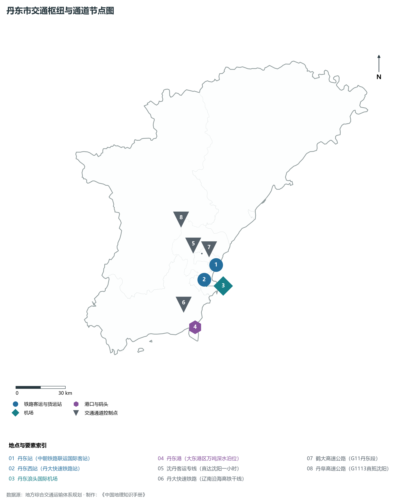
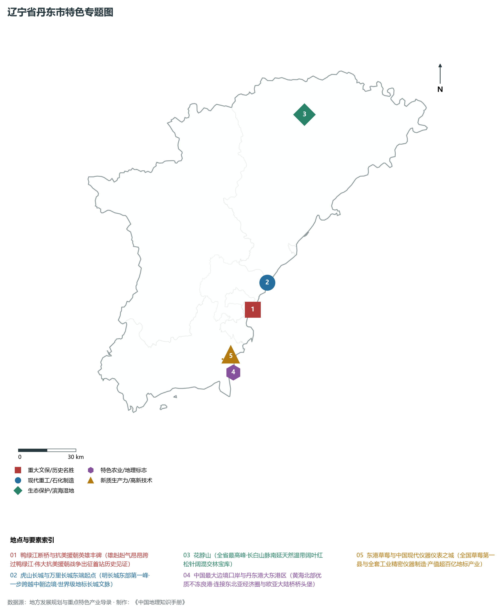
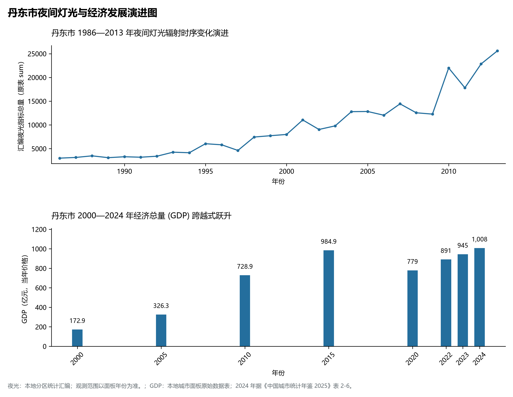

# 5.6 丹东市
丹东市，位于辽宁省，其战略定位与特色概括为：**中国最大边境城市·鸭绿江入海口与对朝经贸门户·抗美援朝出征地与现代轻工仪器基地**。辖区土地。2024 年常住人口 **207 万人**，常住人口城镇化率 **71.18%**，地区生产总值 **1,008 亿元**（当年价格），人均地区生产总值 **48,439 元**，三次产业构成为 **19.14 : 27.8 : 53.06**。

---
## 一、自然地理底盘与地貌水系机理
丹东市在地质构造演化史上隶属于中朝准地台东北缘，基底古老深厚，经中生代燕山造山运动与新生代断裂下陷改造，形成了山脉雄峙、水网环绕、冲积阶地发育的优越自然地理底盘。全境地表高程最低为 **0.0 m**，最高隆起峰顶海拔达 **1336.1 m**，地势落差与微地貌分异造就了多层次的生物多样性与空间资源承载力。

区域主要控制性山脉与地形极点包括：

- **花脖山 (1336.1m 辽宁第一峰·辽宁屋脊)**（坐标约东经 124.950°、北纬 40.950°，高程约 1336.1 m）；
- **凤凰山 (836m 国家级风景名胜险绝)**（坐标约东经 124.080°、北纬 40.400°，高程约 836.0 m）；
- **黄海鸭绿江口 (0m 辽东海岸基线)**（坐标约东经 124.250°、北纬 39.800°，高程约 0.0 m）；

水系与水文网络方面，丹东市地表水资源丰富，骨干河流纵横穿流：

- **鸭绿江干流 (中朝界河万古长流)**（流经约东经 124.450°、北纬 40.150° 水域）：对全市农业灌溉、城市工业供水及生态水网维持发挥核心调蓄作用；
- **爱河 (鸭绿江下游最大支流)**（流经约东经 124.420°、北纬 40.350° 水域）：对全市农业灌溉、城市工业供水及生态水网维持发挥核心调蓄作用；
- **黄海北部大东沟水域**（流经约东经 124.100°、北纬 39.750° 水域）：对全市农业灌溉、城市工业供水及生态水网维持发挥核心调蓄作用；
- **水丰水库 (界河巨型水电大坝)**（流经约东经 125.000°、北纬 40.500° 水域）：对全市农业灌溉、城市工业供水及生态水网维持发挥核心调蓄作用；

---
## 二、行政区划沿革与城镇空间体系
丹东市历史文脉源远流长，自先秦置郡以来行政建置历经变迁演进。新中国成立后，伴随老工业基地大规模建设与现代化城镇化推进，形成了结构完备、产城紧密融合的市辖区与县级行政单元空间组织体系：

- **丹东市委市政府 (振兴区新城区)**（驻地坐标：124.320°E, 39.980°N）：承担区域行政综合治理、公共资源配置与核心城镇组团功能；
- **元宝区政府 (老城商核)**（驻地坐标：124.390°E, 40.140°N）：承担区域行政综合治理、公共资源配置与核心城镇组团功能；
- **振安区政府**（驻地坐标：124.420°E, 40.160°N）：承担区域行政综合治理、公共资源配置与核心城镇组团功能；
- **东港市政府 (黄海门户)**（驻地坐标：124.150°E, 39.880°N）：承担区域行政综合治理、公共资源配置与核心城镇组团功能；
- **凤城市政府 (凤凰山脚)**（驻地坐标：124.070°E, 40.450°N）：承担区域行政综合治理、公共资源配置与核心城镇组团功能；
- **宽甸满族自治县政府**（驻地坐标：124.780°E, 40.730°N）：承担区域行政综合治理、公共资源配置与核心城镇组团功能；

在城镇空间发展战略上，丹东市依托国土空间总体规划，聚力构建“极核集聚、多组团协同、轴带串联、生态穿插”的现代城镇空间体系，全力推进产城融合与区域一体化协同发展。

---
## 三、综合立体交通网络与交通走廊
丹东市地处东北内陆与沿海交通关键走廊之上，依托高速铁路、干线普铁、国家高速公路与沿海航空/海港码头，构筑了现代化立体综合交通运输骨架：

**主要综合交通客运与货运物流枢纽节点：**

- **丹东站 (中朝铁路联运国际客站)**（位置坐标：124.385°E, 40.125°N）：区域客货运流量集散分拨中心；
- **丹东西站 (丹大快速铁路站)**（位置坐标：124.280°E, 40.060°N）：区域客货运流量集散分拨中心；
- **丹东浪头国际机场**（位置坐标：124.288°E, 40.025°N）：区域客货运流量集散分拨中心；
- **丹东港 (大东港区万吨深水泊位)**（位置坐标：124.150°E, 39.820°N）：区域客货运流量集散分拨中心；

**核心干线铁路与高等级公路交通走廊：**

- **沈丹客运专线 (直达沈阳一小时)**（廊道控制点：124.250°E, 40.250°N）：实现城市对外快速互联互通的高速客货运通道；
- **丹大快速铁路 (辽南沿海高铁干线)**（廊道控制点：124.100°E, 39.950°N）：实现城市对外快速互联互通的高速客货运通道；
- **鹤大高速公路 (G11丹东段)**（廊道控制点：124.300°E, 40.200°N）：实现城市对外快速互联互通的高速客货运通道；
- **丹阜高速公路 (G1113直抵沈阳)**（廊道控制点：124.200°E, 40.400°N）：实现城市对外快速互联互通的高速客货运通道；

---
## 四、现代重点产业布局与特色功能组团
在新时代东北全面振兴指引下，丹东市坚持高端化、智能化、绿色化发展方向，加快改造升级传统优势工业，积极培育壮大新兴未来产业，打造特色现代化产业集群：

**重点园区与现代化产业基地：**

- **丹东边境经济合作区**（空间分布：124.310°E, 39.990°N）；
- **中国仪器仪表产业基地**（空间分布：124.350°E, 40.050°N）；
- **东港草莓现代农业国家级产业园**（空间分布：124.100°E, 39.900°N）；
- **宽甸特色硼铁矿产精深加工区**（空间分布：124.750°E, 40.680°N）；

**代表性特色地标与战略支撑维度：**

- **鸭绿江断桥与抗美援朝英雄丰碑**（124.394°E, 40.116°N）：雄赳赳气昂昂跨过鸭绿江·伟大抗美援朝战争出征首站历史见证；
- **虎山长城与万里长城东端起点**（124.515°E, 40.225°N）：明长城东部第一峰·一步跨越中朝边境·世界级地标长城文脉；
- **花脖山 (1336.1m 辽宁屋脊)**（124.950°E, 40.950°N）：全省最高峰·长白山脉南延天然温带阔叶红松针阔混交林宝库；
- **中国最大边境口岸与丹东港大东港区**（124.200°E, 39.850°N）：黄海北部优质不冻良港·连接东北亚经济圈与欧亚大陆桥桥头堡；
- **东港草莓与中国现代仪器仪表之城**（124.150°E, 39.920°N）：全国草莓第一县与全套工业精密仪器制造·产值超百亿地标产业；

---
## 五、1986—2013年夜间灯光演变与经济变化分析

本节夜光图的观测年份为 1986—2013 年，指标为行政区汇总值（原表 sum）。

- **1996 年空间发展说明**：振兴区沿江老码头与边贸口岸夜市繁盛；
- **2008 年空间发展说明**：丹东新城区向鸭绿江下游跨越拓展；
- **2021 年空间发展说明**：丹东港深水散杂货港区扩建；仪器仪表与绿色户外纺织产业集聚；

| 年份 | 地区生产总值（亿元，当年价格） |
|:---|---:|
| 2000 年 | 172.9 |
| 2005 年 | 326.3 |
| 2010 年 | 728.9 |
| 2015 年 | 984.9 |
| 2020 年 | 779 |
| 2022 年 | 891 |
| 2023 年 | 945 |
| 2024 年 | 1,008 |

---
## 六、文化旅游名胜、生态屏障与可持续人地共生
丹东市高度注重统筹经济高质量发展与高水平生态环境保护，筑牢绿色生态底盘，弘扬优秀历史文化：

- **鸭绿江断桥 (全国重点文物保护单位)**（位置坐标：124.394°E, 40.116°N）；
- **抗美援朝纪念馆 (英烈丰碑)**（位置坐标：124.375°E, 40.130°N）；
- **虎山长城 (万里长城东端起点)**（位置坐标：124.515°E, 40.225°N）；
- **鸭绿江口湿地国家级自然保护区**（位置坐标：124.200°E, 39.850°N）；

在人地协调机制方面，丹东市统筹推进山水林田湖草沙海一体化保护与系统治理，坚决打好蓝天、碧水、净土保卫战，推进传统工矿区生态恢复治理，打造人与自然和谐共生的生态宜居美丽家园。

---
## 七、丹东市关键地理统计指标速查矩阵

| 统计指标项 | 统计数值 / 口径标准 | 空间特征与全省位次说明 |
|:---|:---|:---|
| **行政区划代码** | `210600` | 国家民政部标准行政区划编号 |
| **辖区陆地面积** | **15,222.0** km² | 土地利用类型兼具山地、丘陵、平原与城镇工矿 |
| **常住人口规模** | 207 万人 | 2024 年，全市；年鉴公布口径 |
| **常住人口城镇化率** | 71.18% | 2024 年，全市；年鉴公布口径 |
| **地区生产总值 (2024)** | 1,008 亿元 | 2024 年，全市；年鉴公布口径 |
| **人均 GDP 水平** | 48,439 元/人 | 2024 年，全市；年鉴公布口径 |
| **三次产业结构比** | 19.14 : 27.8 : 53.06 | 2024 年，全市；年鉴公布口径 |
| **地表极限高程** | **0.0 m ～ 1336.1 m** | 形成极具特色的立体地貌剖面格局 |

2024 年统计来源：《中国城市统计年鉴 2025》表 2-1、2-6、2-7（2024 年，全市）。其他年份 GDP 据本地城市面板“原始数据”表，单位为亿元、当年价格。
