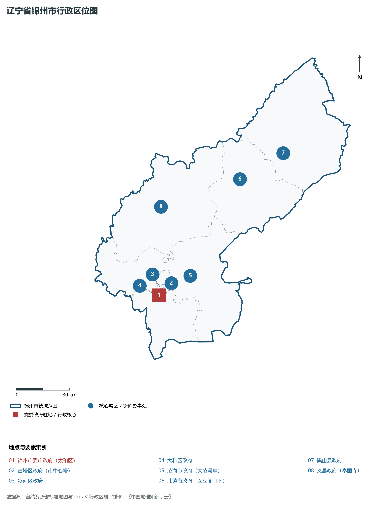
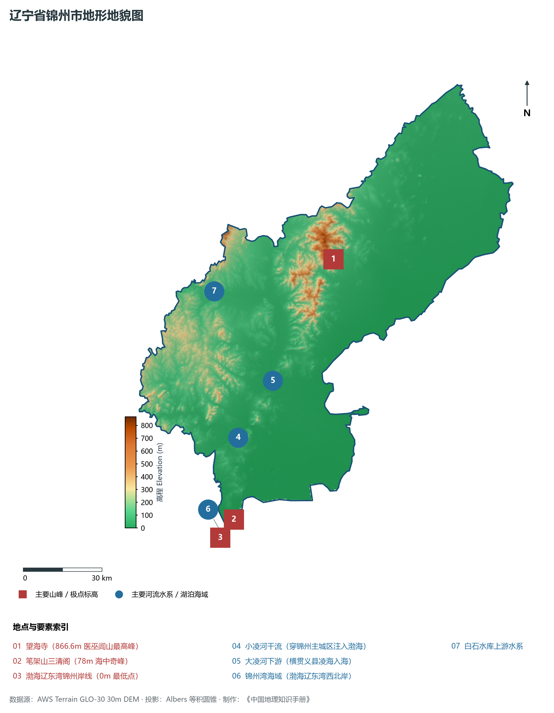
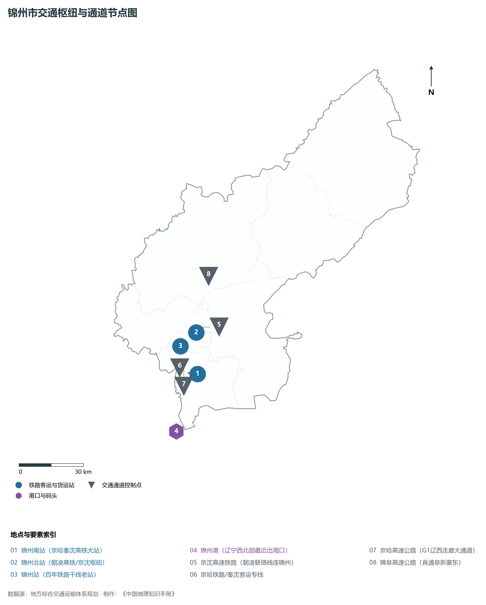
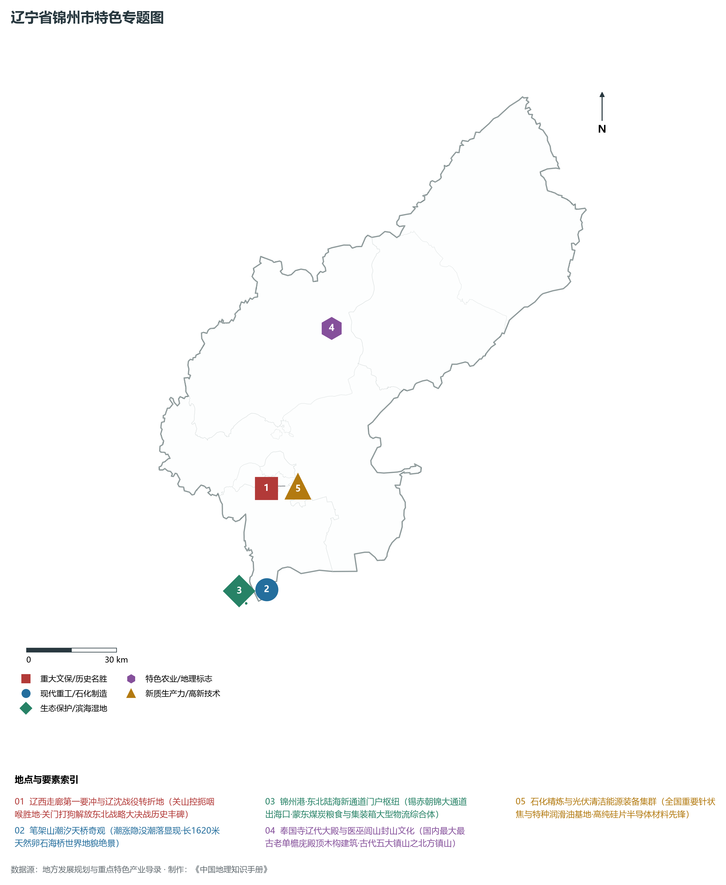
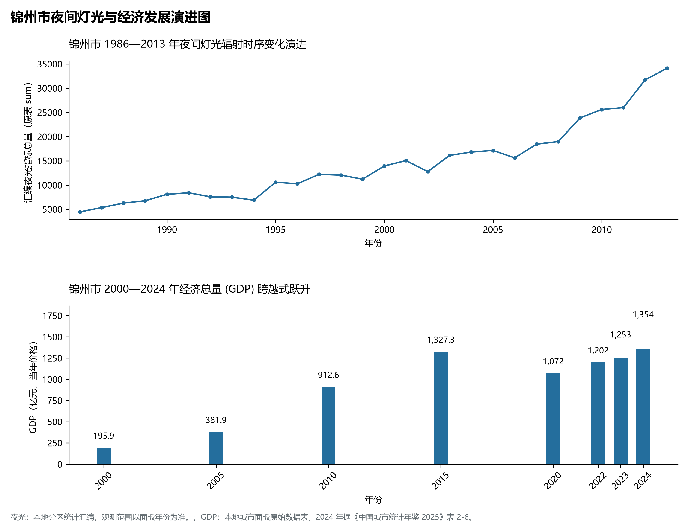

# 5.7 锦州市
锦州市，位于辽宁省，其战略定位与特色概括为：**辽西走廊咽喉要冲·笔架山天桥海岸动力·现代港口与精细石化基地·辽沈战役转折之地**。辖区土地。2024 年常住人口 **259 万人**，常住人口城镇化率 **62.33%**，地区生产总值 **1,354 亿元**（当年价格），人均地区生产总值 **51,811 元**，三次产业构成为 **16.45 : 29.5 : 54.05**。

---
## 一、自然地理底盘与地貌水系机理
锦州市在地质构造演化史上隶属于中朝准地台东北缘，基底古老深厚，经中生代燕山造山运动与新生代断裂下陷改造，形成了山脉雄峙、水网环绕、冲积阶地发育的优越自然地理底盘。全境地表高程最低为 **0.0 m**，最高隆起峰顶海拔达 **866.0 m**，地势落差与微地貌分异造就了多层次的生物多样性与空间资源承载力。

区域主要控制性山脉与地形极点包括：

- **望海寺 (866.6m 医巫闾山最高峰)**（坐标约东经 121.720°、北纬 41.620°，高程约 866.6 m）；
- **笔架山三清阁 (78m 海中奇峰)**（坐标约东经 121.070°、北纬 40.810°，高程约 78.0 m）；
- **渤海辽东湾锦州岸线 (0m 最低点)**（坐标约东经 121.050°、北纬 40.750°，高程约 0.0 m）；

水系与水文网络方面，锦州市地表水资源丰富，骨干河流纵横穿流：

- **小凌河干流 (穿锦州主城区注入渤海)**（流经约东经 121.150°、北纬 41.080° 水域）：对全市农业灌溉、城市工业供水及生态水网维持发挥核心调蓄作用；
- **大凌河下游 (横贯义县凌海入海)**（流经约东经 121.350°、北纬 41.250° 水域）：对全市农业灌溉、城市工业供水及生态水网维持发挥核心调蓄作用；
- **锦州湾海域 (渤海辽东湾西北岸)**（流经约东经 121.000°、北纬 40.780° 水域）：对全市农业灌溉、城市工业供水及生态水网维持发挥核心调蓄作用；
- **白石水库上游水系**（流经约东经 121.150°、北纬 41.580° 水域）：对全市农业灌溉、城市工业供水及生态水网维持发挥核心调蓄作用；

---
## 二、行政区划沿革与城镇空间体系
锦州市历史文脉源远流长，自先秦置郡以来行政建置历经变迁演进。新中国成立后，伴随老工业基地大规模建设与现代化城镇化推进，形成了结构完备、产城紧密融合的市辖区与县级行政单元空间组织体系：

- **锦州市委市政府 (太和区)**（驻地坐标：121.130°E, 41.100°N）：承担区域行政综合治理、公共资源配置与核心城镇组团功能；
- **古塔区政府 (市中心塔)**（驻地坐标：121.120°E, 41.120°N）：承担区域行政综合治理、公共资源配置与核心城镇组团功能；
- **凌河区政府**（驻地坐标：121.150°E, 41.130°N）：承担区域行政综合治理、公共资源配置与核心城镇组团功能；
- **太和区政府**（驻地坐标：121.100°E, 41.110°N）：承担区域行政综合治理、公共资源配置与核心城镇组团功能；
- **凌海市政府 (大凌河畔)**（驻地坐标：121.360°E, 41.170°N）：承担区域行政综合治理、公共资源配置与核心城镇组团功能；
- **北镇市政府 (医巫闾山下)**（驻地坐标：121.800°E, 41.600°N）：承担区域行政综合治理、公共资源配置与核心城镇组团功能；
- **黑山县政府**（驻地坐标：122.120°E, 41.690°N）：承担区域行政综合治理、公共资源配置与核心城镇组团功能；
- **义县政府 (奉国寺)**（驻地坐标：121.240°E, 41.530°N）：承担区域行政综合治理、公共资源配置与核心城镇组团功能；

在城镇空间发展战略上，锦州市依托国土空间总体规划，聚力构建“极核集聚、多组团协同、轴带串联、生态穿插”的现代城镇空间体系，全力推进产城融合与区域一体化协同发展。

---
## 三、综合立体交通网络与交通走廊
锦州市地处东北内陆与沿海交通关键走廊之上，依托高速铁路、干线普铁、国家高速公路与沿海航空/海港码头，构筑了现代化立体综合交通运输骨架：

**主要综合交通客运与货运物流枢纽节点：**

- **锦州南站 (京哈秦沈高铁大站)**（位置坐标：121.150°E, 41.010°N）：区域客货运流量集散分拨中心；
- **锦州北站 (朝凌高铁/京沈枢纽)**（位置坐标：121.180°E, 41.180°N）：区域客货运流量集散分拨中心；
- **锦州站 (百年铁路干线老站)**（位置坐标：121.135°E, 41.128°N）：区域客货运流量集散分拨中心；
- **锦州港 (辽宁西北部最近出海口)**（位置坐标：120.980°E, 40.790°N）：区域客货运流量集散分拨中心；

**核心干线铁路与高等级公路交通走廊：**

- **京沈高速铁路 (朝凌联络线连锦州)**（廊道控制点：121.200°E, 41.200°N）：实现城市对外快速互联互通的高速客货运通道；
- **京哈铁路/秦沈客运专线**（廊道控制点：121.100°E, 41.020°N）：实现城市对外快速互联互通的高速客货运通道；
- **京哈高速公路 (G1辽西走廊大通道)**（廊道控制点：121.080°E, 41.050°N）：实现城市对外快速互联互通的高速客货运通道；
- **锦阜高速公路 (直通阜新蒙东)**（廊道控制点：121.300°E, 41.400°N）：实现城市对外快速互联互通的高速客货运通道；

---
## 四、现代重点产业布局与特色功能组团
在新时代东北全面振兴指引下，锦州市坚持高端化、智能化、绿色化发展方向，加快改造升级传统优势工业，积极培育壮大新兴未来产业，打造特色现代化产业集群：

**重点园区与现代化产业基地：**

- **锦州经济技术开发区 (国家级经开区)**（空间分布：121.020°E, 40.830°N）；
- **中国石油锦州石化公司**（空间分布：121.180°E, 41.110°N）；
- **锦州光伏与新材料产业基地**（空间分布：121.120°E, 41.160°N）；
- **辽宁汤河子经济开发区 (有色合金)**（空间分布：121.050°E, 41.130°N）；

**代表性特色地标与战略支撑维度：**

- **辽西走廊第一要冲与辽沈战役转折地**（121.135°E, 41.115°N）：关山控扼咽喉胜地·关门打狗解放东北战略大决战历史丰碑；
- **笔架山潮汐天桥奇观**（121.070°E, 40.820°N）：潮涨隐没潮落显现·长1620米天然卵石海桥世界地貌绝景；
- **锦州港·东北陆海新通道门户枢纽**（120.980°E, 40.790°N）：锡赤朝锦大通道出海口·蒙东煤炭粮食与集装箱大型物流综合体；
- **奉国寺辽代大殿与医巫闾山封山文化**（121.500°E, 41.550°N）：国内最大最古老单檐庑殿顶木构建筑·古代五大镇山之北方镇山；
- **石化精炼与光伏清洁能源装备集群**（121.150°E, 41.120°N）：全国重要针状焦与特种润滑油基地·高纯硅片半导体材料先锋；

---
## 五、1986—2013年夜间灯光演变与经济变化分析

本节夜光图的观测年份为 1986—2013 年，指标为行政区汇总值（原表 sum）。

- **1996 年空间发展说明**：古塔区凌河区老城区沿小凌河连片集聚；
- **2008 年空间发展说明**：向南挺进锦州湾·锦州经济技术开发区跨越成型；
- **2021 年空间发展说明**：京沈客专锦州北站通车·陆海统筹港产城协同；

| 年份 | 地区生产总值（亿元，当年价格） |
|:---|---:|
| 2000 年 | 195.9 |
| 2005 年 | 381.9 |
| 2010 年 | 912.6 |
| 2015 年 | 1,327.3 |
| 2020 年 | 1,072 |
| 2022 年 | 1,202 |
| 2023 年 | 1,253 |
| 2024 年 | 1,354 |

---
## 六、文化旅游名胜、生态屏障与可持续人地共生
锦州市高度注重统筹经济高质量发展与高水平生态环境保护，筑牢绿色生态底盘，弘扬优秀历史文化：

- **笔架山风景区 (天桥连岛潮汐奇观)**（位置坐标：121.070°E, 40.820°N）；
- **辽沈战役纪念馆 (全国红色地标)**（位置坐标：121.135°E, 41.115°N）；
- **奉国寺 (义县大佛寺·辽代木构绝品)**（位置坐标：121.245°E, 41.540°N）；
- **北镇医巫闾山风景名胜区 (北方镇山)**（位置坐标：121.730°E, 41.600°N）；

在人地协调机制方面，锦州市统筹推进山水林田湖草沙海一体化保护与系统治理，坚决打好蓝天、碧水、净土保卫战，推进传统工矿区生态恢复治理，打造人与自然和谐共生的生态宜居美丽家园。

---
## 七、锦州市关键地理统计指标速查矩阵

| 统计指标项 | 统计数值 / 口径标准 | 空间特征与全省位次说明 |
|:---|:---|:---|
| **行政区划代码** | `210700` | 国家民政部标准行政区划编号 |
| **辖区陆地面积** | **10,301.0** km² | 土地利用类型兼具山地、丘陵、平原与城镇工矿 |
| **常住人口规模** | 259 万人 | 2024 年，全市；年鉴公布口径 |
| **常住人口城镇化率** | 62.33% | 2024 年，全市；年鉴公布口径 |
| **地区生产总值 (2024)** | 1,354 亿元 | 2024 年，全市；年鉴公布口径 |
| **人均 GDP 水平** | 51,811 元/人 | 2024 年，全市；年鉴公布口径 |
| **三次产业结构比** | 16.45 : 29.5 : 54.05 | 2024 年，全市；年鉴公布口径 |
| **地表极限高程** | **0.0 m ～ 866.0 m** | 形成极具特色的立体地貌剖面格局 |

2024 年统计来源：《中国城市统计年鉴 2025》表 2-1、2-6、2-7（2024 年，全市）。其他年份 GDP 据本地城市面板“原始数据”表，单位为亿元、当年价格。
