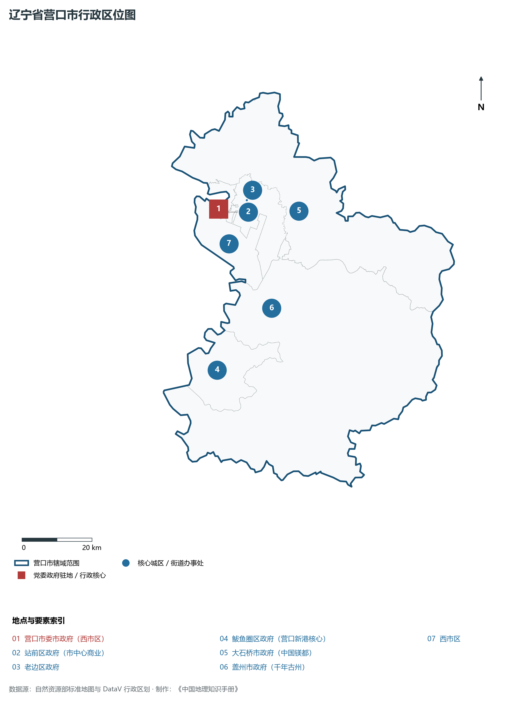
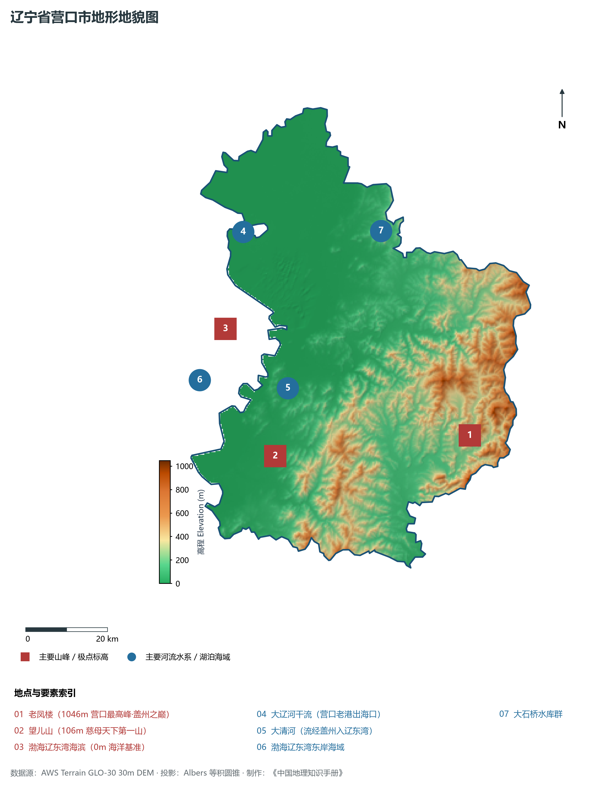
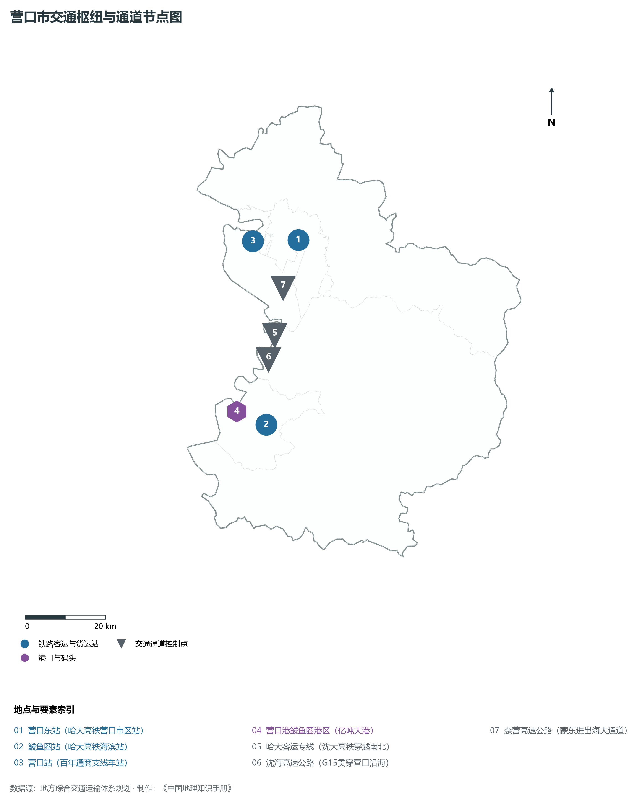
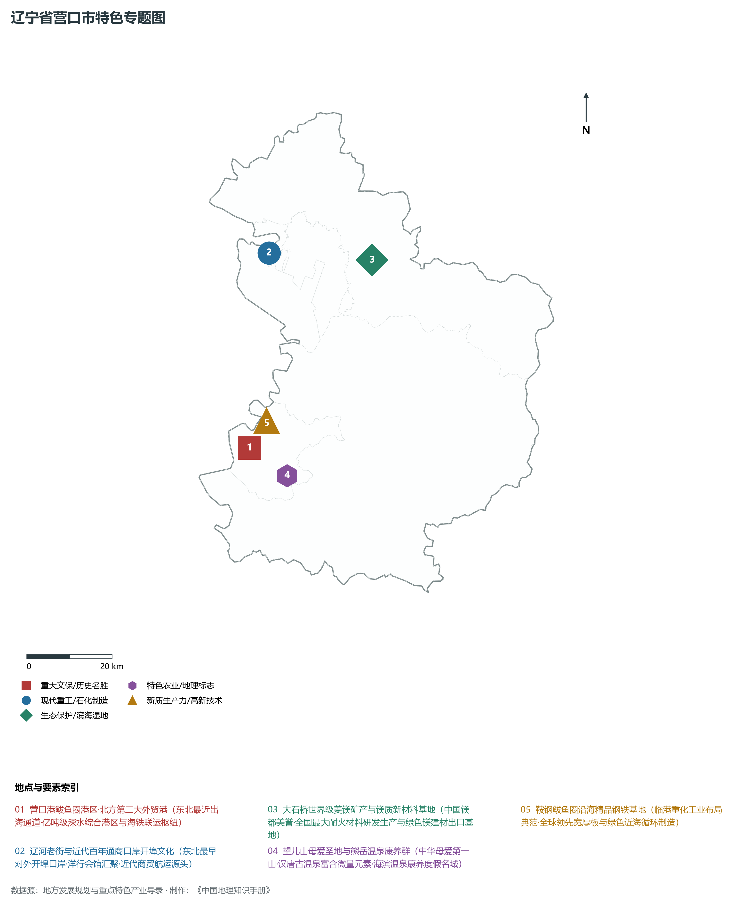
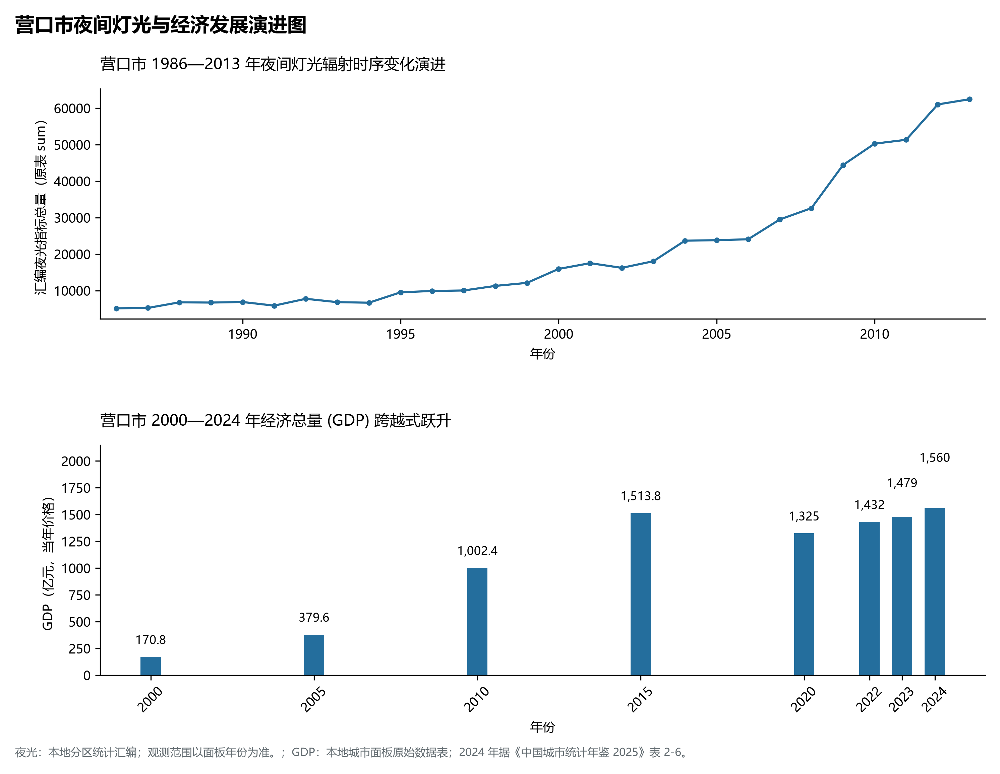

# 5.8 营口市
营口市，位于辽宁省，其战略定位与特色概括为：**大辽河入海口·东北近代百年通商口岸·现代港口民营经济先锋与国家级镁质新材料基地**。辖区土地。2024 年常住人口 **224 万人**，常住人口城镇化率 **68.65%**，地区生产总值 **1,560 亿元**（当年价格），人均地区生产总值 **69,254 元**，三次产业构成为 **7.75 : 33.87 : 58.38**。

---
## 一、自然地理底盘与地貌水系机理
营口市在地质构造演化史上隶属于中朝准地台东北缘，基底古老深厚，经中生代燕山造山运动与新生代断裂下陷改造，形成了山脉雄峙、水网环绕、冲积阶地发育的优越自然地理底盘。全境地表高程最低为 **0.0 m**，最高隆起峰顶海拔达 **1046.0 m**，地势落差与微地貌分异造就了多层次的生物多样性与空间资源承载力。

区域主要控制性山脉与地形极点包括：

- **老凤楼 (1046m 营口最高峰·盖州之巅)**（坐标约东经 122.750°、北纬 40.180°，高程约 1046.0 m）；
- **望儿山 (106m 慈母天下第一山)**（坐标约东经 122.180°、北纬 40.210°，高程约 106.0 m）；
- **渤海辽东湾海滨 (0m 海洋基准)**（坐标约东经 122.100°、北纬 40.500°，高程约 0.0 m）；

水系与水文网络方面，营口市地表水资源丰富，骨干河流纵横穿流：

- **大辽河干流 (营口老港出海口)**（流经约东经 122.200°、北纬 40.700° 水域）：对全市农业灌溉、城市工业供水及生态水网维持发挥核心调蓄作用；
- **大清河 (流经盖州入辽东湾)**（流经约东经 122.250°、北纬 40.350° 水域）：对全市农业灌溉、城市工业供水及生态水网维持发挥核心调蓄作用；
- **渤海辽东湾东岸海域**（流经约东经 122.000°、北纬 40.400° 水域）：对全市农业灌溉、城市工业供水及生态水网维持发挥核心调蓄作用；
- **大石桥水库群**（流经约东经 122.600°、北纬 40.650° 水域）：对全市农业灌溉、城市工业供水及生态水网维持发挥核心调蓄作用；

---
## 二、行政区划沿革与城镇空间体系
营口市历史文脉源远流长，自先秦置郡以来行政建置历经变迁演进。新中国成立后，伴随老工业基地大规模建设与现代化城镇化推进，形成了结构完备、产城紧密融合的市辖区与县级行政单元空间组织体系：

- **营口市委市政府 (西市区)**（驻地坐标：122.230°E, 40.670°N）：承担区域行政综合治理、公共资源配置与核心城镇组团功能；
- **站前区政府 (市中心商业)**（驻地坐标：122.250°E, 40.660°N）：承担区域行政综合治理、公共资源配置与核心城镇组团功能；
- **老边区政府**（驻地坐标：122.330°E, 40.680°N）：承担区域行政综合治理、公共资源配置与核心城镇组团功能；
- **鲅鱼圈区政府 (营口新港核心)**（驻地坐标：122.130°E, 40.270°N）：承担区域行政综合治理、公共资源配置与核心城镇组团功能；
- **大石桥市政府 (中国镁都)**（驻地坐标：122.500°E, 40.630°N）：承担区域行政综合治理、公共资源配置与核心城镇组团功能；
- **盖州市政府 (千年古州)**（驻地坐标：122.350°E, 40.400°N）：承担区域行政综合治理、公共资源配置与核心城镇组团功能；

在城镇空间发展战略上，营口市依托国土空间总体规划，聚力构建“极核集聚、多组团协同、轴带串联、生态穿插”的现代城镇空间体系，全力推进产城融合与区域一体化协同发展。

---
## 三、综合立体交通网络与交通走廊
营口市地处东北内陆与沿海交通关键走廊之上，依托高速铁路、干线普铁、国家高速公路与沿海航空/海港码头，构筑了现代化立体综合交通运输骨架：

**主要综合交通客运与货运物流枢纽节点：**

- **营口东站 (哈大高铁营口市区站)**（位置坐标：122.370°E, 40.650°N）：区域客货运流量集散分拨中心；
- **鲅鱼圈站 (哈大高铁海滨站)**（位置坐标：122.180°E, 40.260°N）：区域客货运流量集散分拨中心；
- **营口站 (百年通商支线车站)**（位置坐标：122.235°E, 40.665°N）：区域客货运流量集散分拨中心；
- **营口港鲅鱼圈港区 (亿吨大港)**（位置坐标：122.100°E, 40.300°N）：区域客货运流量集散分拨中心；

**核心干线铁路与高等级公路交通走廊：**

- **哈大客运专线 (沈大高铁穿越南北)**（廊道控制点：122.250°E, 40.450°N）：实现城市对外快速互联互通的高速客货运通道；
- **沈海高速公路 (G15贯穿营口沿海)**（廊道控制点：122.220°E, 40.400°N）：实现城市对外快速互联互通的高速客货运通道；
- **奈营高速公路 (蒙东进出海大通道)**（廊道控制点：122.300°E, 40.550°N）：实现城市对外快速互联互通的高速客货运通道；

---
## 四、现代重点产业布局与特色功能组团
在新时代东北全面振兴指引下，营口市坚持高端化、智能化、绿色化发展方向，加快改造升级传统优势工业，积极培育壮大新兴未来产业，打造特色现代化产业集群：

**重点园区与现代化产业基地：**

- **中国(辽宁)自由贸易试验区营口片区**（空间分布：122.200°E, 40.640°N）；
- **大石桥中国镁都精深加工产业基地**（空间分布：122.520°E, 40.620°N）；
- **营口港现代集装箱物流枢纽**（空间分布：122.090°E, 40.280°N）；
- **鞍钢股份有限公司鲅鱼圈钢铁分公司**（空间分布：122.150°E, 40.330°N）；

**代表性特色地标与战略支撑维度：**

- **营口港鲅鱼圈港区·北方第二大外贸港**（122.090°E, 40.280°N）：东北最近出海通道·亿吨级深水综合港区与海铁联运枢纽；
- **辽河老街与近代百年通商口岸开埠文化**（122.238°E, 40.672°N）：东北最早对外开埠口岸·洋行会馆汇聚·近代商贸航运源头；
- **大石桥世界级菱镁矿产与镁质新材料基地**（122.520°E, 40.620°N）：中国镁都美誉·全国最大耐火材料研发生产与绿色镁建材出口基地；
- **望儿山母爱圣地与熊岳温泉康养群**（122.180°E, 40.210°N）：中华母爱第一山·汉唐古温泉富含微量元素·海滨温泉康养度假名城；
- **鞍钢鲅鱼圈沿海精品钢铁基地**（122.150°E, 40.330°N）：临港重化工业布局典范·全球领先宽厚板与绿色近海循环制造；

---
## 五、1986—2013年夜间灯光演变与经济变化分析

本节夜光图的观测年份为 1986—2013 年，指标为行政区汇总值（原表 sum）。

- **2021 年空间发展说明**：自贸试验区营口片区与大石桥镁产业高质量集聚；

| 年份 | 地区生产总值（亿元，当年价格） |
|:---|---:|
| 2000 年 | 170.8 |
| 2005 年 | 379.6 |
| 2010 年 | 1,002.4 |
| 2015 年 | 1,513.8 |
| 2020 年 | 1,325 |
| 2022 年 | 1,432 |
| 2023 年 | 1,479 |
| 2024 年 | 1,560 |

---
## 六、文化旅游名胜、生态屏障与可持续人地共生
营口市高度注重统筹经济高质量发展与高水平生态环境保护，筑牢绿色生态底盘，弘扬优秀历史文化：

- **望儿山风景名胜区 (母爱文化圣地)**（位置坐标：122.180°E, 40.210°N）；
- **辽河老街 (近代百年通商历史风貌)**（位置坐标：122.238°E, 40.672°N）；
- **熊岳温泉 (东北第一古温泉)**（位置坐标：122.140°E, 40.180°N）；
- **西炮台国防教育基地 (抗英抗日遗址)**（位置坐标：122.180°E, 40.680°N）；

在人地协调机制方面，营口市统筹推进山水林田湖草沙海一体化保护与系统治理，坚决打好蓝天、碧水、净土保卫战，推进传统工矿区生态恢复治理，打造人与自然和谐共生的生态宜居美丽家园。

---
## 七、营口市关键地理统计指标速查矩阵

| 统计指标项 | 统计数值 / 口径标准 | 空间特征与全省位次说明 |
|:---|:---|:---|
| **行政区划代码** | `210800` | 国家民政部标准行政区划编号 |
| **辖区陆地面积** | **5,427.0** km² | 土地利用类型兼具山地、丘陵、平原与城镇工矿 |
| **常住人口规模** | 224 万人 | 2024 年，全市；年鉴公布口径 |
| **常住人口城镇化率** | 68.65% | 2024 年，全市；年鉴公布口径 |
| **地区生产总值 (2024)** | 1,560 亿元 | 2024 年，全市；年鉴公布口径 |
| **人均 GDP 水平** | 69,254 元/人 | 2024 年，全市；年鉴公布口径 |
| **三次产业结构比** | 7.75 : 33.87 : 58.38 | 2024 年，全市；年鉴公布口径 |
| **地表极限高程** | **0.0 m ～ 1046.0 m** | 形成极具特色的立体地貌剖面格局 |

2024 年统计来源：《中国城市统计年鉴 2025》表 2-1、2-6、2-7（2024 年，全市）。其他年份 GDP 据本地城市面板“原始数据”表，单位为亿元、当年价格。
