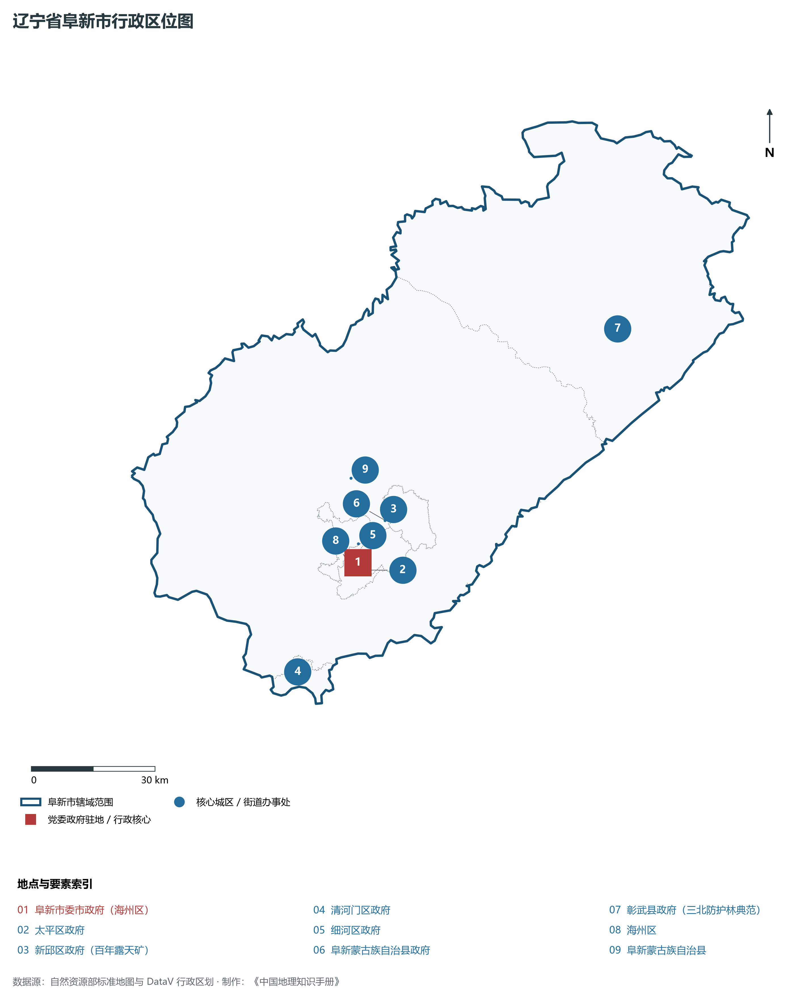
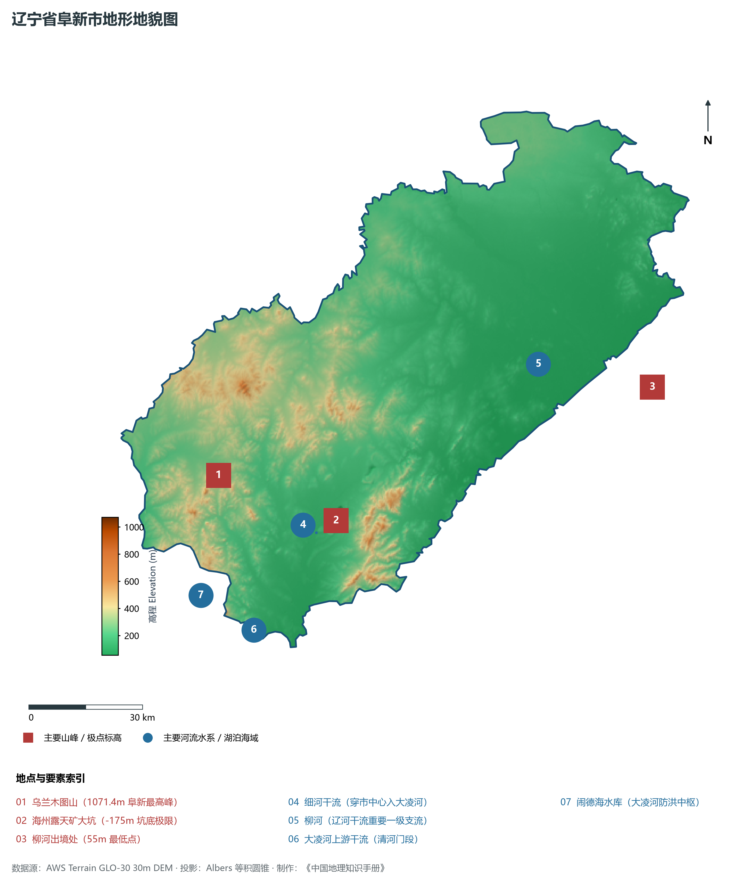
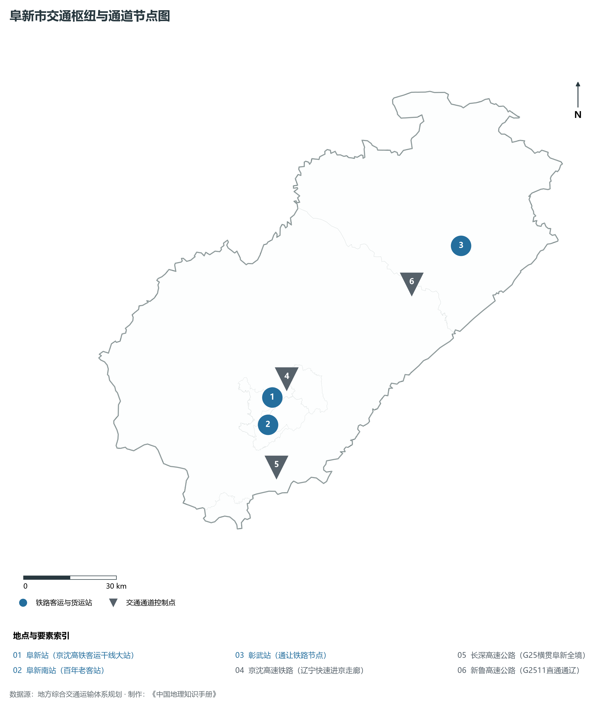
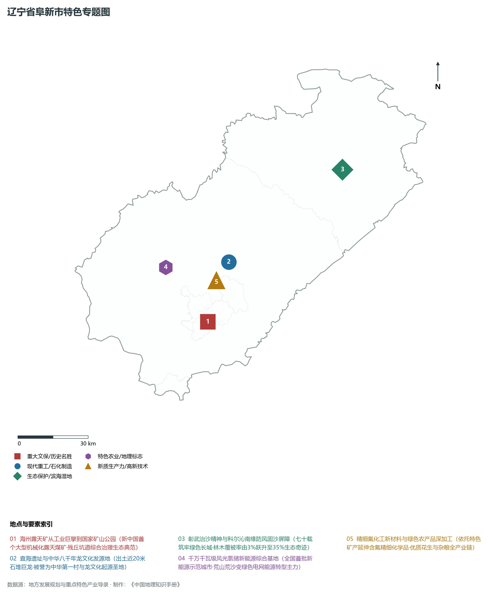
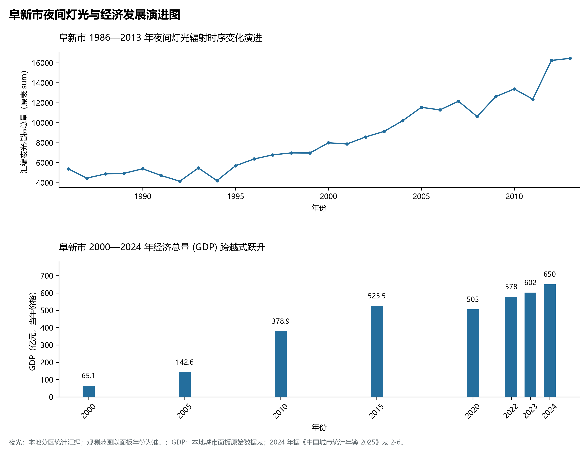

# 5.9 阜新市
阜新市，位于辽宁省，其战略定位与特色概括为：**首批资源枯竭型城市转型样本·海州露天矿生态修复·查海文化发祥地与辽西风光绿能基地**。辖区土地。2024 年常住人口 **154 万人**，常住人口城镇化率 **64.08%**，地区生产总值 **650 亿元**（当年价格），人均地区生产总值 **41,861 元**，三次产业构成为 **18.69 : 28.92 : 52.39**。

---
## 一、自然地理底盘与地貌水系机理
阜新市在地质构造演化史上隶属于中朝准地台东北缘，基底古老深厚，经中生代燕山造山运动与新生代断裂下陷改造，形成了山脉雄峙、水网环绕、冲积阶地发育的优越自然地理底盘。全境地表高程最低为 **55.0 m**，最高隆起峰顶海拔达 **1071.0 m**，地势落差与微地貌分异造就了多层次的生物多样性与空间资源承载力。

区域主要控制性山脉与地形极点包括：

- **乌兰木图山 (1071.4m 阜新最高峰)**（坐标约东经 121.320°、北纬 42.120°，高程约 1071.4 m）；
- **海州露天矿大坑 (-175m 坑底极限)**（坐标约东经 121.670°、北纬 41.970°，高程约 -175.0 m）；
- **柳河出境处 (55m 最低点)**（坐标约东经 122.750°、北纬 42.150°，高程约 55.0 m）；

水系与水文网络方面，阜新市地表水资源丰富，骨干河流纵横穿流：

- **细河干流 (穿市中心入大凌河)**（流经约东经 121.600°、北纬 41.950° 水域）：对全市农业灌溉、城市工业供水及生态水网维持发挥核心调蓄作用；
- **柳河 (辽河干流重要一级支流)**（流经约东经 122.400°、北纬 42.250° 水域）：对全市农业灌溉、城市工业供水及生态水网维持发挥核心调蓄作用；
- **大凌河上游干流 (清河门段)**（流经约东经 121.350°、北纬 41.750° 水域）：对全市农业灌溉、城市工业供水及生态水网维持发挥核心调蓄作用；
- **闹德海水库 (大凌河防洪中枢)**（流经约东经 121.200°、北纬 41.850° 水域）：对全市农业灌溉、城市工业供水及生态水网维持发挥核心调蓄作用；

---
## 二、行政区划沿革与城镇空间体系
阜新市历史文脉源远流长，自先秦置郡以来行政建置历经变迁演进。新中国成立后，伴随老工业基地大规模建设与现代化城镇化推进，形成了结构完备、产城紧密融合的市辖区与县级行政单元空间组织体系：

- **阜新市委市政府 (海州区)**（驻地坐标：121.650°E, 41.980°N）：承担区域行政综合治理、公共资源配置与核心城镇组团功能；
- **太平区政府**（驻地坐标：121.680°E, 41.960°N）：承担区域行政综合治理、公共资源配置与核心城镇组团功能；
- **新邱区政府 (百年露天矿)**（驻地坐标：121.780°E, 42.080°N）：承担区域行政综合治理、公共资源配置与核心城镇组团功能；
- **清河门区政府**（驻地坐标：121.420°E, 41.770°N）：承担区域行政综合治理、公共资源配置与核心城镇组团功能；
- **细河区政府**（驻地坐标：121.660°E, 42.020°N）：承担区域行政综合治理、公共资源配置与核心城镇组团功能；
- **阜新蒙古族自治县政府**（驻地坐标：121.750°E, 42.060°N）：承担区域行政综合治理、公共资源配置与核心城镇组团功能；
- **彰武县政府 (三北防护林典范)**（驻地坐标：122.530°E, 42.380°N）：承担区域行政综合治理、公共资源配置与核心城镇组团功能；

在城镇空间发展战略上，阜新市依托国土空间总体规划，聚力构建“极核集聚、多组团协同、轴带串联、生态穿插”的现代城镇空间体系，全力推进产城融合与区域一体化协同发展。

---
## 三、综合立体交通网络与交通走廊
阜新市地处东北内陆与沿海交通关键走廊之上，依托高速铁路、干线普铁、国家高速公路与沿海航空/海港码头，构筑了现代化立体综合交通运输骨架：

**主要综合交通客运与货运物流枢纽节点：**

- **阜新站 (京沈高铁客运干线大站)**（位置坐标：121.680°E, 42.050°N）：区域客货运流量集散分拨中心；
- **阜新南站 (百年老客站)**（位置坐标：121.645°E, 41.975°N）：区域客货运流量集散分拨中心；
- **彰武站 (通让铁路节点)**（位置坐标：122.520°E, 42.385°N）：区域客货运流量集散分拨中心；

**核心干线铁路与高等级公路交通走廊：**

- **京沈高速铁路 (辽宁快速进京走廊)**（廊道控制点：121.700°E, 42.100°N）：实现城市对外快速互联互通的高速客货运通道；
- **长深高速公路 (G25横贯阜新全境)**（廊道控制点：121.650°E, 41.850°N）：实现城市对外快速互联互通的高速客货运通道；
- **新鲁高速公路 (G2511直通通辽)**（廊道控制点：122.300°E, 42.300°N）：实现城市对外快速互联互通的高速客货运通道；

---
## 四、现代重点产业布局与特色功能组团
在新时代东北全面振兴指引下，阜新市坚持高端化、智能化、绿色化发展方向，加快改造升级传统优势工业，积极培育壮大新兴未来产业，打造特色现代化产业集群：

**重点园区与现代化产业基地：**

- **海州露天矿国家矿山公园 (工业遗址公园)**（空间分布：121.670°E, 41.970°N）；
- **阜新风光氢储绿色清洁能源基地**（空间分布：121.500°E, 42.200°N）；
- **彰武防沙治沙与生态固碳示范区**（空间分布：122.500°E, 42.450°N）；
- **阜新氟化工产业开发区**（空间分布：121.750°E, 42.120°N）；

**代表性特色地标与战略支撑维度：**

- **海州露天矿从工业巨擘到国家矿山公园**（121.670°E, 41.970°N）：新中国首个大型机械化露天煤矿·残丘坑道综合治理生态典范；
- **查海遗址与中华八千年龙文化发源地**（121.830°E, 42.180°N）：出土近20米石堆巨龙·被誉为中华第一村与龙文化起源圣地；
- **彰武治沙精神与科尔沁南缘防风固沙屏障**（122.500°E, 42.450°N）：七十载筑牢绿色长城·林木覆被率由3%跃升至35%生态奇迹；
- **千万千瓦级风光氢储新能源综合基地**（121.500°E, 42.200°N）：全国首批新能源示范城市·荒山荒沙变绿色电网能源转型主力；
- **精细氟化工新材料与绿色农产品深加工**（121.750°E, 42.120°N）：依托特色矿产延伸含氟精细化学品·优质花生与杂粮全产业链；

---
## 五、1986—2013年夜间灯光演变与经济变化分析

本节夜光图的观测年份为 1986—2013 年，指标为行政区汇总值（原表 sum）。

- **1996 年空间发展说明**：海州矿周边与新邱矿区煤火点缀；
- **2008 年空间发展说明**：转型经济开发区启动·沙化土地绿色生态治理；
- **2021 年空间发展说明**：京沈客专阜新站开通·辽西北防风治沙绿能大基地成型；

| 年份 | 地区生产总值（亿元，当年价格） |
|:---|---:|
| 2000 年 | 65.1 |
| 2005 年 | 142.6 |
| 2010 年 | 378.9 |
| 2015 年 | 525.5 |
| 2020 年 | 505 |
| 2022 年 | 578 |
| 2023 年 | 602 |
| 2024 年 | 650 |

---
## 六、文化旅游名胜、生态屏障与可持续人地共生
阜新市高度注重统筹经济高质量发展与高水平生态环境保护，筑牢绿色生态底盘，弘扬优秀历史文化：

- **查海遗址 (8000年红山前龙文化第一村)**（位置坐标：121.830°E, 42.180°N）；
- **海州露天煤矿国家矿山公园**（位置坐标：121.670°E, 41.970°N）；
- **瑞应寺 (全国重点文物保护单位·藏传佛教)**（位置坐标：121.520°E, 42.020°N）；
- **大清沟国家级自然保护区 (科尔沁沙地绿洲)**（位置坐标：122.650°E, 42.600°N）；

在人地协调机制方面，阜新市统筹推进山水林田湖草沙海一体化保护与系统治理，坚决打好蓝天、碧水、净土保卫战，推进传统工矿区生态恢复治理，打造人与自然和谐共生的生态宜居美丽家园。

---
## 七、阜新市关键地理统计指标速查矩阵

| 统计指标项 | 统计数值 / 口径标准 | 空间特征与全省位次说明 |
|:---|:---|:---|
| **行政区划代码** | `210900` | 国家民政部标准行政区划编号 |
| **辖区陆地面积** | **10,355.0** km² | 土地利用类型兼具山地、丘陵、平原与城镇工矿 |
| **常住人口规模** | 154 万人 | 2024 年，全市；年鉴公布口径 |
| **常住人口城镇化率** | 64.08% | 2024 年，全市；年鉴公布口径 |
| **地区生产总值 (2024)** | 650 亿元 | 2024 年，全市；年鉴公布口径 |
| **人均 GDP 水平** | 41,861 元/人 | 2024 年，全市；年鉴公布口径 |
| **三次产业结构比** | 18.69 : 28.92 : 52.39 | 2024 年，全市；年鉴公布口径 |
| **地表极限高程** | **55.0 m ～ 1071.0 m** | 形成极具特色的立体地貌剖面格局 |

2024 年统计来源：《中国城市统计年鉴 2025》表 2-1、2-6、2-7（2024 年，全市）。其他年份 GDP 据本地城市面板“原始数据”表，单位为亿元、当年价格。
