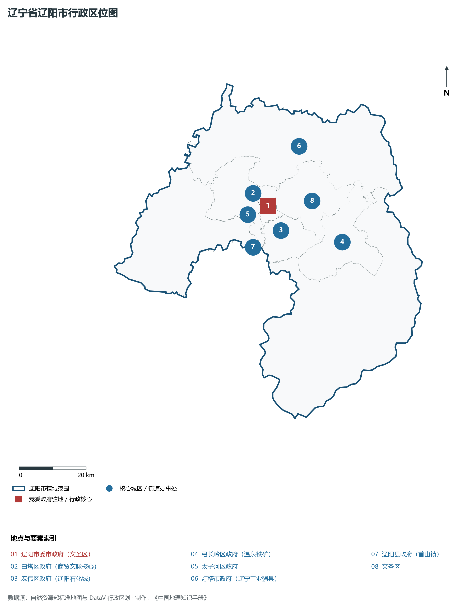
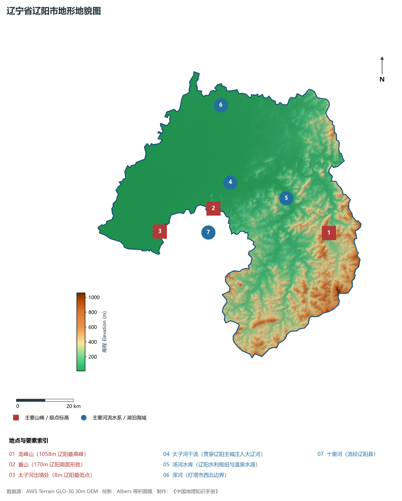
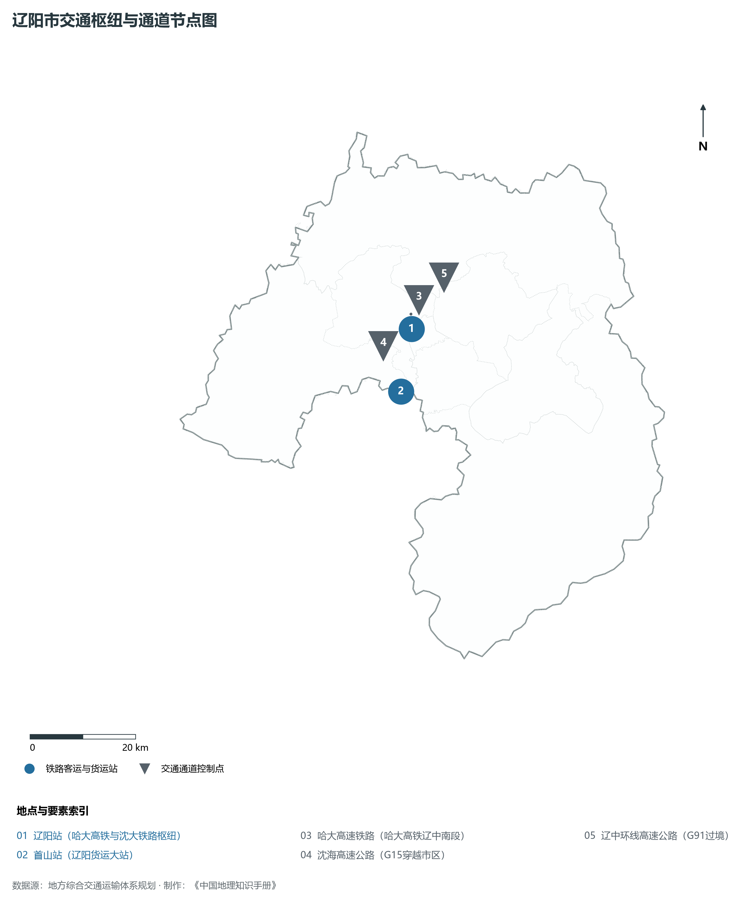
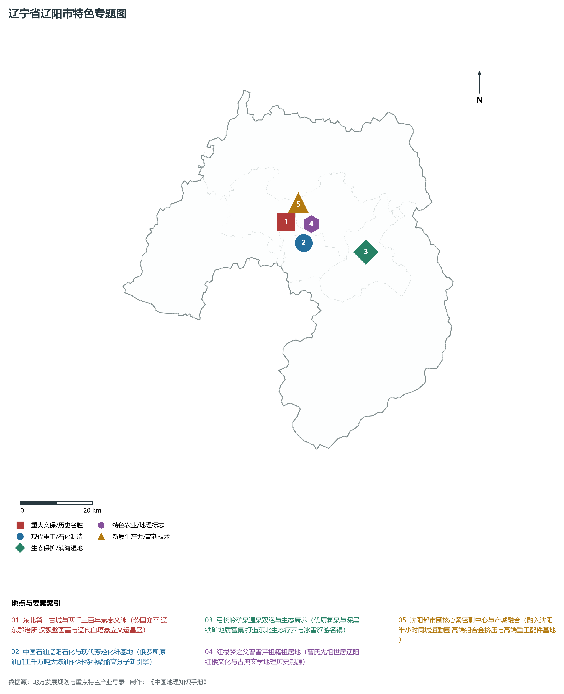
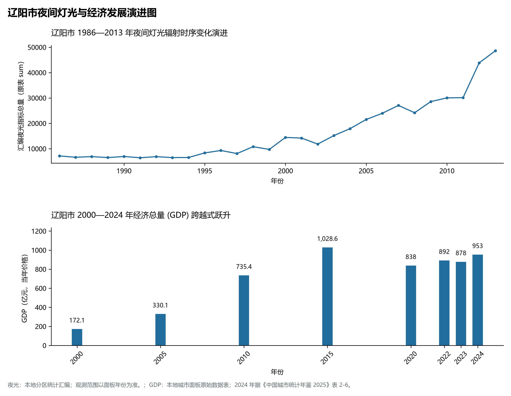

# 5.10 辽阳市
辽阳市，位于辽宁省，其战略定位与特色概括为：**东北第一古城·两千年文脉·太子河中游重工转型与现代芳烃纤化基地**。辖区土地。2024 年常住人口 **151 万人**，常住人口城镇化率 **68.63%**，地区生产总值 **953 亿元**（当年价格），人均地区生产总值 **62,658 元**，三次产业构成为 **10.29 : 41.94 : 47.77**。

---
## 一、自然地理底盘与地貌水系机理
辽阳市在地质构造演化史上隶属于中朝准地台东北缘，基底古老深厚，经中生代燕山造山运动与新生代断裂下陷改造，形成了山脉雄峙、水网环绕、冲积阶地发育的优越自然地理底盘。全境地表高程最低为 **8.0 m**，最高隆起峰顶海拔达 **1058.0 m**，地势落差与微地貌分异造就了多层次的生物多样性与空间资源承载力。

区域主要控制性山脉与地形极点包括：

- **龙峰山 (1058m 辽阳最高峰)**（坐标约东经 123.550°、北纬 41.050°，高程约 1058.0 m）；
- **首山 (170m 辽阳南面形胜)**（坐标约东经 123.090°、北纬 41.190°，高程约 170.0 m）；
- **太子河出境处 (8m 辽阳最低点)**（坐标约东经 122.850°、北纬 41.150°，高程约 8.0 m）；

水系与水文网络方面，辽阳市地表水资源丰富，骨干河流纵横穿流：

- **太子河干流 (贯穿辽阳主城注入大辽河)**（流经约东经 123.180°、北纬 41.260° 水域）：对全市农业灌溉、城市工业供水及生态水网维持发挥核心调蓄作用；
- **汤河水库 (辽阳水利枢纽与温泉水源)**（流经约东经 123.400°、北纬 41.180° 水域）：对全市农业灌溉、城市工业供水及生态水网维持发挥核心调蓄作用；
- **浑河 (灯塔市西北边界)**（流经约东经 123.200°、北纬 41.500° 水域）：对全市农业灌溉、城市工业供水及生态水网维持发挥核心调蓄作用；
- **十里河 (流经辽阳县)**（流经约东经 123.050°、北纬 41.120° 水域）：对全市农业灌溉、城市工业供水及生态水网维持发挥核心调蓄作用；

---
## 二、行政区划沿革与城镇空间体系
辽阳市历史文脉源远流长，自先秦置郡以来行政建置历经变迁演进。新中国成立后，伴随老工业基地大规模建设与现代化城镇化推进，形成了结构完备、产城紧密融合的市辖区与县级行政单元空间组织体系：

- **辽阳市委市政府 (文圣区)**（驻地坐标：123.180°E, 41.280°N）：承担区域行政综合治理、公共资源配置与核心城镇组团功能；
- **白塔区政府 (商贸文脉核心)**（驻地坐标：123.160°E, 41.270°N）：承担区域行政综合治理、公共资源配置与核心城镇组团功能；
- **宏伟区政府 (辽阳石化城)**（驻地坐标：123.210°E, 41.210°N）：承担区域行政综合治理、公共资源配置与核心城镇组团功能；
- **弓长岭区政府 (温泉铁矿)**（驻地坐标：123.420°E, 41.150°N）：承担区域行政综合治理、公共资源配置与核心城镇组团功能；
- **太子河区政府**（驻地坐标：123.130°E, 41.250°N）：承担区域行政综合治理、公共资源配置与核心城镇组团功能；
- **灯塔市政府 (辽宁工业强县)**（驻地坐标：123.330°E, 41.420°N）：承担区域行政综合治理、公共资源配置与核心城镇组团功能；
- **辽阳县政府 (首山镇)**（驻地坐标：123.100°E, 41.180°N）：承担区域行政综合治理、公共资源配置与核心城镇组团功能；

在城镇空间发展战略上，辽阳市依托国土空间总体规划，聚力构建“极核集聚、多组团协同、轴带串联、生态穿插”的现代城镇空间体系，全力推进产城融合与区域一体化协同发展。

---
## 三、综合立体交通网络与交通走廊
辽阳市地处东北内陆与沿海交通关键走廊之上，依托高速铁路、干线普铁、国家高速公路与沿海航空/海港码头，构筑了现代化立体综合交通运输骨架：

**主要综合交通客运与货运物流枢纽节点：**

- **辽阳站 (哈大高铁与沈大铁路枢纽)**（位置坐标：123.155°E, 41.275°N）：区域客货运流量集散分拨中心；
- **首山站 (辽阳货运大站)**（位置坐标：123.105°E, 41.175°N）：区域客货运流量集散分拨中心；

**核心干线铁路与高等级公路交通走廊：**

- **哈大高速铁路 (哈大高铁辽中南段)**（廊道控制点：123.160°E, 41.300°N）：实现城市对外快速互联互通的高速客货运通道；
- **沈海高速公路 (G15穿越市区)**（廊道控制点：123.120°E, 41.250°N）：实现城市对外快速互联互通的高速客货运通道；
- **辽中环线高速公路 (G91过境)**（廊道控制点：123.250°E, 41.350°N）：实现城市对外快速互联互通的高速客货运通道；

---
## 四、现代重点产业布局与特色功能组团
在新时代东北全面振兴指引下，辽阳市坚持高端化、智能化、绿色化发展方向，加快改造升级传统优势工业，积极培育壮大新兴未来产业，打造特色现代化产业集群：

**重点园区与现代化产业基地：**

- **中国石油辽阳石化分公司 (宏伟区)**（空间分布：123.220°E, 41.220°N）；
- **辽阳高新技术产业开发区**（空间分布：123.200°E, 41.240°N）；
- **弓长岭绿色矿山采选与冷热温泉区**（空间分布：123.440°E, 41.140°N）；
- **灯塔日化与皮装轻工产业园区**（空间分布：123.350°E, 41.440°N）；

**代表性特色地标与战略支撑维度：**

- **东北第一古城与两千三百年燕秦文脉**（123.175°E, 41.278°N）：燕国襄平·辽东郡治所·汉魏壁画墓与辽代白塔矗立文运昌盛；
- **中国石油辽阳石化与现代芳烃化纤基地**（123.220°E, 41.220°N）：俄罗斯原油加工千万吨大炼油·化纤特种聚酯高分子新引擎；
- **弓长岭矿泉温泉双绝与生态康养**（123.420°E, 41.170°N）：优质氡泉与深层铁矿地质富集·打造东北生态疗养与冰雪旅游名镇；
- **红楼梦之父曹雪芹祖籍祖居地**（123.185°E, 41.272°N）：曹氏先祖世居辽阳·红楼文化与古典文学地理历史溯源；
- **沈阳都市圈核心紧密副中心与产城融合**（123.180°E, 41.280°N）：融入沈阳半小时同城通勤圈·高端铝合金挤压与高端重工配件基地；

---
## 五、1986—2013年夜间灯光演变与经济变化分析

本节夜光图的观测年份为 1986—2013 年，指标为行政区汇总值（原表 sum）。

- **1996 年空间发展说明**：白塔老城与宏伟区辽阳石化厂区双极闪烁；
- **2008 年空间发展说明**：哈大高铁通车带动河东新城全面拓荒；
- **2021 年空间发展说明**：辽阳石化俄罗斯原油加工转型升级·金属压延与汽车零部件集聚；

| 年份 | 地区生产总值（亿元，当年价格） |
|:---|---:|
| 2000 年 | 172.1 |
| 2005 年 | 330.1 |
| 2010 年 | 735.4 |
| 2015 年 | 1,028.6 |
| 2020 年 | 838 |
| 2022 年 | 892 |
| 2023 年 | 878 |
| 2024 年 | 953 |

---
## 六、文化旅游名胜、生态屏障与可持续人地共生
辽阳市高度注重统筹经济高质量发展与高水平生态环境保护，筑牢绿色生态底盘，弘扬优秀历史文化：

- **广佑寺与白塔 (国家重点文物保护单位)**（位置坐标：123.175°E, 41.278°N）；
- **辽阳汉魏壁画墓群 (全国重点文物保护单位)**（位置坐标：123.150°E, 41.300°N）；
- **汤河温泉小镇 (弓长岭温泉康养)**（位置坐标：123.420°E, 41.170°N）；
- **曹雪芹纪念馆 (红楼梦文脉寻根)**（位置坐标：123.185°E, 41.272°N）；

在人地协调机制方面，辽阳市统筹推进山水林田湖草沙海一体化保护与系统治理，坚决打好蓝天、碧水、净土保卫战，推进传统工矿区生态恢复治理，打造人与自然和谐共生的生态宜居美丽家园。

---
## 七、辽阳市关键地理统计指标速查矩阵

| 统计指标项 | 统计数值 / 口径标准 | 空间特征与全省位次说明 |
|:---|:---|:---|
| **行政区划代码** | `211000` | 国家民政部标准行政区划编号 |
| **辖区陆地面积** | **4,743.0** km² | 土地利用类型兼具山地、丘陵、平原与城镇工矿 |
| **常住人口规模** | 151 万人 | 2024 年，全市；年鉴公布口径 |
| **常住人口城镇化率** | 68.63% | 2024 年，全市；年鉴公布口径 |
| **地区生产总值 (2024)** | 953 亿元 | 2024 年，全市；年鉴公布口径 |
| **人均 GDP 水平** | 62,658 元/人 | 2024 年，全市；年鉴公布口径 |
| **三次产业结构比** | 10.29 : 41.94 : 47.77 | 2024 年，全市；年鉴公布口径 |
| **地表极限高程** | **8.0 m ～ 1058.0 m** | 形成极具特色的立体地貌剖面格局 |

2024 年统计来源：《中国城市统计年鉴 2025》表 2-1、2-6、2-7（2024 年，全市）。其他年份 GDP 据本地城市面板“原始数据”表，单位为亿元、当年价格。
