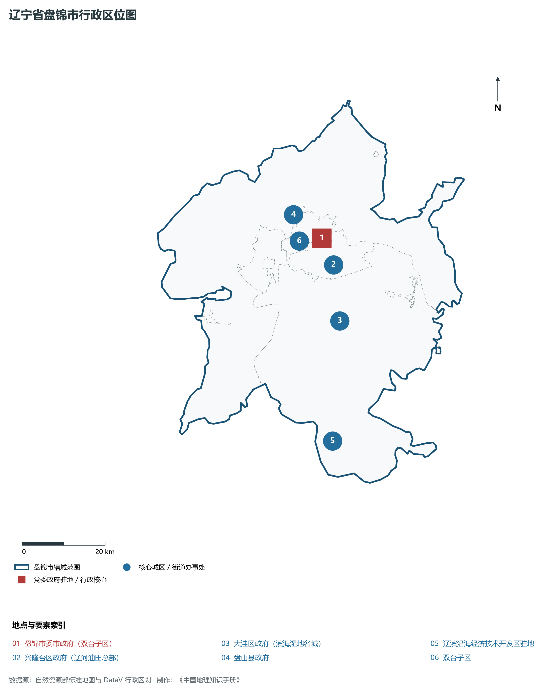
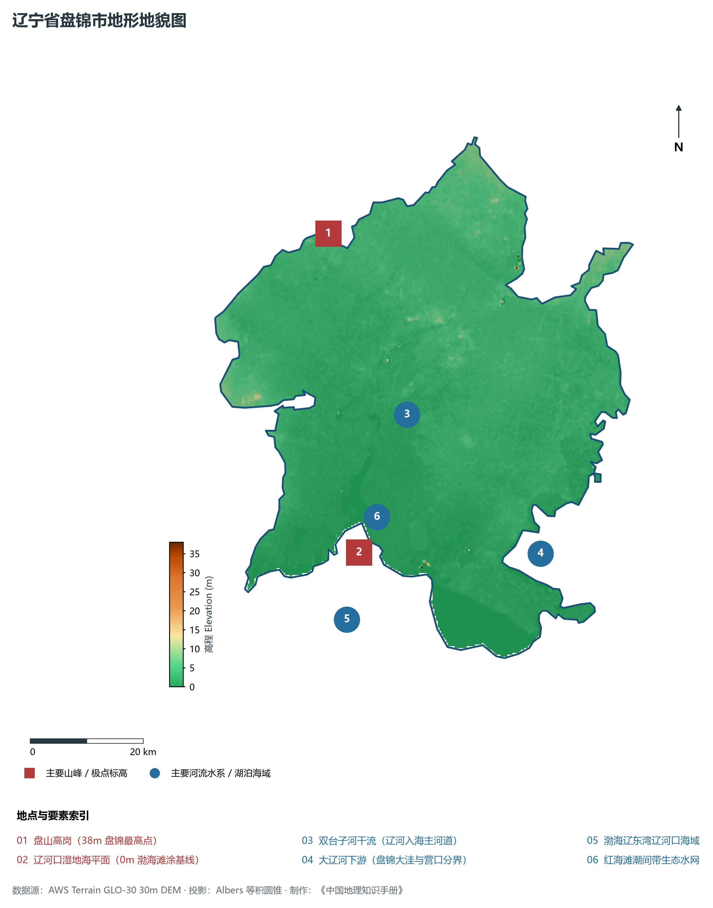
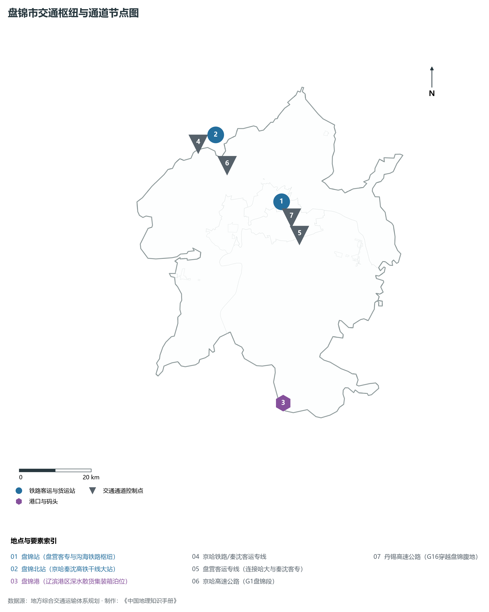
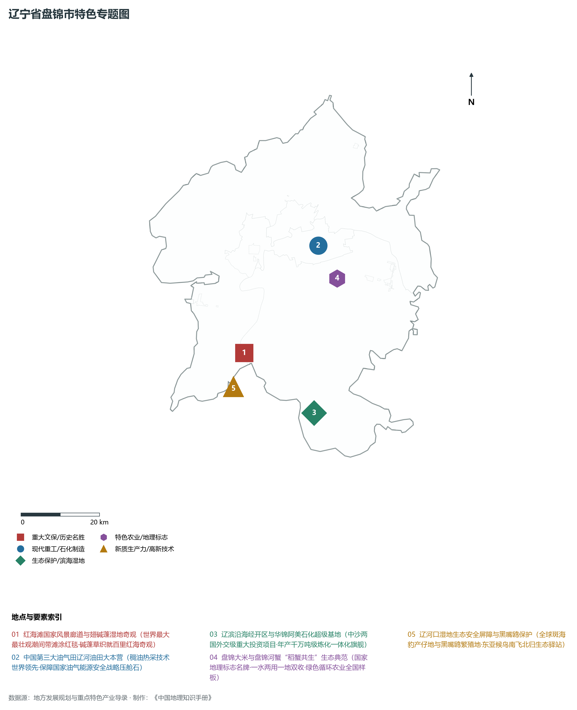
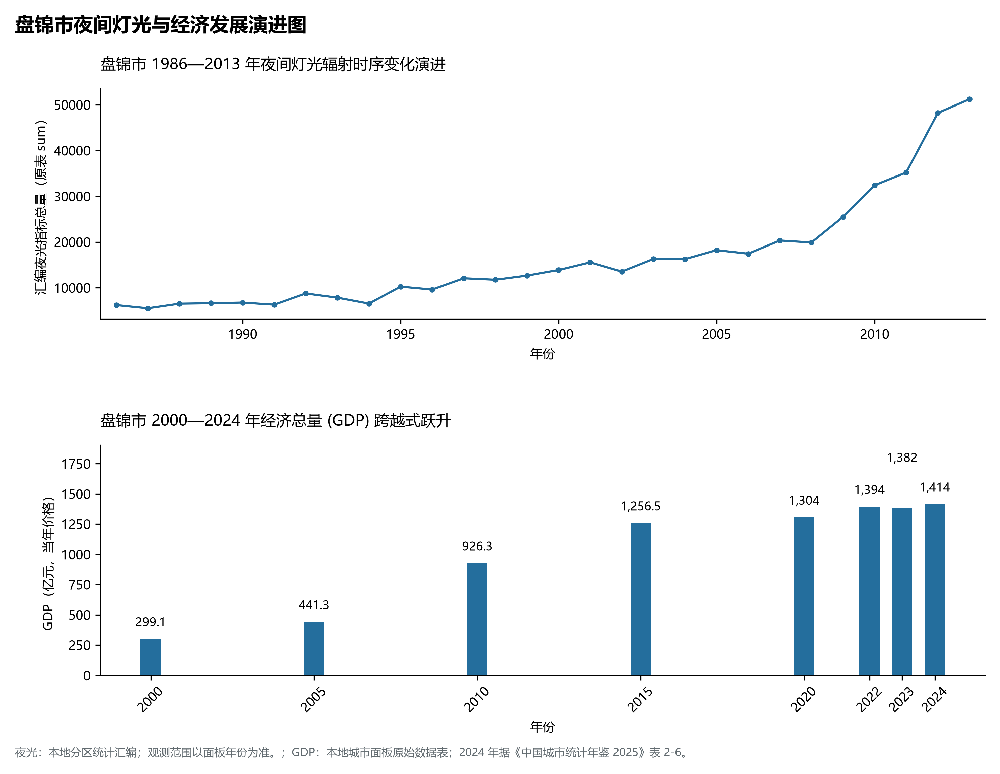

# 5.11 盘锦市
盘锦市，位于辽宁省，其战略定位与特色概括为：**辽河三角洲湿地之都·辽河油田主产区·世界红海滩生态奇观与国家优质粳稻之乡**。辖区土地。2024 年常住人口 **138 万人**，常住人口城镇化率 **80.29%**，地区生产总值 **1,414 亿元**（当年价格），人均地区生产总值 **102,468 元**，三次产业构成为 **7.59 : 50.01 : 42.4**。

---
## 一、自然地理底盘与地貌水系机理
盘锦市在地质构造演化史上隶属于中朝准地台东北缘，基底古老深厚，经中生代燕山造山运动与新生代断裂下陷改造，形成了山脉雄峙、水网环绕、冲积阶地发育的优越自然地理底盘。全境地表高程最低为 **0.0 m**，最高隆起峰顶海拔达 **38.0 m**，地势落差与微地貌分异造就了多层次的生物多样性与空间资源承载力。

区域主要控制性山脉与地形极点包括：

- **盘山高岗 (38m 盘锦最高点)**（坐标约东经 121.850°、北纬 41.350°，高程约 38.0 m）；
- **辽河口湿地海平面 (0m 渤海滩涂基线)**（坐标约东经 121.800°、北纬 40.850°，高程约 0.0 m）；

水系与水文网络方面，盘锦市地表水资源丰富，骨干河流纵横穿流：

- **双台子河干流 (辽河入海主河道)**（流经约东经 121.950°、北纬 41.050° 水域）：对全市农业灌溉、城市工业供水及生态水网维持发挥核心调蓄作用；
- **大辽河下游 (盘锦大洼与营口分界)**（流经约东经 122.180°、北纬 40.800° 水域）：对全市农业灌溉、城市工业供水及生态水网维持发挥核心调蓄作用；
- **渤海辽东湾辽河口海域**（流经约东经 121.750°、北纬 40.750° 水域）：对全市农业灌溉、城市工业供水及生态水网维持发挥核心调蓄作用；
- **红海滩潮间带生态水网**（流经约东经 121.850°、北纬 40.900° 水域）：对全市农业灌溉、城市工业供水及生态水网维持发挥核心调蓄作用；

---
## 二、行政区划沿革与城镇空间体系
盘锦市历史文脉源远流长，自先秦置郡以来行政建置历经变迁演进。新中国成立后，伴随老工业基地大规模建设与现代化城镇化推进，形成了结构完备、产城紧密融合的市辖区与县级行政单元空间组织体系：

- **盘锦市委市政府 (双台子区)**（驻地坐标：122.050°E, 41.180°N）：承担区域行政综合治理、公共资源配置与核心城镇组团功能；
- **兴隆台区政府 (辽河油田总部)**（驻地坐标：122.070°E, 41.120°N）：承担区域行政综合治理、公共资源配置与核心城镇组团功能；
- **大洼区政府 (滨海湿地名城)**（驻地坐标：122.060°E, 41.000°N）：承担区域行政综合治理、公共资源配置与核心城镇组团功能；
- **盘山县政府**（驻地坐标：121.980°E, 41.240°N）：承担区域行政综合治理、公共资源配置与核心城镇组团功能；
- **辽滨沿海经济技术开发区驻地**（驻地坐标：121.980°E, 40.750°N）：承担区域行政综合治理、公共资源配置与核心城镇组团功能；

在城镇空间发展战略上，盘锦市依托国土空间总体规划，聚力构建“极核集聚、多组团协同、轴带串联、生态穿插”的现代城镇空间体系，全力推进产城融合与区域一体化协同发展。

---
## 三、综合立体交通网络与交通走廊
盘锦市地处东北内陆与沿海交通关键走廊之上，依托高速铁路、干线普铁、国家高速公路与沿海航空/海港码头，构筑了现代化立体综合交通运输骨架：

**主要综合交通客运与货运物流枢纽节点：**

- **盘锦站 (盘营客专与沟海铁路枢纽)**（位置坐标：122.060°E, 41.190°N）：区域客货运流量集散分拨中心；
- **盘锦北站 (京哈秦沈高铁干线大站)**（位置坐标：121.880°E, 41.380°N）：区域客货运流量集散分拨中心；
- **盘锦港 (辽滨港区深水散货集装箱泊位)**（位置坐标：121.950°E, 40.700°N）：区域客货运流量集散分拨中心；

**核心干线铁路与高等级公路交通走廊：**

- **京哈铁路/秦沈客运专线**（廊道控制点：121.850°E, 41.360°N）：实现城市对外快速互联互通的高速客货运通道；
- **盘营客运专线 (连接哈大与秦沈客专)**（廊道控制点：122.100°E, 41.100°N）：实现城市对外快速互联互通的高速客货运通道；
- **京哈高速公路 (G1盘锦段)**（廊道控制点：121.900°E, 41.300°N）：实现城市对外快速互联互通的高速客货运通道；
- **丹锡高速公路 (G16穿越盘锦腹地)**（廊道控制点：122.050°E, 41.150°N）：实现城市对外快速互联互通的高速客货运通道；

---
## 四、现代重点产业布局与特色功能组团
在新时代东北全面振兴指引下，盘锦市坚持高端化、智能化、绿色化发展方向，加快改造升级传统优势工业，积极培育壮大新兴未来产业，打造特色现代化产业集群：

**重点园区与现代化产业基地：**

- **辽河油田分公司 (全国第三大油气田)**（空间分布：122.080°E, 41.130°N）；
- **盘锦辽滨沿海经济技术开发区**（空间分布：121.980°E, 40.760°N）；
- **华锦阿美精细化工及原料工程项目**（空间分布：121.950°E, 40.780°N）；
- **盘锦大米与河蟹生态现代农业产业园**（空间分布：122.120°E, 41.050°N）；

**代表性特色地标与战略支撑维度：**

- **红海滩国家风景廊道与翅碱蓬湿地奇观**（121.800°E, 40.920°N）：世界最大最壮观潮间带滩涂红毯·碱蓬草织就百里红海奇观；
- **中国第三大油气田辽河油田大本营**（122.080°E, 41.130°N）：稠油热采技术世界领先·保障国家油气能源安全战略压舱石；
- **辽滨沿海经开区与华锦阿美石化超级基地**（121.980°E, 40.760°N）：中沙两国外交级重大投资项目·年产千万吨级炼化一体化旗舰；
- **盘锦大米与盘锦河蟹“稻蟹共生”生态典范**（122.120°E, 41.050°N）：国家地理标志名牌·一水两用一地双收·绿色循环农业全国样板；
- **辽河口湿地生态安全屏障与黑嘴鸥保护**（121.750°E, 40.850°N）：全球斑海豹产仔地与黑嘴鸥繁殖地·东亚候鸟南飞北归生态驿站；

---
## 五、1986—2013年夜间灯光演变与经济变化分析

本节夜光图的观测年份为 1986—2013 年，指标为行政区汇总值（原表 sum）。

- **1996 年空间发展说明**：双台子兴隆台辽河油田总部与采油厂夜火密集；
- **2008 年空间发展说明**：向海发展大伙房辽滨沿海经济技术开发区跨越成型；
- **2021 年空间发展说明**：华锦阿美精细化工百亿美元项目入驻·生态与石化交融；

| 年份 | 地区生产总值（亿元，当年价格） |
|:---|---:|
| 2000 年 | 299.1 |
| 2005 年 | 441.3 |
| 2010 年 | 926.3 |
| 2015 年 | 1,256.5 |
| 2020 年 | 1,304 |
| 2022 年 | 1,394 |
| 2023 年 | 1,382 |
| 2024 年 | 1,414 |

---
## 六、文化旅游名胜、生态屏障与可持续人地共生
盘锦市高度注重统筹经济高质量发展与高水平生态环境保护，筑牢绿色生态底盘，弘扬优秀历史文化：

- **红海滩国家风景廊道 (5A·天下奇观)**（位置坐标：121.800°E, 40.920°N）；
- **辽河口国家级自然保护区 (黑嘴鸥之乡)**（位置坐标：121.750°E, 40.850°N）；
- **鼎翔生态旅游区 (国家4A·鸟乐园)**（位置坐标：121.900°E, 41.220°N）；
- **辽河湿地公园 (退耕还湿生态样板)**（位置坐标：122.020°E, 41.180°N）；

在人地协调机制方面，盘锦市统筹推进山水林田湖草沙海一体化保护与系统治理，坚决打好蓝天、碧水、净土保卫战，推进传统工矿区生态恢复治理，打造人与自然和谐共生的生态宜居美丽家园。

---
## 七、盘锦市关键地理统计指标速查矩阵

| 统计指标项 | 统计数值 / 口径标准 | 空间特征与全省位次说明 |
|:---|:---|:---|
| **行政区划代码** | `211100` | 国家民政部标准行政区划编号 |
| **辖区陆地面积** | **4,147.0** km² | 土地利用类型兼具山地、丘陵、平原与城镇工矿 |
| **常住人口规模** | 138 万人 | 2024 年，全市；年鉴公布口径 |
| **常住人口城镇化率** | 80.29% | 2024 年，全市；年鉴公布口径 |
| **地区生产总值 (2024)** | 1,414 亿元 | 2024 年，全市；年鉴公布口径 |
| **人均 GDP 水平** | 102,468 元/人 | 2024 年，全市；年鉴公布口径 |
| **三次产业结构比** | 7.59 : 50.01 : 42.4 | 2024 年，全市；年鉴公布口径 |
| **地表极限高程** | **0.0 m ～ 38.0 m** | 形成极具特色的立体地貌剖面格局 |

2024 年统计来源：《中国城市统计年鉴 2025》表 2-1、2-6、2-7（2024 年，全市）。其他年份 GDP 据本地城市面板“原始数据”表，单位为亿元、当年价格。
