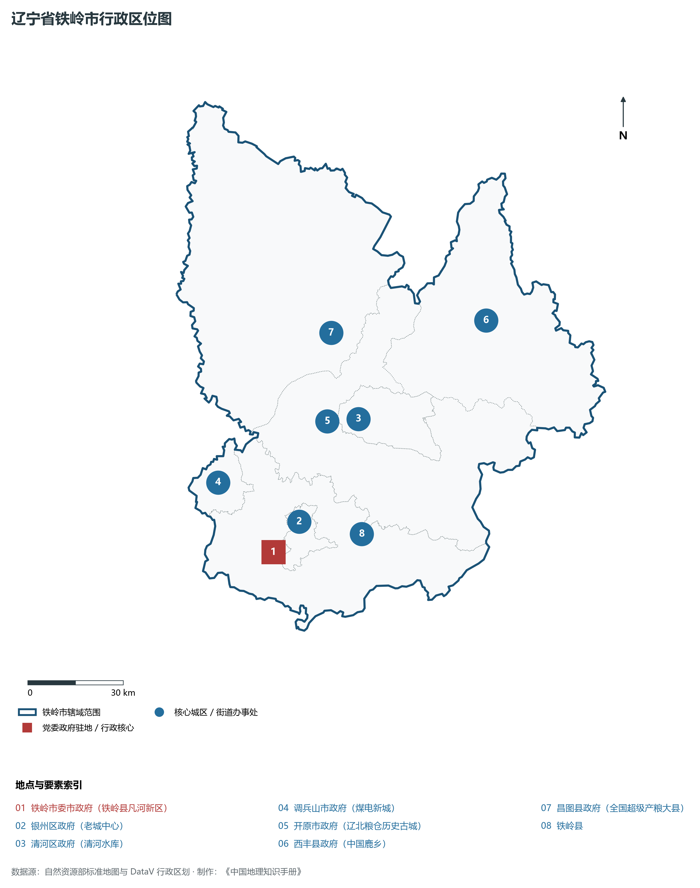
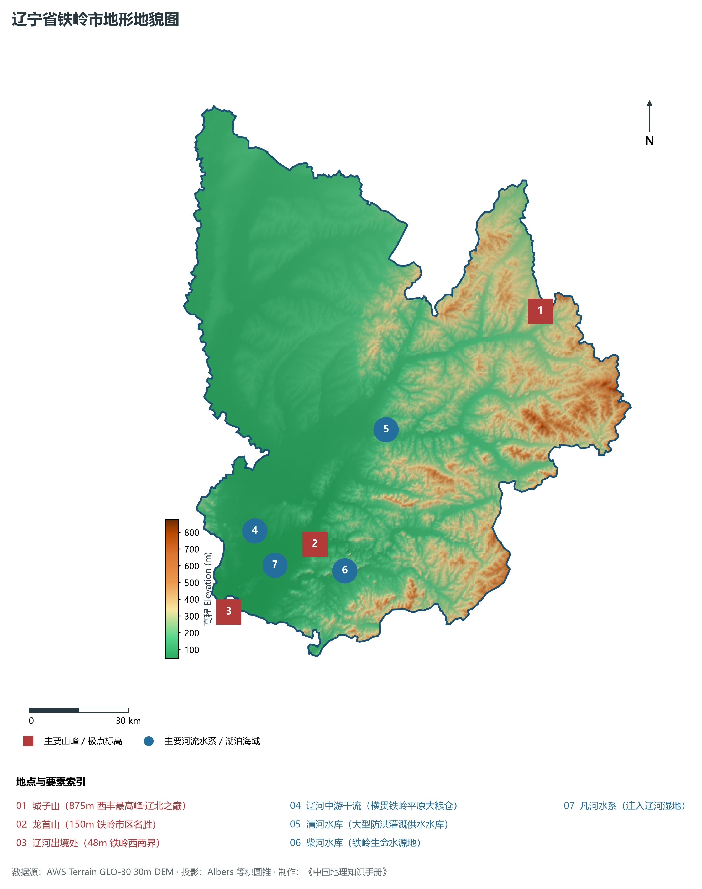
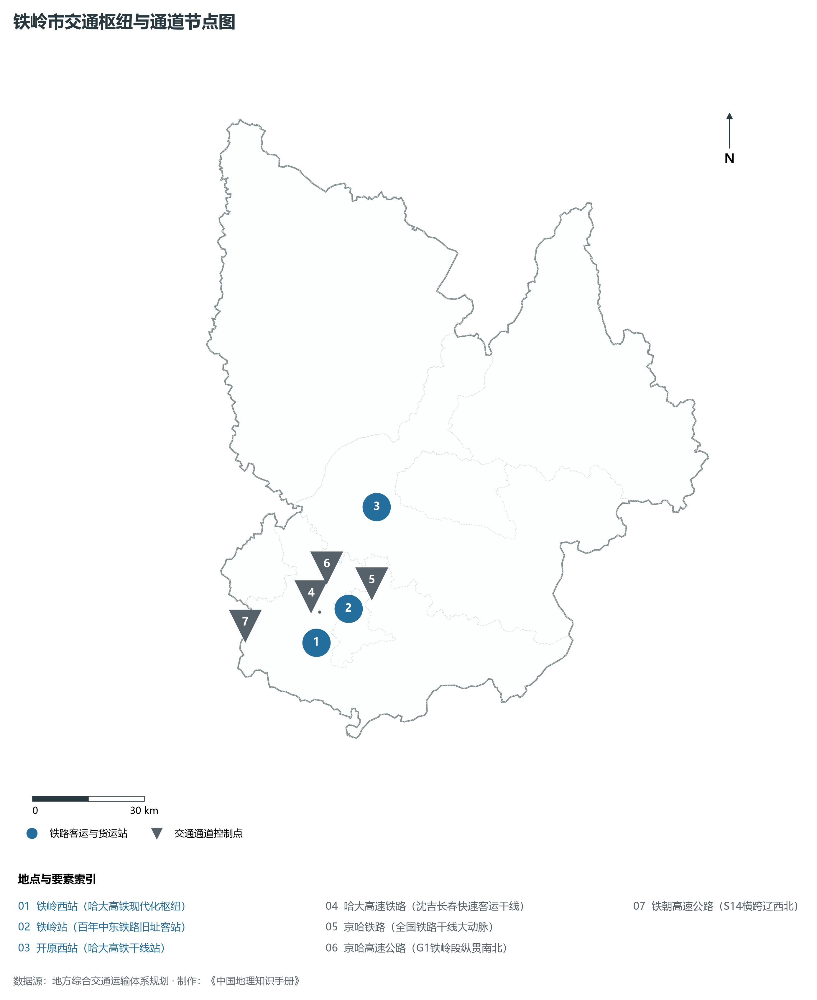
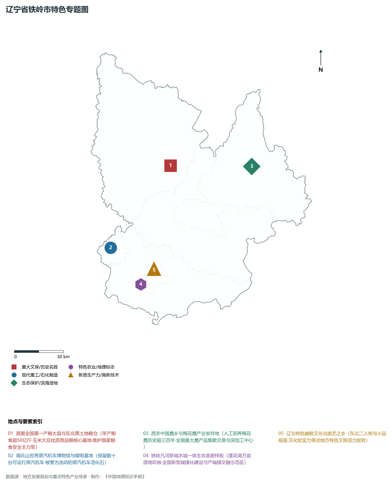
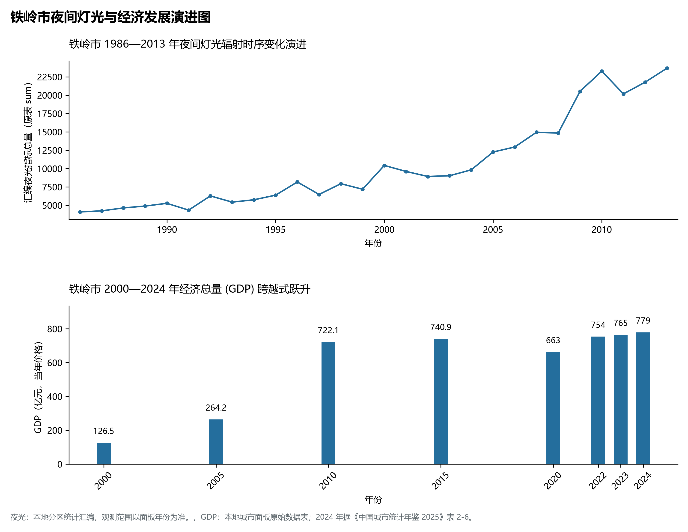

# 5.12 铁岭市
铁岭市，位于辽宁省，其战略定位与特色概括为：**辽北黑土地大粮仓·辽河中游沃野·国家重要商品粮基地与特色文化幽默之都**。辖区土地。2024 年常住人口 **223 万人**，常住人口城镇化率 **58.88%**，地区生产总值 **779 亿元**（当年价格），人均地区生产总值 **34,674 元**，三次产业构成为 **21.33 : 27.27 : 51.28**。

---
## 一、自然地理底盘与地貌水系机理
铁岭市在地质构造演化史上隶属于中朝准地台东北缘，基底古老深厚，经中生代燕山造山运动与新生代断裂下陷改造，形成了山脉雄峙、水网环绕、冲积阶地发育的优越自然地理底盘。全境地表高程最低为 **48.0 m**，最高隆起峰顶海拔达 **875.0 m**，地势落差与微地貌分异造就了多层次的生物多样性与空间资源承载力。

区域主要控制性山脉与地形极点包括：

- **城子山 (875m 西丰最高峰·辽北之巅)**（坐标约东经 124.850°、北纬 42.780°，高程约 875.0 m）；
- **龙首山 (150m 铁岭市区名胜)**（坐标约东经 123.860°、北纬 42.285°，高程约 150.0 m）；
- **辽河出境处 (48m 铁岭西南界)**（坐标约东经 123.500°、北纬 42.150°，高程约 48.0 m）；

水系与水文网络方面，铁岭市地表水资源丰富，骨干河流纵横穿流：

- **辽河中游干流 (横贯铁岭平原大粮仓)**（流经约东经 123.650°、北纬 42.350° 水域）：对全市农业灌溉、城市工业供水及生态水网维持发挥核心调蓄作用；
- **清河水库 (大型防洪灌溉供水水库)**（流经约东经 124.200°、北纬 42.550° 水域）：对全市农业灌溉、城市工业供水及生态水网维持发挥核心调蓄作用；
- **柴河水库 (铁岭生命水源地)**（流经约东经 123.950°、北纬 42.200° 水域）：对全市农业灌溉、城市工业供水及生态水网维持发挥核心调蓄作用；
- **凡河水系 (注入辽河湿地)**（流经约东经 123.700°、北纬 42.250° 水域）：对全市农业灌溉、城市工业供水及生态水网维持发挥核心调蓄作用；

---
## 二、行政区划沿革与城镇空间体系
铁岭市历史文脉源远流长，自先秦置郡以来行政建置历经变迁演进。新中国成立后，伴随老工业基地大规模建设与现代化城镇化推进，形成了结构完备、产城紧密融合的市辖区与县级行政单元空间组织体系：

- **铁岭市委市政府 (铁岭县凡河新区)**（驻地坐标：123.730°E, 42.220°N）：承担区域行政综合治理、公共资源配置与核心城镇组团功能；
- **银州区政府 (老城中心)**（驻地坐标：123.850°E, 42.290°N）：承担区域行政综合治理、公共资源配置与核心城镇组团功能；
- **清河区政府 (清河水库)**（驻地坐标：124.150°E, 42.540°N）：承担区域行政综合治理、公共资源配置与核心城镇组团功能；
- **调兵山市政府 (煤电新城)**（驻地坐标：123.570°E, 42.440°N）：承担区域行政综合治理、公共资源配置与核心城镇组团功能；
- **开原市政府 (辽北粮仓历史古城)**（驻地坐标：124.030°E, 42.550°N）：承担区域行政综合治理、公共资源配置与核心城镇组团功能；
- **西丰县政府 (中国鹿乡)**（驻地坐标：124.710°E, 42.740°N）：承担区域行政综合治理、公共资源配置与核心城镇组团功能；
- **昌图县政府 (全国超级产粮大县)**（驻地坐标：124.110°E, 42.790°N）：承担区域行政综合治理、公共资源配置与核心城镇组团功能；

在城镇空间发展战略上，铁岭市依托国土空间总体规划，聚力构建“极核集聚、多组团协同、轴带串联、生态穿插”的现代城镇空间体系，全力推进产城融合与区域一体化协同发展。

---
## 三、综合立体交通网络与交通走廊
铁岭市地处东北内陆与沿海交通关键走廊之上，依托高速铁路、干线普铁、国家高速公路与沿海航空/海港码头，构筑了现代化立体综合交通运输骨架：

**主要综合交通客运与货运物流枢纽节点：**

- **铁岭西站 (哈大高铁现代化枢纽)**（位置坐标：123.720°E, 42.230°N）：区域客货运流量集散分拨中心；
- **铁岭站 (百年中东铁路旧址客站)**（位置坐标：123.845°E, 42.295°N）：区域客货运流量集散分拨中心；
- **开原西站 (哈大高铁干线站)**（位置坐标：124.000°E, 42.520°N）：区域客货运流量集散分拨中心；

**核心干线铁路与高等级公路交通走廊：**

- **哈大高速铁路 (沈吉长春快速客运干线)**（廊道控制点：123.750°E, 42.300°N）：实现城市对外快速互联互通的高速客货运通道；
- **京哈铁路 (全国铁路干线大动脉)**（廊道控制点：123.880°E, 42.350°N）：实现城市对外快速互联互通的高速客货运通道；
- **京哈高速公路 (G1铁岭段纵贯南北)**（廊道控制点：123.800°E, 42.400°N）：实现城市对外快速互联互通的高速客货运通道；
- **铁朝高速公路 (S14横跨辽西北)**（廊道控制点：123.500°E, 42.300°N）：实现城市对外快速互联互通的高速客货运通道；

---
## 四、现代重点产业布局与特色功能组团
在新时代东北全面振兴指引下，铁岭市坚持高端化、智能化、绿色化发展方向，加快改造升级传统优势工业，积极培育壮大新兴未来产业，打造特色现代化产业集群：

**重点园区与现代化产业基地：**

- **铁岭经济技术开发区 (专用车制造基地)**（空间分布：123.780°E, 42.250°N）；
- **昌图县国家级现代农业产业园**（空间分布：124.120°E, 42.820°N）；
- **调兵山煤电能源与新型储能基地**（空间分布：123.550°E, 42.420°N）；
- **西丰中国鹿乡现代生物医药健康产业园**（空间分布：124.720°E, 42.730°N）；

**代表性特色地标与战略支撑维度：**

- **昌图全国第一产粮大县与东北黑土地粮仓**（124.120°E, 42.820°N）：年产粮食超50亿斤·玉米大豆优质商品粮核心基地·维护国家粮食安全主力军；
- **调兵山世界蒸汽机车博物馆与煤电基地**（123.560°E, 42.445°N）：保留数十台可运行蒸汽机车·被誉为流动的蒸汽机车活化石；
- **西丰中国鹿乡与梅花鹿产业发祥地**（124.720°E, 42.730°N）：人工驯养梅花鹿历史超三百年·全国最大鹿产品集散交易与深加工中心；
- **铁岭凡河新城水城一体生态宜居样板**（123.730°E, 42.220°N）：莲花湖万亩湿地环抱·全国新型城镇化建设与产城绿交融示范区；
- **辽北特色幽默文化与曲艺之乡**（123.850°E, 42.290°N）：东北二人转与小品摇篮·文化软实力带动地方特色文旅活力绽放；

---
## 五、1986—2013年夜间灯光演变与经济变化分析

本节夜光图的观测年份为 1986—2013 年，指标为行政区汇总值（原表 sum）。

- **1996 年空间发展说明**：银州区老城与调兵山煤田夜间亮光点状分布；
- **2008 年空间发展说明**：凡河新城铁岭新区大尺度开发建设；
- **2021 年空间发展说明**：哈大高铁铁岭西站快速直通沈阳·现代农产品深加工成链；

| 年份 | 地区生产总值（亿元，当年价格） |
|:---|---:|
| 2000 年 | 126.5 |
| 2005 年 | 264.2 |
| 2010 年 | 722.1 |
| 2015 年 | 740.9 |
| 2020 年 | 663 |
| 2022 年 | 754 |
| 2023 年 | 765 |
| 2024 年 | 779 |

---
## 六、文化旅游名胜、生态屏障与可持续人地共生
铁岭市高度注重统筹经济高质量发展与高水平生态环境保护，筑牢绿色生态底盘，弘扬优秀历史文化：

- **龙首山风景区 (慈清寺与秀峰塔)**（位置坐标：123.865°E, 42.288°N）；
- **清河水库旅游度假区 (国家级水利风景区)**（位置坐标：124.220°E, 42.560°N）；
- **调兵山蒸汽机车博览馆 (国家4A·世界唯一)**（位置坐标：123.560°E, 42.445°N）；
- **城子山山城遗址 (高句丽高山军事古堡)**（位置坐标：124.860°E, 42.790°N）；

在人地协调机制方面，铁岭市统筹推进山水林田湖草沙海一体化保护与系统治理，坚决打好蓝天、碧水、净土保卫战，推进传统工矿区生态恢复治理，打造人与自然和谐共生的生态宜居美丽家园。

---
## 七、铁岭市关键地理统计指标速查矩阵

| 统计指标项 | 统计数值 / 口径标准 | 空间特征与全省位次说明 |
|:---|:---|:---|
| **行政区划代码** | `211200` | 国家民政部标准行政区划编号 |
| **辖区陆地面积** | **12,985.0** km² | 土地利用类型兼具山地、丘陵、平原与城镇工矿 |
| **常住人口规模** | 223 万人 | 2024 年，全市；年鉴公布口径 |
| **常住人口城镇化率** | 58.88% | 2024 年，全市；年鉴公布口径 |
| **地区生产总值 (2024)** | 779 亿元 | 2024 年，全市；年鉴公布口径 |
| **人均 GDP 水平** | 34,674 元/人 | 2024 年，全市；年鉴公布口径 |
| **三次产业结构比** | 21.33 : 27.27 : 51.28 | 2024 年，全市；年鉴公布口径 |
| **地表极限高程** | **48.0 m ～ 875.0 m** | 形成极具特色的立体地貌剖面格局 |

2024 年统计来源：《中国城市统计年鉴 2025》表 2-1、2-6、2-7（2024 年，全市）。其他年份 GDP 据本地城市面板“原始数据”表，单位为亿元、当年价格。
