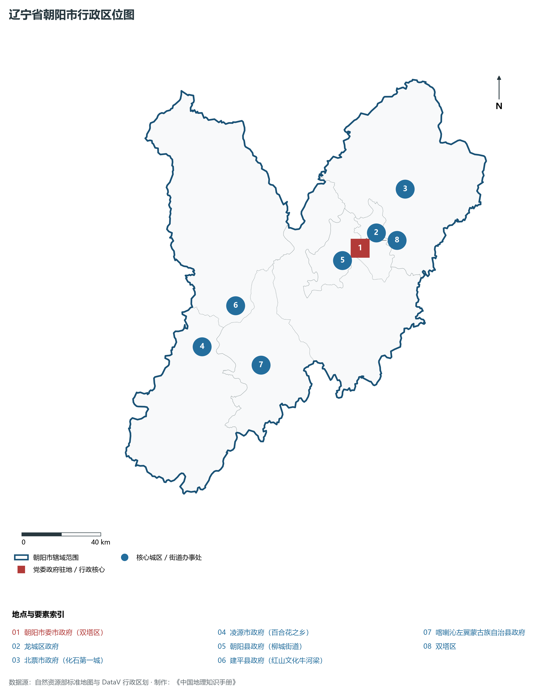
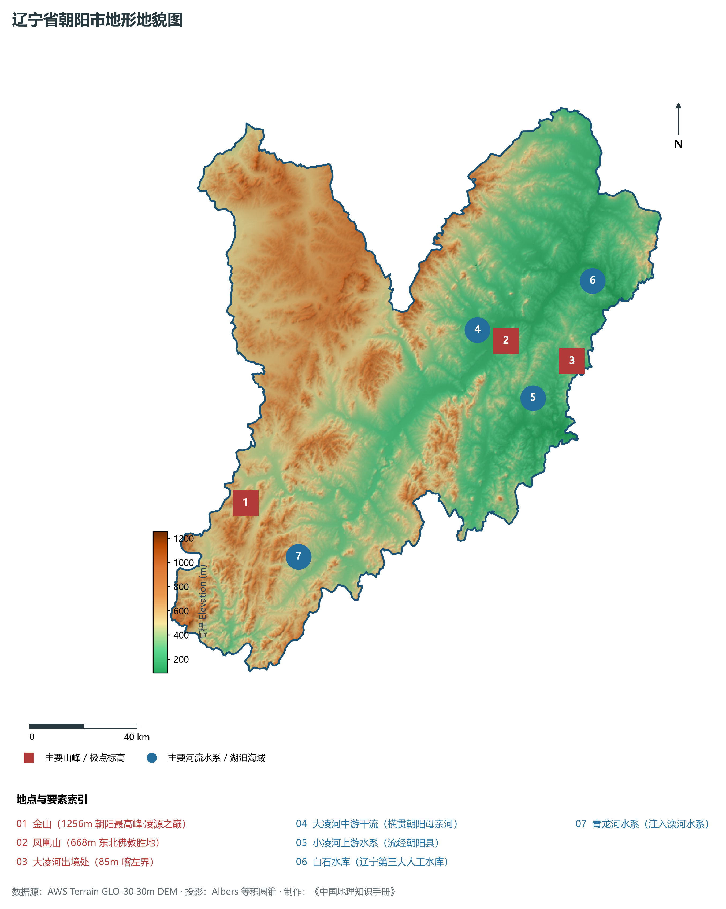
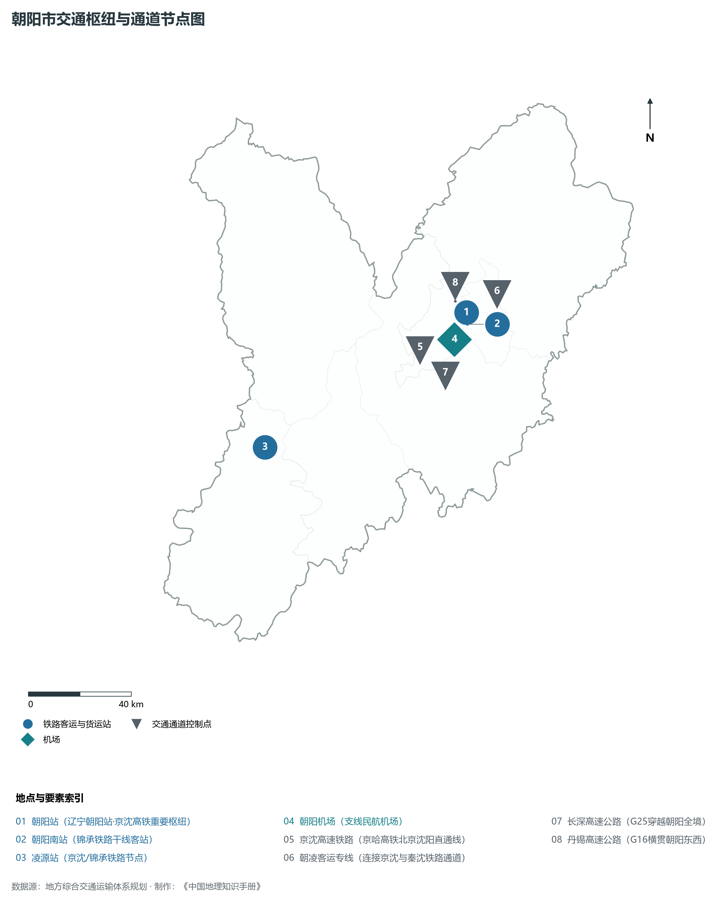
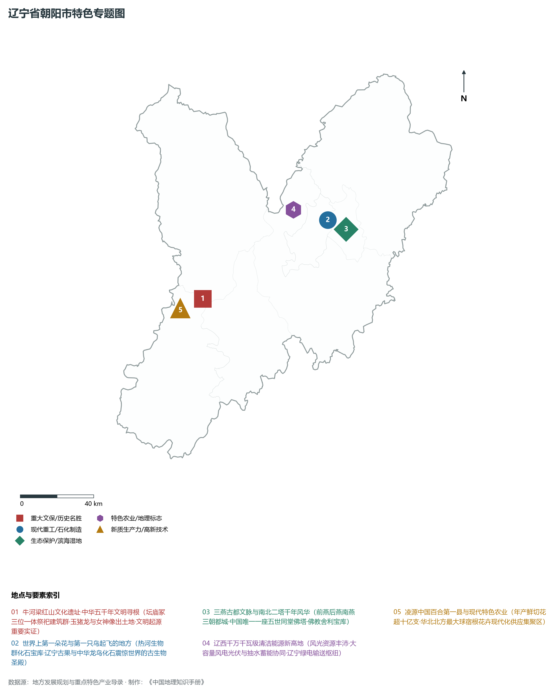
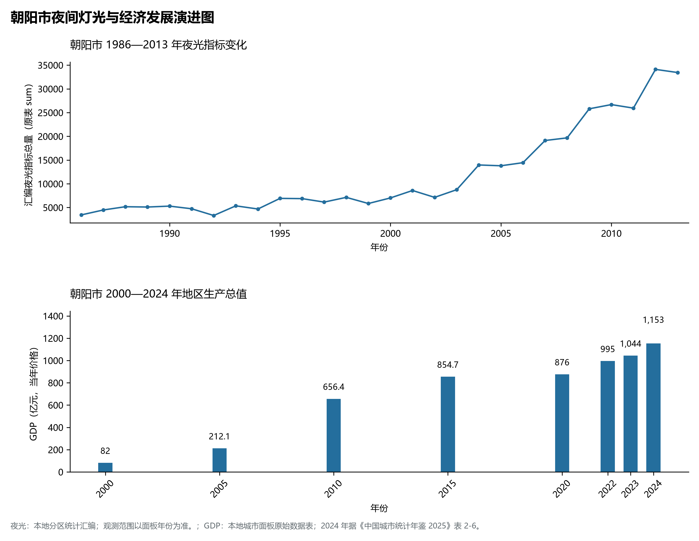

# 5.13 朝阳市
朝阳市，位于辽宁省，是三燕古都和辽西地区的重要交通节点。辖区土地。2024 年常住人口 **276 万人**，常住人口城镇化率 **52.17%**，地区生产总值 **1,153 亿元**（当年价格），人均地区生产总值 **41,842 元**，三次产业构成为 **20.83 : 30.58 : 48.59**。

---
## 一、自然地理底盘与地貌水系机理
朝阳市在地质构造演化史上隶属于中朝准地台东北缘，基底古老深厚，经中生代燕山造山运动与新生代断裂下陷改造，形成了山脉雄峙、水网环绕、冲积阶地发育的优越自然地理底盘。全境地表高程最低为 **85.0 m**，最高隆起峰顶海拔达 **1256.0 m**，地势落差与微地貌分异造就了多层次的生物多样性与空间资源承载力。

区域主要控制性山脉与地形极点包括：

- **金山 (1256m 朝阳最高峰·凌源之巅)**（坐标约东经 119.250°、北纬 41.150°，高程约 1256.0 m）；
- **凤凰山 (668m 东北佛教胜地)**（坐标约东经 120.520°、北纬 41.550°，高程约 668.0 m）；
- **大凌河出境处 (85m 喀左界)**（坐标约东经 120.800°、北纬 41.450°，高程约 85.0 m）；

水系与水文网络方面，朝阳市地表水资源丰富，骨干河流纵横穿流：

- **大凌河中游干流 (横贯朝阳母亲河)**（流经约东经 120.400°、北纬 41.600° 水域）：对全市农业灌溉、城市工业供水及生态水网维持发挥核心调蓄作用；
- **小凌河上游水系 (流经朝阳县)**（流经约东经 120.600°、北纬 41.350° 水域）：对全市农业灌溉、城市工业供水及生态水网维持发挥核心调蓄作用；
- **白石水库 (辽宁第三大人工水库)**（流经约东经 120.950°、北纬 41.700° 水域）：对全市农业灌溉、城市工业供水及生态水网维持发挥核心调蓄作用；
- **青龙河水系 (注入滦河水系)**（流经约东经 119.450°、北纬 40.950° 水域）：对全市农业灌溉、城市工业供水及生态水网维持发挥核心调蓄作用；

---
## 二、行政区划沿革与城镇空间体系
朝阳市历史文脉源远流长，自先秦置郡以来行政建置历经变迁演进。新中国成立后，伴随老工业基地大规模建设与现代化城镇化推进，形成了结构完备、产城紧密融合的市辖区与县级行政单元空间组织体系：

- **朝阳市委市政府 (双塔区)**（驻地坐标：120.450°E, 41.570°N）：承担区域行政综合治理、公共资源配置与核心城镇组团功能；
- **龙城区政府**（驻地坐标：120.430°E, 41.590°N）：承担区域行政综合治理、公共资源配置与核心城镇组团功能；
- **北票市政府 (化石第一城)**（驻地坐标：120.780°E, 41.800°N）：承担区域行政综合治理、公共资源配置与核心城镇组团功能；
- **凌源市政府 (百合花之乡)**（驻地坐标：119.400°E, 41.240°N）：承担区域行政综合治理、公共资源配置与核心城镇组团功能；
- **朝阳县政府 (柳城街道)**（驻地坐标：120.400°E, 41.520°N）：承担区域行政综合治理、公共资源配置与核心城镇组团功能；
- **建平县政府 (红山文化牛河梁)**（驻地坐标：119.640°E, 41.400°N）：承担区域行政综合治理、公共资源配置与核心城镇组团功能；
- **喀喇沁左翼蒙古族自治县政府**（驻地坐标：119.740°E, 41.120°N）：承担区域行政综合治理、公共资源配置与核心城镇组团功能；

在城镇空间发展战略上，朝阳市依托国土空间总体规划，聚力构建“极核集聚、多组团协同、轴带串联、生态穿插”的现代城镇空间体系，全力推进产城融合与区域一体化协同发展。

---
## 三、综合立体交通网络与交通走廊
朝阳市地处东北内陆与沿海交通关键走廊之上，依托高速铁路、干线普铁、国家高速公路与沿海航空/海港码头，构筑了现代化立体综合交通运输骨架：

**主要综合交通客运与货运物流枢纽节点：**

- **朝阳站 (辽宁朝阳站·京沈高铁重要枢纽)**（位置坐标：120.445°E, 41.605°N）：区域客货运流量集散分拨中心；
- **朝阳南站 (锦承铁路干线客站)**（位置坐标：120.440°E, 41.565°N）：区域客货运流量集散分拨中心；
- **凌源站 (京沈/锦承铁路节点)**（位置坐标：119.410°E, 41.250°N）：区域客货运流量集散分拨中心；
- **朝阳机场 (支线民航机场)**（位置坐标：120.435°E, 41.538°N）：区域客货运流量集散分拨中心；

**核心干线铁路与高等级公路交通走廊：**

- **京沈高速铁路 (京哈高铁北京沈阳直通线)**（廊道控制点：120.200°E, 41.500°N）：实现城市对外快速互联互通的高速客货运通道；
- **朝凌客运专线 (连接京沈与秦沈铁路通道)**（廊道控制点：120.600°E, 41.650°N）：实现城市对外快速互联互通的高速客货运通道；
- **长深高速公路 (G25穿越朝阳全境)**（廊道控制点：120.300°E, 41.400°N）：实现城市对外快速互联互通的高速客货运通道；
- **丹锡高速公路 (G16横贯朝阳东西)**（廊道控制点：120.400°E, 41.650°N）：实现城市对外快速互联互通的高速客货运通道；

---
## 四、现代重点产业布局与特色功能组团
在新时代东北全面振兴指引下，朝阳市坚持高端化、智能化、绿色化发展方向，加快改造升级传统优势工业，积极培育壮大新兴未来产业，打造特色现代化产业集群：

**重点园区与现代化产业基地：**

- **朝阳鸟化石国家地质公园产研基地**（空间分布：120.420°E, 41.620°N）；
- **辽宁朝阳千万千瓦级风光储清洁能源基地**（空间分布：120.200°E, 41.700°N）；
- **凌源现代花卉产业国家级示范园区**（空间分布：119.420°E, 41.280°N）；
- **朝阳高新技术产业开发区 (先进金属材料)**（空间分布：120.480°E, 41.580°N）；

**代表性特色地标与战略支撑维度：**

- **牛河梁红山文化遗址·中华五千年文明寻根**（119.520°E, 41.340°N）：坛庙冢三位一体祭祀建筑群·玉猪龙与女神像出土地·文明起源重要实证；
- **世界上第一朵花与第一只鸟起飞的地方**（120.415°E, 41.625°N）：热河生物群化石宝库·辽宁古果与中华龙鸟化石震惊世界的古生物圣殿；
- **三燕古都文脉与南北二塔千年风华**（120.455°E, 41.575°N）：前燕后燕南燕三朝都城·中国唯一一座五世同堂佛塔·佛教舍利宝库；
- **辽西千万千瓦级清洁能源新高地**（120.200°E, 41.700°N）：风光资源丰沛·大容量风电光伏与抽水蓄能协同·辽宁绿电输送枢纽；
- **凌源中国百合第一县与现代特色农业**（119.420°E, 41.280°N）：年产鲜切花超十亿支·华北北方最大球宿根花卉现代化供应集聚区；

---
## 五、1986—2013年夜间灯光演变与经济变化分析

本节夜光图的观测年份为 1986—2013 年，指标为行政区汇总值（原表 sum）。

- **1996 年空间发展说明**：双塔区龙城区大凌河两岸古都夜景初显；
- **2008 年空间发展说明**：大凌河生态综合治理引爆沿河城市空间重构；
- **2021 年空间发展说明**：京沈客专全线通车·辽西千万千瓦级清洁能源基地铺开；

下表列示若干年份的地区生产总值：
| 年份 | 地区生产总值（亿元，当年价格） |
|:---|---:|
| 2000 年 | 82 |
| 2005 年 | 212.1 |
| 2010 年 | 656.4 |
| 2015 年 | 854.7 |
| 2020 年 | 876 |
| 2022 年 | 995 |
| 2023 年 | 1,044 |
| 2024 年 | 1,153 |

数值为当年价格，不能直接作为剔除价格因素后的增长率。2024 年数据据《中国城市统计年鉴 2025》表 2-6；其余年份据本地城市面板原始数据表。

---
## 六、文化旅游名胜、生态屏障与可持续人地共生
朝阳市高度注重统筹经济高质量发展与高水平生态环境保护，筑牢绿色生态底盘，弘扬优秀历史文化：

- **牛河梁国家考古遗址公园 (中华文明五千年源头)**（位置坐标：119.520°E, 41.340°N）；
- **朝阳双塔与南塔 (全国重点文物保护单位)**（位置坐标：120.455°E, 41.575°N）；
- **朝阳鸟化石国家地质公园 (中生代庞贝城)**（位置坐标：120.415°E, 41.625°N）；
- **朝阳凤凰山国家森林公园 (东北佛宝名山)**（位置坐标：120.525°E, 41.555°N）；

在人地协调机制方面，朝阳市统筹推进山水林田湖草沙海一体化保护与系统治理，坚决打好蓝天、碧水、净土保卫战，推进传统工矿区生态恢复治理，打造人与自然和谐共生的生态宜居美丽家园。

---
## 七、朝阳市关键地理统计指标速查矩阵

| 统计指标项 | 统计数值 / 口径标准 | 空间特征与全省位次说明 |
|:---|:---|:---|
| **行政区划代码** | `211300` | 国家民政部标准行政区划编号 |
| **辖区陆地面积** | **19,736.0** km² | 土地利用类型兼具山地、丘陵、平原与城镇工矿 |
| **常住人口规模（2024 年末）** | 276 万人 | 2024 年，全市；年鉴公布口径 |
| **常住人口城镇化率（2024 年）** | 52.17% | 2024 年，全市；年鉴公布口径 |
| **地区生产总值（2024 年）** | 1,153 亿元 | 2024 年，全市；年鉴公布口径 |
| **人均 GDP（2024 年）** | 41,842 元/人 | 2024 年，全市；年鉴公布口径 |
| **三次产业结构比（2024 年）** | 20.83 : 30.58 : 48.59 | 2024 年，全市；年鉴公布口径 |
| **地表极限高程** | **85.0 m ～ 1256.0 m** | 形成极具特色的立体地貌剖面格局 |

2024 年统计来源：《中国城市统计年鉴 2025》表 2-1、2-6、2-7（2024 年，全市）。其他年份 GDP 据本地城市面板“原始数据”表，单位为亿元、当年价格。
