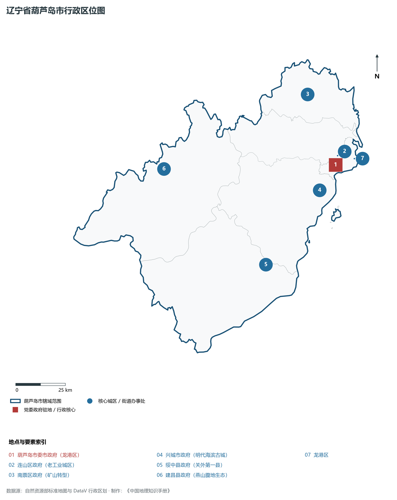
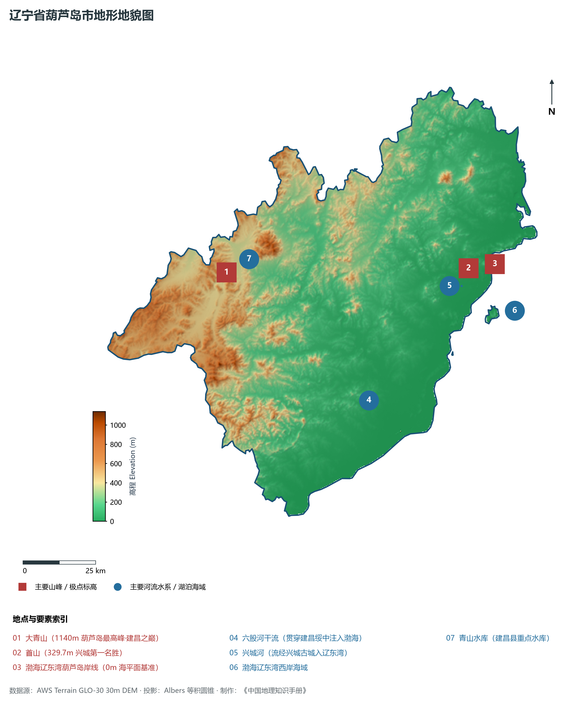
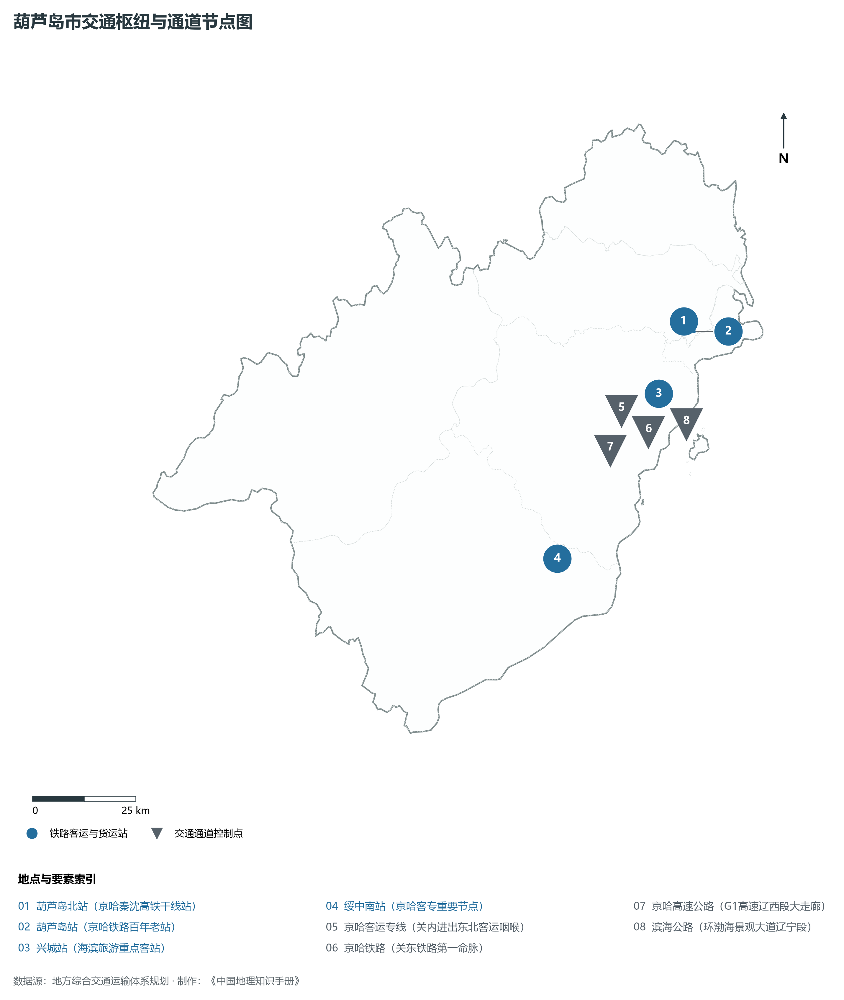
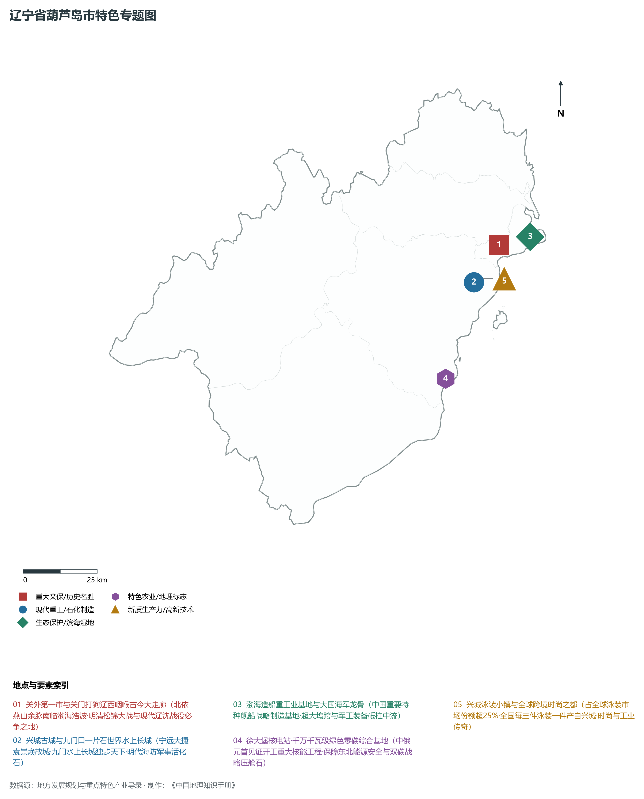
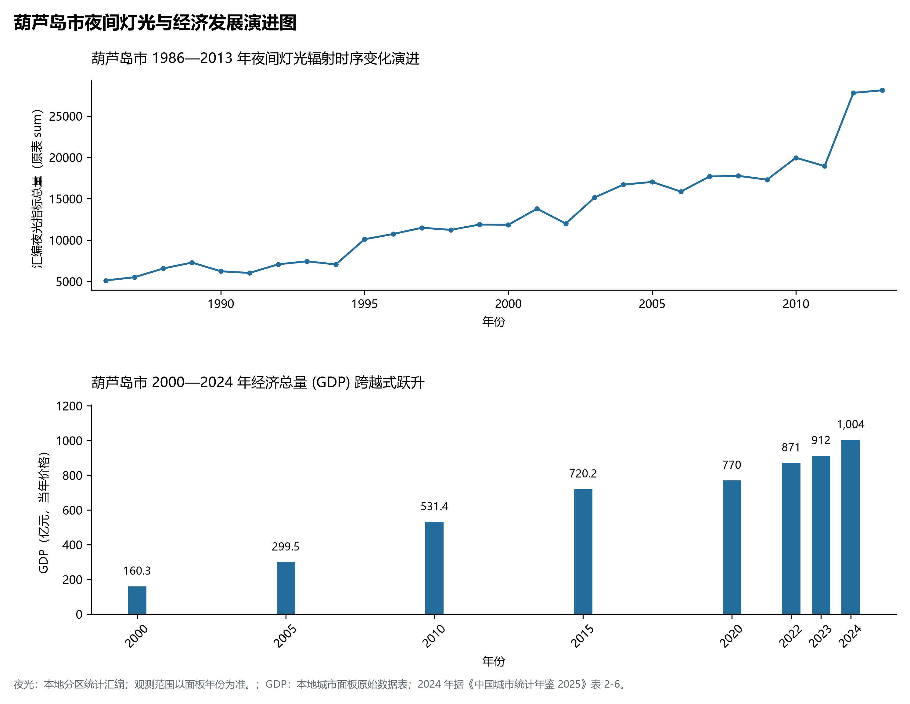

# 5.14 葫芦岛市
葫芦岛市，位于辽宁省，其战略定位与特色概括为：**关外第一市·辽西走廊南咽喉·兴城明代海滨古城·特种船舶重工与徐大堡核电清洁能源基地**。辖区土地。2024 年常住人口 **232 万人**，常住人口城镇化率 **57.32%**，地区生产总值 **1,004 亿元**（当年价格），人均地区生产总值 **43,154 元**，三次产业构成为 **14.8 : 35.8 : 49.39**。

---
## 一、自然地理底盘与地貌水系机理
葫芦岛市在地质构造演化史上隶属于中朝准地台东北缘，基底古老深厚，经中生代燕山造山运动与新生代断裂下陷改造，形成了山脉雄峙、水网环绕、冲积阶地发育的优越自然地理底盘。全境地表高程最低为 **0.0 m**，最高隆起峰顶海拔达 **1140.0 m**，地势落差与微地貌分异造就了多层次的生物多样性与空间资源承载力。

区域主要控制性山脉与地形极点包括：

- **大青山 (1140m 葫芦岛最高峰·建昌之巅)**（坐标约东经 119.750°、北纬 40.750°，高程约 1140.0 m）；
- **首山 (329.7m 兴城第一名胜)**（坐标约东经 120.740°、北纬 40.650°，高程约 329.7 m）；
- **渤海辽东湾葫芦岛岸线 (0m 海平面基准)**（坐标约东经 120.850°、北纬 40.650°，高程约 0.0 m）；

水系与水文网络方面，葫芦岛市地表水资源丰富，骨干河流纵横穿流：

- **六股河干流 (贯穿建昌绥中注入渤海)**（流经约东经 120.250°、北纬 40.300° 水域）：对全市农业灌溉、城市工业供水及生态水网维持发挥核心调蓄作用；
- **兴城河 (流经兴城古城入辽东湾)**（流经约东经 120.700°、北纬 40.600° 水域）：对全市农业灌溉、城市工业供水及生态水网维持发挥核心调蓄作用；
- **渤海辽东湾西岸海域**（流经约东经 120.900°、北纬 40.500° 水域）：对全市农业灌溉、城市工业供水及生态水网维持发挥核心调蓄作用；
- **青山水库 (建昌县重点水库)**（流经约东经 119.850°、北纬 40.780° 水域）：对全市农业灌溉、城市工业供水及生态水网维持发挥核心调蓄作用；

---
## 二、行政区划沿革与城镇空间体系
葫芦岛市历史文脉源远流长，自先秦置郡以来行政建置历经变迁演进。新中国成立后，伴随老工业基地大规模建设与现代化城镇化推进，形成了结构完备、产城紧密融合的市辖区与县级行政单元空间组织体系：

- **葫芦岛市委市政府 (龙港区)**（驻地坐标：120.850°E, 40.720°N）：承担区域行政综合治理、公共资源配置与核心城镇组团功能；
- **连山区政府 (老工业城区)**（驻地坐标：120.870°E, 40.760°N）：承担区域行政综合治理、公共资源配置与核心城镇组团功能；
- **南票区政府 (矿山转型)**（驻地坐标：120.750°E, 41.050°N）：承担区域行政综合治理、公共资源配置与核心城镇组团功能；
- **兴城市政府 (明代海滨古城)**（驻地坐标：120.730°E, 40.620°N）：承担区域行政综合治理、公共资源配置与核心城镇组团功能；
- **绥中县政府 (关外第一县)**（驻地坐标：120.340°E, 40.330°N）：承担区域行政综合治理、公共资源配置与核心城镇组团功能；
- **建昌县政府 (燕山腹地生态)**（驻地坐标：119.820°E, 40.820°N）：承担区域行政综合治理、公共资源配置与核心城镇组团功能；

在城镇空间发展战略上，葫芦岛市依托国土空间总体规划，聚力构建“极核集聚、多组团协同、轴带串联、生态穿插”的现代城镇空间体系，全力推进产城融合与区域一体化协同发展。

---
## 三、综合立体交通网络与交通走廊
葫芦岛市地处东北内陆与沿海交通关键走廊之上，依托高速铁路、干线普铁、国家高速公路与沿海航空/海港码头，构筑了现代化立体综合交通运输骨架：

**主要综合交通客运与货运物流枢纽节点：**

- **葫芦岛北站 (京哈秦沈高铁干线站)**（位置坐标：120.820°E, 40.770°N）：区域客货运流量集散分拨中心；
- **葫芦岛站 (京哈铁路百年老站)**（位置坐标：120.845°E, 40.745°N）：区域客货运流量集散分拨中心；
- **兴城站 (海滨旅游重点客站)**（位置坐标：120.715°E, 40.625°N）：区域客货运流量集散分拨中心；
- **绥中南站 (京哈客专重要节点)**（位置坐标：120.350°E, 40.310°N）：区域客货运流量集散分拨中心；

**核心干线铁路与高等级公路交通走廊：**

- **京哈客运专线 (关内进出东北客运咽喉)**（廊道控制点：120.600°E, 40.600°N）：实现城市对外快速互联互通的高速客货运通道；
- **京哈铁路 (关东铁路第一命脉)**（廊道控制点：120.650°E, 40.580°N）：实现城市对外快速互联互通的高速客货运通道；
- **京哈高速公路 (G1高速辽西段大走廊)**（廊道控制点：120.550°E, 40.520°N）：实现城市对外快速互联互通的高速客货运通道；
- **滨海公路 (环渤海景观大道辽宁段)**（廊道控制点：120.780°E, 40.550°N）：实现城市对外快速互联互通的高速客货运通道；

---
## 四、现代重点产业布局与特色功能组团
在新时代东北全面振兴指引下，葫芦岛市坚持高端化、智能化、绿色化发展方向，加快改造升级传统优势工业，积极培育壮大新兴未来产业，打造特色现代化产业集群：

**重点园区与现代化产业基地：**

- **中国船舶渤海造船重工集团基地**（空间分布：120.980°E, 40.730°N）；
- **徐大堡核电站清洁能源基石 (绥中)**（空间分布：120.550°E, 40.350°N）；
- **兴城泳装现代跨境电商时尚产业园**（空间分布：120.750°E, 40.630°N）；
- **葫芦岛高新技术产业开发区 (精细化工)**（空间分布：120.880°E, 40.750°N）；

**代表性特色地标与战略支撑维度：**

- **关外第一市与关门打狗辽西咽喉古今大走廊**（120.850°E, 40.720°N）：北依燕山余脉南临渤海浩波·明清松锦大战与现代辽沈战役必争之地；
- **兴城古城与九门口一片石世界水上长城**（120.725°E, 40.622°N）：宁远大捷袁崇焕故城·九门水上长城独步天下·明代海防军事活化石；
- **渤海造船重工业基地与大国海军龙骨**（120.980°E, 40.730°N）：中国重要特种舰船战略制造基地·超大坞跨与军工装备砥柱中流；
- **徐大堡核电站·千万千瓦级绿色零碳综合基地**（120.550°E, 40.350°N）：中俄元首见证开工重大核能工程·保障东北能源安全与双碳战略压舱石；
- **兴城泳装小镇与全球跨境时尚之都**（120.750°E, 40.630°N）：占全球泳装市场份额超25%·全国每三件泳装一件产自兴城·时尚与工业传奇；

---
## 五、1986—2013年夜间灯光演变与经济变化分析

本节夜光图的观测年份为 1986—2013 年，指标为行政区汇总值（原表 sum）。

- **1996 年空间发展说明**：连山龙港滨海重工区与锦西化工夜火辉映；
- **2008 年空间发展说明**：兴城海滨旅游区与绥中滨海新城初具雏形；
- **2021 年空间发展说明**：徐大堡核电巨型清洁能源项目全面开工·沿海经济带协同崛起；

| 年份 | 地区生产总值（亿元，当年价格） |
|:---|---:|
| 2000 年 | 160.3 |
| 2005 年 | 299.5 |
| 2010 年 | 531.4 |
| 2015 年 | 720.2 |
| 2020 年 | 770 |
| 2022 年 | 871 |
| 2023 年 | 912 |
| 2024 年 | 1,004 |

---
## 六、文化旅游名胜、生态屏障与可持续人地共生
葫芦岛市高度注重统筹经济高质量发展与高水平生态环境保护，筑牢绿色生态底盘，弘扬优秀历史文化：

- **兴城古城 (全国保存最完整四大明代古城之一)**（位置坐标：120.725°E, 40.622°N）；
- **九门口长城 (世界文化遗产·水上长城独一无二)**（位置坐标：119.740°E, 40.120°N）；
- **觉华岛风景名胜区 (菊花岛·北方第一大岛)**（位置坐标：120.820°E, 40.500°N）；
- **兴城海滨温泉风景名胜区 (国家级)**（位置坐标：120.780°E, 40.610°N）；

在人地协调机制方面，葫芦岛市统筹推进山水林田湖草沙海一体化保护与系统治理，坚决打好蓝天、碧水、净土保卫战，推进传统工矿区生态恢复治理，打造人与自然和谐共生的生态宜居美丽家园。

---
## 七、葫芦岛市关键地理统计指标速查矩阵

| 统计指标项 | 统计数值 / 口径标准 | 空间特征与全省位次说明 |
|:---|:---|:---|
| **行政区划代码** | `211400` | 国家民政部标准行政区划编号 |
| **辖区陆地面积** | **10,415.0** km² | 土地利用类型兼具山地、丘陵、平原与城镇工矿 |
| **常住人口规模** | 232 万人 | 2024 年，全市；年鉴公布口径 |
| **常住人口城镇化率** | 57.32% | 2024 年，全市；年鉴公布口径 |
| **地区生产总值 (2024)** | 1,004 亿元 | 2024 年，全市；年鉴公布口径 |
| **人均 GDP 水平** | 43,154 元/人 | 2024 年，全市；年鉴公布口径 |
| **三次产业结构比** | 14.8 : 35.8 : 49.39 | 2024 年，全市；年鉴公布口径 |
| **地表极限高程** | **0.0 m ～ 1140.0 m** | 形成极具特色的立体地貌剖面格局 |

2024 年统计来源：《中国城市统计年鉴 2025》表 2-1、2-6、2-7（2024 年，全市）。其他年份 GDP 据本地城市面板“原始数据”表，单位为亿元、当年价格。
