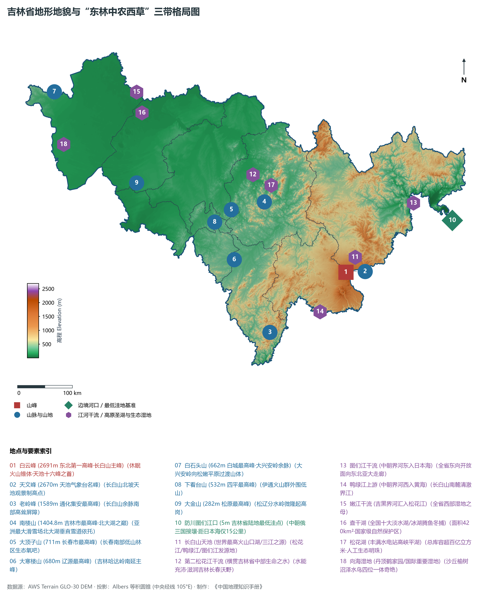
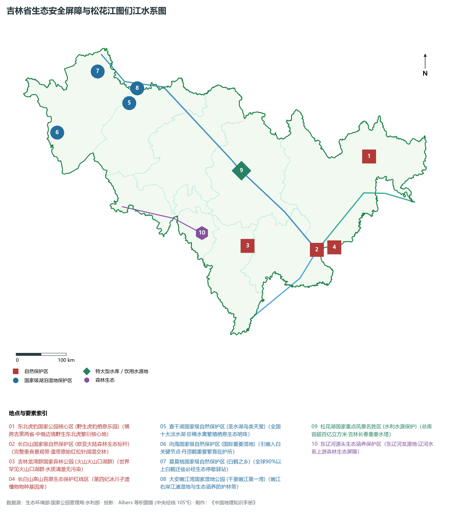
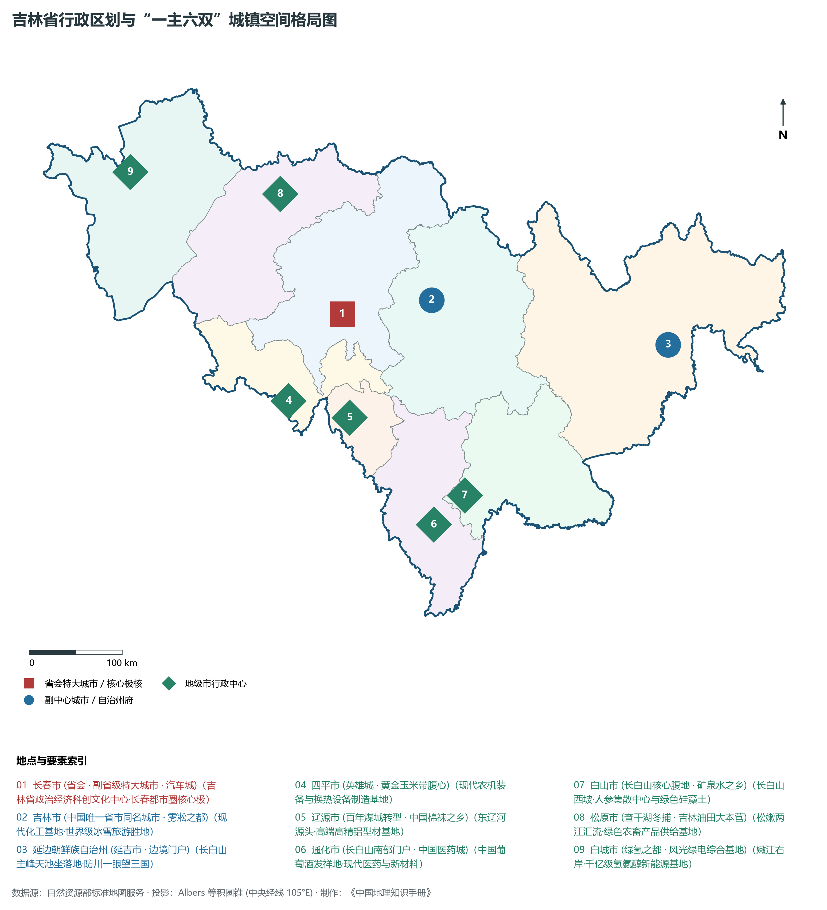
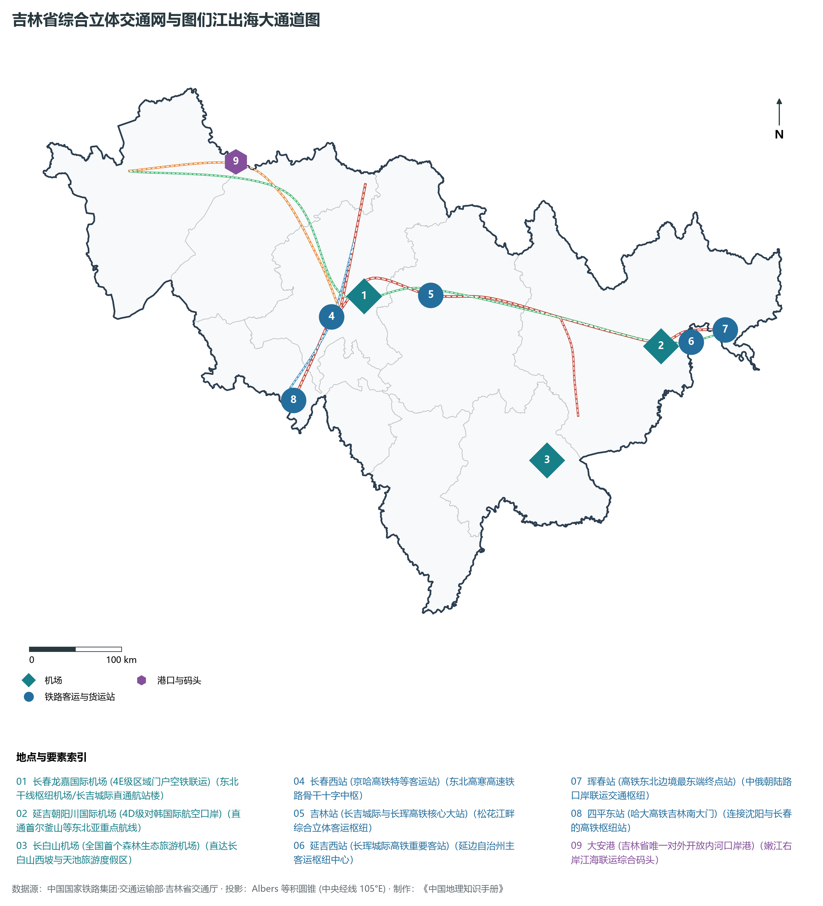
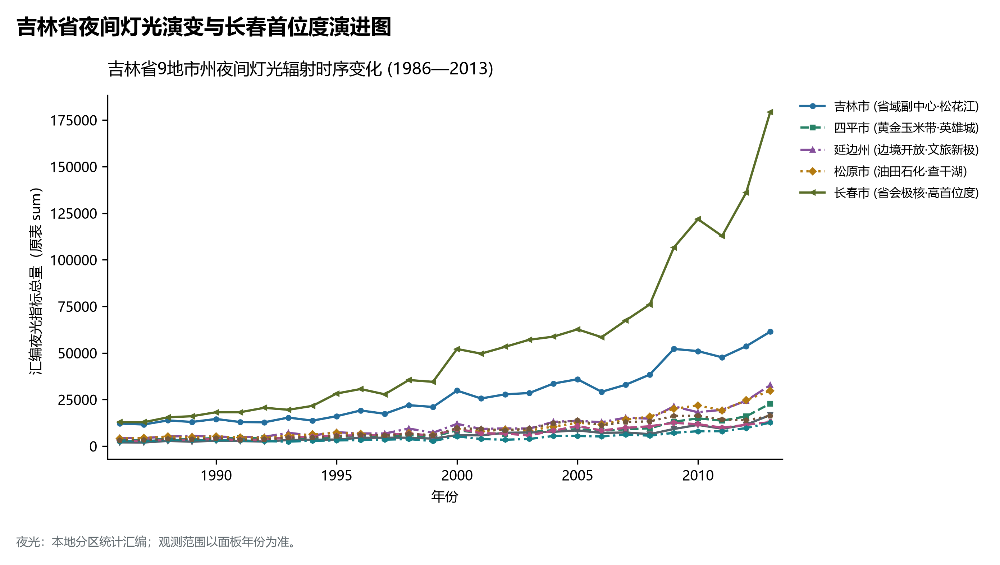

# 6.0 吉林省地理统揽

吉林省，简称“吉”，省会长春市，位于中华人民共和国东北地区中部，地处东经 121° 38' ～ 131° 19'、北纬 40° 50' ～ 46° 19' 之间。全省陆地面积达 18.74 × 10⁴ km²，占全国陆地总面积的 1.95%。吉林省东部与俄罗斯联邦接壤，东南部以图们江、鸭绿江为界与朝鲜民主主义人民共和国隔水相望，边境线总长达 1438.7 km；南连辽宁省，西接内蒙古自治区，北邻黑龙江省。吉林地处东北亚地理几何中心，是联合国开发计划署重点支持的“图们江区域国际合作开发”的核心区，更是我国“一带一路”向北开放的重要前沿与沿边开放战略要地。

吉林全省地貌大势宏观上呈现极为典型的**“东林中农西草”三带空间格局**。长白山脉横亘东部，万木葱茏、群峰竞秀；松辽平原腹心黑土沃野延绵中部，构成世界著名的“黄金玉米带”与国家粮食安全压舱石；松嫩平原西部与科尔沁草原东缘铺展于西部，湖泡棋布、草甸连绵，正加速崛起为我国北方重要的风光绿电与氢氨醇现代能源高地。全省现辖 8 个地级市（长春市、吉林市、四平市、辽源市、通化市、白山市、松原市、白城市）和 1 个自治州（延边朝鲜族自治州），其中包括副省级特大城市长春市。截至 2024 年末，全省常住人口约 2335 万人，常住人口城镇化率达 64.5%。2024 年全省实现地区生产总值（GDP）约 1.42 万亿元。作为新中国工业与农业的“双料脊梁”，吉林诞生了新中国第一辆解放牌载重汽车、第一辆红旗高级轿车、第一列铁路客车、第一袋化肥、第一家商业遥感卫星公司等众多奠基性成果，当前正深入贯彻新时代推动东北全面振兴战略，全力推进“一主六双”高质量发展战略布局。

---

## 一、地质构造演化与“东林中农西草”三带宏观地貌格局

吉林省在大地构造上处于极其复杂的造山带交汇部位：北部属于中亚造山带东延的**兴蒙造山带**，南部属于古老刚硬的**华北克拉通（中朝准地台）东北缘**，二者于古生代末期沿西拉木伦河—延吉缝合带发生碰撞拼接。进入中生代以来，太平洋板块向欧亚大陆俯冲引发大规模岩浆侵入与强烈断陷构造，形成了一系列北北东向的断陷盆地与隆起带；新生代时期，地幔柱热柱上涌与地壳深大断裂活动催生了蔚为壮观的**长白山多期次玄武岩火山溢流喷发**，奠定了现代长白山玄武岩台地与巨大复式火山锥体的壮丽地质基底；与此同时，中部及西部的大型内陆松辽裂陷盆地接受巨厚中新生代湖相及河流冲洪积物充填，最终演化为一望无际的黑土平原台地。

吉林省全境地表高程极值跨度悬殊，垂直地貌梯度落差高达 **2686 m**：

- **全省最高极顶**：位于延边州安图县境内的长白山天池十六峰之首——**白云峰（海拔 2691 m）**，也是整个中国东北大陆的地理最高峰，素有“东北屋脊”之称。
- **全省最低洼出境点**：位于延边州珲春市敬信镇防川村的**图们江出境处（海拔仅约 5 m）**，距日本海仅 15 km，中朝俄三国接壤，“一眼望三国，犬吠惊三疆”。

依据地表形态成因与自然地理特征，全省自东向西呈现极其分明的三大自然地理梯度分异带：

1. **东部山地森林带（长白山地生态屏障区）**：包括延边、白山、通化全境及吉林市东部，平均海拔在 500～ 1500 m 之间。山脉主要由长白山主脉、吉林哈达岭、龙岗山脉、大黑山脉、张广才岭及老爷岭等构成。地貌类型兼具高耸的火山锥体、熔岩台地、低山丘陵与侵蚀峡谷。该区植被茂密，森林覆被率超过 70%，是我国东北乃至东北亚地区最为关键的水源涵养水塔、木材储备基地与野生动植物基因库。
2. **中部黑土平原台地带（松辽平原农业核心区）**：涵盖长春市、四平市全境以及吉林市西部和松原市东南部，平均海拔在 150～ 300 m 之间。主要由松花江、东辽河及其支流（伊通河、饮马河）冲积下沉而成。地表平坦开阔，覆盖着深厚肥沃的黑土、黑钙土与草甸土，有机质含量极高。该带处于全球三大黑土带之一的东北黑土区腹心，气候雨热同季，是享誉世界的“黄金玉米带”与国家核心商品粮调出战略基地。
3. **西部草原湿地湖泡带（松嫩平原生态与绿电区）**：包括白城市全境及松原市西部，平均海拔在 130～ 180 m 之间。属于松嫩平原西南部与科尔沁草原东缘，嫩江与松花江于此交汇。区内地势低洼平缓，封闭性洼地与泡沼星罗棋布，拥有查干湖、向海、莫莫格、大安嫩江湾等著名湿地系统。该区过去受干旱风沙与盐碱化困扰，近年来通过实施“引嫩入白”等重大水利工程推进生态修复，同时依托极为充沛的风光资源，建设国家级千万千瓦级“陆上风光三峡”清洁能源与绿色氢氨醇高地。

**吉林省“东林中农西草”宏观地理剖面示意表**

| 西部草原湿地带 | 中部黑土平原带 | 东部山地森林带 |
| --- | --- | --- |
| (白城/松原风光地)；嫩江/查干湖湿地；盐碱治理与绿氢氨 | (长春/四平黄金粮)；松花江/东辽河冲积；沃野黑土装备造车 | (白山/通化/延边)；白云峰 (2691m)；天池/林海源泉水塔 |

西 (松嫩平原西/白城) · 中 (松辽分水岭平原/长春) · → 东 (长白山脉主峰/延边)；过渡关系：山前台地过渡；低山丘陵过渡；海拔 130~180m · 海拔 150~300m · 海拔 500~2691m；干旱半干旱湿地草甸 · 温带湿润半湿润黑土耕地 · 温带针阔混交与高山苔原

---

## 二、温带季风气候与松花江、图们江、鸭绿江水文网络

吉林省深居亚欧大陆中纬度东部，受东亚大陆和西太平洋季风环流共同影响，属于典型的**温带大陆性季风气候**：

- **热量与四季分明**：全省四季更迭显著，春季干燥多风、回暖迅速；夏季温热多雨、雨热同期；秋季天高气爽、降温剧烈；冬季寒冷漫长、积雪期长达 4 至 6 个月。全省年平均气温在 2～ 6°C 之间，自东南向西北递降。初霜期一般在 9 月下旬，终霜期在 5 月上中旬，无霜期为 100～ 160 d，积温条件高度吻合优质单季玉米、水稻与大豆的生长发育需求。
- **降水梯度由东南向西北阶梯递减**：全省多年平均降水量为 400～ 1000 mm。受长白山山体对来自日本海与黄渤海夏季暖湿气流的强力地形抬升阻挡，东南部通化、白山迎风坡降水量高达 800～ 1100 mm，为全省湿润中心；向西北延伸至松辽平原长春、四平一带减至 550～ 650 mm，属半湿润区；越过大黑山脉深入西北部白城通榆、镇赉一带，年降水量仅 350～ 420 mm，而年蒸发量高达 1500～ 1800 mm，呈现典型的半干旱季风气候。

吉林省是东北亚水系的重要发源地和枢纽区域，境内河流密布，流域面积在 100 km² 以上的河流达 280 余条，分属于松花江、辽河、图们江、鸭绿江四大独立水系：

1. **松花江水系（全省第一大水系）**：
   - **第二松花江（干流）**：发源于长白山天池，全长 958 km。上游水势湍急，穿行于高山峡谷之间，兴建了白山（总库容 64.5× 10⁸ m³）、丰满（总库容 107.8× 10⁸ m³）等巨型水电站与松花湖高峡平湖；中游穿过吉林市区，呈现冬季“江水不冻出雾凇”的地理奇景；下游经松原市三岔河与嫩江汇合后始称松花江干流，向北奔流出省汇入黑龙江。松花江流域涵盖全省面积的 40% 以上，是吉林工业、农业与城乡供水的核心命脉。
   - **嫩江**：吉黑两省天然界河，自西北向东南流经白城大安，水面宽阔、河曲发育。
2. **图们江水系（中朝界河与向东出海通道）**：
   - 发源于长白山主峰东麓圆池，全长 525 km，在延边州境内蜿蜒向东注入日本海。中上游流经和龙、龙井、延吉、图们，下游穿过珲春市。图们江下游距日本海口仅十数公里，是中国内陆通往日本海、走向东北亚与北极航道的最短水运陆港大通道。
3. **鸭绿江水系（中朝界河南段水塔）**：
   - 发源于长白山南麓天池南侧，全长 795 km，在吉林境内流经长白朝鲜族自治县、临江市、集安市，穿行于深山险隘之间。上游建有云峰特大型水电站，沿岸森林繁茂、悬崖对峙，是著名的边境生态画廊与红色抗美援朝出征咽喉。
4. **辽河水系（东辽河）**：
   - 发源于吉林省辽源市东丰县小寒葱顶山，向西横贯辽源、四平两市，注入辽宁省昌图县福德店与西辽河汇流。东辽河全长 360 km，是辽源与四平两座历史名城的摇篮，滋润着辽河流域广袤黑土地。
5. **重要湖泊与湿地生态系统**：
   - **长白山天池**：位于海拔 2189.1 m 的火山口盆地中，平均水深 204 m，最大水深达 373 m，总蓄水量达 20.4× 10⁸ m³，是我国最高、最深的火山口湖，松花江、图们江、鸭绿江三大江河的三江之源。
   - **查干湖**：位于松原前郭尔罗斯境内，水域面积达 420 km²，为全省第一大天然淡水湖，“查干湖冬捕”入选国家级非物质文化遗产。
   - **向海与莫莫格湿地**：国家级自然保护区，被列入国际重要湿地名录，是白鹤、丹顶鹤等珍稀候鸟南北迁徙的全球核心停歇繁殖圣地。

---

## 三、行政区划、人口与“一主六双”城镇空间发展格局

吉林省现辖 8 个地级市、1 个自治州，下设 20 个市辖区、20 个县级市、16 个县、3 个自治县，共 59 个县级行政区。全省常住人口空间分布呈现“长春单核高度集聚、吉林市为次中心、沿哈大中轴与长珲客运轴密集分布、东西两翼山水相依疏朗”的格局。

按照吉林省深入推动新时代东北全面振兴战略与《吉林省国土空间规划（2021—2035年）》，吉林全面构筑了**“一主六双”高质量发展战略格局**：

1. **“一主”：长春现代化都市圈**：以省会长春为核心，涵盖公主岭、九台、双阳及周边协同区，发挥副省级城市和国家创新型城市的强力辐射牵引作用。做强万亿级汽车产业集群（中国一汽根据地）、千亿级光电信息产业集群、现代生物医药与高端农机产业，打造东北亚区域创新极核。
2. **“六双”重大战略支撑平台**：
   - **双廊**：
     - *长辽通白延医药健康产业走廊*：串联长春、辽源、通化、白山、延边，依托长白山道地药材与长春国家级医药基地，打造世界级现代中药与生物医药基地；
     - *长吉珲大通道*：依托长春、吉林、延边珲春快速通道，打造面向东北亚向海图强开放走廊。
   - **双带**：
     - *沿边开放旅游经济带*：沿集安、临江、长白、和龙、龙井、图们、珲春中朝俄边境线，打造千里边境风情画卷与开放高地；
     - *沿中俄朝边境开放带*：做深做实珲春海洋经济发展示范区，构建多国边境贸易枢纽。
   - **双线**：
     - *东部生态旅游线*：以长白山为龙头，串联通化、白山、延边原始林海、温泉、红色遗迹与冰雪资源；
     - *西部湿地生态旅游线*：以查干湖、向海、莫莫格为纽带，打响生态湿地、科尔沁草原文化与观鹤冬捕名片。
   - **双通道**：
     - *长吉珲向东出海通道*：经珲春出境利用俄罗斯扎鲁比诺港、符拉迪沃斯托克港发展“内贸外运”与跨国航运；
     - *白松长通至丹东向南出海通道*：打通吉林内陆纵贯向南、连接辽宁丹东港与营口港的陆海联运通道。
   - **双基地**：
     - *中部现代农业高新技术产业基地*：以公主岭国家农高区和长春、四平黑土地保护区为核心，打造现代农业硅谷；
     - *西部国家级清洁能源基地*：在白城、松原打造“风光水火氢氨醇”一体化千万千瓦级清洁能源基地。
   - **双协同**：
     - *长吉一体化协同*：推动长春与吉林两市基础设施互联互通、产业分工协同、生态共建共治，打造“长吉半小时经济圈”；
     - *长平一体化协同*：推动长春与四平深度融合，打破行政边界，构筑吉林南部产业隆起带。

| 行政区划单元 | 驻地行政区 | 面积 (km²) | 常住人口 (万人) | 城镇化率 (%) | 发展定位与核心功能优势 |
|:---|:---|:---|:---|:---|:---|
| **长春市** | 南关区 | 24,744 | 909 | 68.43 | 省会、副省级市、特大城市、中国汽车城、光电摇篮、农高区 |
| **吉林市** | 船营区 | 27,120 | 349 | 66.78 | 省市同名城市、化工新材料、雾凇冰雪胜地、丰满水电之源 |
| **四平市** | 铁西区 | 14,323 | 164 | 55.01 | 英雄城、东北交通咽喉、黄金玉米带核心区、现代农机制造 |
| **辽源市** | 龙山区 | 5,140 | 92 | 61.71 | 辽河源头、中国袜业名城、高精铝合金、资源枯竭型城市转型 |
| **通化市** | 东昌区 | 15,611 | 117 | 64.26 | 中国医药城、长白山葡萄酒乡、高句丽世界文化遗产、抗联摇篮 |
| **白山市** | 浑江区 | 17,505 | 89 | 81.12 | 长白山腹地生态水塔、中国人参之乡、优质矿泉水之乡、生态康养 |
| **松原市** | 宁江区 | 22,034 | 209 | 50.68 | 吉林油田根据地、查干湖冬捕非遗圣地、松花江嫩江交汇水乡 |
| **白城市** | 洮北区 | 25,758 | 145 | 57.88 | 陆上风光三峡绿电基地、向海鹤乡、生态治碱、现代农牧业 |
| **延边朝鲜族自治州** | 延吉市 | 43,329 | 192.0 | 74.0 | 全国最大朝鲜族聚居地、长白山天池主景区、边境开放枢纽 |

---

## 四、综合立体交通网络与图们江向海图强大通道

吉林省位于东北亚几何中心，历史以来即为关东平原与长白山地的交通要道。新时代以来，全省全力推进综合立体交通网建设，构筑起贯通南北、承东启西、面向大海的高铁公路与空港大通道：

1. **高等级干线铁路与高速客运网络**：
   - **京哈高铁（哈大段）**：国家“八纵八横”高速铁路网京哈—京港澳通道重要组成部分，设计时速 350 km/h，纵贯四平、公主岭、长春、德惠，是吉林连接北京、沈阳与哈尔滨的超高速骨干动脉；
   - **长珲城际铁路（吉图珲客专）**：西起长春，经吉林市、蛟河、敦化、安图、延吉、图们，终至边境城市珲春，被誉为“东北最美高铁”，彻底打通了长吉腹地直达图们江中朝俄边境的旅游与商务快道；
   - **敦白客专（长白山高铁）**：连接敦化与长白山池北区（安图二道白河），将长白山天池脚下直接接入国家高铁网；
   - **沈白高铁（在建）**：由沈阳经抚顺、通化、白山直通长白山，将构筑吉林东南部山地融入环渤海与京津冀的全新时速 350 km/h 大动脉。
2. **国家高速公路骨架网**：
   - **京哈高速（G1）**：横贯平原腹地，双向八车道大通道；
   - **珲乌高速（G12）**：横向骨干大动脉，东起珲春防川口岸，经延吉、吉林、长春、松原、白城，直至内蒙古乌兰浩特，串联吉林省东西两翼所有核心地市；
   - **大广高速（G45）**与**鹤大高速（G11）**：分别纵贯西部大平原与东部长白山脉。
3. **图们江出海大通道与内贸外运航线**：
   - 吉林省虽然属于内陆省份，但珲春市区距日本海仅数十公里。通过中俄、中朝边境铁路公路口岸，吉林常态化开通了经俄罗斯扎鲁比诺港、符拉迪沃斯托克（海参崴）港至我国东南沿海宁波、上海、广州等地的“内贸货物跨境运输”海上航线，以及直达日本新潟、韩国釜山的国际陆海联运大通道，实现了从“内陆腹地”向“借港出海”的战略跨越。
4. **民用航空枢纽布局**：
   - 全省构建了“一枢纽、多支线”的民航网络：**长春龙嘉国际机场（4E级）**为区域大型枢纽机场，实现空铁地下无缝联运；**延吉朝阳川国际机场**为东北重要支线与对韩国际口岸；辅以长白山机场、通化三源浦机场、白城长安机场、松原查干湖机场，全面覆盖重点生态旅游与工矿节点。

---

## 五、1986—2013年夜间灯光时序演进与长春极核首位度分析

本节夜光图的观测年份为 1986—2013 年，指标为行政区汇总值（原表 sum）。

1. **时序演进的三个鲜明历史阶段**：
2. **长春极核首位度及其空间外溢效应**：
   - 近年来，长春通过“一主六双”战略全力打破“单核过热”，积极推动产业与要素向吉林市、四平市、辽源市等周边腹地外溢，形成了具有紧密产业配套关系的半小时至一小时紧密经济协同圈。

---

## 六、长白山生态安全屏障、黑土地国家粮仓与向北开放新高地

站在人地关系地域系统与新时代国家战略安全的全局高度审视，吉林省肩负着维护**国家粮食安全、生态安全、国防安全、产业安全、能源安全**的五大重任，具有不可替代的全局战略地位：

1. **世界级“长白山生态水塔”与生物多样性庇护所**：
   - 长白山是东北亚大陆的生态制高点，不仅是松花江、图们江、鸭绿江的“三江之源”，更完好保存了欧亚大陆东岸最为典型的高山火山天池苔原与温带针阔叶混交林群落。
   - **东北虎豹国家公园**：面积跨吉林、黑龙江两省达 1.41× 10⁴ km²，其中吉林片区占三分之二以上，野生东北虎、东北豹种群实现爆发式恢复增长，成为全球野生濒危大猫保护的旗舰典范。
2. **东北“黄金玉米带”与用好养好黑土地的“梨树模式”**：
   - 吉林省地处世界三大黑土带核心区，耕地面积超过 1.1 亿亩，正常年份粮食产量连续跨越 800 亿斤台阶，单产水平稳居全国粮食主产省前列。
   - 创造性探索并在全国推广以“秸秆覆盖、免耕播种、保墒培肥”为核心的**“梨树模式”**，有效遏制了黑土层变薄、变瘦、变硬退化，使黑土地重现“抓一把攥出油”的肥沃生机，为大国粮仓夯实最深厚的土壤底盘。
3. **“双碳”战略先行者：西部“陆上风光三峡”与绿氢绿氨高地**：
   - 充分发挥吉林西部风能、太阳能富集优势，大规划布局建设装机达数千万千瓦的新能源基地。以白城、松原为支点，创新推动“绿电转化为绿氢、绿氨、绿醇”，摆脱对远距离特高压外送单一依赖，就地孵化绿色零碳化工与新质生产力，成为全国绿色能源转型的样板省份。
4. **图们江区域沿边开放向海图强新前沿**：
   - 吉林面向东北亚三国两海，以珲春为战略桥头堡，深度融入中俄蒙经济走廊与“冰上丝绸之路”建设。边境口岸通关效率跃升、跨境电商试验区加速推进、跨境铁路集装箱专列常态化运营，为推动我国沿边高水平开放构筑起前沿开放新窗口。

地市统计来源：《中国城市统计年鉴 2025》表 2-1、2-6、2-7（2024 年，全市）。
