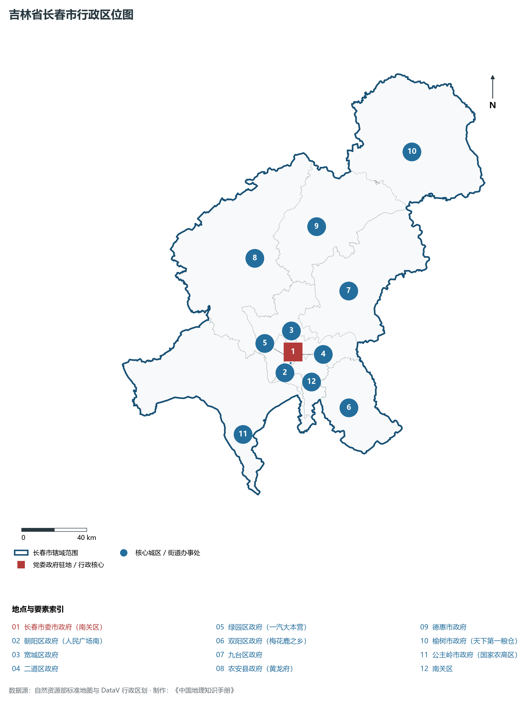
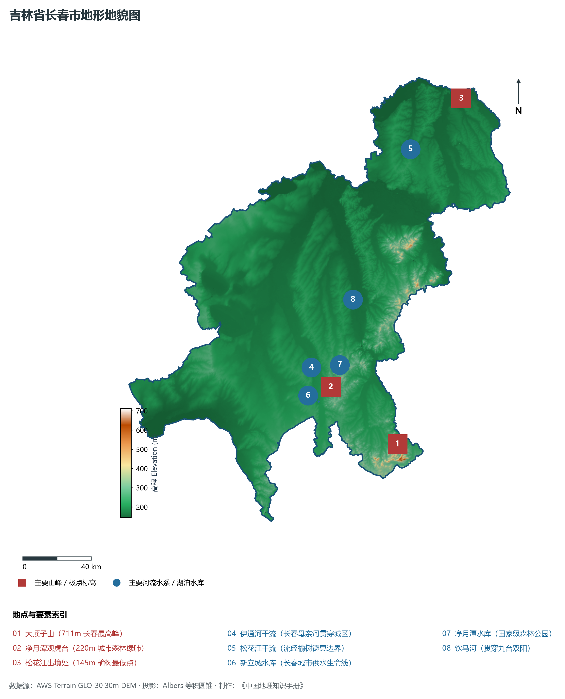
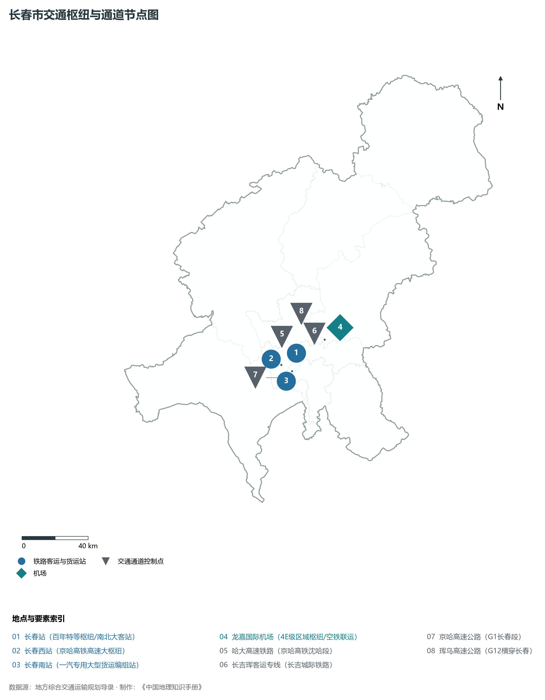
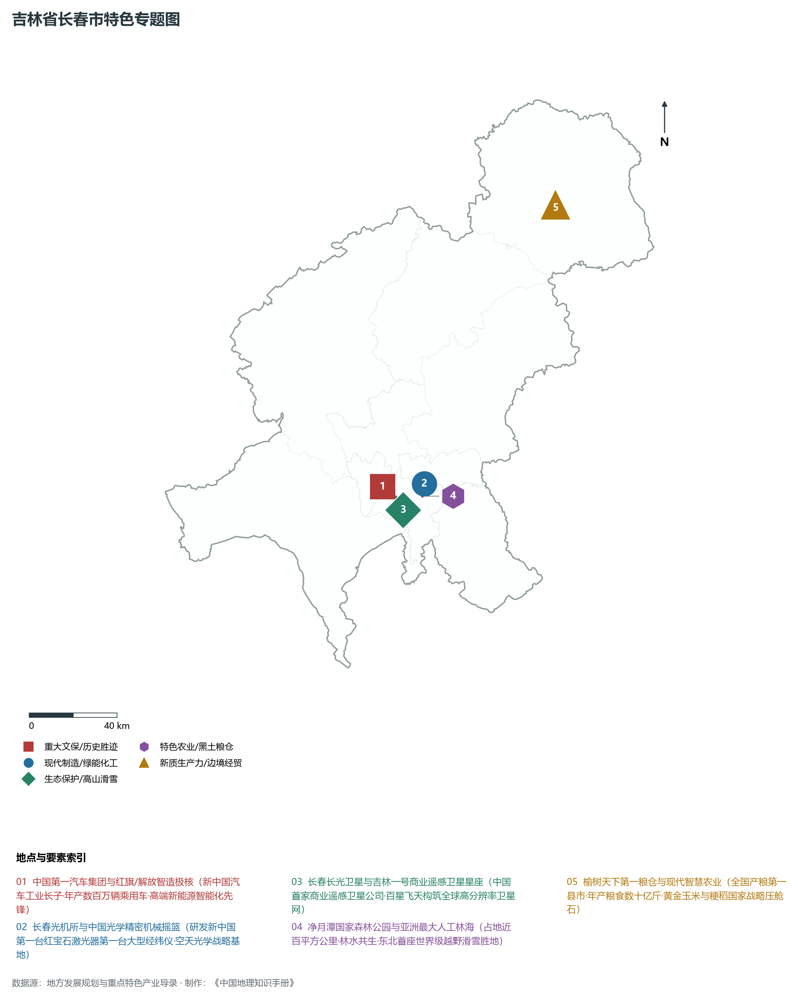
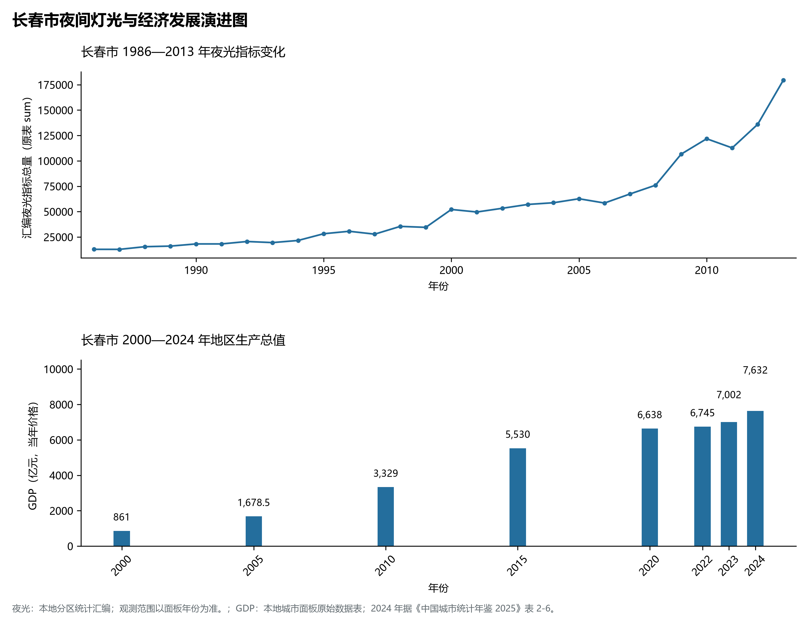

# 6.1 长春市

长春市位于吉林省中部，是省会与副省级城市，也是中国重要的汽车、光电和生物医药产业基地。2024 年常住人口 **909 万人**，常住人口城镇化率 **68.43%**，地区生产总值 **7,632 亿元**（当年价格），人均地区生产总值 **83,930 元**，三次产业构成为 **6.65 : 35.37 : 57.99**。

---

## 一、自然地理底盘与地貌水系机理

区域骨干控制性山脉与地形高程极点包括：

- **大顶子山 (711m 长春最高峰)**（坐标约东经 125.850°、北纬 43.420°，高程约 711.0 m）；
- **净月潭观虎台 (220m 城市森林绿肺)**（坐标约东经 125.460°、北纬 43.780°，高程约 220.0 m）；
- **松花江出境处 (145m 榆树最低点)**（坐标约东经 126.850°、北纬 45.100°，高程约 145.0 m）；

水系与水文网络方面，长春市地表水资源丰富，骨干江河湖泊纵横穿流：

- **伊通河干流 (长春母亲河贯穿城区)**（流经约东经 125.350°、北纬 43.900° 水域）；
- **松花江干流 (流经榆树德惠边界)**（流经约东经 126.400°、北纬 44.900° 水域）；
- **新立城水库 (长春城市供水生命线)**（流经约东经 125.350°、北纬 43.720° 水域）；
- **净月潭水库 (国家级森林公园)**（流经约东经 125.440°、北纬 43.790° 水域）；
- **饮马河 (贯穿九台双阳)**（流经约东经 125.750°、北纬 44.200° 水域）；

---

## 二、行政区划沿革与城镇空间体系

长春市历史文脉积淀深厚，建置沿革源远流长。新中国成立以来，伴随国家重点工程布局、老工业基地建设与新型城镇化战略推进，形成了梯次鲜明、产城紧密融合的市辖区与县级行政单元空间组织体系：

- **长春市委市政府 (南关区)**（驻地坐标：125.324°E, 43.886°N）；
- **朝阳区政府 (人民广场南)**（驻地坐标：125.288°E, 43.830°N）；
- **宽城区政府**（驻地坐标：125.326°E, 43.940°N）；
- **二道区政府**（驻地坐标：125.375°E, 43.865°N）；
- **绿园区政府 (一汽大本营)**（驻地坐标：125.255°E, 43.880°N）；
- **双阳区政府 (梅花鹿之乡)**（驻地坐标：125.655°E, 43.525°N）；
- **九台区政府**（驻地坐标：125.840°E, 44.150°N）；
- **农安县政府 (黄龙府)**（驻地坐标：125.180°E, 44.430°N）；
- **德惠市政府**（驻地坐标：125.700°E, 44.530°N）；
- **榆树市政府 (天下第一粮仓)**（驻地坐标：126.550°E, 44.820°N）；
- **公主岭市政府 (国家农高区)**（驻地坐标：124.820°E, 43.500°N）；

在城镇空间总体布局上，长春市紧扣《国土空间总体规划》，坚持“极核集聚、轴带贯通、组团联动、绿色涵养”的总体思路，统筹协调中心城区扩容提质与县域城镇特色发展，构建多中心、网络化、集约型的空间发展格局。

---

## 三、综合立体交通网络与交通走廊

长春市地处东北地区立体交通网络关键节点，依托高速铁路、干线普速铁路、国家高速公路与航空口岸，构筑了四通八达的现代化立体综合交通运输骨架：

**主要综合客运与货运物流交通枢纽节点：**

- **长春站 (百年特等枢纽/南北大客站)**（位置坐标：125.320°E, 43.910°N）；
- **长春西站 (京哈高铁高速大枢纽)**（位置坐标：125.190°E, 43.865°N）；
- **龙嘉国际机场 (4E级区域枢纽/空铁联运)**（位置坐标：125.685°E, 43.996°N）；
- **长春南站 (一汽专用大型货运编组站)**（位置坐标：125.260°E, 43.820°N）；

**核心干线铁路与高等级公路交通走廊：**

- **哈大高速铁路 (京哈高铁沈哈段)**（廊道控制点：125.220°E, 43.950°N）：对外快速互联互通的高速客货运通道；
- **长吉珲客运专线 (长吉城际铁路)**（廊道控制点：125.550°E, 43.950°N）：对外快速互联互通的高速客货运通道；
- **京哈高速公路 (G1长春段)**（廊道控制点：125.150°E, 43.800°N）：对外快速互联互通的高速客货运通道；
- **珲乌高速公路 (G12横穿长春)**（廊道控制点：125.400°E, 44.050°N）：对外快速互联互通的高速客货运通道；

---

## 四、现代重点产业布局与特色功能组团

在新时代推动东北全面振兴战略引领下，长春市紧扣高质量发展首要任务，深度融入全省“一主六双”高质量发展战略格局，加快传统优势产业转型升级，培育壮大新兴战略性产业链群，全力打造特色鲜明的现代化产业高地：

**重点园区与现代化产业承载基地：**

- **中国第一汽车集团总部及红旗繁荣工厂**（空间分布：125.240°E, 43.850°N）；
- **长春汽车经济技术开发区 (国家级经开区)**（空间分布：125.220°E, 43.830°N）；
- **长春高新技术产业开发区 (生物医药基地)**（空间分布：125.260°E, 43.810°N）；
- **中科院长春光机所 (中国光学摇篮)**（空间分布：125.390°E, 43.840°N）；
- **长春农高区 (吉林公主岭国家农高区)**（空间分布：124.850°E, 43.520°N）；

**代表性特色地标与战略支撑维度：**

- **中国第一汽车集团与红旗/解放智造极核**（125.240°E, 43.850°N）：新中国汽车工业长子·年产数百万辆乘用车·高端新能源智能化先锋；
- **长春光机所与中国光学精密机械摇篮**（125.390°E, 43.840°N）：研发新中国第一台红宝石激光器第一台大型经纬仪·空天光学战略基地；
- **长春长光卫星与吉林一号商业遥感卫星星座**（125.300°E, 43.800°N）：中国首家商业遥感卫星公司·百星飞天构筑全球高分辨率卫星网；
- **净月潭国家森林公园与亚洲最大人工林海**（125.450°E, 43.780°N）：占地近百平方公里·林水共生·东北首座世界级越野滑雪胜地；
- **榆树天下第一粮仓与现代智慧农业**（126.550°E, 44.820°N）：全国产粮第一县市·年产粮食数十亿斤·黄金玉米与粳稻国家战略压舱石；

---

## 五、1986—2013年夜间灯光演变与经济变化分析

本节夜光图的观测年份为 1986—2013 年，指标为行政区汇总值（原表 sum）。

**城市发展背景：**

- 人民广场和一汽厂区是长春老城区的重要功能节点。
- 净月与长春高新区构成城市发展的重要空间。
- 公主岭划归长春代管后，城市行政范围发生调整。

2024 年长春市全市地区生产总值为 7,632 亿元（当年价格）。

| 年份 | 地区生产总值（亿元，当年价格） |
|:---|---:|
| 2000 年 | 861 |
| 2005 年 | 1,678.5 |
| 2010 年 | 3,329 |
| 2015 年 | 5,530 |
| 2020 年 | 6,638 |
| 2022 年 | 6,745 |
| 2023 年 | 7,002 |
| 2024 年 | 7,632 |

数值为当年价格，不能直接作为剔除价格因素后的增长率。2024 年数据据《中国城市统计年鉴 2025》表 2-6；其余年份据本地城市面板原始数据表。

---

## 六、文化旅游名胜、生态屏障与可持续人地共生

长春市高度注重统筹经济高质量发展与高水平生态环境保护，筑牢绿色生态底盘，弘扬优秀历史文化：

- **伪满皇宫博物院 (5A·国家一级博物馆)**（位置坐标：125.340°E, 43.905°N）；
- **长春净月潭国家级风景名胜区 (5A)**（位置坐标：125.450°E, 43.780°N）；
- **长影世纪城与长春电影制片厂**（位置坐标：125.430°E, 43.750°N）；
- **农安辽塔 (黄龙府千年古塔)**（位置坐标：125.185°E, 44.435°N）；

在人地协调机制方面，长春市统筹推进山水林田湖草沙一体化保护与系统治理，坚决打好蓝天、碧水、净土保卫战，筑牢长白山林区水塔屏障与平原黑土地粮仓，打造人与自然和谐共生的生态宜居美丽家园。

---

## 七、长春市关键地理统计指标速查矩阵

| 统计指标项 | 统计数值 / 口径标准 | 空间特征与全省位次说明 |
|:---|:---|:---|
| **行政区划代码** | `220100` | 国家民政部标准行政区划编号 |
| **辖区陆地面积** | **24,744.0** km² | 土地利用类型兼具山地、丘陵、平原与城镇工矿 |
| **常住人口规模（2024 年末）** | 909 万人 | 2024 年，全市；年鉴公布口径 |
| **常住人口城镇化率（2024 年）** | 68.43% | 2024 年，全市；年鉴公布口径 |
| **地区生产总值（2024 年）** | 7,632 亿元 | 2024 年，全市；年鉴公布口径 |
| **人均 GDP（2024 年）** | 83,930 元/人 | 2024 年，全市；年鉴公布口径 |
| **三次产业结构比（2024 年）** | 6.65 : 35.37 : 57.99 | 2024 年，全市；年鉴公布口径 |
| **地表极限高程** | **145.0 m ～ 711.0 m** | 形成极具特色的立体地貌剖面格局 |

2024 年统计来源：《中国城市统计年鉴 2025》表 2-1、2-6、2-7（2024 年，全市）。其他年份 GDP 据本地城市面板“原始数据”表，单位为亿元、当年价格。
