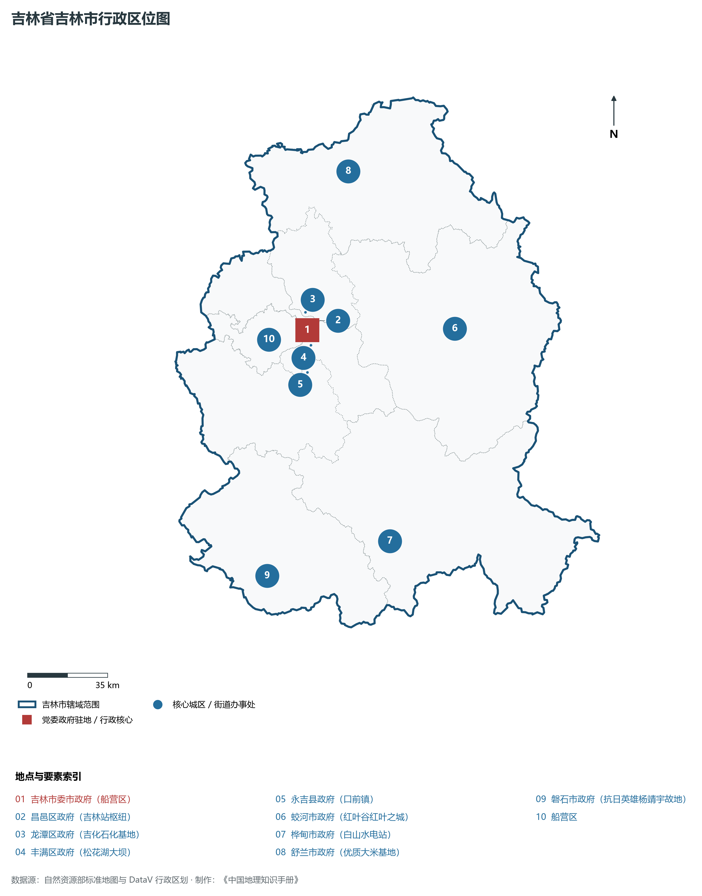
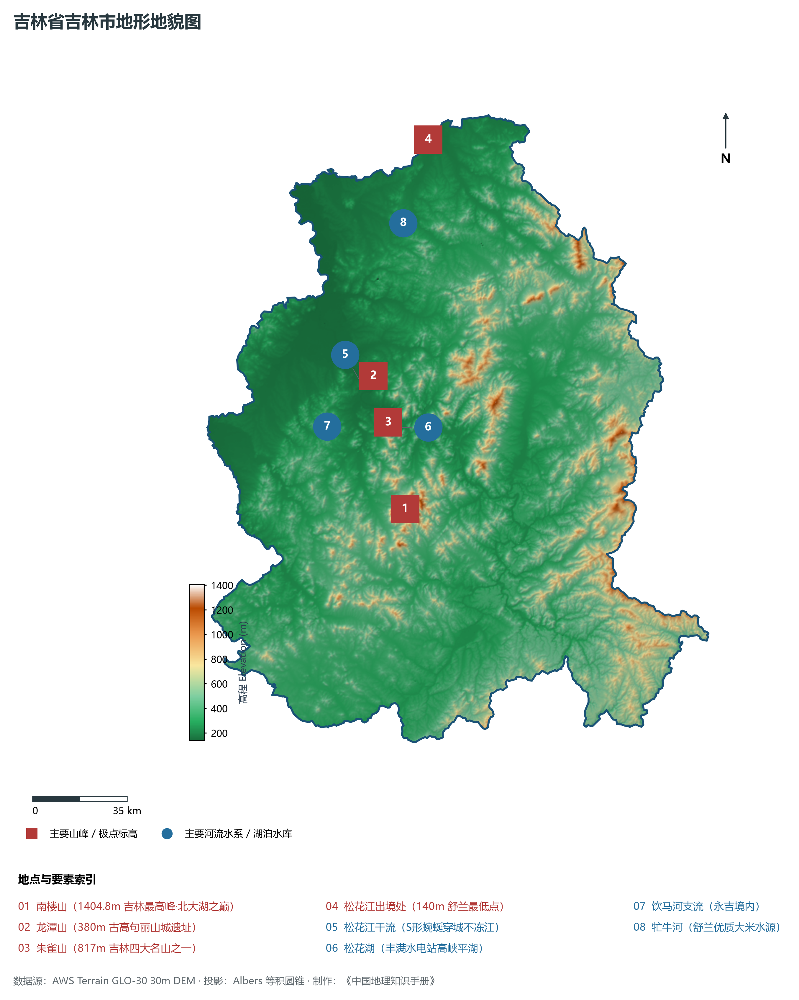
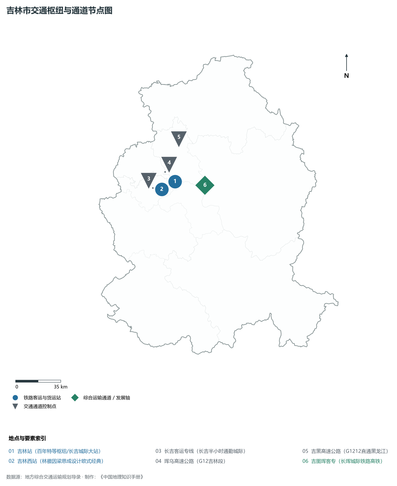
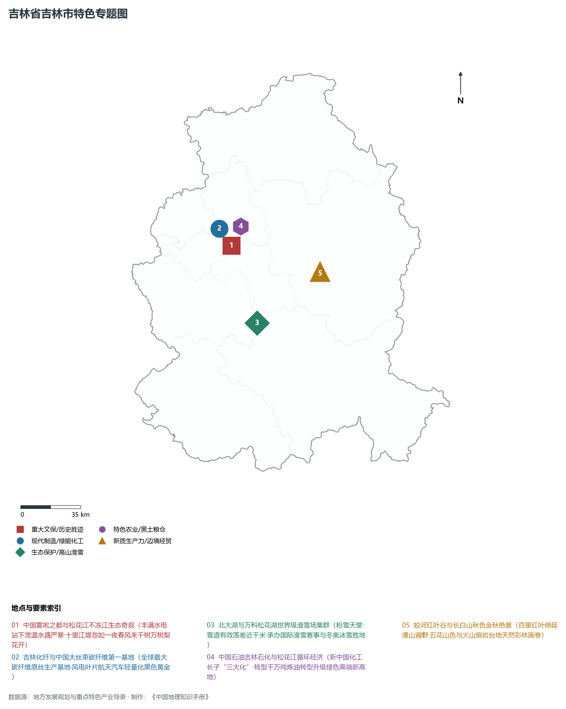
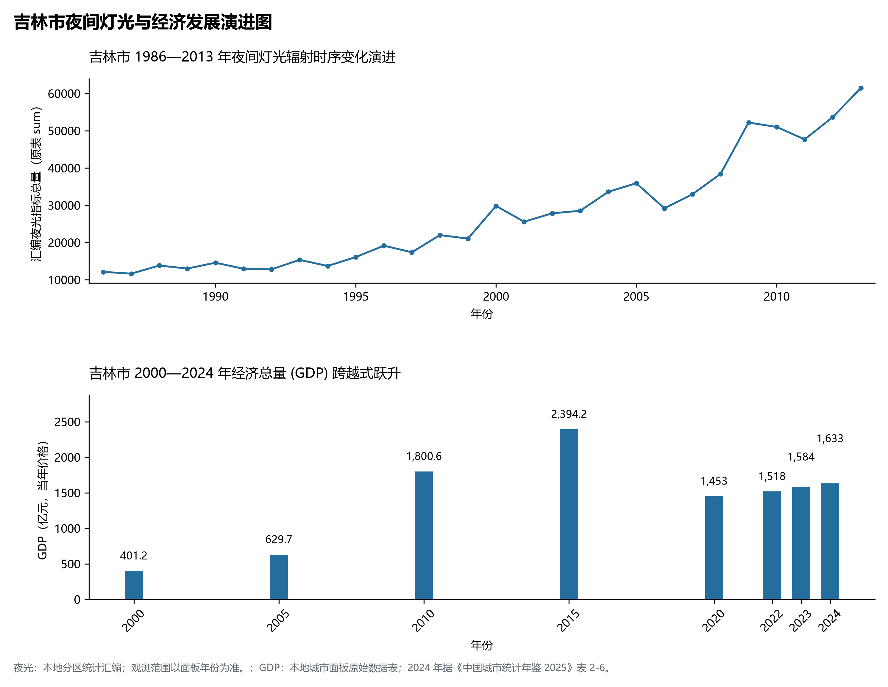

# 6.2 吉林市

吉林市，位于吉林省，其战略定位与特色概括为：**中国唯一省市同名城市·松花江呈S形穿城·“雾凇之都”·中国化工城与世界滑雪胜地**。2024 年常住人口 **349 万人**，常住人口城镇化率 **66.78%**，地区生产总值 **1,633 亿元**（当年价格），人均地区生产总值 **46,511 元**，三次产业构成为 **12.25 : 36.17 : 51.59**。

---

## 一、自然地理底盘与地貌水系机理

区域骨干控制性山脉与地形高程极点包括：

- **南楼山 (1404.8m 吉林最高峰·北大湖之巅)**（坐标约东经 126.620°、北纬 43.430°，高程约 1404.8 m）；
- **龙潭山 (380m 古高句丽山城遗址)**（坐标约东经 126.610°、北纬 43.880°，高程约 380.0 m）；
- **朱雀山 (817m 吉林四大名山之一)**（坐标约东经 126.630°、北纬 43.720°，高程约 817.0 m）；
- **松花江出境处 (140m 舒兰最低点)**（坐标约东经 127.100°、北纬 44.600°，高程约 140.0 m）；

水系与水文网络方面，吉林市地表水资源丰富，骨干江河湖泊纵横穿流：

- **松花江干流 (S形蜿蜒穿城不冻江)**（流经约东经 126.550°、北纬 43.860° 水域）；
- **松花湖 (丰满水电站高峡平湖)**（流经约东经 126.650°、北纬 43.700° 水域）；
- **饮马河支流 (永吉境内)**（流经约东经 126.350°、北纬 43.750° 水域）；
- **牤牛河 (舒兰优质大米水源)**（流经约东经 126.900°、北纬 44.350° 水域）；

---

## 二、行政区划沿革与城镇空间体系

吉林市历史文脉积淀深厚，建置沿革源远流长。新中国成立以来，伴随国家重点工程布局、老工业基地建设与新型城镇化战略推进，形成了梯次鲜明、产城紧密融合的市辖区与县级行政单元空间组织体系：

- **吉林市委市政府 (船营区)**（驻地坐标：126.550°E, 43.840°N）；
- **昌邑区政府 (吉林站枢纽)**（驻地坐标：126.570°E, 43.875°N）；
- **龙潭区政府 (吉化石化基地)**（驻地坐标：126.560°E, 43.910°N）；
- **丰满区政府 (松花湖大坝)**（驻地坐标：126.550°E, 43.780°N）；
- **永吉县政府 (口前镇)**（驻地坐标：126.500°E, 43.680°N）；
- **蛟河市政府 (红叶谷红叶之城)**（驻地坐标：127.340°E, 43.720°N）；
- **桦甸市政府 (白山水电站)**（驻地坐标：126.740°E, 42.970°N）；
- **舒兰市政府 (优质大米基地)**（驻地坐标：126.960°E, 44.410°N）；
- **磐石市政府 (抗日英雄杨靖宇故地)**（驻地坐标：126.050°E, 42.940°N）；

在城镇空间总体布局上，吉林市紧扣《国土空间总体规划》，坚持“极核集聚、轴带贯通、组团联动、绿色涵养”的总体思路，统筹协调中心城区扩容提质与县域城镇特色发展，构建多中心、网络化、集约型的空间发展格局。

---

## 三、综合立体交通网络与交通走廊

吉林市地处东北地区立体交通网络关键节点，依托高速铁路、干线普速铁路、国家高速公路与航空口岸，构筑了四通八达的现代化立体综合交通运输骨架：

**主要综合客运与货运物流交通枢纽节点：**

- **吉林站 (百年特等枢纽/长吉城际大站)**（位置坐标：126.575°E, 43.870°N）；
- **吉林西站 (林徽因梁思成设计欧式经典)**（位置坐标：126.510°E, 43.825°N）；

**核心干线铁路与高等级公路交通走廊：**

- **长吉客运专线 (长吉半小时通勤城际)**（廊道控制点：126.350°E, 43.860°N）：对外快速互联互通的高速客货运通道；
- **吉图珲客专 (长珲城际铁路高铁)**（廊道控制点：126.850°E, 43.800°N）：对外快速互联互通的高速客货运通道；
- **珲乌高速公路 (G12吉林段)**（廊道控制点：126.500°E, 43.950°N）：对外快速互联互通的高速客货运通道；
- **吉黑高速公路 (G1212直通黑龙江)**（廊道控制点：126.700°E, 44.150°N）：对外快速互联互通的高速客货运通道；

---

## 四、现代重点产业布局与特色功能组团

在新时代推动东北全面振兴战略引领下，吉林市紧扣高质量发展首要任务，深度融入全省“一主六双”高质量发展战略格局，加快传统优势产业转型升级，培育壮大新兴战略性产业链群，全力打造特色鲜明的现代化产业高地：

**重点园区与现代化产业承载基地：**

- **中国石油吉林石化分公司 (现代石化基地)**（空间分布：126.580°E, 43.920°N）；
- **吉林经济技术开发区 (国家级碳纤维基地)**（空间分布：126.500°E, 43.950°N）；
- **吉林高新技术产业开发区**（空间分布：126.530°E, 43.810°N）；
- **北大湖滑雪度假区 (亚洲最大滑雪场)**（空间分布：126.600°E, 43.450°N）；

**代表性特色地标与战略支撑维度：**

- **中国雾凇之都与松花江不冻江生态奇观**（126.560°E, 43.850°N）：丰满水电站下泄温水遇严寒·十里江堤忽如一夜春风来千树万树梨花开；
- **吉林化纤与中国大丝束碳纤维第一基地**（126.500°E, 43.950°N）：全球最大碳纤维原丝生产基地·风电叶片航天汽车轻量化黑色黄金；
- **北大湖与万科松花湖世界级滑雪场集群**（126.620°E, 43.430°N）：粉雪天堂·雪道有效落差近千米·承办国际滑雪赛事与冬奥冰雪胜地；
- **中国石油吉林石化与松花江循环经济**（126.580°E, 43.920°N）：新中国化工长子“三大化”·转型千万吨炼油转型升级绿色高端新高地；
- **蛟河红叶谷与长白山秋色金秋绝景**（127.150°E, 43.620°N）：百里红叶绵延漫山遍野·五花山色与火山熔岩台地天然彩林画卷；

---

## 五、1986—2013年夜间灯光演变与经济变化分析

本节夜光图的观测年份为 1986—2013 年，指标为行政区汇总值（原表 sum）。

2024 年吉林市全市地区生产总值为 1,633 亿元（当年价格）。

| 年份 | 地区生产总值（亿元，当年价格） |
|:---|---:|
| 2000 年 | 401.2 |
| 2005 年 | 629.7 |
| 2010 年 | 1,800.6 |
| 2015 年 | 2,394.2 |
| 2020 年 | 1,453 |
| 2022 年 | 1,518 |
| 2023 年 | 1,584 |
| 2024 年 | 1,633 |

---

## 六、文化旅游名胜、生态屏障与可持续人地共生

吉林市高度注重统筹经济高质量发展与高水平生态环境保护，筑牢绿色生态底盘，弘扬优秀历史文化：

- **吉林雾凇景观带 (中国四大自然奇观)**（位置坐标：126.560°E, 43.850°N）；
- **松花湖国家级风景名胜区 (水清山秀)**（位置坐标：126.680°E, 43.680°N）；
- **吉林文庙 (全国四大文庙之一)**（位置坐标：126.575°E, 43.835°N）；
- **蛟河红叶谷风景名胜区 (秋染红叶第一谷)**（位置坐标：127.150°E, 43.620°N）；

在人地协调机制方面，吉林市统筹推进山水林田湖草沙一体化保护与系统治理，坚决打好蓝天、碧水、净土保卫战，筑牢长白山林区水塔屏障与平原黑土地粮仓，打造人与自然和谐共生的生态宜居美丽家园。

---

## 七、吉林市关键地理统计指标速查矩阵

| 统计指标项 | 统计数值 / 口径标准 | 空间特征与全省位次说明 |
|:---|:---|:---|
| **行政区划代码** | `220200` | 国家民政部标准行政区划编号 |
| **辖区陆地面积** | **27,120.0** km² | 土地利用类型兼具山地、丘陵、平原与城镇工矿 |
| **常住人口规模** | 349 万人 | 2024 年，全市；年鉴公布口径 |
| **常住人口城镇化率** | 66.78% | 2024 年，全市；年鉴公布口径 |
| **地区生产总值 (2024)** | 1,633 亿元 | 2024 年，全市；年鉴公布口径 |
| **人均 GDP 水平** | 46,511 元/人 | 2024 年，全市；年鉴公布口径 |
| **三次产业结构比** | 12.25 : 36.17 : 51.59 | 2024 年，全市；年鉴公布口径 |
| **地表极限高程** | **140.0 m ～ 1404.8 m** | 形成极具特色的立体地貌剖面格局 |

2024 年统计来源：《中国城市统计年鉴 2025》表 2-1、2-6、2-7（2024 年，全市）。其他年份 GDP 据本地城市面板“原始数据”表，单位为亿元、当年价格。
