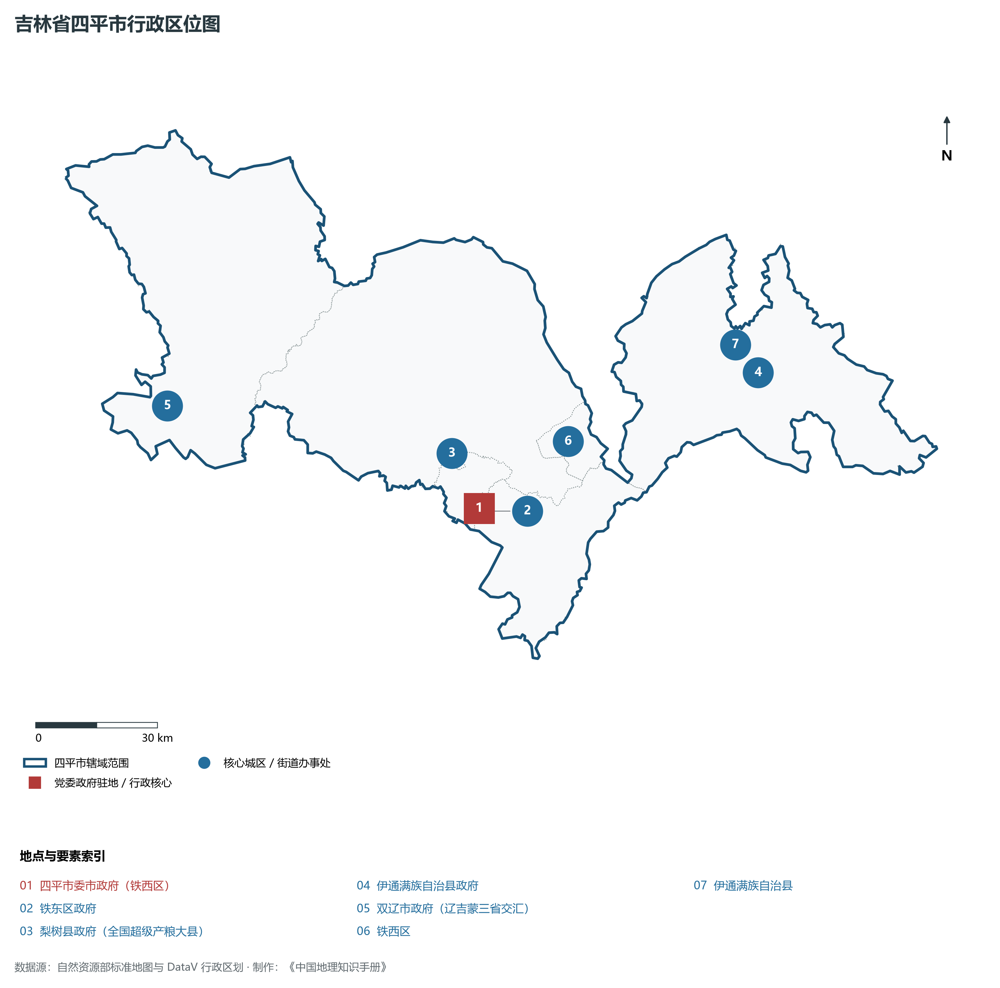
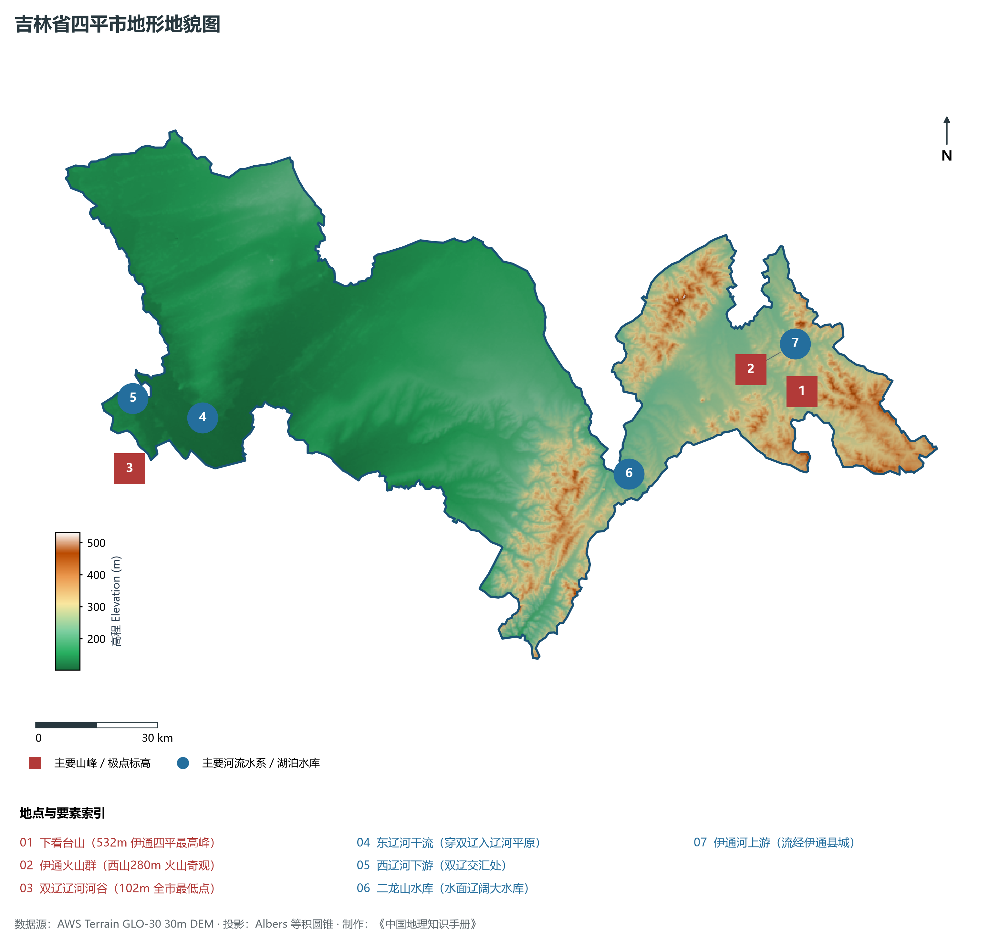
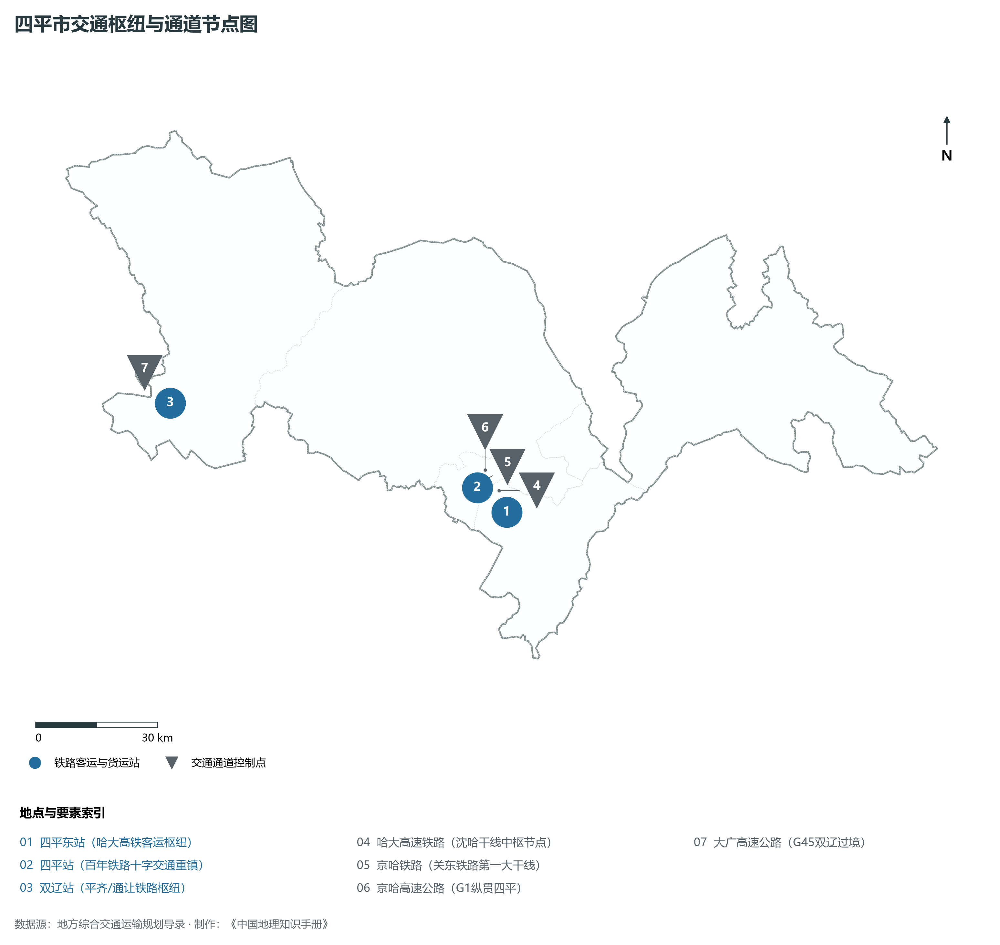
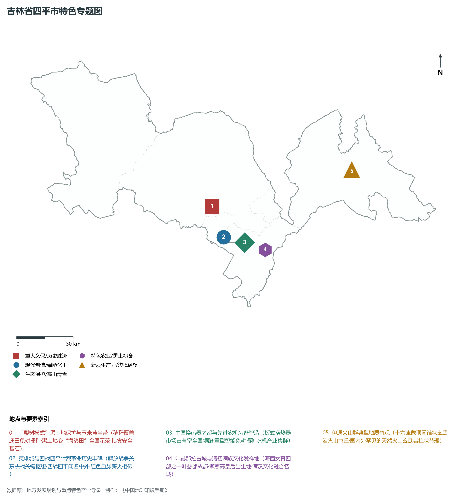
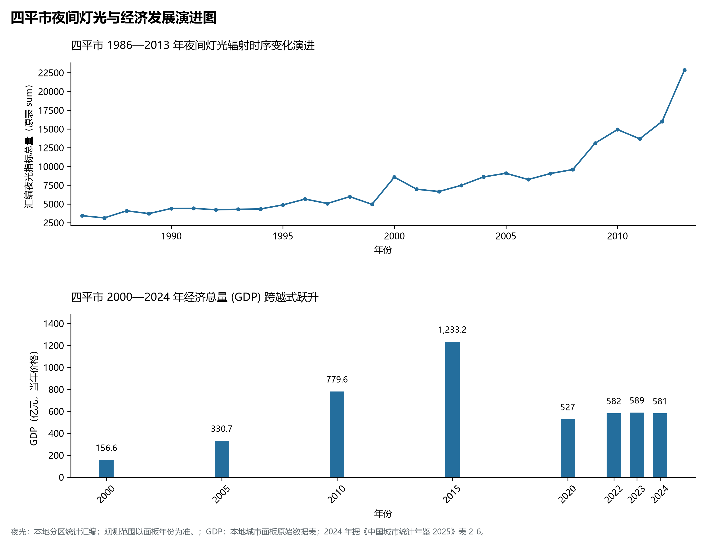

# 6.3 四平市

四平市，位于吉林省，其战略定位与特色概括为：**英雄城·松辽平原黄金玉米带核心·现代农机装备与换热设备制造基地**。2024 年常住人口 **164 万人**，常住人口城镇化率 **55.01%**，地区生产总值 **581 亿元**（当年价格），人均地区生产总值 **35,040 元**，三次产业构成为 **31.26 : 20.25 : 48.49**。

---

## 一、自然地理底盘与地貌水系机理

区域骨干控制性山脉与地形高程极点包括：

- **下看台山 (532m 伊通四平最高峰)**（坐标约东经 125.420°、北纬 43.280°，高程约 532.0 m）；
- **伊通火山群 (西山280m 火山奇观)**（坐标约东经 125.280°、北纬 43.350°，高程约 280.0 m）；
- **双辽辽河河谷 (102m 全市最低点)**（坐标约东经 123.350°、北纬 43.400°，高程约 102.0 m）；

水系与水文网络方面，四平市地表水资源丰富，骨干江河湖泊纵横穿流：

- **东辽河干流 (穿双辽入辽河平原)**（流经约东经 123.600°、北纬 43.480° 水域）；
- **西辽河下游 (双辽交汇处)**（流经约东经 123.400°、北纬 43.550° 水域）；
- **二龙山水库 (水面辽阔大水库)**（流经约东经 124.850°、北纬 43.180° 水域）；
- **伊通河上游 (流经伊通县城)**（流经约东经 125.320°、北纬 43.360° 水域）；

---

## 二、行政区划沿革与城镇空间体系

四平市历史文脉积淀深厚，建置沿革源远流长。新中国成立以来，伴随国家重点工程布局、老工业基地建设与新型城镇化战略推进，形成了梯次鲜明、产城紧密融合的市辖区与县级行政单元空间组织体系：

- **四平市委市政府 (铁西区)**（驻地坐标：124.380°E, 43.170°N）；
- **铁东区政府**（驻地坐标：124.410°E, 43.160°N）；
- **梨树县政府 (全国超级产粮大县)**（驻地坐标：124.330°E, 43.300°N）；
- **伊通满族自治县政府**（驻地坐标：125.300°E, 43.340°N）；
- **双辽市政府 (辽吉蒙三省交汇)**（驻地坐标：123.500°E, 43.520°N）；

在城镇空间总体布局上，四平市紧扣《国土空间总体规划》，坚持“极核集聚、轴带贯通、组团联动、绿色涵养”的总体思路，统筹协调中心城区扩容提质与县域城镇特色发展，构建多中心、网络化、集约型的空间发展格局。

---

## 三、综合立体交通网络与交通走廊

四平市地处东北地区立体交通网络关键节点，依托高速铁路、干线普速铁路、国家高速公路与航空口岸，构筑了四通八达的现代化立体综合交通运输骨架：

**主要综合客运与货运物流交通枢纽节点：**

- **四平东站 (哈大高铁客运枢纽)**（位置坐标：124.460°E, 43.150°N）；
- **四平站 (百年铁路十字交通重镇)**（位置坐标：124.375°E, 43.175°N）；
- **双辽站 (平齐/通让铁路枢纽)**（位置坐标：123.510°E, 43.525°N）；

**核心干线铁路与高等级公路交通走廊：**

- **哈大高速铁路 (沈哈干线中枢节点)**（廊道控制点：124.450°E, 43.200°N）：对外快速互联互通的高速客货运通道；
- **京哈铁路 (关东铁路第一大干线)**（廊道控制点：124.380°E, 43.220°N）：对外快速互联互通的高速客货运通道；
- **京哈高速公路 (G1纵贯四平)**（廊道控制点：124.420°E, 43.250°N）：对外快速互联互通的高速客货运通道；
- **大广高速公路 (G45双辽过境)**（廊道控制点：123.450°E, 43.600°N）：对外快速互联互通的高速客货运通道；

---

## 四、现代重点产业布局与特色功能组团

在新时代推动东北全面振兴战略引领下，四平市紧扣高质量发展首要任务，深度融入全省“一主六双”高质量发展战略格局，加快传统优势产业转型升级，培育壮大新兴战略性产业链群，全力打造特色鲜明的现代化产业高地：

**重点园区与现代化产业承载基地：**

- **四平红嘴经济技术开发区**（空间分布：124.360°E, 43.200°N）；
- **中国换热器之都特色产业园区**（空间分布：124.400°E, 43.140°N）；
- **梨树县现代农业科技示范区 (黑土地保护)**（空间分布：124.350°E, 43.320°N）；
- **双辽现代玻璃与精细化工园区**（空间分布：123.550°E, 43.500°N）；

**代表性特色地标与战略支撑维度：**

- **“梨树模式”黑土地保护与玉米黄金带**（124.350°E, 43.320°N）：秸秆覆盖还田免耕播种·黑土地变“海绵田”全国示范·粮食安全基石；
- **英雄城与四战四平壮烈革命历史丰碑**（124.385°E, 43.168°N）：解放战争关东决战关键枢纽·四战四平闻名中外·红色血脉薪火相传；
- **中国换热器之都与先进农机装备智造**（124.400°E, 43.140°N）：板式换热器市场占有率全国领跑·重型智能免耕播种农机产业集群；
- **叶赫那拉古城与清初满族文化发祥地**（124.580°E, 43.080°N）：海西女真四部之一叶赫部故都·孝慈高皇后出生地·满汉文化融合名城；
- **伊通火山群典型地质奇观**（125.300°E, 43.360°N）：十六座截顶圆锥状玄武岩火山穹丘·国内外罕见的天然火山玄武岩柱状节理；

---

## 五、1986—2013年夜间灯光演变与经济变化分析

本节夜光图的观测年份为 1986—2013 年，指标为行政区汇总值（原表 sum）。

2024 年四平市全市地区生产总值为 581 亿元（当年价格）。

| 年份 | 地区生产总值（亿元，当年价格） |
|:---|---:|
| 2000 年 | 156.6 |
| 2005 年 | 330.7 |
| 2010 年 | 779.6 |
| 2015 年 | 1,233.2 |
| 2020 年 | 527 |
| 2022 年 | 582 |
| 2023 年 | 589 |
| 2024 年 | 581 |

---

## 六、文化旅游名胜、生态屏障与可持续人地共生

四平市高度注重统筹经济高质量发展与高水平生态环境保护，筑牢绿色生态底盘，弘扬优秀历史文化：

- **四平战役纪念馆 (全国红色爱国主义教育基地)**（位置坐标：124.385°E, 43.168°N）；
- **叶赫那拉城 (满族发祥圣地/慈禧太后祖居)**（位置坐标：124.580°E, 43.080°N）；
- **伊通火山群国家级自然保护区 (火山地貌博物馆)**（位置坐标：125.300°E, 43.360°N）；
- **二龙湖风景名胜区 (高峡平湖生态胜地)**（位置坐标：124.880°E, 43.190°N）；

在人地协调机制方面，四平市统筹推进山水林田湖草沙一体化保护与系统治理，坚决打好蓝天、碧水、净土保卫战，筑牢长白山林区水塔屏障与平原黑土地粮仓，打造人与自然和谐共生的生态宜居美丽家园。

---

## 七、四平市关键地理统计指标速查矩阵

| 统计指标项 | 统计数值 / 口径标准 | 空间特征与全省位次说明 |
|:---|:---|:---|
| **行政区划代码** | `220300` | 国家民政部标准行政区划编号 |
| **辖区陆地面积** | **10,242.0** km² | 土地利用类型兼具山地、丘陵、平原与城镇工矿 |
| **常住人口规模** | 164 万人 | 2024 年，全市；年鉴公布口径 |
| **常住人口城镇化率** | 55.01% | 2024 年，全市；年鉴公布口径 |
| **地区生产总值 (2024)** | 581 亿元 | 2024 年，全市；年鉴公布口径 |
| **人均 GDP 水平** | 35,040 元/人 | 2024 年，全市；年鉴公布口径 |
| **三次产业结构比** | 31.26 : 20.25 : 48.49 | 2024 年，全市；年鉴公布口径 |
| **地表极限高程** | **102.0 m ～ 532.0 m** | 形成极具特色的立体地貌剖面格局 |

2024 年统计来源：《中国城市统计年鉴 2025》表 2-1、2-6、2-7（2024 年，全市）。其他年份 GDP 据本地城市面板“原始数据”表，单位为亿元、当年价格。
