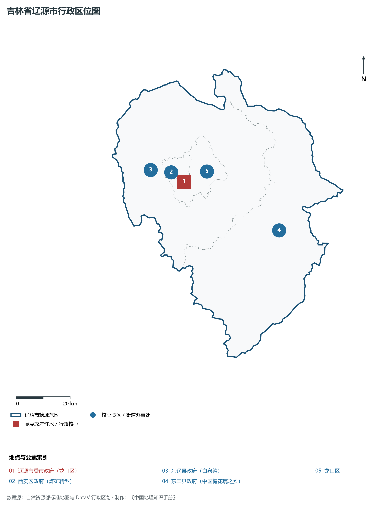
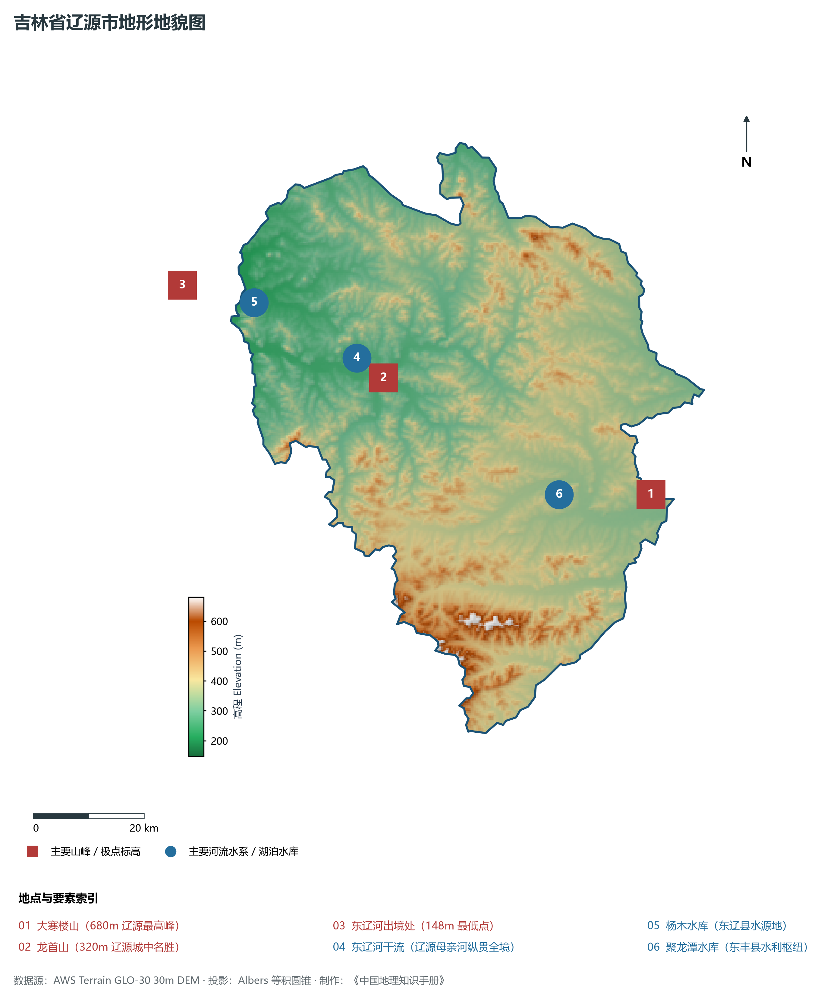
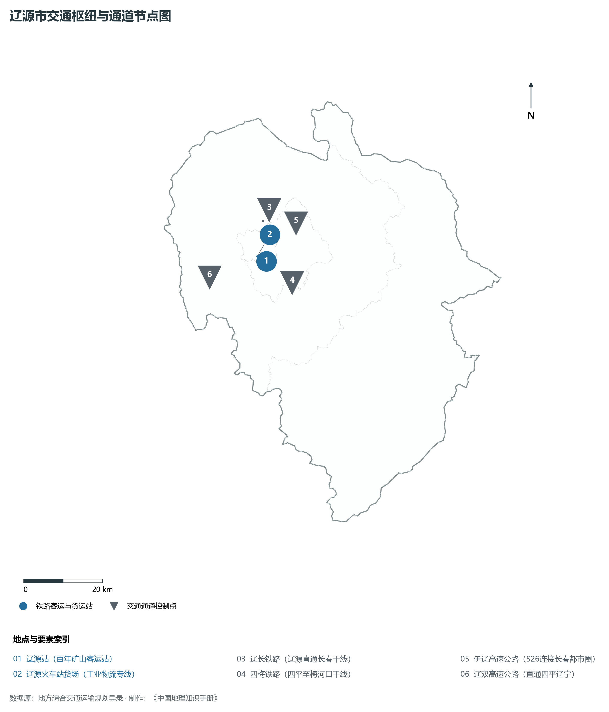
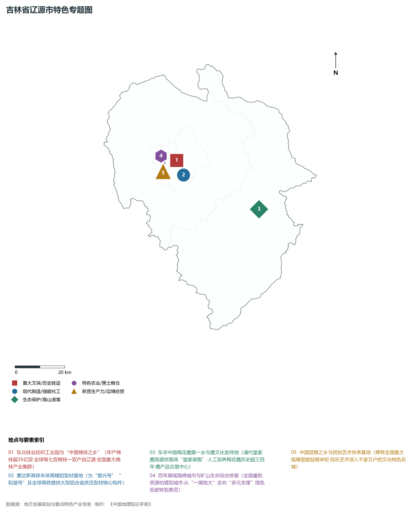
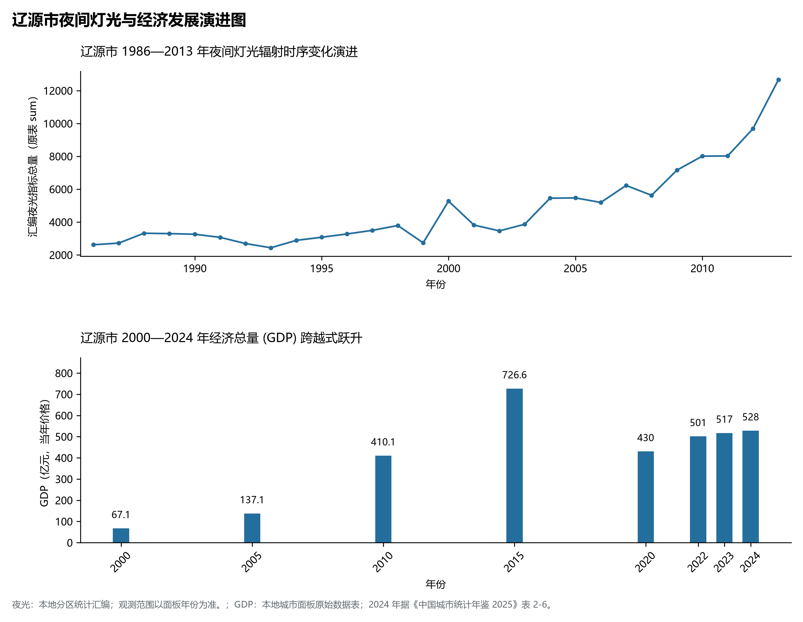

# 6.4 辽源市

辽源市，位于吉林省，其战略定位与特色概括为：**东辽河源头·百年煤城转型·“中国棉袜之乡”与国家级高端铝型材制造基地**。2024 年常住人口 **92 万人**，常住人口城镇化率 **61.71%**，地区生产总值 **528 亿元**（当年价格），人均地区生产总值 **56,735 元**，三次产业构成为 **9.67 : 24.21 : 66.11**。

---

## 一、自然地理底盘与地貌水系机理

区域骨干控制性山脉与地形高程极点包括：

- **大寒楼山 (680m 辽源最高峰)**（坐标约东经 125.680°、北纬 42.620°，高程约 680.0 m）；
- **龙首山 (320m 辽源城中名胜)**（坐标约东经 125.150°、北纬 42.890°，高程约 320.0 m）；
- **东辽河出境处 (148m 最低点)**（坐标约东经 124.750°、北纬 43.100°，高程约 148.0 m）；

水系与水文网络方面，辽源市地表水资源丰富，骨干江河湖泊纵横穿流：

- **东辽河干流 (辽源母亲河纵贯全境)**（流经约东经 125.100°、北纬 42.930° 水域）；
- **杨木水库 (东辽县水源地)**（流经约东经 124.900°、北纬 43.050° 水域）；
- **聚龙潭水库 (东丰县水利枢纽)**（流经约东经 125.480°、北纬 42.650° 水域）；

---

## 二、行政区划沿革与城镇空间体系

辽源市历史文脉积淀深厚，建置沿革源远流长。新中国成立以来，伴随国家重点工程布局、老工业基地建设与新型城镇化战略推进，形成了梯次鲜明、产城紧密融合的市辖区与县级行政单元空间组织体系：

- **辽源市委市政府 (龙山区)**（驻地坐标：125.140°E, 42.900°N）；
- **西安区政府 (煤矿转型)**（驻地坐标：125.120°E, 42.920°N）；
- **东辽县政府 (白泉镇)**（驻地坐标：125.000°E, 42.960°N）；
- **东丰县政府 (中国梅花鹿之乡)**（驻地坐标：125.520°E, 42.680°N）；

在城镇空间总体布局上，辽源市紧扣《国土空间总体规划》，坚持“极核集聚、轴带贯通、组团联动、绿色涵养”的总体思路，统筹协调中心城区扩容提质与县域城镇特色发展，构建多中心、网络化、集约型的空间发展格局。

---

## 三、综合立体交通网络与交通走廊

辽源市地处东北地区立体交通网络关键节点，依托高速铁路、干线普速铁路、国家高速公路与航空口岸，构筑了四通八达的现代化立体综合交通运输骨架：

**主要综合客运与货运物流交通枢纽节点：**

- **辽源站 (百年矿山客运站)**（位置坐标：125.135°E, 42.910°N）；
- **辽源火车站货场 (工业物流专线)**（位置坐标：125.110°E, 42.925°N）；

**核心干线铁路与高等级公路交通走廊：**

- **辽长铁路 (辽源直通长春干线)**（廊道控制点：125.150°E, 43.000°N）：对外快速互联互通的高速客货运通道；
- **四梅铁路 (四平至梅河口干线)**（廊道控制点：125.200°E, 42.850°N）：对外快速互联互通的高速客货运通道；
- **伊辽高速公路 (S26连接长春都市圈)**（廊道控制点：125.250°E, 42.980°N）：对外快速互联互通的高速客货运通道；
- **辽双高速公路 (直通四平辽宁)**（廊道控制点：124.950°E, 42.900°N）：对外快速互联互通的高速客货运通道；

---

## 四、现代重点产业布局与特色功能组团

在新时代推动东北全面振兴战略引领下，辽源市紧扣高质量发展首要任务，深度融入全省“一主六双”高质量发展战略格局，加快传统优势产业转型升级，培育壮大新兴战略性产业链群，全力打造特色鲜明的现代化产业高地：

**重点园区与现代化产业承载基地：**

- **东北袜业纺织工业园 (中国棉袜之乡)**（空间分布：125.180°E, 42.920°N）；
- **利源精制与麦达斯高端铝型材基地**（空间分布：125.160°E, 42.870°N）；
- **东丰国际梅花鹿产业创投园**（空间分布：125.530°E, 42.690°N）；
- **辽源高新技术产业开发区**（空间分布：125.190°E, 42.940°N）；

**代表性特色地标与战略支撑维度：**

- **东北袜业纺织工业园与“中国棉袜之乡”**（125.180°E, 42.920°N）：年产棉袜超35亿双·全球每七双棉袜一双产自辽源·全国最大棉袜产业集群；
- **麦达斯高铁车体高精铝型材基地**（125.160°E, 42.870°N）：为“复兴号”“和谐号”及全球高铁提供大型铝合金挤压型材核心构件；
- **东丰中国梅花鹿第一乡与鹿文化发祥地**（125.530°E, 42.690°N）：清代皇家鹿苑盛京围场“皇家御围”·人工驯养梅花鹿历史超三百年·鹿产品交易中心；
- **百年煤城海绵城市与矿山生态综合修复**（125.120°E, 42.920°N）：全国首批资源枯竭型城市·从“一煤独大”走向“多元支撑”绿色低碳转型典范；
- **中国琵琶之乡与民俗艺术传承基地**（125.140°E, 42.900°N）：拥有全国最大规模显顺琵琶学校·民乐艺术深入千家万户的文化特色名城；

---

## 五、1986—2013年夜间灯光演变与经济变化分析

本节夜光图的观测年份为 1986—2013 年，指标为行政区汇总值（原表 sum）。

2024 年辽源市全市地区生产总值为 528 亿元（当年价格）。

| 年份 | 地区生产总值（亿元，当年价格） |
|:---|---:|
| 2000 年 | 67.1 |
| 2005 年 | 137.1 |
| 2010 年 | 410.1 |
| 2015 年 | 726.6 |
| 2020 年 | 430 |
| 2022 年 | 501 |
| 2023 年 | 517 |
| 2024 年 | 528 |

---

## 六、文化旅游名胜、生态屏障与可持续人地共生

辽源市高度注重统筹经济高质量发展与高水平生态环境保护，筑牢绿色生态底盘，弘扬优秀历史文化：

- **龙首山风景区 (魁星楼道教名山)**（位置坐标：125.155°E, 42.885°N）；
- **东丰梅花鹿国家级自然生态区**（位置坐标：125.550°E, 42.670°N）；
- **辽源二战盟军战俘营旧址**（位置坐标：125.130°E, 42.895°N）；
- **鴜鹭湖国家级水利风景区**（位置坐标：125.020°E, 43.120°N）；

在人地协调机制方面，辽源市统筹推进山水林田湖草沙一体化保护与系统治理，坚决打好蓝天、碧水、净土保卫战，筑牢长白山林区水塔屏障与平原黑土地粮仓，打造人与自然和谐共生的生态宜居美丽家园。

---

## 七、辽源市关键地理统计指标速查矩阵

| 统计指标项 | 统计数值 / 口径标准 | 空间特征与全省位次说明 |
|:---|:---|:---|
| **行政区划代码** | `220400` | 国家民政部标准行政区划编号 |
| **辖区陆地面积** | **5,140.0** km² | 土地利用类型兼具山地、丘陵、平原与城镇工矿 |
| **常住人口规模** | 92 万人 | 2024 年，全市；年鉴公布口径 |
| **常住人口城镇化率** | 61.71% | 2024 年，全市；年鉴公布口径 |
| **地区生产总值 (2024)** | 528 亿元 | 2024 年，全市；年鉴公布口径 |
| **人均 GDP 水平** | 56,735 元/人 | 2024 年，全市；年鉴公布口径 |
| **三次产业结构比** | 9.67 : 24.21 : 66.11 | 2024 年，全市；年鉴公布口径 |
| **地表极限高程** | **148.0 m ～ 680.0 m** | 形成极具特色的立体地貌剖面格局 |

2024 年统计来源：《中国城市统计年鉴 2025》表 2-1、2-6、2-7（2024 年，全市）。其他年份 GDP 据本地城市面板“原始数据”表，单位为亿元、当年价格。
