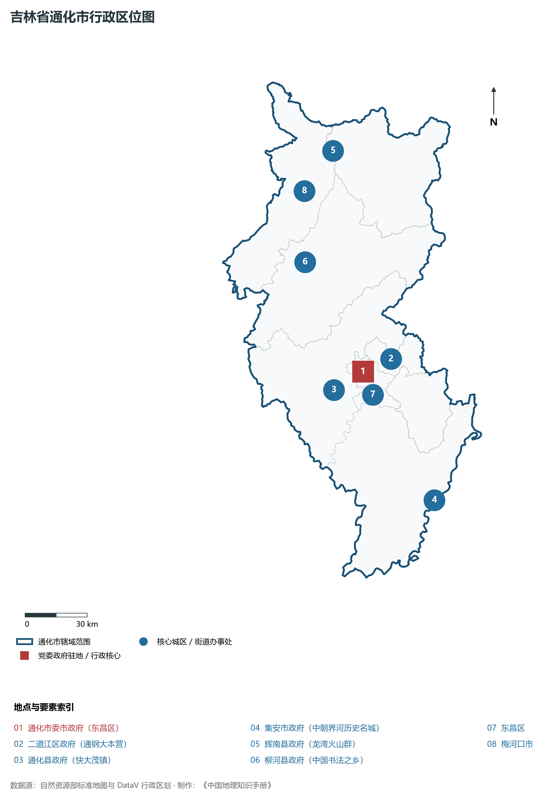
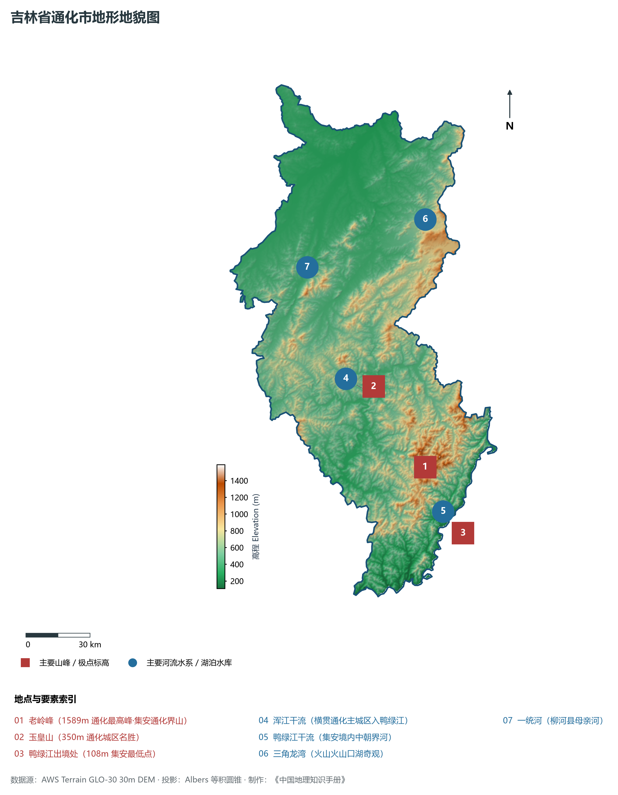
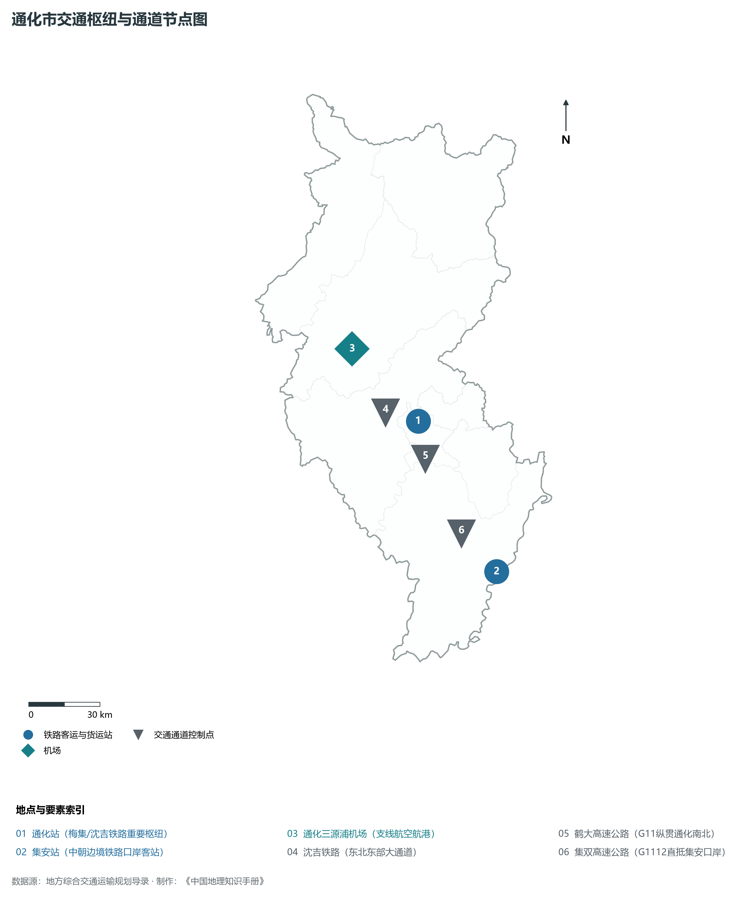
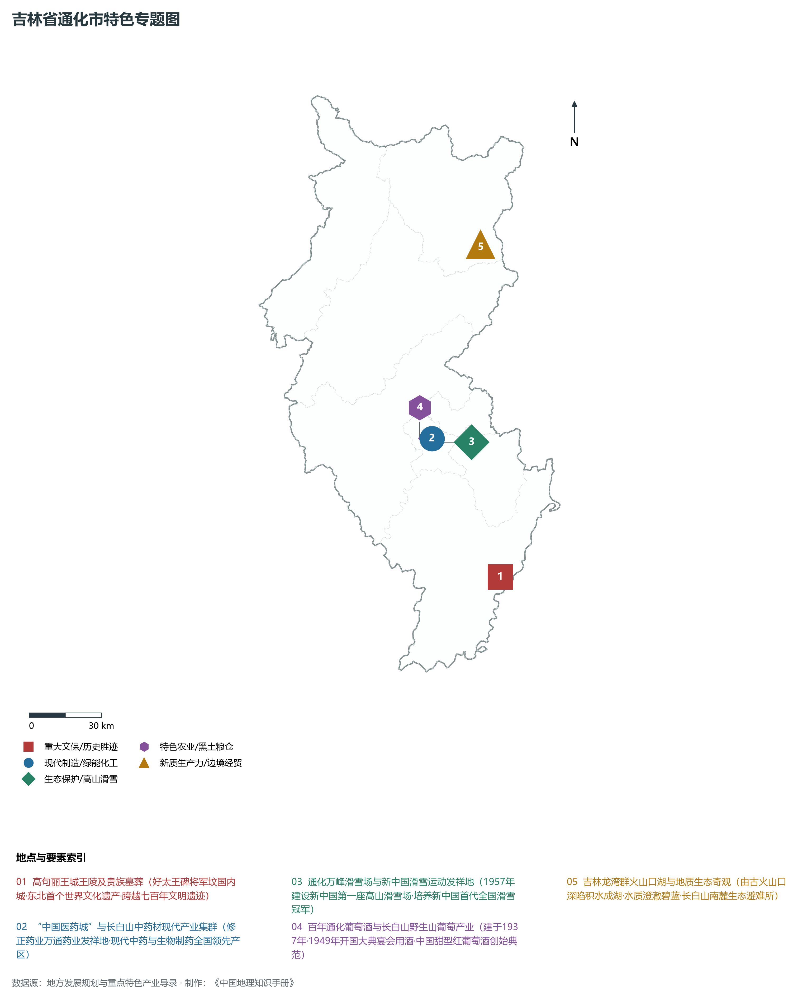
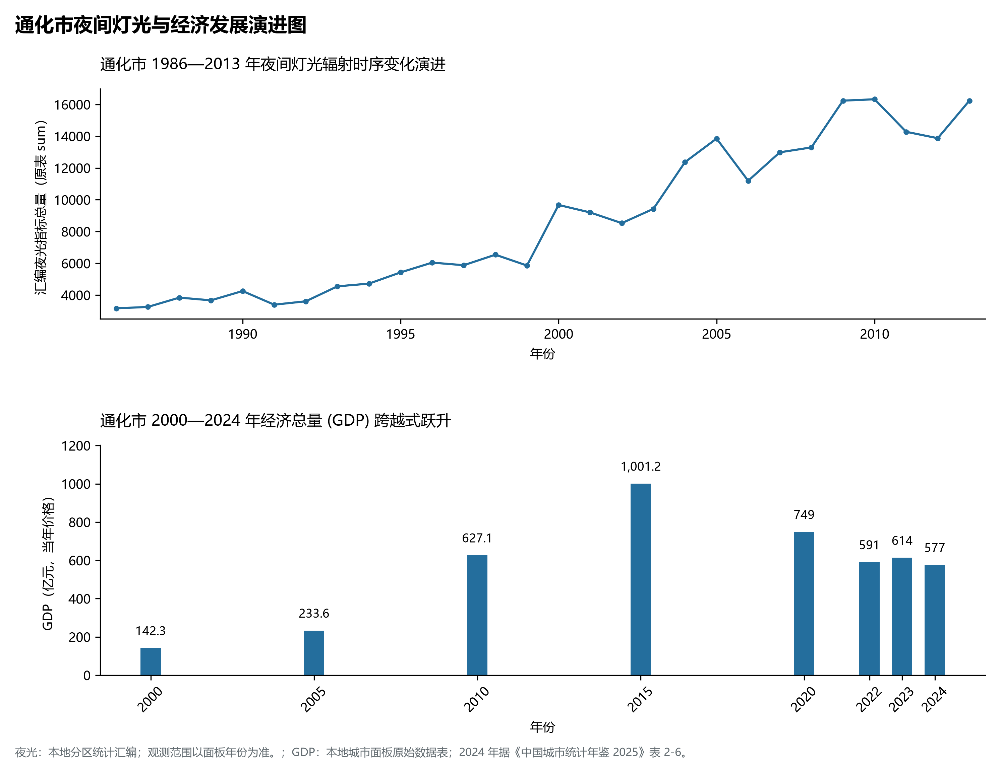

# 6.5 通化市

通化市，位于吉林省，其战略定位与特色概括为：**长白山南麓门户·浑江流域“中国医药城”·中国葡萄酒发源地与滑雪运动摇篮**。2024 年常住人口 **117 万人**，常住人口城镇化率 **64.26%**，地区生产总值 **577 亿元**（当年价格），人均地区生产总值 **48,672 元**，三次产业构成为 **12.87 : 26.47 : 60.65**。

---

## 一、自然地理底盘与地貌水系机理

区域骨干控制性山脉与地形高程极点包括：

- **老岭峰 (1589m 通化最高峰·集安通化界山)**（坐标约东经 126.120°、北纬 41.350°，高程约 1589.0 m）；
- **玉皇山 (350m 通化城区名胜)**（坐标约东经 125.930°、北纬 41.720°，高程约 350.0 m）；
- **鸭绿江出境处 (108m 集安最低点)**（坐标约东经 126.250°、北纬 41.050°，高程约 108.0 m）；

水系与水文网络方面，通化市地表水资源丰富，骨干江河湖泊纵横穿流：

- **浑江干流 (横贯通化主城区入鸭绿江)**（流经约东经 125.900°、北纬 41.700° 水域）；
- **鸭绿江干流 (集安境内中朝界河)**（流经约东经 126.150°、北纬 41.100° 水域）；
- **三角龙湾 (火山火山口湖奇观)**（流经约东经 126.420°、北纬 42.350° 水域）；
- **一统河 (柳河县母亲河)**（流经约东经 125.700°、北纬 42.260° 水域）；

---

## 二、行政区划沿革与城镇空间体系

通化市历史文脉积淀深厚，建置沿革源远流长。新中国成立以来，伴随国家重点工程布局、老工业基地建设与新型城镇化战略推进，形成了梯次鲜明、产城紧密融合的市辖区与县级行政单元空间组织体系：

- **通化市委市政府 (东昌区)**（驻地坐标：125.940°E, 41.730°N）；
- **二道江区政府 (通钢大本营)**（驻地坐标：126.040°E, 41.770°N）；
- **通化县政府 (快大茂镇)**（驻地坐标：125.750°E, 41.680°N）；
- **集安市政府 (中朝界河历史名城)**（驻地坐标：126.190°E, 41.130°N）；
- **辉南县政府 (龙湾火山群)**（驻地坐标：126.040°E, 42.680°N）；
- **柳河县政府 (中国书法之乡)**（驻地坐标：125.740°E, 42.240°N）；

在城镇空间总体布局上，通化市紧扣《国土空间总体规划》，坚持“极核集聚、轴带贯通、组团联动、绿色涵养”的总体思路，统筹协调中心城区扩容提质与县域城镇特色发展，构建多中心、网络化、集约型的空间发展格局。

---

## 三、综合立体交通网络与交通走廊

通化市地处东北地区立体交通网络关键节点，依托高速铁路、干线普速铁路、国家高速公路与航空口岸，构筑了四通八达的现代化立体综合交通运输骨架：

**主要综合客运与货运物流交通枢纽节点：**

- **通化站 (梅集/沈吉铁路重要枢纽)**（位置坐标：125.955°E, 41.745°N）；
- **集安站 (中朝边境铁路口岸客站)**（位置坐标：126.185°E, 41.135°N）；
- **通化三源浦机场 (支线航空航港)**（位置坐标：125.700°E, 42.060°N）；

**核心干线铁路与高等级公路交通走廊：**

- **沈吉铁路 (东北东部大通道)**（廊道控制点：125.800°E, 41.800°N）：对外快速互联互通的高速客货运通道；
- **鹤大高速公路 (G11纵贯通化南北)**（廊道控制点：125.950°E, 41.600°N）：对外快速互联互通的高速客货运通道；
- **集双高速公路 (G1112直抵集安口岸)**（廊道控制点：126.050°E, 41.300°N）：对外快速互联互通的高速客货运通道；

---

## 四、现代重点产业布局与特色功能组团

在新时代推动东北全面振兴战略引领下，通化市紧扣高质量发展首要任务，深度融入全省“一主六双”高质量发展战略格局，加快传统优势产业转型升级，培育壮大新兴战略性产业链群，全力打造特色鲜明的现代化产业高地：

**重点园区与现代化产业承载基地：**

- **通化医药高新技术产业开发区 (国家级高新区)**（空间分布：125.980°E, 41.700°N）；
- **通化钢铁集团有限责任公司生产基地**（空间分布：126.050°E, 41.780°N）；
- **中国通化葡萄酒产业集聚区**（空间分布：125.920°E, 41.710°N）；
- **通化万峰滑雪场 (原新中国首座滑雪场)**（空间分布：126.020°E, 41.680°N）；

**代表性特色地标与战略支撑维度：**

- **高句丽王城王陵及贵族墓葬 (世界文化遗产)**（126.170°E, 41.150°N）：好太王碑将军坟国内城·东北首个世界文化遗产·跨越七百年文明遗迹；
- **“中国医药城”与长白山中药材现代产业集群**（125.980°E, 41.700°N）：修正药业万通药业发祥地·现代中药与生物制药全国领先产区；
- **通化万峰滑雪场与新中国滑雪运动发祥地**（126.020°E, 41.680°N）：1957年建设新中国第一座高山滑雪场·培养新中国首代全国滑雪冠军；
- **百年通化葡萄酒与长白山野生山葡萄产业**（125.920°E, 41.710°N）：建于1937年·1949年开国大典宴会用酒·中国甜型红葡萄酒创始典范；
- **吉林龙湾群火山口湖与地质生态奇观**（126.430°E, 42.360°N）：由古火山口深陷积水成湖·水质澄澈碧蓝·长白山南麓生态避难所；

---

## 五、1986—2013年夜间灯光演变与经济变化分析

本节夜光图的观测年份为 1986—2013 年，指标为行政区汇总值（原表 sum）。

2024 年通化市全市地区生产总值为 577 亿元（当年价格）。

| 年份 | 地区生产总值（亿元，当年价格） |
|:---|---:|
| 2000 年 | 142.3 |
| 2005 年 | 233.6 |
| 2010 年 | 627.1 |
| 2015 年 | 1,001.2 |
| 2020 年 | 749 |
| 2022 年 | 591 |
| 2023 年 | 614 |
| 2024 年 | 577 |

---

## 六、文化旅游名胜、生态屏障与可持续人地共生

通化市高度注重统筹经济高质量发展与高水平生态环境保护，筑牢绿色生态底盘，弘扬优秀历史文化：

- **高句丽王城王陵及贵族墓葬 (世界文化遗产)**（位置坐标：126.170°E, 41.150°N）；
- **吉林龙湾群国家森林公园 (七湾一瀑地质公园)**（位置坐标：126.430°E, 42.360°N）；
- **杨靖宇烈士陵园 (全国重点烈士纪念建筑物)**（位置坐标：125.935°E, 41.735°N）；
- **集安鸭绿江国境铁路大桥与口岸**（位置坐标：126.200°E, 41.120°N）；

在人地协调机制方面，通化市统筹推进山水林田湖草沙一体化保护与系统治理，坚决打好蓝天、碧水、净土保卫战，筑牢长白山林区水塔屏障与平原黑土地粮仓，打造人与自然和谐共生的生态宜居美丽家园。

---

## 七、通化市关键地理统计指标速查矩阵

| 统计指标项 | 统计数值 / 口径标准 | 空间特征与全省位次说明 |
|:---|:---|:---|
| **行政区划代码** | `220500` | 国家民政部标准行政区划编号 |
| **辖区陆地面积** | **15,611.0** km² | 土地利用类型兼具山地、丘陵、平原与城镇工矿 |
| **常住人口规模** | 117 万人 | 2024 年，全市；年鉴公布口径 |
| **常住人口城镇化率** | 64.26% | 2024 年，全市；年鉴公布口径 |
| **地区生产总值 (2024)** | 577 亿元 | 2024 年，全市；年鉴公布口径 |
| **人均 GDP 水平** | 48,672 元/人 | 2024 年，全市；年鉴公布口径 |
| **三次产业结构比** | 12.87 : 26.47 : 60.65 | 2024 年，全市；年鉴公布口径 |
| **地表极限高程** | **108.0 m ～ 1589.0 m** | 形成极具特色的立体地貌剖面格局 |

2024 年统计来源：《中国城市统计年鉴 2025》表 2-1、2-6、2-7（2024 年，全市）。其他年份 GDP 据本地城市面板“原始数据”表，单位为亿元、当年价格。
