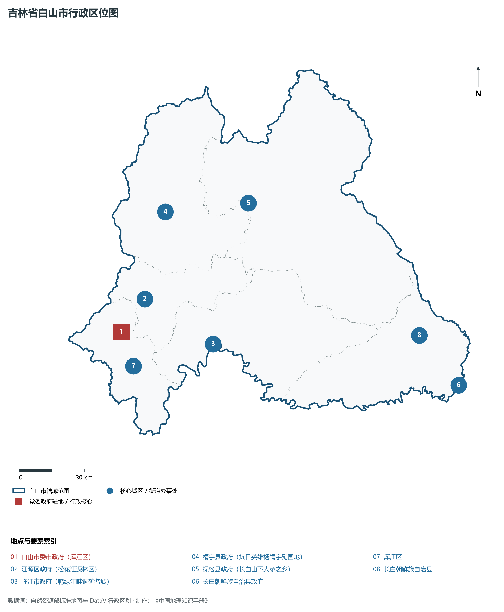
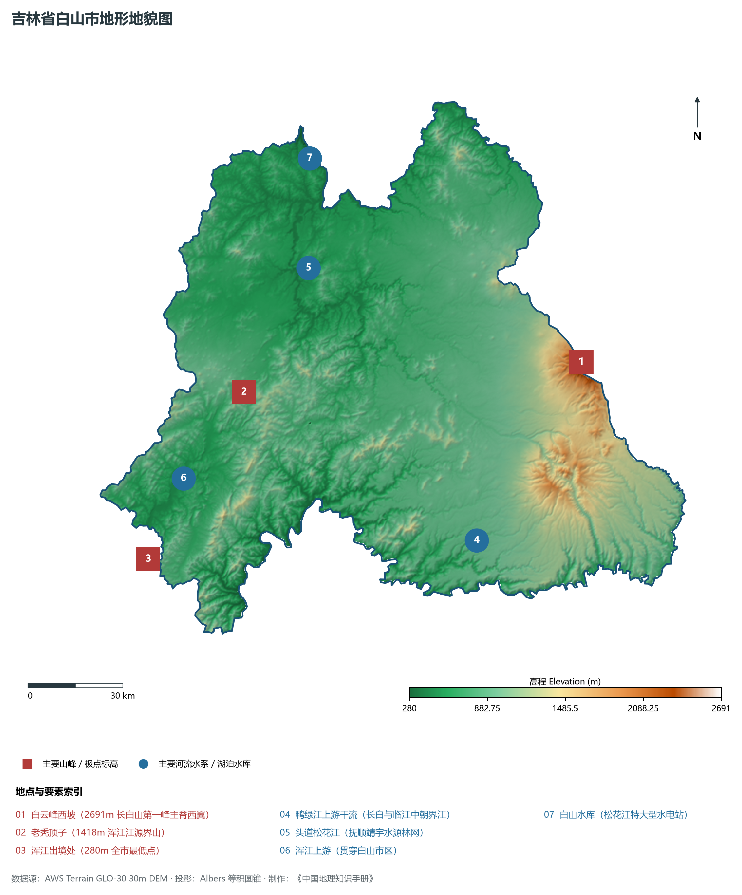
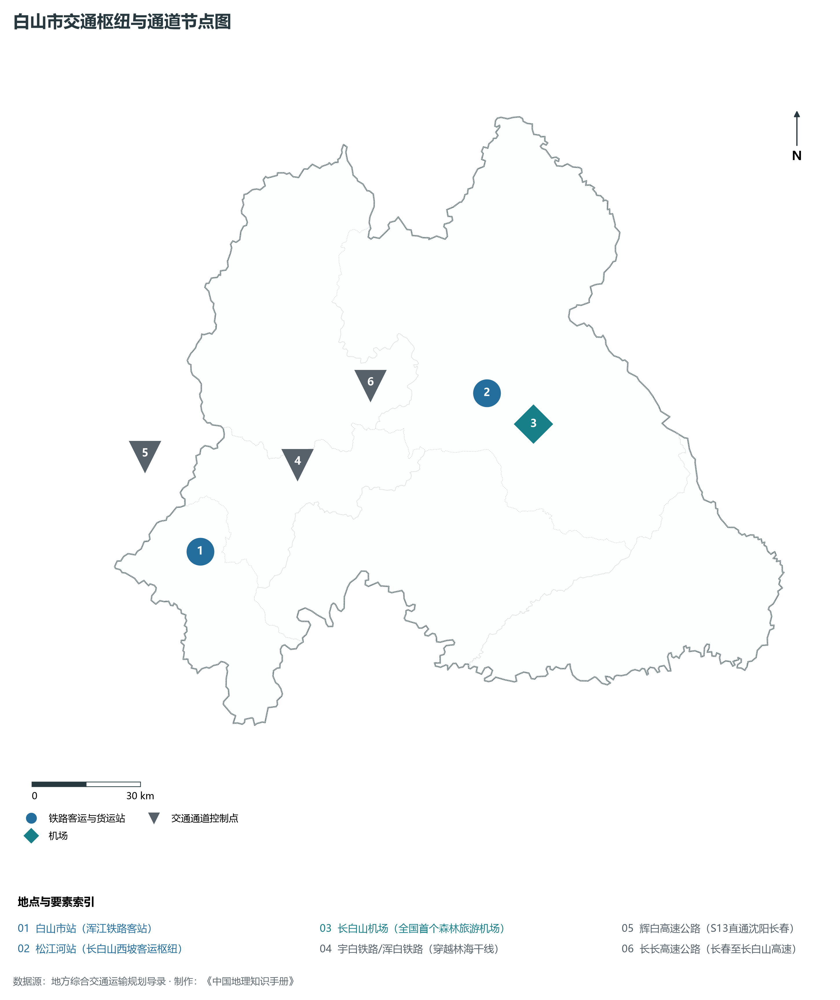
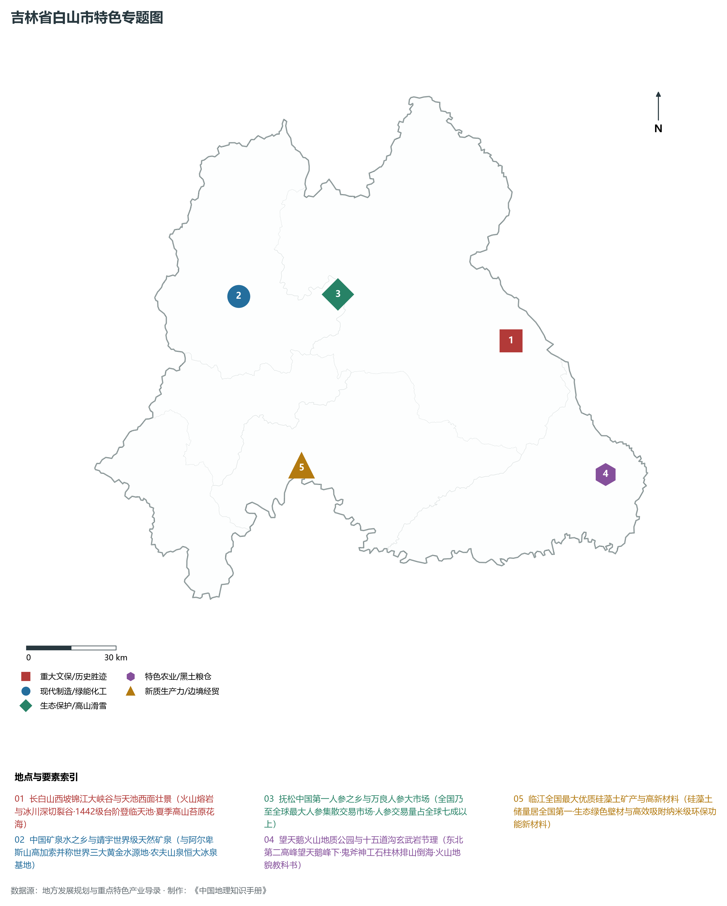
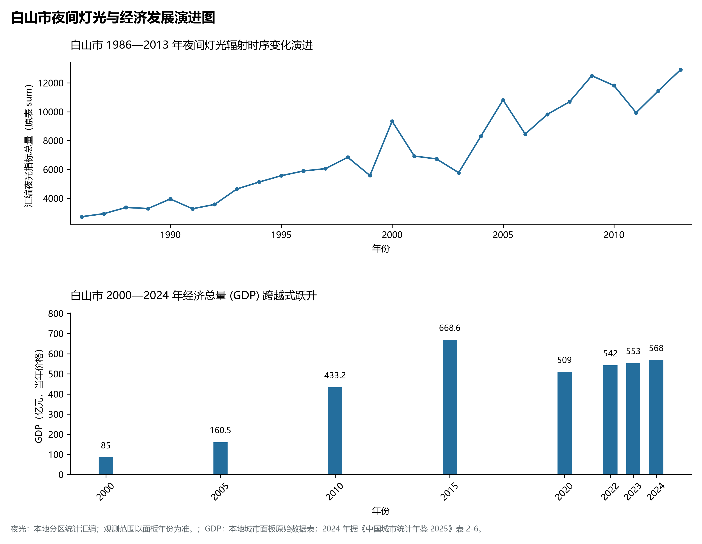

# 6.6 白山市

白山市，位于吉林省，其战略定位与特色概括为：**长白山核心腹地·鸭绿江松花江分水岭·“中国矿泉水之乡”与国家级人参产业基地**。2024 年常住人口 **89 万人**，常住人口城镇化率 **81.12%**，地区生产总值 **568 亿元**（当年价格），人均地区生产总值 **63,632 元**，三次产业构成为 **12.82 : 24.9 : 62.28**。

---

## 一、自然地理底盘与地貌水系机理

区域骨干控制性山脉与地形高程极点包括：

- **白云峰西坡 (2691m 长白山第一峰主脊西翼)**（坐标约东经 128.050°、北纬 42.020°，高程约 2691.0 m）；
- **老秃顶子 (1418m 浑江江源界山)**（坐标约东经 126.750°、北纬 42.150°，高程约 1418.0 m）；
- **浑江出境处 (280m 全市最低点)**（坐标约东经 126.250°、北纬 41.750°，高程约 280.0 m）；

水系与水文网络方面，白山市地表水资源丰富，骨干江河湖泊纵横穿流：

- **鸭绿江上游干流 (长白与临江中朝界江)**（流经约东经 127.500°、北纬 41.600° 水域）；
- **头道松花江 (抚顺靖宇水源林网)**（流经约东经 127.100°、北纬 42.450° 水域）；
- **浑江上游 (贯穿白山市区)**（流经约东经 126.450°、北纬 41.950° 水域）；
- **白山水库 (松花江特大型水电站)**（流经约东经 127.200°、北纬 42.750° 水域）；

---

## 二、行政区划沿革与城镇空间体系

白山市历史文脉积淀深厚，建置沿革源远流长。新中国成立以来，伴随国家重点工程布局、老工业基地建设与新型城镇化战略推进，形成了梯次鲜明、产城紧密融合的市辖区与县级行政单元空间组织体系：

- **白山市委市政府 (浑江区)**（驻地坐标：126.420°E, 41.940°N）；
- **江源区政府 (松花江源林区)**（驻地坐标：126.590°E, 42.050°N）；
- **临江市政府 (鸭绿江畔铜矿名城)**（驻地坐标：126.910°E, 41.810°N）；
- **靖宇县政府 (抗日英雄杨靖宇殉国地)**（驻地坐标：126.810°E, 42.380°N）；
- **抚松县政府 (长白山下人参之乡)**（驻地坐标：127.280°E, 42.340°N）；
- **长白朝鲜族自治县政府**（驻地坐标：128.200°E, 41.420°N）；

在城镇空间总体布局上，白山市紧扣《国土空间总体规划》，坚持“极核集聚、轴带贯通、组团联动、绿色涵养”的总体思路，统筹协调中心城区扩容提质与县域城镇特色发展，构建多中心、网络化、集约型的空间发展格局。

---

## 三、综合立体交通网络与交通走廊

白山市地处东北地区立体交通网络关键节点，依托高速铁路、干线普速铁路、国家高速公路与航空口岸，构筑了四通八达的现代化立体综合交通运输骨架：

**主要综合客运与货运物流交通枢纽节点：**

- **白山市站 (浑江铁路客站)**（位置坐标：126.415°E, 41.945°N）；
- **松江河站 (长白山西坡客运枢纽)**（位置坐标：127.480°E, 42.170°N）；
- **长白山机场 (全国首个森林旅游机场)**（位置坐标：127.610°E, 42.070°N）；

**核心干线铁路与高等级公路交通走廊：**

- **宇白铁路/浑白铁路 (穿越林海干线)**（廊道控制点：126.800°E, 42.100°N）：对外快速互联互通的高速客货运通道；
- **辉白高速公路 (S13直通沈阳长春)**（廊道控制点：126.300°E, 42.200°N）：对外快速互联互通的高速客货运通道；
- **长长高速公路 (长春至长白山高速)**（廊道控制点：127.100°E, 42.250°N）：对外快速互联互通的高速客货运通道；

---

## 四、现代重点产业布局与特色功能组团

在新时代推动东北全面振兴战略引领下，白山市紧扣高质量发展首要任务，深度融入全省“一主六双”高质量发展战略格局，加快传统优势产业转型升级，培育壮大新兴战略性产业链群，全力打造特色鲜明的现代化产业高地：

**重点园区与现代化产业承载基地：**

- **靖宇中国矿泉水产业开发区 (天然矿泉水之乡)**（空间分布：126.850°E, 42.360°N）；
- **抚松长白山万良人参现代交易市场**（空间分布：127.250°E, 42.300°N）；
- **长白山国际旅游度假区 (万达滑雪场)**（空间分布：127.550°E, 42.110°N）；
- **白山硅藻土特色产业开发区 (临江)**（空间分布：126.950°E, 41.830°N）；

**代表性特色地标与战略支撑维度：**

- **长白山西坡锦江大峡谷与天池西面壮景**（127.900°E, 42.050°N）：火山熔岩与冰川深切裂谷·1442级台阶登临天池·夏季高山苔原花海；
- **中国矿泉水之乡与靖宇世界级天然矿泉**（126.850°E, 42.360°N）：与阿尔卑斯山高加索并称世界三大黄金水源地·农夫山泉恒大冰泉基地；
- **抚松中国第一人参之乡与万良人参大市场**（127.250°E, 42.300°N）：全国乃至全球最大人参集散交易市场·人参交易量占全球七成以上；
- **望天鹅火山地质公园与十五道沟玄武岩节理**（128.150°E, 41.600°N）：东北第二高峰望天鹅峰下·鬼斧神工石柱林排山倒海·火山地貌教科书；
- **临江全国最大优质硅藻土矿产与高新材料**（126.950°E, 41.830°N）：硅藻土储量居全国第一·生态绿色壁材与高效吸附纳米级环保功能新材料；

---

## 五、1986—2013年夜间灯光演变与经济变化分析

本节夜光图的观测年份为 1986—2013 年，指标为行政区汇总值（原表 sum）。

2024 年白山市全市地区生产总值为 568 亿元（当年价格）。

| 年份 | 地区生产总值（亿元，当年价格） |
|:---|---:|
| 2000 年 | 85 |
| 2005 年 | 160.5 |
| 2010 年 | 433.2 |
| 2015 年 | 668.6 |
| 2020 年 | 509 |
| 2022 年 | 542 |
| 2023 年 | 553 |
| 2024 年 | 568 |

---

## 六、文化旅游名胜、生态屏障与可持续人地共生

白山市高度注重统筹经济高质量发展与高水平生态环境保护，筑牢绿色生态底盘，弘扬优秀历史文化：

- **长白山西坡风景区 (锦江大峡谷/天池高山苔原)**（位置坐标：127.900°E, 42.050°N）；
- **望天鹅风景区 (十五道沟火山玄武岩柱)**（位置坐标：128.150°E, 41.600°N）；
- **鸭绿江大峡谷风景区 (火山喷发下陷深谷)**（位置坐标：127.850°E, 41.900°N）；
- **杨靖宇将军殉国地纪念馆 (靖宇县)**（位置坐标：126.830°E, 42.390°N）；

在人地协调机制方面，白山市统筹推进山水林田湖草沙一体化保护与系统治理，坚决打好蓝天、碧水、净土保卫战，筑牢长白山林区水塔屏障与平原黑土地粮仓，打造人与自然和谐共生的生态宜居美丽家园。

---

## 七、白山市关键地理统计指标速查矩阵

| 统计指标项 | 统计数值 / 口径标准 | 空间特征与全省位次说明 |
|:---|:---|:---|
| **行政区划代码** | `220600` | 国家民政部标准行政区划编号 |
| **辖区陆地面积** | **17,511.0** km² | 土地利用类型兼具山地、丘陵、平原与城镇工矿 |
| **常住人口规模** | 89 万人 | 2024 年，全市；年鉴公布口径 |
| **常住人口城镇化率** | 81.12% | 2024 年，全市；年鉴公布口径 |
| **地区生产总值 (2024)** | 568 亿元 | 2024 年，全市；年鉴公布口径 |
| **人均 GDP 水平** | 63,632 元/人 | 2024 年，全市；年鉴公布口径 |
| **三次产业结构比** | 12.82 : 24.9 : 62.28 | 2024 年，全市；年鉴公布口径 |
| **地表极限高程** | **280.0 m ～ 2691.0 m** | 形成极具特色的立体地貌剖面格局 |

2024 年统计来源：《中国城市统计年鉴 2025》表 2-1、2-6、2-7（2024 年，全市）。其他年份 GDP 据本地城市面板“原始数据”表，单位为亿元、当年价格。
