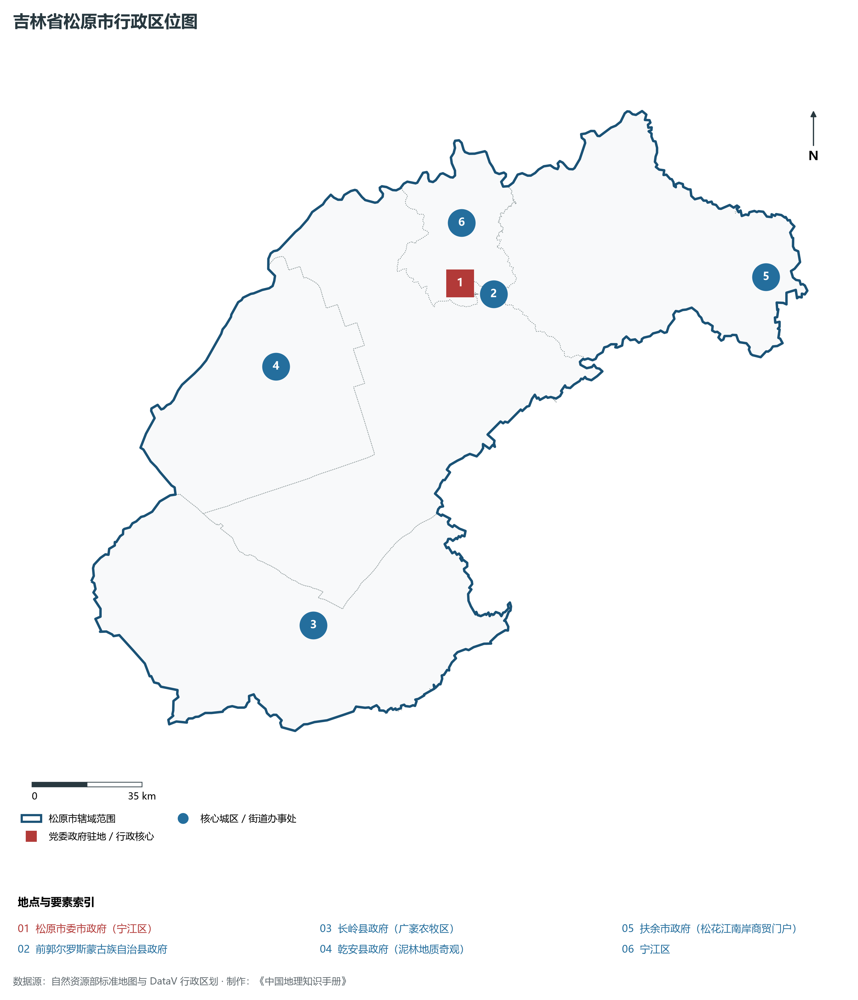
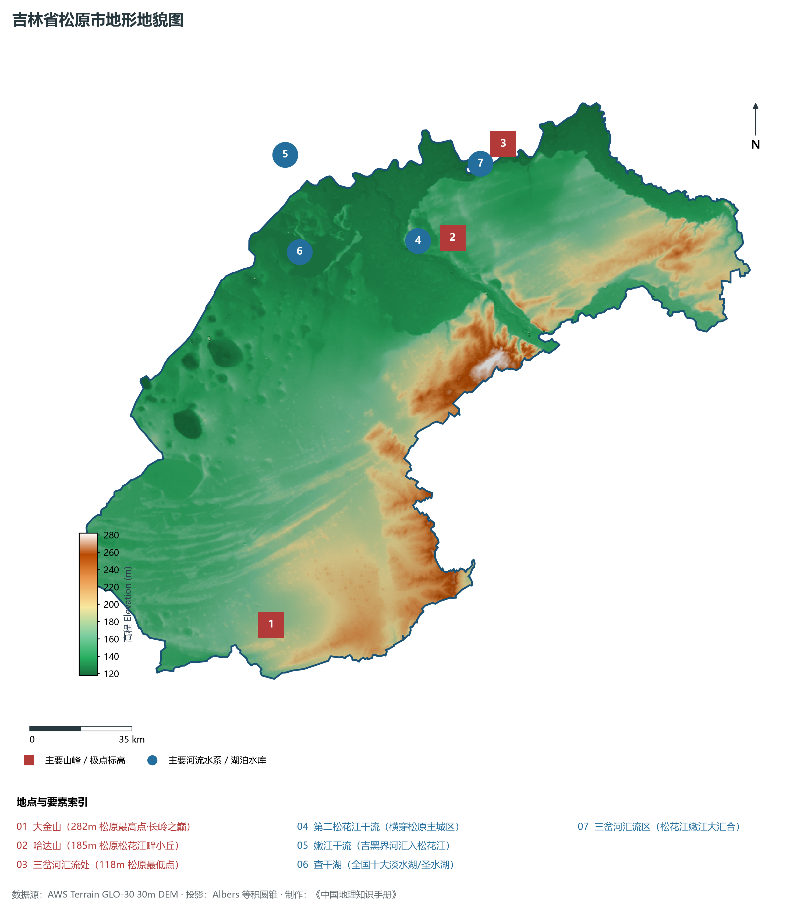
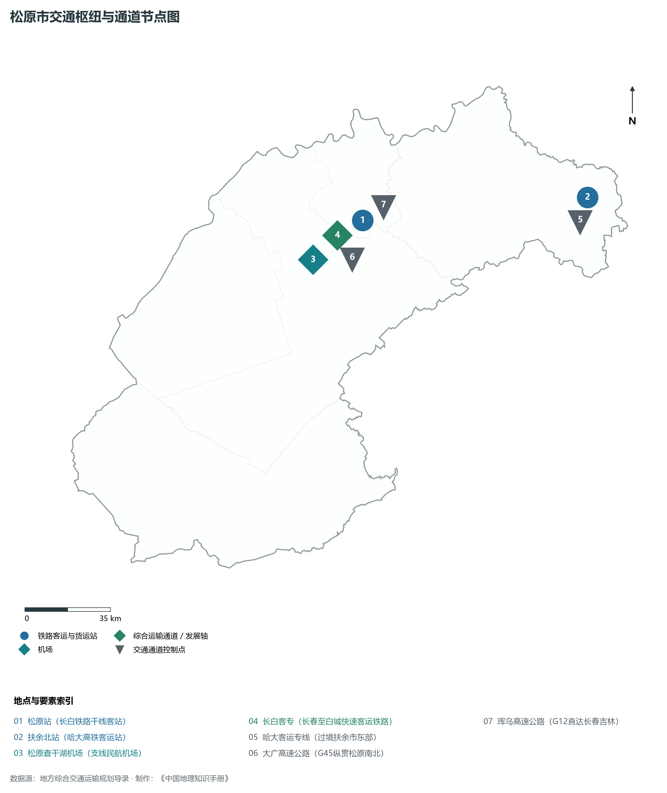
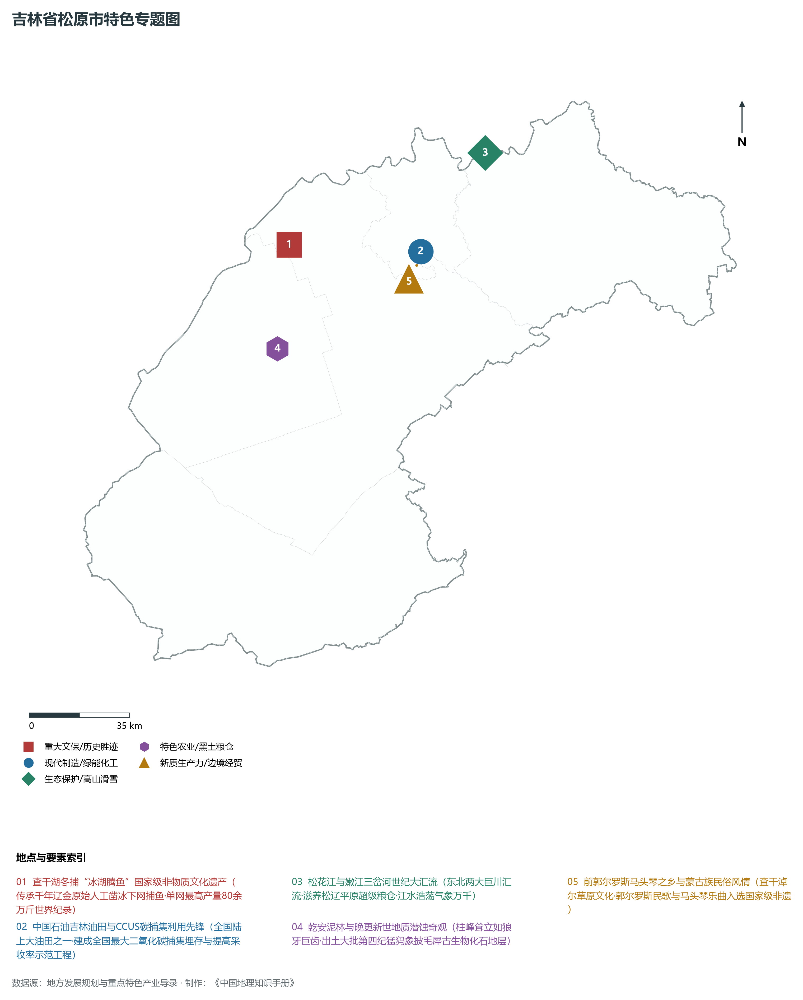
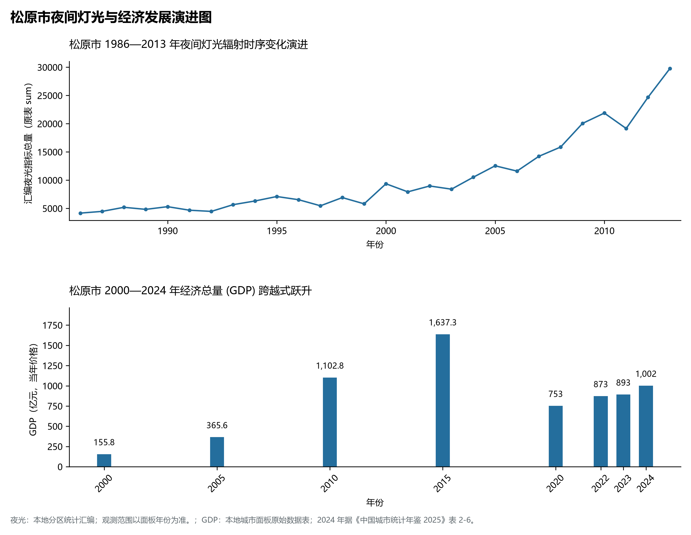

# 6.7 松原市

松原市，位于吉林省，其战略定位与特色概括为：**查干湖冬捕盛景·松嫩两江汇流·吉林油田大本营与绿色现代农畜基地**。2024 年常住人口 **209 万人**，常住人口城镇化率 **50.68%**，地区生产总值 **1,002 亿元**（当年价格），人均地区生产总值 **47,544 元**，三次产业构成为 **24.06 : 23.72 : 52.22**。

---

## 一、自然地理底盘与地貌水系机理

区域骨干控制性山脉与地形高程极点包括：

- **大金山 (282m 松原最高点·长岭之巅)**（坐标约东经 123.850°、北纬 44.150°，高程约 282.0 m）；
- **哈达山 (185m 松原松花江畔小丘)**（坐标约东经 124.950°、北纬 45.200°，高程约 185.0 m）；
- **三岔河汇流处 (118m 松原最低点)**（坐标约东经 125.250°、北纬 45.450°，高程约 118.0 m）；

水系与水文网络方面，松原市地表水资源丰富，骨干江河湖泊纵横穿流：

- **第二松花江干流 (横穿松原主城区)**（流经约东经 124.850°、北纬 45.180° 水域）；
- **嫩江干流 (吉黑界河汇入松花江)**（流经约东经 124.300°、北纬 45.550° 水域）；
- **查干湖 (全国十大淡水湖/圣水湖)**（流经约东经 124.280°、北纬 45.250° 水域）；
- **三岔河汇流区 (松花江嫩江大汇合)**（流经约东经 125.200°、北纬 45.420° 水域）；

---

## 二、行政区划沿革与城镇空间体系

松原市历史文脉积淀深厚，建置沿革源远流长。新中国成立以来，伴随国家重点工程布局、老工业基地建设与新型城镇化战略推进，形成了梯次鲜明、产城紧密融合的市辖区与县级行政单元空间组织体系：

- **松原市委市政府 (宁江区)**（驻地坐标：124.820°E, 45.140°N）；
- **前郭尔罗斯蒙古族自治县政府**（驻地坐标：124.810°E, 45.110°N）；
- **长岭县政府 (广袤农牧区)**（驻地坐标：123.970°E, 44.270°N）；
- **乾安县政府 (泥林地质奇观)**（驻地坐标：124.020°E, 45.010°N）；
- **扶余市政府 (松花江南岸商贸门户)**（驻地坐标：126.040°E, 44.980°N）；

在城镇空间总体布局上，松原市紧扣《国土空间总体规划》，坚持“极核集聚、轴带贯通、组团联动、绿色涵养”的总体思路，统筹协调中心城区扩容提质与县域城镇特色发展，构建多中心、网络化、集约型的空间发展格局。

---

## 三、综合立体交通网络与交通走廊

松原市地处东北地区立体交通网络关键节点，依托高速铁路、干线普速铁路、国家高速公路与航空口岸，构筑了四通八达的现代化立体综合交通运输骨架：

**主要综合客运与货运物流交通枢纽节点：**

- **松原站 (长白铁路干线客站)**（位置坐标：124.845°E, 45.135°N）；
- **扶余北站 (哈大高铁客运站)**（位置坐标：126.020°E, 45.050°N）；
- **松原查干湖机场 (支线民航机场)**（位置坐标：124.550°E, 45.030°N）；

**核心干线铁路与高等级公路交通走廊：**

- **长白客专 (长春至白城快速客运铁路)**（廊道控制点：124.700°E, 45.100°N）：对外快速互联互通的高速客货运通道；
- **哈大客运专线 (过境扶余市东部)**（廊道控制点：126.000°E, 45.000°N）：对外快速互联互通的高速客货运通道；
- **大广高速公路 (G45纵贯松原南北)**（廊道控制点：124.750°E, 45.000°N）：对外快速互联互通的高速客货运通道；
- **珲乌高速公路 (G12直达长春吉林)**（廊道控制点：124.900°E, 45.150°N）：对外快速互联互通的高速客货运通道；

---

## 四、现代重点产业布局与特色功能组团

在新时代推动东北全面振兴战略引领下，松原市紧扣高质量发展首要任务，深度融入全省“一主六双”高质量发展战略格局，加快传统优势产业转型升级，培育壮大新兴战略性产业链群，全力打造特色鲜明的现代化产业高地：

**重点园区与现代化产业承载基地：**

- **中国石油吉林油田分公司大本营**（空间分布：124.830°E, 45.160°N）；
- **松原石化产业开发区 (精细化工基地)**（空间分布：124.880°E, 45.190°N）；
- **前郭现代农业与特色渔业示范区**（空间分布：124.350°E, 45.200°N）；
- **查干湖生态渔业与文旅集聚区**（空间分布：124.250°E, 45.280°N）；

**代表性特色地标与战略支撑维度：**

- **查干湖冬捕“冰湖腾鱼”国家级非物质文化遗产**（124.260°E, 45.260°N）：传承千年辽金原始人工凿冰下网捕鱼·单网最高产量80余万斤世界纪录；
- **中国石油吉林油田与CCUS碳捕集利用先锋**（124.830°E, 45.160°N）：全国陆上大油田之一·建成全国最大二氧化碳捕集埋存与提高采收率示范工程；
- **松花江与嫩江三岔河世纪大汇流**（125.200°E, 45.420°N）：东北两大巨川汇流·滋养松辽平原超级粮仓·江水浩荡气象万千；
- **乾安泥林与晚更新世地质潜蚀奇观**（124.120°E, 44.950°N）：柱峰耸立如狼牙巨齿·出土大批第四纪猛犸象披毛犀古生物化石地层；
- **前郭尔罗斯马头琴之乡与蒙古族民俗风情**（124.800°E, 45.120°N）：查干淖尔草原文化·郭尔罗斯民歌与马头琴乐曲入选国家级非遗；

---

## 五、1986—2013年夜间灯光演变与经济变化分析

本节夜光图的观测年份为 1986—2013 年，指标为行政区汇总值（原表 sum）。

2024 年松原市全市地区生产总值为 1,002 亿元（当年价格）。

| 年份 | 地区生产总值（亿元，当年价格） |
|:---|---:|
| 2000 年 | 155.8 |
| 2005 年 | 365.6 |
| 2010 年 | 1,102.8 |
| 2015 年 | 1,637.3 |
| 2020 年 | 753 |
| 2022 年 | 873 |
| 2023 年 | 893 |
| 2024 年 | 1,002 |

---

## 六、文化旅游名胜、生态屏障与可持续人地共生

松原市高度注重统筹经济高质量发展与高水平生态环境保护，筑牢绿色生态底盘，弘扬优秀历史文化：

- **查干湖国家级自然保护区 (5A·冬捕胜地)**（位置坐标：124.260°E, 45.260°N）；
- **乾安泥林地质公园 (狼牙坝潜蚀地貌)**（位置坐标：124.120°E, 44.950°N）；
- **前郭妙音寺与成吉思汗召**（位置坐标：124.800°E, 45.120°N）；
- **哈达山水利枢纽风景区 (松江平湖)**（位置坐标：124.960°E, 45.220°N）；

在人地协调机制方面，松原市统筹推进山水林田湖草沙一体化保护与系统治理，坚决打好蓝天、碧水、净土保卫战，筑牢长白山林区水塔屏障与平原黑土地粮仓，打造人与自然和谐共生的生态宜居美丽家园。

---

## 七、松原市关键地理统计指标速查矩阵

| 统计指标项 | 统计数值 / 口径标准 | 空间特征与全省位次说明 |
|:---|:---|:---|
| **行政区划代码** | `220700` | 国家民政部标准行政区划编号 |
| **辖区陆地面积** | **22,034.0** km² | 土地利用类型兼具山地、丘陵、平原与城镇工矿 |
| **常住人口规模** | 209 万人 | 2024 年，全市；年鉴公布口径 |
| **常住人口城镇化率** | 50.68% | 2024 年，全市；年鉴公布口径 |
| **地区生产总值 (2024)** | 1,002 亿元 | 2024 年，全市；年鉴公布口径 |
| **人均 GDP 水平** | 47,544 元/人 | 2024 年，全市；年鉴公布口径 |
| **三次产业结构比** | 24.06 : 23.72 : 52.22 | 2024 年，全市；年鉴公布口径 |
| **地表极限高程** | **118.0 m ～ 282.0 m** | 形成极具特色的立体地貌剖面格局 |

2024 年统计来源：《中国城市统计年鉴 2025》表 2-1、2-6、2-7（2024 年，全市）。其他年份 GDP 据本地城市面板“原始数据”表，单位为亿元、当年价格。
