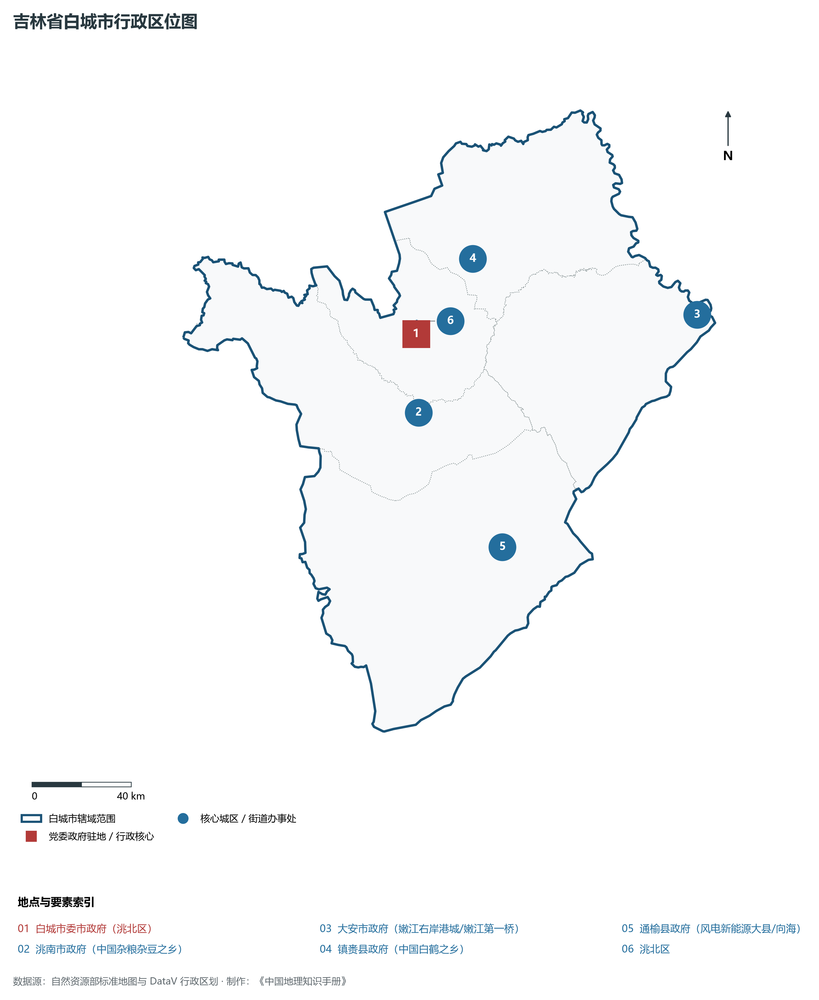
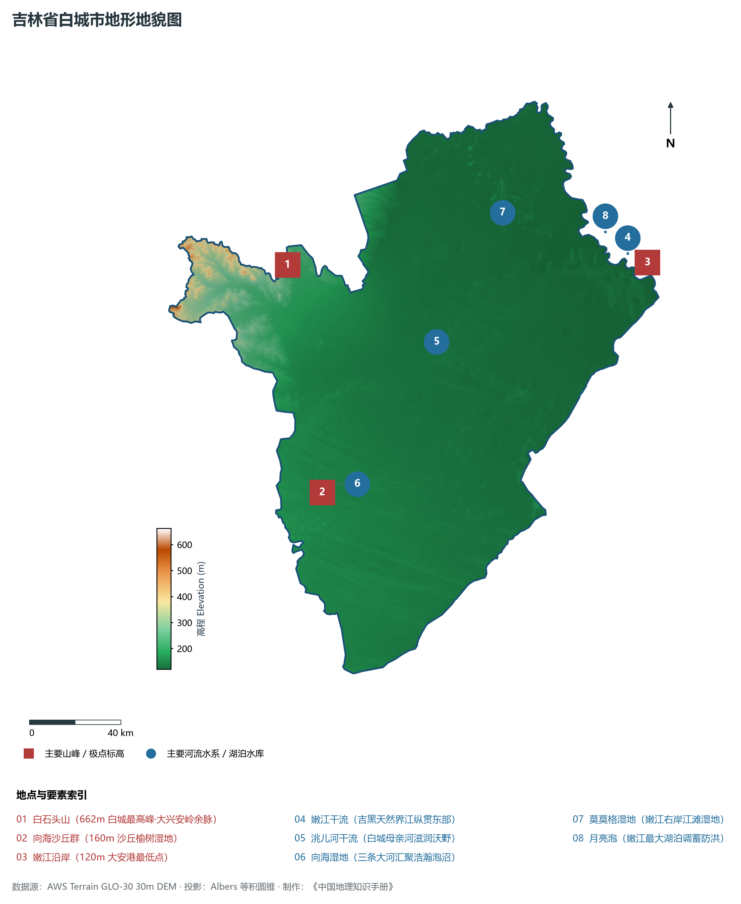
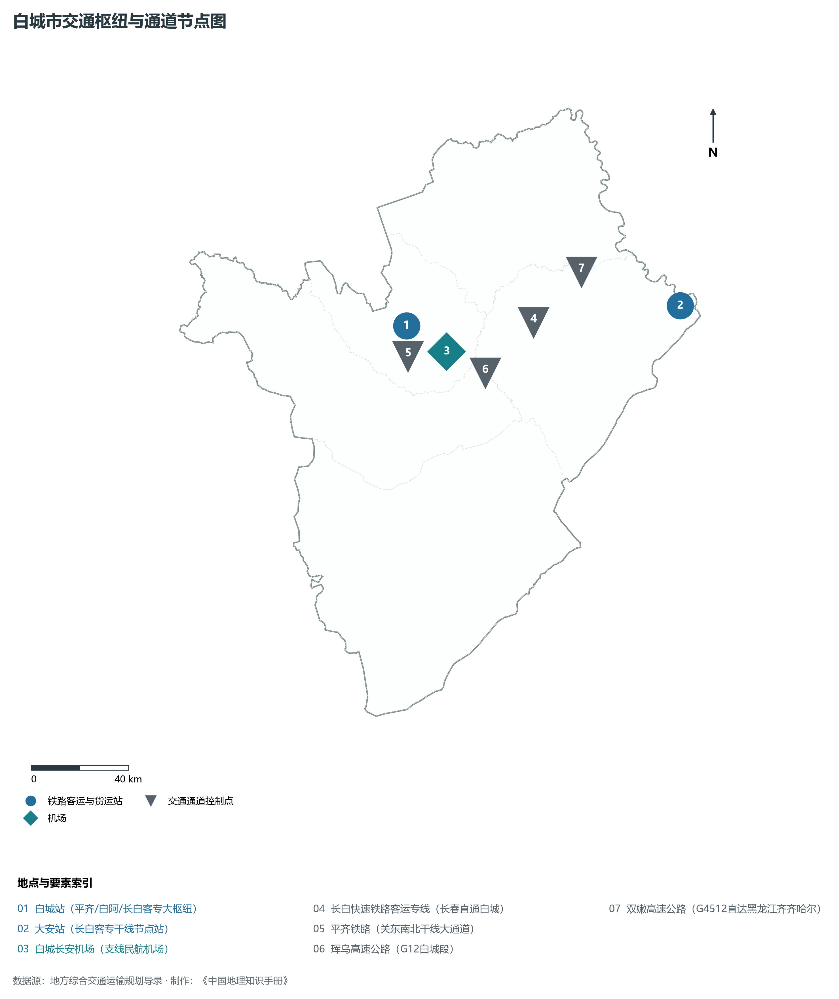
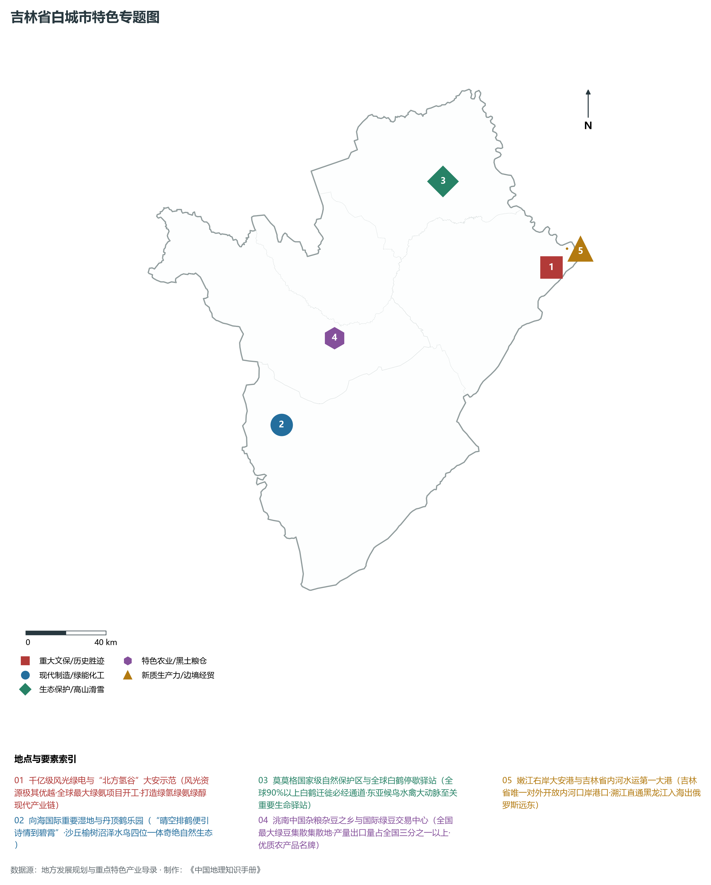
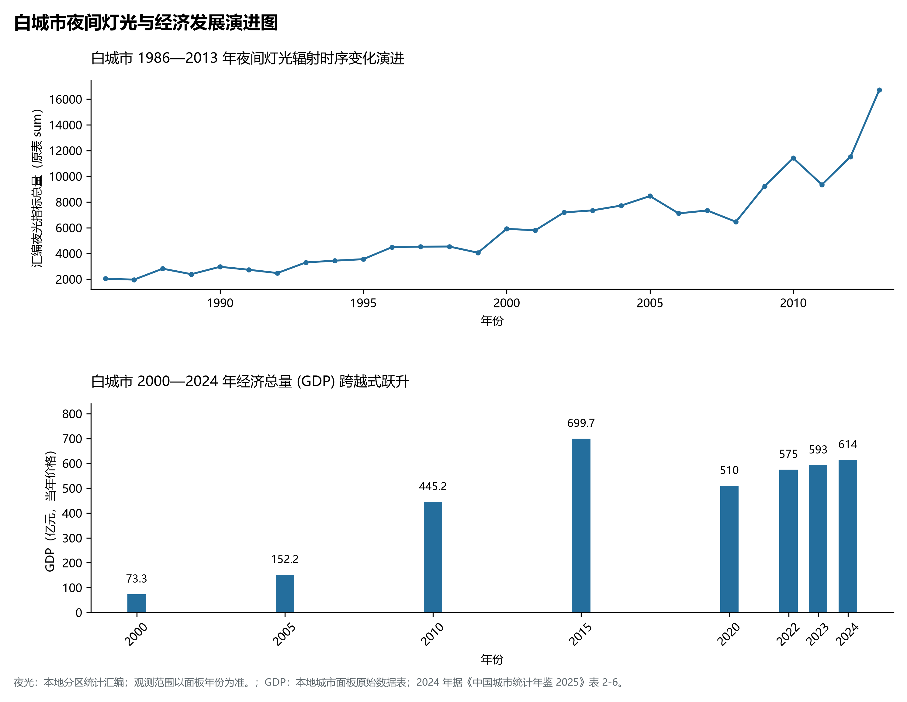

# 6.8 白城市

白城市，位于吉林省，其战略定位与特色概括为：**嫩江右岸·科尔沁草原东缘·“绿氢之都”千亿级风光绿能氢氨醇综合基地**。2024 年常住人口 **145 万人**，常住人口城镇化率 **57.88%**，地区生产总值 **614 亿元**（当年价格），人均地区生产总值 **42,097 元**，三次产业构成为 **26.03 : 21 : 52.97**。

---

## 一、自然地理底盘与地貌水系机理

区域骨干控制性山脉与地形高程极点包括：

- **白石头山 (662m 白城最高峰·大兴安岭余脉)**（坐标约东经 122.350°、北纬 45.850°，高程约 662.0 m）；
- **向海沙丘群 (160m 沙丘榆树湿地)**（坐标约东经 122.320°、北纬 44.950°，高程约 160.0 m）；
- **嫩江沿岸 (120m 大安港最低点)**（坐标约东经 124.350°、北纬 45.600°，高程约 120.0 m）；

水系与水文网络方面，白城市地表水资源丰富，骨干江河湖泊纵横穿流：

- **嫩江干流 (吉黑天然界江纵贯东部)**（流经约东经 124.250°、北纬 45.650° 水域）；
- **洮儿河干流 (白城母亲河滋润沃野)**（流经约东经 123.100°、北纬 45.450° 水域）；
- **向海湿地 (三条大河汇聚浩瀚泡沼)**（流经约东经 122.350°、北纬 44.980° 水域）；
- **莫莫格湿地 (嫩江右岸江滩湿地)**（流经约东经 123.600°、北纬 45.900° 水域）；
- **月亮泡 (嫩江最大湖泊调蓄防洪)**（流经约东经 124.150°、北纬 45.750° 水域）；

---

## 二、行政区划沿革与城镇空间体系

白城市历史文脉积淀深厚，建置沿革源远流长。新中国成立以来，伴随国家重点工程布局、老工业基地建设与新型城镇化战略推进，形成了梯次鲜明、产城紧密融合的市辖区与县级行政单元空间组织体系：

- **白城市委市政府 (洮北区)**（驻地坐标：122.840°E, 45.620°N）；
- **洮南市政府 (中国杂粮杂豆之乡)**（驻地坐标：122.780°E, 45.340°N）；
- **大安市政府 (嫩江右岸港城/嫩江第一桥)**（驻地坐标：124.290°E, 45.500°N）；
- **镇赉县政府 (中国白鹤之乡)**（驻地坐标：123.200°E, 45.850°N）；
- **通榆县政府 (风电新能源大县/向海)**（驻地坐标：123.080°E, 44.810°N）；

在城镇空间总体布局上，白城市紧扣《国土空间总体规划》，坚持“极核集聚、轴带贯通、组团联动、绿色涵养”的总体思路，统筹协调中心城区扩容提质与县域城镇特色发展，构建多中心、网络化、集约型的空间发展格局。

---

## 三、综合立体交通网络与交通走廊

白城市地处东北地区立体交通网络关键节点，依托高速铁路、干线普速铁路、国家高速公路与航空口岸，构筑了四通八达的现代化立体综合交通运输骨架：

**主要综合客运与货运物流交通枢纽节点：**

- **白城站 (平齐/白阿/长白客专大枢纽)**（位置坐标：122.835°E, 45.625°N）；
- **大安站 (长白客专干线节点站)**（位置坐标：124.280°E, 45.510°N）；
- **白城长安机场 (支线民航机场)**（位置坐标：123.020°E, 45.505°N）；

**核心干线铁路与高等级公路交通走廊：**

- **长白快速铁路客运专线 (长春直通白城)**（廊道控制点：123.500°E, 45.550°N）：对外快速互联互通的高速客货运通道；
- **平齐铁路 (关东南北干线大通道)**（廊道控制点：122.900°E, 45.500°N）：对外快速互联互通的高速客货运通道；
- **珲乌高速公路 (G12白城段)**（廊道控制点：123.200°E, 45.400°N）：对外快速互联互通的高速客货运通道；
- **双嫩高速公路 (G4512直达黑龙江齐齐哈尔)**（廊道控制点：123.800°E, 45.700°N）：对外快速互联互通的高速客货运通道；

---

## 四、现代重点产业布局与特色功能组团

在新时代推动东北全面振兴战略引领下，白城市紧扣高质量发展首要任务，深度融入全省“一主六双”高质量发展战略格局，加快传统优势产业转型升级，培育壮大新兴战略性产业链群，全力打造特色鲜明的现代化产业高地：

**重点园区与现代化产业承载基地：**

- **大安风光制绿氢合成氨一体化示范基地**（空间分布：124.200°E, 45.450°N）；
- **白城绿电产业园区 (千万千瓦级清洁能源基地)**（空间分布：122.950°E, 45.550°N）；
- **洮南国家级现代杂粮杂豆加工交易中心**（空间分布：122.750°E, 45.320°N）；
- **通榆三一重能与远景风电主机制造基地**（空间分布：123.120°E, 44.830°N）；

**代表性特色地标与战略支撑维度：**

- **千亿级风光绿电与“北方氢谷”大安示范**（124.200°E, 45.450°N）：风光资源极其优越·全球最大绿氨项目开工·打造绿氢绿氨绿醇现代产业链；
- **向海国际重要湿地与丹顶鹤乐园**（122.320°E, 44.980°N）：“晴空排鹤便引诗情到碧霄”·沙丘榆树沼泽水鸟四位一体奇绝自然生态；
- **莫莫格国家级自然保护区与全球白鹤停歇驿站**（123.620°E, 45.920°N）：全球90%以上白鹤迁徙必经通道·东亚候鸟水禽大动脉至关重要生命驿站；
- **洮南中国杂粮杂豆之乡与国际绿豆交易中心**（122.750°E, 45.320°N）：全国最大绿豆集散集散地·产量出口量占全国三分之一以上·优质农产品名牌；
- **嫩江右岸大安港与吉林省内河水运第一大港**（124.320°E, 45.520°N）：吉林省唯一对外开放内河口岸港口·溯江直通黑龙江入海出俄罗斯远东；

---

## 五、1986—2013年夜间灯光演变与经济变化分析

本节夜光图的观测年份为 1986—2013 年，指标为行政区汇总值（原表 sum）。

2024 年白城市全市地区生产总值为 614 亿元（当年价格）。

| 年份 | 地区生产总值（亿元，当年价格） |
|:---|---:|
| 2000 年 | 73.3 |
| 2005 年 | 152.2 |
| 2010 年 | 445.2 |
| 2015 年 | 699.7 |
| 2020 年 | 510 |
| 2022 年 | 575 |
| 2023 年 | 593 |
| 2024 年 | 614 |

---

## 六、文化旅游名胜、生态屏障与可持续人地共生

白城市高度注重统筹经济高质量发展与高水平生态环境保护，筑牢绿色生态底盘，弘扬优秀历史文化：

- **向海国家级自然保护区 (国际重要湿地·4A)**（位置坐标：122.320°E, 44.980°N）；
- **莫莫格国家级自然保护区 (白鹤之乡)**（位置坐标：123.620°E, 45.920°N）；
- **大安嫩江湾国家湿地公园 (江湾胜境)**（位置坐标：124.320°E, 45.520°N）；
- **通榆香海温泉生态旅游区**（位置坐标：123.050°E, 44.850°N）；

在人地协调机制方面，白城市统筹推进山水林田湖草沙一体化保护与系统治理，坚决打好蓝天、碧水、净土保卫战，筑牢长白山林区水塔屏障与平原黑土地粮仓，打造人与自然和谐共生的生态宜居美丽家园。

---

## 七、白城市关键地理统计指标速查矩阵

| 统计指标项 | 统计数值 / 口径标准 | 空间特征与全省位次说明 |
|:---|:---|:---|
| **行政区划代码** | `220800` | 国家民政部标准行政区划编号 |
| **辖区陆地面积** | **25,758.0** km² | 土地利用类型兼具山地、丘陵、平原与城镇工矿 |
| **常住人口规模** | 145 万人 | 2024 年，全市；年鉴公布口径 |
| **常住人口城镇化率** | 57.88% | 2024 年，全市；年鉴公布口径 |
| **地区生产总值 (2024)** | 614 亿元 | 2024 年，全市；年鉴公布口径 |
| **人均 GDP 水平** | 42,097 元/人 | 2024 年，全市；年鉴公布口径 |
| **三次产业结构比** | 26.03 : 21 : 52.97 | 2024 年，全市；年鉴公布口径 |
| **地表极限高程** | **120.0 m ～ 662.0 m** | 形成极具特色的立体地貌剖面格局 |

2024 年统计来源：《中国城市统计年鉴 2025》表 2-1、2-6、2-7（2024 年，全市）。其他年份 GDP 据本地城市面板“原始数据”表，单位为亿元、当年价格。
