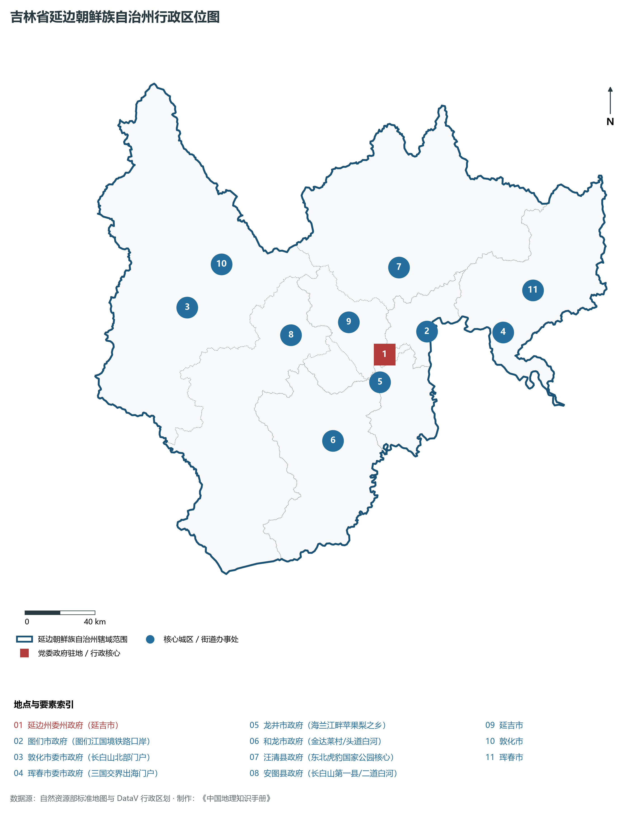
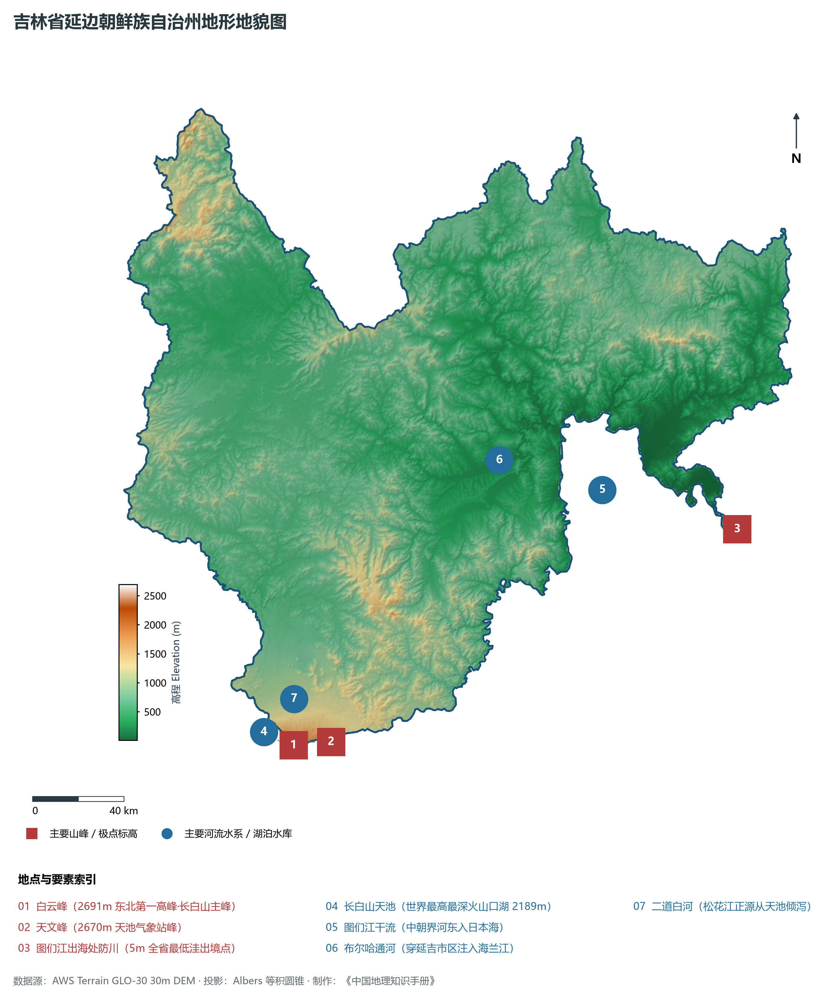
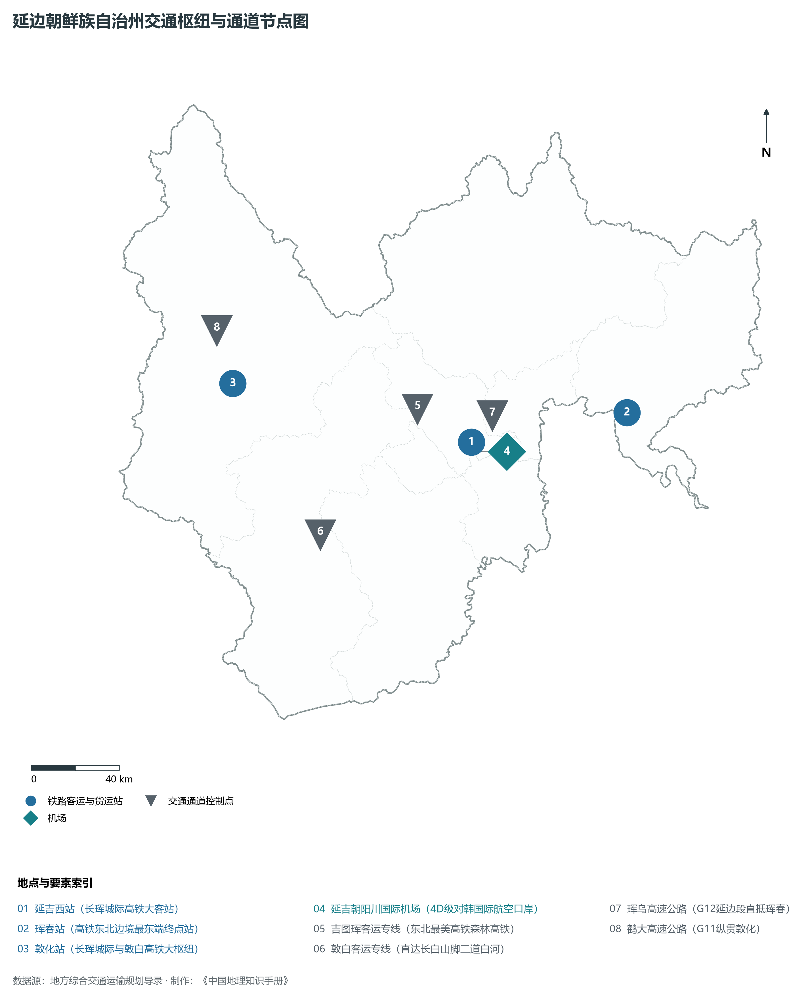
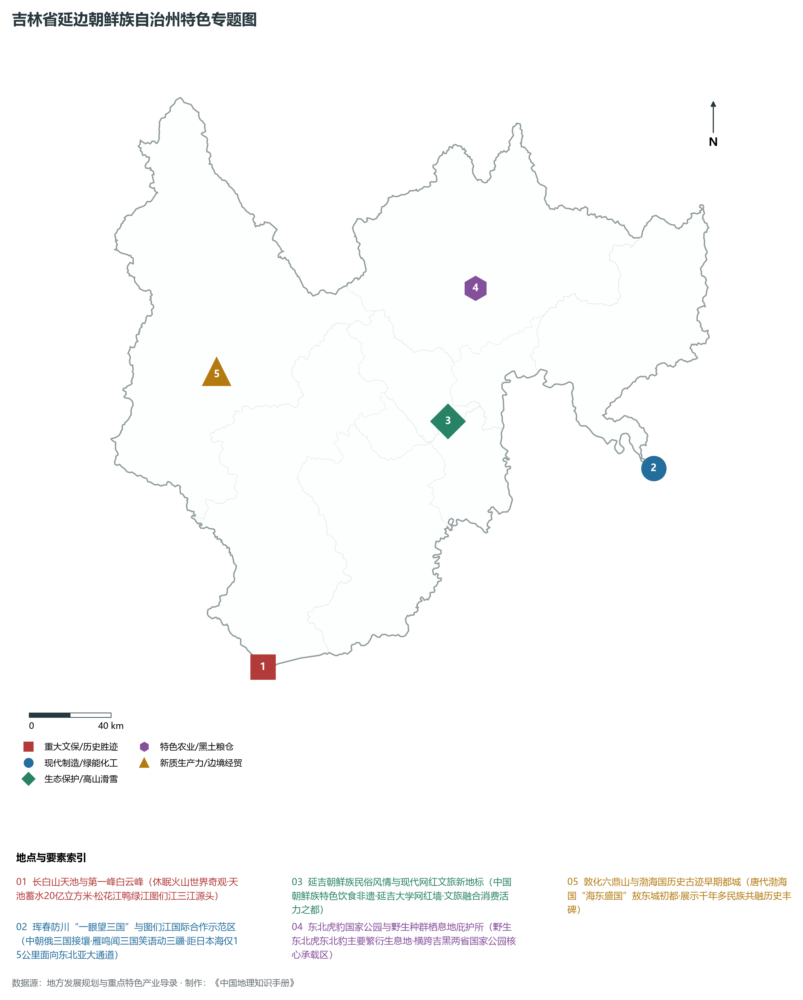
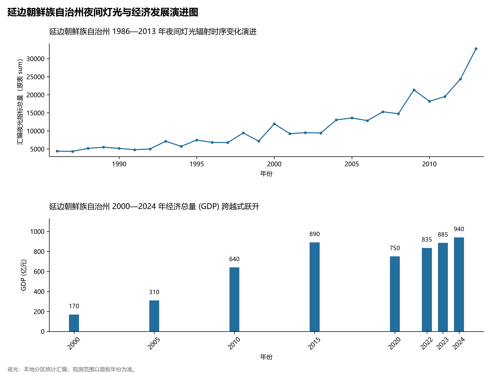

# 6.9 延边朝鲜族自治州

延边朝鲜族自治州，位于吉林省，其战略定位与特色概括为：**长白山第一峰天池·图们江出海门户防川一眼望三国·中国最大朝鲜族自治聚居区**。全境土地总面积达 **43,329.0 km²**，截至 2024 年末常住人口约 **195.0** 万人，常住人口城镇化率达 **76.5%**。2024 年实现地区生产总值（GDP）约 **940.0** 亿元，人均 GDP 约 **48,200** 元，三次产业结构比为 **7.5 : 36.5 : 56.0**。全境地表高程极值跨度介于 **5.0 m ～ 2691.0 m** 之间，展现出雄浑宏阔的自然地理风貌与独具特色的现代产业发展基底。

---

## 一、自然地理底盘与地貌水系机理

区域骨干控制性山脉与地形高程极点包括：

- **白云峰 (2691m 东北第一高峰·长白山主峰)**（坐标约东经 128.060°、北纬 42.025°，高程约 2691.0 m）；
- **天文峰 (2670m 天池气象站峰)**（坐标约东经 128.080°、北纬 42.035°，高程约 2670.0 m）；
- **图们江出海处防川 (5m 全省最低洼出境点)**（坐标约东经 130.650°、北纬 42.420°，高程约 5.0 m）；

水系与水文网络方面，延边朝鲜族自治州地表水资源丰富，骨干江河湖泊纵横穿流：

- **长白山天池 (世界最高最深火山口湖 2189m)**（流经约东经 128.055°、北纬 42.010° 水域）；
- **图们江干流 (中朝界河东入日本海)**（流经约东经 130.000°、北纬 42.700° 水域）；
- **布尔哈通河 (穿延吉市区注入海兰江)**（流经约东经 129.500°、北纬 42.910° 水域）；
- **二道白河 (松花江正源从天池倾泻)**（流经约东经 128.120°、北纬 42.200° 水域）；

---

## 二、行政区划沿革与城镇空间体系

延边朝鲜族自治州历史文脉积淀深厚，建置沿革源远流长。新中国成立以来，伴随国家重点工程布局、老工业基地建设与新型城镇化战略推进，形成了梯次鲜明、产城紧密融合的市辖区与县级行政单元空间组织体系：

- **延边州委州政府 (延吉市)**（驻地坐标：129.510°E, 42.900°N）；
- **图们市政府 (图们江国境铁路口岸)**（驻地坐标：129.840°E, 42.960°N）；
- **敦化市委市政府 (长白山北部门户)**（驻地坐标：128.230°E, 43.370°N）；
- **珲春市委市政府 (三国交界出海门户)**（驻地坐标：130.360°E, 42.860°N）；
- **龙井市政府 (海兰江畔苹果梨之乡)**（驻地坐标：129.430°E, 42.770°N）；
- **和龙市政府 (金达莱村/头道白河)**（驻地坐标：129.010°E, 42.540°N）；
- **汪清县政府 (东北虎豹国家公园核心)**（驻地坐标：129.760°E, 43.310°N）；
- **安图县政府 (长白山第一县/二道白河)**（驻地坐标：128.900°E, 43.110°N）；

在城镇空间总体布局上，延边朝鲜族自治州紧扣《国土空间总体规划》，坚持“极核集聚、轴带贯通、组团联动、绿色涵养”的总体思路，统筹协调中心城区扩容提质与县域城镇特色发展，构建多中心、网络化、集约型的空间发展格局。

---

## 三、综合立体交通网络与交通走廊

延边朝鲜族自治州地处东北地区立体交通网络关键节点，依托高速铁路、干线普速铁路、国家高速公路与航空口岸，构筑了四通八达的现代化立体综合交通运输骨架：

**主要综合客运与货运物流交通枢纽节点：**

- **延吉西站 (长珲城际高铁大客站)**（位置坐标：129.450°E, 42.920°N）；
- **珲春站 (高铁东北边境最东端终点站)**（位置坐标：130.340°E, 42.880°N）；
- **敦化站 (长珲城际与敦白高铁大枢纽)**（位置坐标：128.220°E, 43.380°N）；
- **延吉朝阳川国际机场 (4D级对韩国际航空口岸)**（位置坐标：129.450°E, 42.880°N）；

**核心干线铁路与高等级公路交通走廊：**

- **吉图珲客运专线 (东北最美高铁森林高铁)**（廊道控制点：129.200°E, 43.100°N）：对外快速互联互通的高速客货运通道；
- **敦白客运专线 (直达长白山脚二道白河)**（廊道控制点：128.500°E, 42.700°N）：对外快速互联互通的高速客货运通道；
- **珲乌高速公路 (G12延边段直抵珲春)**（廊道控制点：129.600°E, 43.000°N）：对外快速互联互通的高速客货运通道；
- **鹤大高速公路 (G11纵贯敦化)**（廊道控制点：128.200°E, 43.600°N）：对外快速互联互通的高速客货运通道；

---

## 四、现代重点产业布局与特色功能组团

在新时代推动东北全面振兴战略引领下，延边朝鲜族自治州紧扣高质量发展首要任务，深度融入全省“一主六双”高质量发展战略格局，加快传统优势产业转型升级，培育壮大新兴战略性产业链群，全力打造特色鲜明的现代化产业高地：

**重点园区与现代化产业承载基地：**

- **珲春边境经济合作区 (国家级边合区)**（空间分布：130.350°E, 42.840°N）；
- **延吉高新技术产业开发区 (生物科技现代医药)**（空间分布：129.480°E, 42.930°N）；
- **敦化中国医药名城现代医药产业园**（空间分布：128.250°E, 43.350°N）；
- **东北虎豹国家公园汪清科研保护基地**（空间分布：129.850°E, 43.400°N）；

**代表性特色地标与战略支撑维度：**

- **长白山天池与第一峰白云峰 (2691m 东北之巅)**（128.060°E, 42.025°N）：休眠火山世界奇观·天池蓄水20亿立方米·松花江鸭绿江图们江三江源头；
- **珲春防川“一眼望三国”与图们江国际合作示范区**（130.620°E, 42.450°N）：中朝俄三国接壤·雁鸣闻三国笑语动三疆·距日本海仅15公里面向东北亚大通道；
- **延吉朝鲜族民俗风情与现代网红文旅新地标**（129.490°E, 42.870°N）：中国朝鲜族特色饮食非遗·延吉大学网红墙·文旅融合消费活力之都；
- **东北虎豹国家公园与野生种群栖息地庇护所**（129.850°E, 43.400°N）：野生东北虎东北豹主要繁衍生息地·横跨吉黑两省国家公园核心承载区；
- **敦化六鼎山与渤海国历史古迹早期都城**（128.200°E, 43.320°N）：唐代渤海国“海东盛国”敖东城初都·展示千年多民族共融历史丰碑；

---

## 五、1986—2013年夜间灯光演变与经济变化分析

本节夜光图的观测年份为 1986—2013 年，指标为行政区汇总值（原表 sum）。

| 年份 | 地区生产总值 (GDP, 亿元) | 发展阶段特征与重大战略工程推进 |
|:---|:---|:---|
| 2000年 | **170.0** | 社会主义市场经济体制初步确立，传统工矿农业结构深度调整 |
| 2005年 | **310.0** | 国家实施振兴东北老工业基地重大战略，重大产业改造与基础设施全面铺开 |
| 2010年 | **640.0** | 国家实施振兴东北老工业基地重大战略，重大产业改造与基础设施全面铺开 |
| 2015年 | **890.0** | 新旧动能加速转换，高质量发展与全面振兴新突破进入攻坚突破期 |
| 2020年 | **750.0** | 新旧动能加速转换，高质量发展与全面振兴新突破进入攻坚突破期 |
| 2022年 | **835.0** | 新旧动能加速转换，高质量发展与全面振兴新突破进入攻坚突破期 |
| 2023年 | **885.0** | 新旧动能加速转换，高质量发展与全面振兴新突破进入攻坚突破期 |
| 2024年 | **940.0** | 新旧动能加速转换，高质量发展与全面振兴新突破进入攻坚突破期 |

## 六、文化旅游名胜、生态屏障与可持续人地共生

延边朝鲜族自治州高度注重统筹经济高质量发展与高水平生态环境保护，筑牢绿色生态底盘，弘扬优秀历史文化：

- **长白山北景区与长白瀑布 (5A·中华名山)**（位置坐标：128.100°E, 42.100°N）；
- **珲春防川风景区 (一眼望三国·中国唯一)**（位置坐标：130.620°E, 42.450°N）；
- **延吉中国朝鲜族民俗园与网红弹幕墙**（位置坐标：129.490°E, 42.870°N）；
- **敦化六鼎山文化旅游区 (5A·金鼎大佛)**（位置坐标：128.200°E, 43.320°N）；

在人地协调机制方面，延边朝鲜族自治州统筹推进山水林田湖草沙一体化保护与系统治理，坚决打好蓝天、碧水、净土保卫战，筑牢长白山林区水塔屏障与平原黑土地粮仓，打造人与自然和谐共生的生态宜居美丽家园。

---

## 七、延边朝鲜族自治州关键地理统计指标速查矩阵

| 统计指标项 | 统计数值 / 口径标准 | 空间特征与全省位次说明 |
|:---|:---|:---|
| **行政区划代码** | `222400` | 国家民政部标准行政区划编号 |
| **辖区陆地面积** | **43,329.0** km² | 土地利用类型兼具山地、丘陵、平原与城镇工矿 |
| **常住人口规模** | **195.0** 万人 | 区域核心人口聚集极核 |
| **常住人口城镇化率** | **76.5%** | 工业化基础扎实，非农人口集聚度较高 |
| **地区生产总值 (2024)** | **940.0** 亿元 | 综合经济实力支撑全省高质量发展大局 |
| **人均 GDP 水平** | 约 **48,200** 元/人 | 居民综合富裕度与要素产出效率指标 |
| **三次产业结构比** | **7.5 : 36.5 : 56.0** | 二产与三产双轮驱动的现代化产业格局 |
| **地表极限高程** | **5.0 m ～ 2691.0 m** | 形成极具特色的立体地貌剖面格局 |
