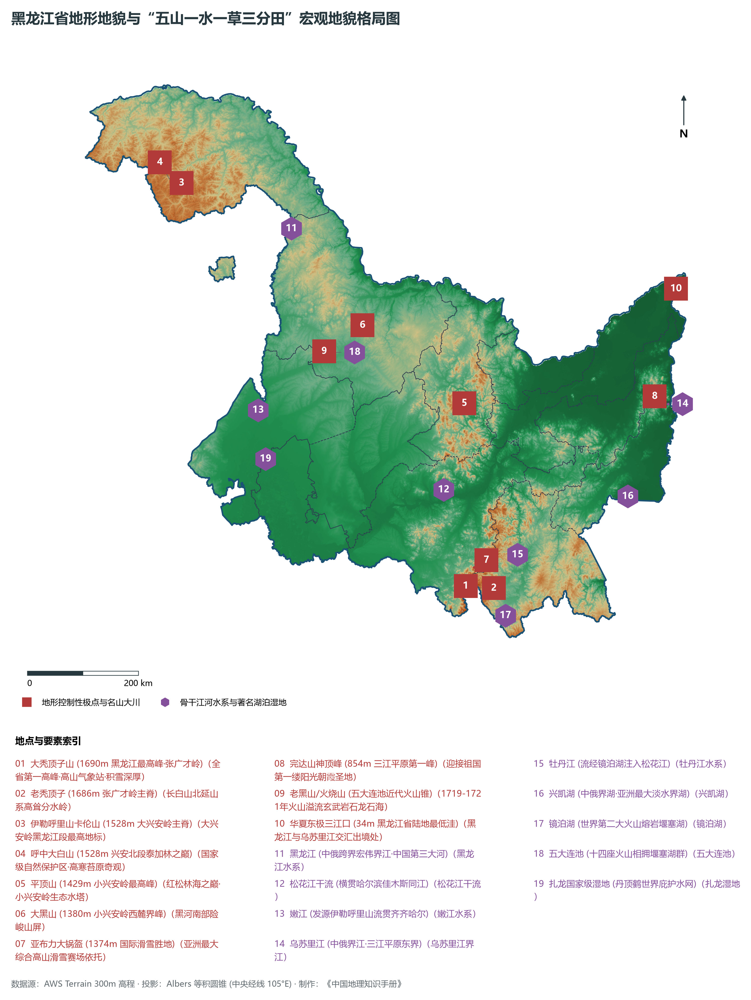
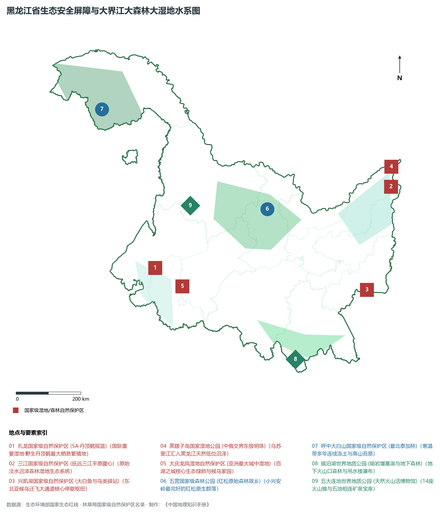
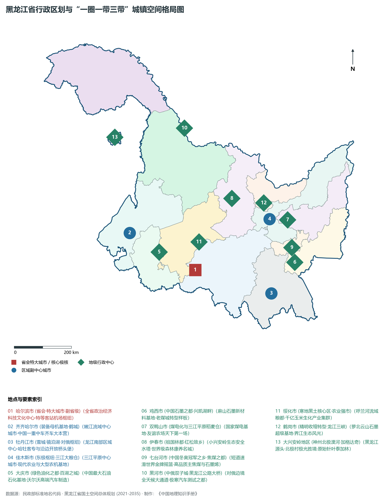
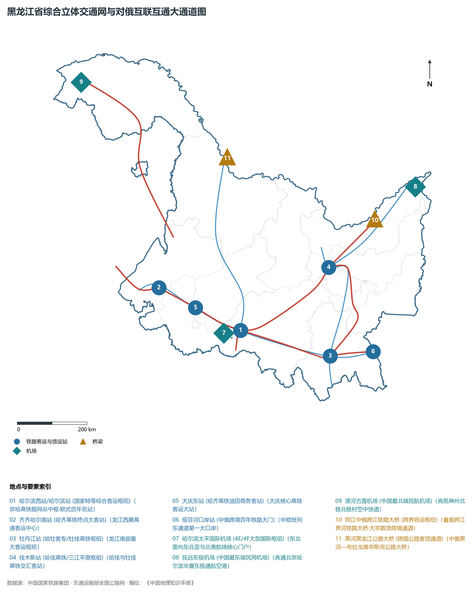
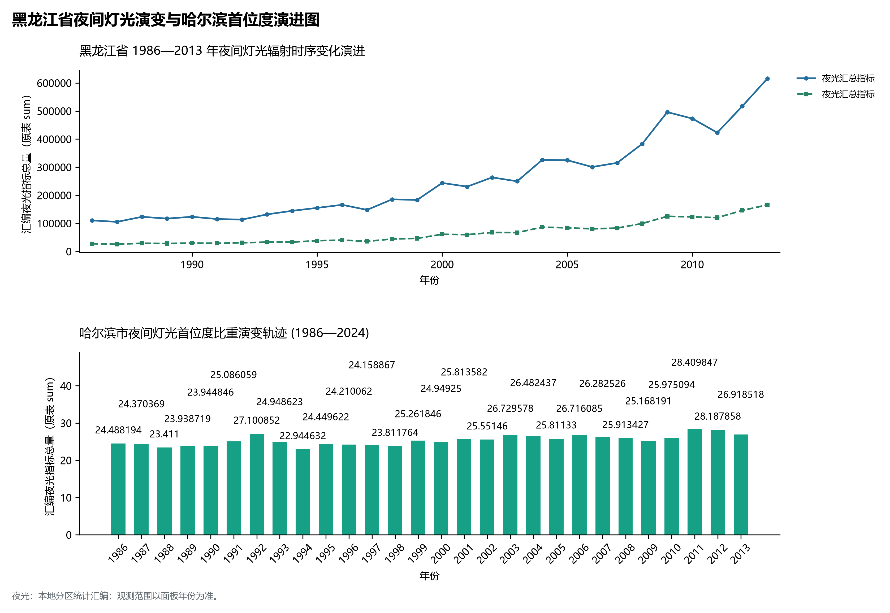

# 7.0 黑龙江省地理统揽

黑龙江省，简称“黑”，省会哈尔滨市，位于中华人民共和国东北边陲，是我国经度最东、纬度最高的省级行政区，地处东经 121° 11' ～ 135° 05'、北纬 43° 26' ～ 53° 33' 之间。全省土地总面积达 47.3 × 10⁴ km²（含大兴安岭地区加格达奇、松岭），占全国国土陆地面积的 4.9%，位居全国第 6 位。黑龙江北部与东部隔黑龙江、乌苏里江与俄罗斯联邦的阿穆尔州、犹太自治州、哈巴罗夫斯克边疆区、滨海边疆区、外贝加尔边疆区相望，边境线总长达 2981 km，约占全国陆地边境线总长度的七分之一，是我国边境线最长、沿边口岸最密集的陆路开放门户；西部与内蒙古自治区毗连，南与吉林省接壤。黑龙江是我国面向东北亚、连接俄罗斯与欧亚大陆的陆海联运大通道核心前沿，更是筑牢维护国家**国防安全、粮食安全、生态安全、能源安全、产业安全**的战略压舱石。

全省地貌宏观上呈现极为开阔壮美的**“五山一水一草三分田”总体格局**。西北部大兴安岭、北部小兴安岭与东南部张广才岭、完达山、老爷岭群山环抱，中部松嫩平原与东部三江平原沃野千里，黑龙江、松花江、嫩江、乌苏里江四大宏伟水系奔腾流淌。全省现辖 12 个地级市（哈尔滨市、齐齐哈尔市、鸡西市、鹤岗市、双鸭山市、大庆市、伊春市、佳木斯市、七台河市、牡丹江市、黑河市、绥化市）和 1 个地区（大兴安岭地区），其中包括副省级特大城市哈尔滨市。截至 2024 年末，全省常住人口约 3060 万人，常住人口城镇化率达 66.5%。2024 年全省实现地区生产总值（GDP）约 1.62 万亿元。作为举世闻名的“北大仓”与国家重工业摇篮，黑龙江粮食总产量连续多年突破 1500 亿斤大关、连续 15 年稳居全国第一；孕育了大庆油田、中国一重、哈电集团、哈飞集团、中车齐车等一批国宝级大国重器制造基地，当前正深入贯彻推动新时代东北全面振兴战略，加快构建“4567”现代化产业体系，全力构筑向北开放新高地。

---

## 一、地质构造演化与“五山一水一草三分田”宏观地貌格局

黑龙江省地处古亚洲洋构造域与滨太平洋构造域叠加复合的极其复杂的交汇地带。大地构造属于中亚造山带东缘的大兴安岭—黑河造山系与佳木斯—兴凯地块的拼合部位。自古生代以来经历了强烈的板块俯冲碰撞与缝合拼贴，中生代燕山运动伴随剧烈的陆内火山岩浆喷发侵入与大规模伸展裂陷，塑造了松辽盆地、三江盆地、勃利盆地等内陆大型沉降盆地与外围隆起山系；新生代喜马拉雅运动引发强烈的玄武岩溢流喷发，形成了五大连池（14座新期与老期火山锥）、镜泊湖熔岩台地等举世罕见的新生代火山堰塞湖奇观；而第四纪以来冰缘冻土与风沙洪积、河漫滩泛滥堆积，在两盆地腹心铺就了深达一米余的广袤肥沃黑土与黑钙土。

黑龙江省地表高程极值跨度由平原水系出境处的 **34 m** 跃升至崇山峻岭顶峰的 **1690 m**，垂直高差落差达 1656 m：

- **全省最高极顶**：位于哈尔滨五常市东南与海林市交界处的张广才岭主峰——**大秃顶子山（海拔 1690 m）**，高耸入云、山顶平坦发育高山草甸与矮曲林，冬季积雪深达两米以上，被誉为“龙江之巅”。
- **全省最低洼出境点**：位于佳木斯同江市与抚远市交界处的**黑龙江与乌苏里江汇流出境处（海拔仅约 34 m）**，水网低平开阔、沼泽连片，为东北平原乃至全国最东端的地理低洼水系出口。

依据地势起伏与形态成因，全省自外向内可划分为鲜明对称的地貌空间单元：

1. **西北部大兴安岭山地**：属于古老断块隆起山脉，在黑龙江境内呈北东走向展布，平均海拔在 800～ 1200 m 之间。主峰卡伦山与呼中大白山海拔达 1528 m。山体宽厚平缓、受古冰川与冰缘冻融作用深刻改造，广泛分布着我国唯一的多年岛状与连续冻土层，覆盖着连绵无际的兴安落叶松与白桦原始泰加林海。
2. **北部小兴安岭低山丘陵区**：西北接伊勒呼里山，东南至松花江下游峡谷，呈西北—东南走向展布，长达近 500 km。平均海拔在 400～ 800 m 之间，最高峰平顶山海拔 1429 m。山峦起伏平缓、侵蚀切割较弱，红松原生针阔混交林密布，素有“祖国林都”美誉。
3. **东南部张广才岭、老爷岭、完达山山原区**：属于长白山脉向东北延伸的支脉系统。张广才岭地势高峻陡拔，海拔多在 1000～ 1500 m 之间，发育大秃顶子山（1690 m）、老秃顶子（1686 m）；完达山横亘于三江平原南部，主峰神顶峰海拔 854 m。山原区降水丰沛、森林茂密、谷深水碧，是松花江与牡丹江流域的核心水源水塔。
4. **西南部松嫩冲积平原区**：位于大兴安岭与小兴安岭之间，由嫩江、松花江及其支流冲击侵蚀而成。地势低平开阔，海拔多在 120～ 200 m 之间，覆盖着深厚肥沃的黑钙土与草甸土。平原上泡沼洼地星罗棋布，拥有大庆天然百湖与扎龙闭流大湿地，是享誉全国的核心粮油与畜牧生产基地。
5. **东北部三江冲积低平原区**：由黑龙江、松花江、乌苏里江三江下游泛滥沉积而成。地势极为平缓低洼，海拔在 34～ 80 m 之间，坡降仅万分之几。全区沼泽湿地连片发育，曾为茫茫“北大荒”，经数十载屯垦戍边，现已崛起为集中连片、机械化水平全球领先的国家超级商品粮仓“北大仓”。

**黑龙江省宏观地貌与三大平原剖面示意表**

| 大兴安岭森林带 | 松嫩黑土农业区 | 小兴安岭红松林 | 三江平原大粮仓 |
| --- | --- | --- | --- |
| (卡伦山 1528m)；寒温带冻土与泰加 | (齐齐哈尔/大庆)；嫩江/松花江流贯 | (平顶山 1429m)；汤旺河穿流石林 | (抚远三江口 34m)；沼泽湿地与现代农机 |

西 (大兴安岭泰加林) · → 中 (松嫩冲积平原) · → 中东 (小兴安岭) · → 东 (三江冲积平原)；海拔 800~1500m · 海拔 120~200m · 海拔 400~1400m · 海拔 34~80m；国家生态第一屏障 · 百湖之城与粮仓 · 祖国林都水源涵养 · 中俄界江东极粮都

---

## 二、温带寒温带大陆季风气候与大界江大森林大湿地水系

黑龙江省横跨温带与寒温带，深居亚欧大陆中高纬度东缘，属于典型的**温带—寒温带大陆性季风气候**：

- **热量梯度与漫长极寒**：全省冬季寒冷漫长、积雪皑皑，封冻期长达 5 至 7 个月，漠河极端最低气温曾达 -53.2°C，全省大部分地区 1 月平均气温在 -15°C ～ -30°C 之间；夏季温凉短促、天高气爽、雨热同期，无霜期仅 100～ 160 d，自南向北迅速缩短。昼夜温差大与高纯净日光辐射，极其有利于作物干物质和糖分积累，造就了黑龙江大米、非转基因大豆品质顶尖的核心光热密码。
- **降水时空分异**：全省年降水量在 400～ 700 mm 之间。受长白山与张广才岭地形抬升阻挡，东南部迎风坡降水量达 600～ 750 mm，为全省湿润核心；向西北延伸至大兴安岭与松嫩平原北部递减至 380～ 450 mm。全年降水主要集中在 7、8 月，夏季暴雨与汛期洪涝过程集中。

黑龙江省境内河流密布、湖沼众多，境内流域面积在 100 km² 以上的水系河流达 1700 余条，拥有浩瀚的大界江、大界湖与全球最关键的国际湿地系统：

1. **黑龙江（Amur River，中国第三大河流）**：
   - 东北亚最大国际界河，南源额尔古纳河与西源石勒喀河在漠河洛古河村交汇后始称黑龙江。中俄界河段长达 2981 km，在省境全长达数千公里，流域面积广阔。两岸原始次生林与峭壁对峙，沿途流经漠河、塔河、呼玛、黑河、孙吴、逊克、嘉荫、萝北、绥滨、同江、抚远，终在抚远三江口附近向东北奔流入俄罗斯境内注入鄂霍次克海鞑靼海峡。
2. **松花江干流（全省第一大内陆生命水脉）**：
   - 第二松花江与嫩江在松原三岔河汇合后向东横穿黑龙江平原腹地，全长 939 km。干流流经肇源、双城、哈尔滨主城、呼兰、宾县、巴彦、木兰、通河、依兰、佳木斯、富锦、绥滨、同江，在同江三江口注入黑龙江。松花江水量充沛，是龙江航运、城乡供水、沿岸灌溉与沿江重大产业群的核心水源。
3. **嫩江水系（东北内陆外流水网脊柱）**：
   - 发源于伊勒呼里山南麓，自北向南流经黑河嫩江市、齐齐哈尔、大庆杜尔伯特，在肇源汇入松花江。全长 1370 km，河道迂回曲折、汊流发育，支流乌裕尔河无尾闭流形成全球著名的扎龙湿地。
4. **乌苏里江水系（中俄东段界河）**：
   - 南源发源于锡霍特山脉西麓，北流至抚远黑瞎子岛汇入黑龙江，全长 890 km，为中俄东部界河。江水清冽纯净、鱼类资源富集，以盛产大马哈鱼、三花五罗十八子享誉全国。
5. **重要湖泊与湿地生态系统**：
   - **兴凯湖**：中俄跨界最大淡水界湖，面积达 4380 km²（中方管辖面积约 1280 km²），水天相连宛若大海，被誉为“东极明珠”，是大白鱼故乡与东亚候鸟迁徙关键驿站；
   - **镜泊湖**：位于牡丹江宁安境内，水域面积 90 km²，为第四纪火山熔岩流堵塞牡丹江古河道形成的我国最大火山堰塞湖，拥有吊水楼瀑布、百里长湖与地下火山口原始森林；
   - **五大连池**：14座火山锥溢流熔岩截断白河形成五个首尾相连的熔岩堰塞湖，被联合国教科文组织授予世界地质公园；
   - **国际重要湿地群**：包括扎龙、三江、兴凯湖、珍宝岛、东方红等 10 余处国家级自然保护区，保存了全球最完好的大面积淡水沼泽与芦苇湿地，是丹顶鹤、白枕鹤、东方白鹳等濒危珍稀水禽的全球核心繁殖庇护地。

---

## 三、行政区划、人口与“一圈一带三带”城镇空间格局

黑龙江省现辖 12 个地级市、1 个地区，下辖 54 个市辖区、21 个县级市、45 个县、1 个自治县，共 121 个县级行政区。全省常住人口空间分布呈现“哈尔滨单核集聚主导、沿哈大齐中轴密集分布、煤林老矿区精明紧凑、边境沿界江带状疏朗”的显著空间分异。

按照新时代推进东北全面振兴战略与《黑龙江省国土空间总体规划（2021—2035年）》，黑龙江系统构筑了**“一圈一带三带”**的省域城镇高质量发展战略空间新格局：

1. **“一圈”：哈尔滨都市圈**：以省会哈尔滨为核心极核，涵盖大庆、绥化全域及齐齐哈尔、牡丹江周边协同区，构建“一小时通勤与产业协同圈”。做强对俄国际经贸合作中心、全国先进装备制造与航空航天基地、创新型科技策源中心与世界冰雪文化名城。
2. **“一带”：沿边沿界江开放带**：依托黑龙江、乌苏里江长达近 3000 km 的边境线，串联漠河、塔河、呼玛、黑河、逊克、嘉荫、萝北、绥滨、同江、抚远、饶河、虎林、密山、绥芬河、东宁等 18 个边境县市。做大做强黑河、绥芬河自贸试验区片区，以中俄界河大桥与铁路口岸为支撑，打造我国向北开放陆海联运桥头堡。
3. **“三带”空间骨架**：
   - **哈大齐牡产业发展带**：沿绥满走廊连接哈尔滨、大庆、齐齐哈尔、牡丹江，集聚全省过半人口与主要重型工业资本，主导重大重型装备、石油石化、整车制造、新材料与数字经济产业链；
   - **佳双七鸡煤电粮食产业带**：串联佳木斯、双鸭山、七台河、鸡西四市，做强三江平原国家粮食安全主阵地，推动老煤炭基地向煤电化、清洁能源、石墨新材料现代循环经济高质量转型；
   - **大小兴安岭生态安全屏障带**：以大兴安岭地区、伊春市及黑河、齐齐哈尔北部森林区为主体，坚定不移贯彻“两山”理念，坚决守护祖国最北生态屏障与水源水塔，壮大森林康养、生态旅游、碳汇交易与北药野生浆果经济。

| 行政区划单元 | 行政公署/驻地 | 陆地面积 (km²) | 常住人口 (万人) | 城镇化率 (%) | 发展定位与核心功能优势 |
|:---|:---|:---|:---|:---|:---|
| **哈尔滨市** | 松北区 | 53,076 | 986 | 71.83 | 省会、特大城市、副省级市、冰城夏都、三大动力/哈飞、对俄中心 |
| **齐齐哈尔市** | 建华区 | 42,469 | 373 | 56.9 | 鹤城、国家装备制造母机基地（中国一重/中车齐车）、烤肉名城 |
| **鸡西市** | 鸡冠区 | 22,551 | 140 | 76 | 中国石墨之都、兴凯湖畔生态名城、老煤城转型样板、绿色粮药 |
| **鹤岗市** | 向阳区 | 14,680 | 83 | 85.86 | 萝北云山石墨超级基地、龙江三峡界江风光、精明收缩转型典范 |
| **双鸭山市** | 尖山区 | 22,483 | 113 | 71.9 | 三江平原天下第一场友谊农场、完达山神顶峰、煤电化一体化 |
| **大庆市** | 萨尔图区 | 21,219 | 267 | 74.96 | 绿色油化之都、中国最大石油基地、沃尔沃智造、天然百湖之城 |
| **伊春市** | 伊美区 | 32,800 | 81 | 86.4 | 祖国林都、红松故乡、小兴安岭生态水塔、世界级森林康养旅游胜地 |
| **佳木斯市** | 前进区 | 32,700 | 207 | 67.22 | 华夏东极抚远、三江平原大粮仓、同江跨江铁路大桥、大型智能农机 |
| **七台河市** | 桃山区 | 6,221 | 65 | 80.14 | 中国冬奥冠军之乡、优质主焦煤保护性开采、石墨烯新材料基石 |
| **牡丹江市** | 西安区 | 38,827 | 218 | 68.27 | 雪城、镜泊湖世界地质公园、绥芬河中俄自贸片区、特种造纸之都 |
| **黑河市** | 爱辉区 | 68,285 | 121 | 68.1 | 中俄双子城、黑龙江大桥、极寒汽车测试之都、中俄天然气首站 |
| **绥化市** | 北林区 | 35,211 | 346 | 46.79 | 寒地黑土核心区、全国产粮百亿斤粮都、千亿玉米生物发酵集群 |
| **大兴安岭地区**| 加格达奇区 | 82,729 | 32.0 | 81.0 | 神州北极漠河、中国最北生态安全屏障、原始泰加林海、极光胜境 |

---

## 四、综合立体交通网络与面向东北亚向北开放大通道

黑龙江省地处中蒙俄经济走廊关键支撑点，构建起陆海空天一体化、畅通向北开放的立体交通新骨架：

1. **高等级干线铁路与高寒高铁网**：
   - **京哈高铁（哈大客专）**：设计时速 350 km/h，是龙江通达京津冀与关内的超高速主通道；
   - **哈齐高铁**：我国纬度最高、首条全线穿越多年冻土区的高寒高速铁路；
   - **哈牡客专**与**哈佳快速铁路**：构成连通龙江东部城市群的两大高速客运通道；
   - **牡佳高铁**：全长 372 km，串联牡丹江、鸡西、七台河、双鸭山、佳木斯，与哈牡、哈佳铁路在龙江东部闭合成“高铁环线”；
   - **哈伊高铁（在建）**：贯穿哈尔滨、绥化、庆安、铁力、伊春，直插小兴安岭腹心；
   - **滨洲铁路与滨绥铁路**：横贯龙江东西百年干线，构成亚欧大陆桥“满洲里—哈尔滨—绥芬河”中欧班列东通道的核心中枢。
2. **国家高速公路骨架网**：
   - **绥满高速（G10）**：东起绥芬河中俄边境，经牡丹江、哈尔滨、大庆、齐齐哈尔直达满洲里；
   - **鹤大高速（G11）**：北起鹤岗，经佳木斯、七台河、牡丹江向南直达辽宁大连旅顺口；
   - **吉黑高速（G1211）**与**大广高速（G45）**：实现全省南北向快速跨省贯通；
   - **沿边国道 G331**：沿黑龙江、乌苏里江边境穿行，构筑起自驾风景大走廊与国防边防大干线。
3. **跨境大桥与重要口岸体系**：
   - **同江中俄跨江铁路大桥**：首座横跨中俄界江黑龙江的铁路跨境大桥，实现双轨客货常态化运营；
   - **黑河黑龙江公路大桥**：中俄两国跨境公路大桥，打通中国黑河与俄罗斯布拉戈维申斯克全天候公路大动脉；
   - **绥芬河口岸**：百年口岸、中欧班列集装箱换装通关大港；
   - 抚远、黑河、同江、饶河、密山等水运公路口岸星罗棋布。
4. **现代化民航机场群**：
   - 构建了“一枢纽、十三支线”的民航布局：**哈尔滨太平国际机场（4E/4F级）**年旅客吞吐量突破 2000 万人次，为全国十大国际航空枢纽之一；辅以漠河古莲（中国最北机场）、抚远东极（中国最东机场）、齐齐哈尔三家子、牡丹江海浪、佳木斯东郊、大庆萨尔图、黑河瑷珲、伊春林都、鸡西兴凯湖、五大连池德都、加格达奇嘎仙等支线机场，全面实现航线全覆盖。

---

## 五、1986—2013年夜间灯光演化与哈尔滨首位度演进分析

本节夜光图的观测年份为 1986—2013 年，指标为行政区汇总值（原表 sum）。

1. **时序演进的三个鲜明历史演变阶段**：
2. **哈尔滨首位度特征及其空间协同机理**：
   - 近年来，黑龙江通过构建哈尔滨都市圈协同发展机制，推动先进装备制造、生物医药、冰雪文化与农产品深加工产业链向绥化、大庆、齐齐哈尔、牡丹江有效延伸，逐步由过去的“单核主导”向“哈大齐牡主轴引领、东部高铁环线联动、沿边开放高地崛起”的协调网络演进。

---

## 六、国家“五大安全”战略基底与高质量振兴新范式

站在中华民族伟大复兴与新时代统筹发展和安全的全局高度，黑龙江省肩负着维护**国家国防安全、粮食安全、生态安全、能源安全、产业安全**的极端重大使命，地位至关重要：

1. **国防安全屏障**：近 3000 km 中俄大界江边境线，是捍卫国家北方主权安全的铜墙铁壁。军民同心筑牢守好祖国“北大门”，打造沿边开放繁荣安宁的坚实防线。
2. **粮食安全压舱石（天下第一仓）**：黑龙江省拥有黑土耕地超 2.5 亿亩，粮食播种面积连续多年突破 2.2 亿亩，粮食年总产量连续突破 1500 亿斤，粮食总产量、商品量、调出量均连续多年稳居全国第一。坚持用好养好黑土地，大范围推广保护性耕作，全力打造农业现代化现代化大农业国家排头兵，确保“中国饭碗任何时候都牢牢端在自己手中、主要装中国粮”。
3. **生态安全第一水塔与绿色碳库**：全省森林面积达 2100 余万公顷，森林覆被率达 47.3%，活立木蓄积量超 22 亿立方米。大兴安岭与小兴安岭构成东北乃至华北平原抵御西伯利亚寒流与风沙的最坚实生态绿屏，涵养了浩瀚的大江大河，是我国巨大的天然绿色碳汇库。
4. **能源安全战略支柱**：大庆油田作为我国最大的陆上石油生产基地，开创了世界同类油田长期高产稳产奇迹，累产原油超 25 亿吨，占同期全国陆上原油总产量的三分之一以上；中俄东线天然气管道首站坐落黑河，每年数百亿立方米清洁天然气由此源源不断注入国家管网，为保障国家能源供应提供战略基石。
5. **产业安全大国重器脊梁**：中国一重制造了全国过半的大型锻件、大型轧钢机与核电锻件，打破国外重型工业极端垄断；哈电集团研制生产了全国三分之一的发电设备；中车齐车制造了全国近三成的重载铁路货车；哈飞集团研制生产了先进战鹰与直升机；哈工大为“天问探火”“嫦娥奔月”贡献硬核科技力量。黑龙江挺起了新中国工业自立自强的钢铁脊梁。

地市统计来源：《中国城市统计年鉴 2025》表 2-1、2-6、2-7（2024 年，全市）。
