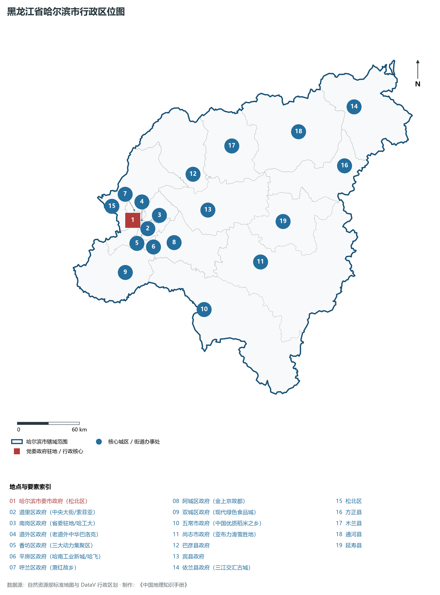
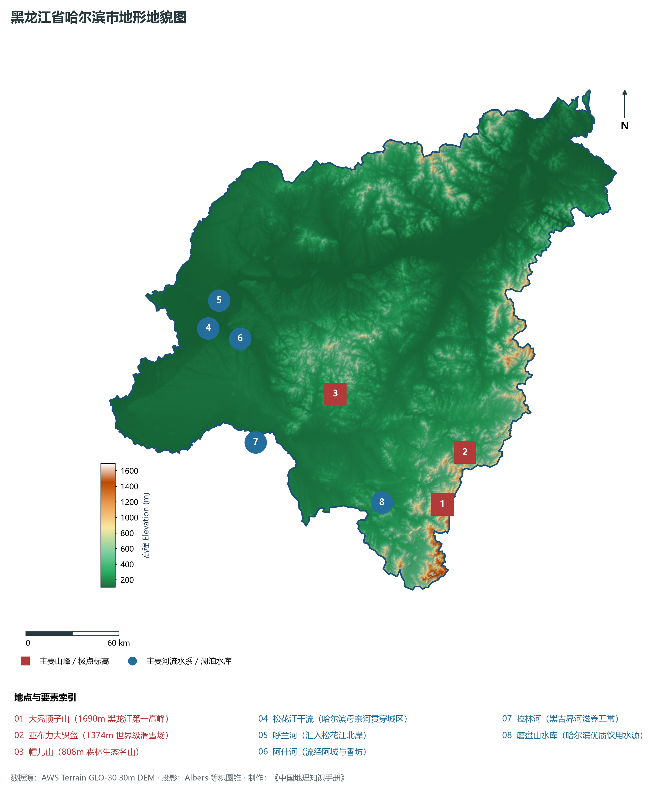
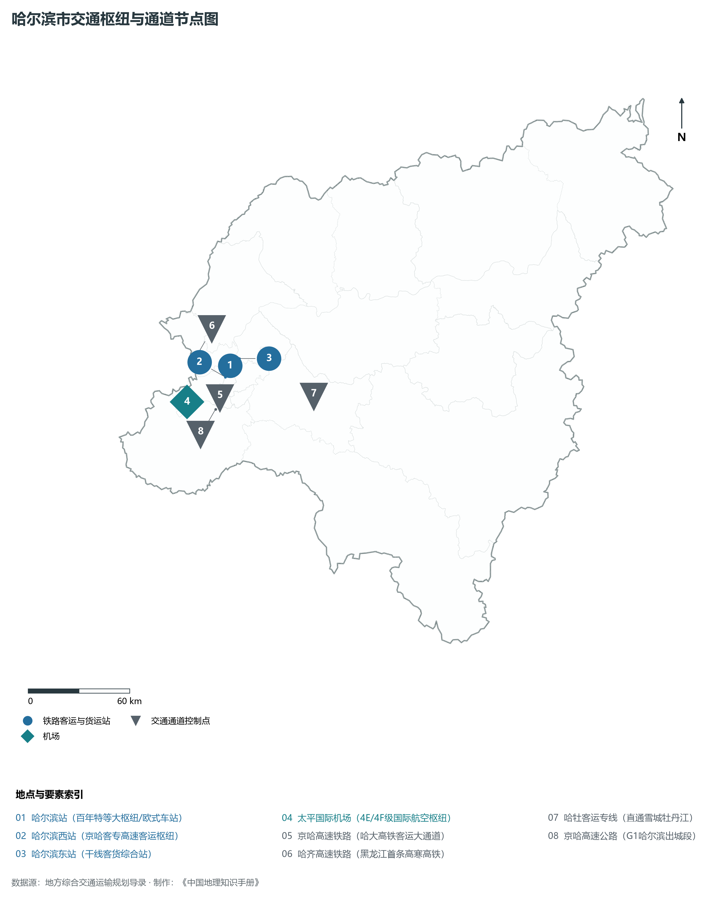
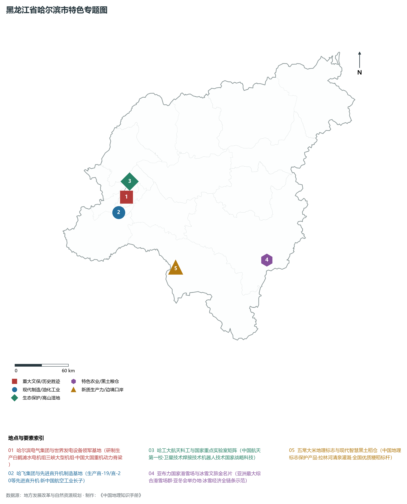
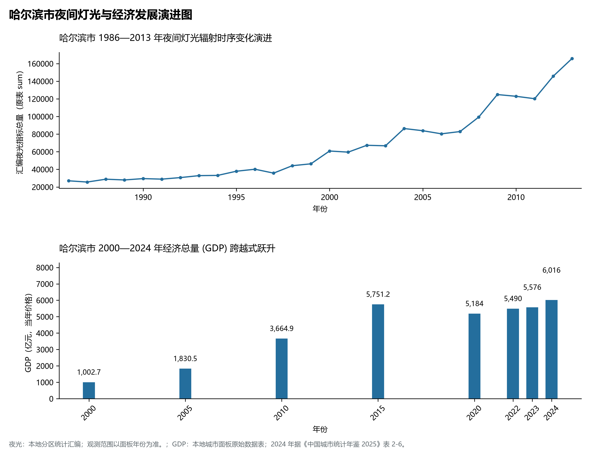

# 7.1 哈尔滨市

哈尔滨市，位于黑龙江省，其战略定位与特色概括为：**省会·副省级特大城市·“冰城夏都”·松花江流域极核·重大装备制造基石与对俄合作中心**。2024 年常住人口 **986 万人**，常住人口城镇化率 **71.83%**，地区生产总值 **6,016 亿元**（当年价格），人均地区生产总值 **61,266 元**，三次产业构成为 **9.04 : 23.67 : 67.29**。

---

## 一、自然地理底盘与地貌水系机理

区域骨干控制性山脉与地形高程极点包括：

- **大秃顶子山 (1690m 黑龙江第一高峰)**（坐标约东经 128.180°、北纬 44.510°，高程约 1690.0 m）；
- **亚布力大锅盔 (1374m 世界级滑雪场)**（坐标约东经 128.460°、北纬 44.770°，高程约 1374.0 m）；
- **帽儿山 (808m 森林生态名山)**（坐标约东经 127.530°、北纬 45.270°，高程约 808.0 m）；

水系与水文网络方面，哈尔滨市地表水资源丰富，骨干江河湖泊纵横穿流：

- **松花江干流 (哈尔滨母亲河贯穿城区)**（流经约东经 126.620°、北纬 45.800° 水域）；
- **呼兰河 (汇入松花江北岸)**（流经约东经 126.650°、北纬 45.920° 水域）；
- **阿什河 (流经阿城与香坊)**（流经约东经 126.750°、北纬 45.720° 水域）；
- **拉林河 (黑吉界河滋养五常)**（流经约东经 126.800°、北纬 45.100° 水域）；
- **磨盘山水库 (哈尔滨优质饮用水源)**（流经约东经 127.700°、北纬 44.600° 水域）；

---

## 二、行政区划沿革与城镇空间体系

哈尔滨市历史文脉积淀深厚，建置沿革源远流长。新中国成立以来，伴随国家老工业基地建设、大庆石油会战、林区综合开发与现代农垦城镇化战略推进，形成了梯次鲜明、产城紧密融合的市辖区与县级行政单元空间组织体系：

- **哈尔滨市委市政府 (松北区)**（驻地坐标：126.540°E, 45.805°N）；
- **道里区政府 (中央大街/索菲亚)**（驻地坐标：126.615°E, 45.760°N）；
- **南岗区政府 (省委驻地/哈工大)**（驻地坐标：126.660°E, 45.750°N）；
- **道外区政府 (老道外中华巴洛克)**（驻地坐标：126.650°E, 45.790°N）；
- **香坊区政府 (三大动力集聚区)**（驻地坐标：126.680°E, 45.720°N）；
- **平房区政府 (哈南工业新城/哈飞)**（驻地坐标：126.635°E, 45.595°N）；
- **呼兰区政府 (萧红故乡)**（驻地坐标：126.585°E, 45.890°N）；
- **阿城区政府 (金上京故都)**（驻地坐标：126.980°E, 45.540°N）；
- **双城区政府 (现代绿色食品城)**（驻地坐标：126.310°E, 45.380°N）；
- **五常市政府 (中国优质稻米之乡)**（驻地坐标：127.160°E, 44.920°N）；
- **尚志市政府 (亚布力滑雪胜地)**（驻地坐标：127.970°E, 45.210°N）；
- **巴彦县政府**（驻地坐标：127.400°E, 46.080°N）；
- **宾县政府**（驻地坐标：127.480°E, 45.750°N）；
- **依兰县政府 (三江交汇古城)**（驻地坐标：129.560°E, 46.320°N）；

在城镇空间总体布局上，哈尔滨市紧扣《国土空间总体规划》，坚持“极核集聚、轴带贯通、组团联动、绿色涵养”的总体思路，统筹协调中心城区扩容提质与县域城镇特色发展，构建多中心、网络化、集约型的空间发展格局。

---

## 三、综合立体交通网络与交通走廊

哈尔滨市地处东北地区立体交通网络关键节点，依托高速铁路、干线普速铁路、国家高速公路与边境口岸/民航机场，构筑了四通八达的现代化立体综合交通运输骨架：

**主要综合客运与货运物流交通枢纽节点：**

- **哈尔滨站 (百年特等大枢纽/欧式车站)**（位置坐标：126.630°E, 45.758°N）；
- **哈尔滨西站 (京哈客专高速客运枢纽)**（位置坐标：126.575°E, 45.705°N）；
- **太平国际机场 (4E/4F级国际航空枢纽)**（位置坐标：126.250°E, 45.620°N）；
- **哈尔滨东站 (干线客货综合站)**（位置坐标：126.710°E, 45.785°N）；

**核心干线铁路与高等级公路交通走廊：**

- **京哈高速铁路 (哈大高铁客运大通道)**（廊道控制点：126.500°E, 45.600°N）：对外快速互联互通的高速客货运通道；
- **哈齐高速铁路 (黑龙江首条高寒高铁)**（廊道控制点：126.400°E, 45.850°N）：对外快速互联互通的高速客货运通道；
- **哈牡客运专线 (直通雪城牡丹江)**（廊道控制点：127.200°E, 45.500°N）：对外快速互联互通的高速客货运通道；
- **京哈高速公路 (G1哈尔滨出城段)**（廊道控制点：126.450°E, 45.550°N）：对外快速互联互通的高速客货运通道；

---

## 四、现代重点产业布局与特色功能组团

在新时代推动东北全面振兴战略引领下，哈尔滨市紧扣高质量发展首要任务，深度融入全省“一圈一带三带”与“4567”现代产业空间新格局，加快传统工业数字化绿色化改造，培育壮大新兴战略性产业链群，全力打造特色鲜明的现代化产业高地：

**重点园区与现代化产业承载基地：**

- **航空工业哈飞与直升机研发制造基地**（空间分布：126.640°E, 45.600°N）；
- **哈电集团三大动力厂 (大型发电设备)**（空间分布：126.690°E, 45.710°N）；
- **哈工大国家大学科技园与机器人创新院**（空间分布：126.630°E, 45.740°N）；
- **中国(黑龙江)自由贸易试验区哈尔滨片区**（空间分布：126.510°E, 45.820°N）；
- **哈南工业新城核心区**（空间分布：126.620°E, 45.570°N）；

**代表性特色地标与战略支撑维度：**

- **哈尔滨电气集团与世界发电设备领军基地**（126.690°E, 45.710°N）：研制生产白鹤滩水电机组三峡大型机组·中国大国重机动力脊梁；
- **哈飞集团与先进直升机制造基地**（126.640°E, 45.600°N）：生产直-19/直-20等先进直升机·新中国航空工业长子；
- **哈工大航天科工与国家重点实验室矩阵**（126.630°E, 45.740°N）：中国航天第一校·卫星技术焊接技术机器人技术国家战略科技；
- **亚布力国家滑雪场与冰雪文旅金名片**（128.450°E, 44.780°N）：亚洲最大综合滑雪场群·亚冬会举办地·冰雪经济全链条示范；
- **五常大米地理标志与现代智慧黑土稻仓**（127.160°E, 44.920°N）：中国地理标志保护产品·拉林河清泉灌溉·全国优质粳稻标杆；

---

## 五、1986—2013年夜间灯光演变与经济变化分析

本节夜光图的观测年份为 1986—2013 年，指标为行政区汇总值（原表 sum）。

2024 年哈尔滨市全市地区生产总值为 6,016 亿元（当年价格）。

| 年份 | 地区生产总值（亿元，当年价格） |
|:---|---:|
| 2000 年 | 1,002.7 |
| 2005 年 | 1,830.5 |
| 2010 年 | 3,664.9 |
| 2015 年 | 5,751.2 |
| 2020 年 | 5,184 |
| 2022 年 | 5,490 |
| 2023 年 | 5,576 |
| 2024 年 | 6,016 |

---

## 六、文化旅游名胜、生态屏障与可持续人地共生

哈尔滨市高度注重统筹经济高质量发展与高水平生态环境保护，筑牢绿色生态底盘，弘扬优秀历史文化：

- **太阳岛国家风景名胜区 (5A·雪博会)**（位置坐标：126.590°E, 45.795°N）；
- **哈尔滨冰雪大世界 (世界最大冰雪乐园)**（位置坐标：126.540°E, 45.780°N）；
- **圣索菲亚大教堂与中央大街步行街**（位置坐标：126.625°E, 45.770°N）；
- **亚布力滑雪旅游度假区 (国家级)**（位置坐标：128.450°E, 44.780°N）；

在人地协调机制方面，哈尔滨市统筹推进山水林田湖草沙一体化保护与系统治理，坚决打好蓝天、碧水、净土保卫战，筑牢大界江大森林大湿地生态屏障与平原黑土地粮仓，打造人与自然和谐共生的生态宜居美丽家园。

---

## 七、哈尔滨市关键地理统计指标速查矩阵

| 统计指标项 | 统计数值 / 口径标准 | 空间特征与全省位次说明 |
|:---|:---|:---|
| **行政区划代码** | `230100` | 国家民政部标准行政区划编号 |
| **辖区陆地面积** | **53,076.0** km² | 土地利用类型兼具山地、丘陵、平原与城镇工矿 |
| **常住人口规模** | 986 万人 | 2024 年，全市；年鉴公布口径 |
| **常住人口城镇化率** | 71.83% | 2024 年，全市；年鉴公布口径 |
| **地区生产总值 (2024)** | 6,016 亿元 | 2024 年，全市；年鉴公布口径 |
| **人均 GDP 水平** | 61,266 元/人 | 2024 年，全市；年鉴公布口径 |
| **三次产业结构比** | 9.04 : 23.67 : 67.29 | 2024 年，全市；年鉴公布口径 |
| **地表极限高程** | **105.0 m ～ 1690.0 m** | 形成极具特色的立体地貌剖面格局 |

2024 年统计来源：《中国城市统计年鉴 2025》表 2-1、2-6、2-7（2024 年，全市）。其他年份 GDP 据本地城市面板“原始数据”表，单位为亿元、当年价格。
