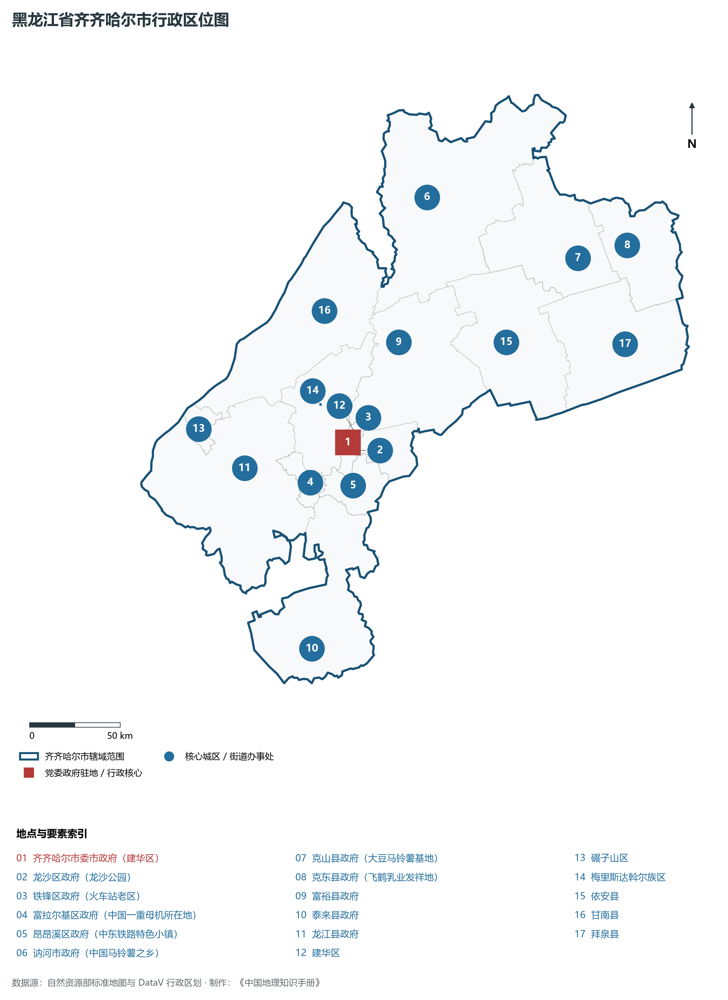
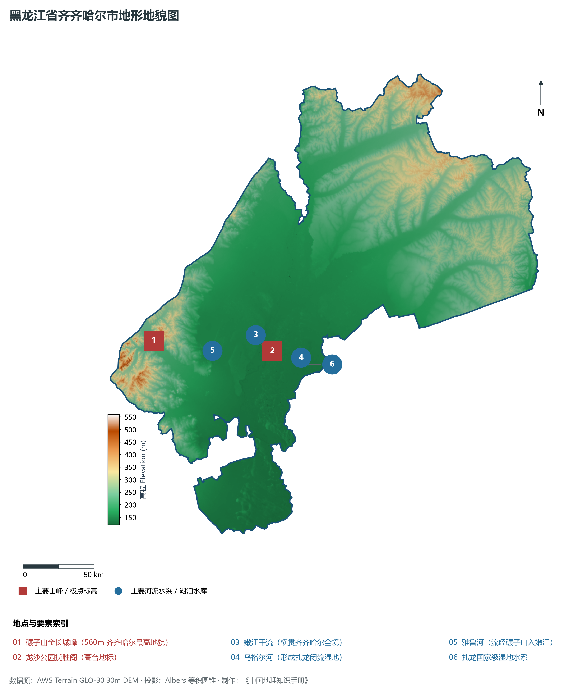
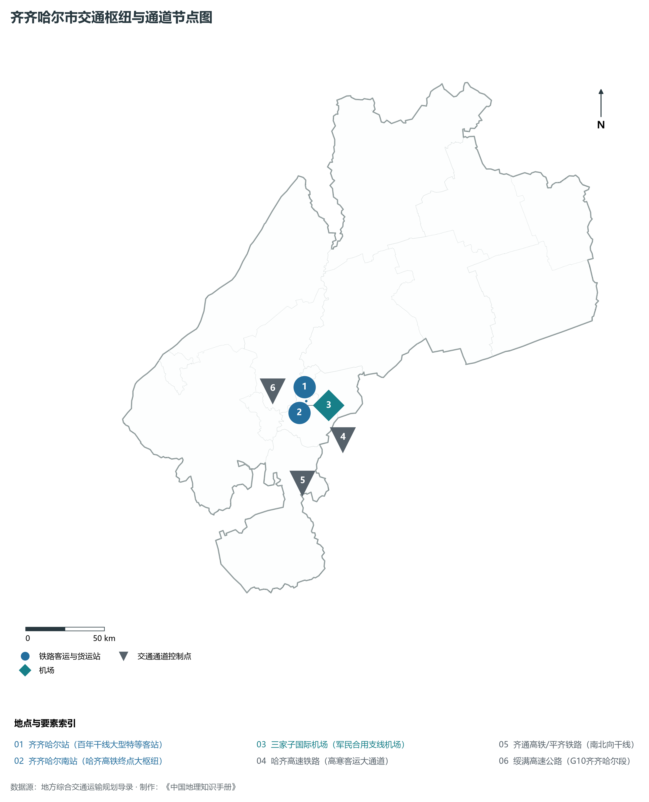
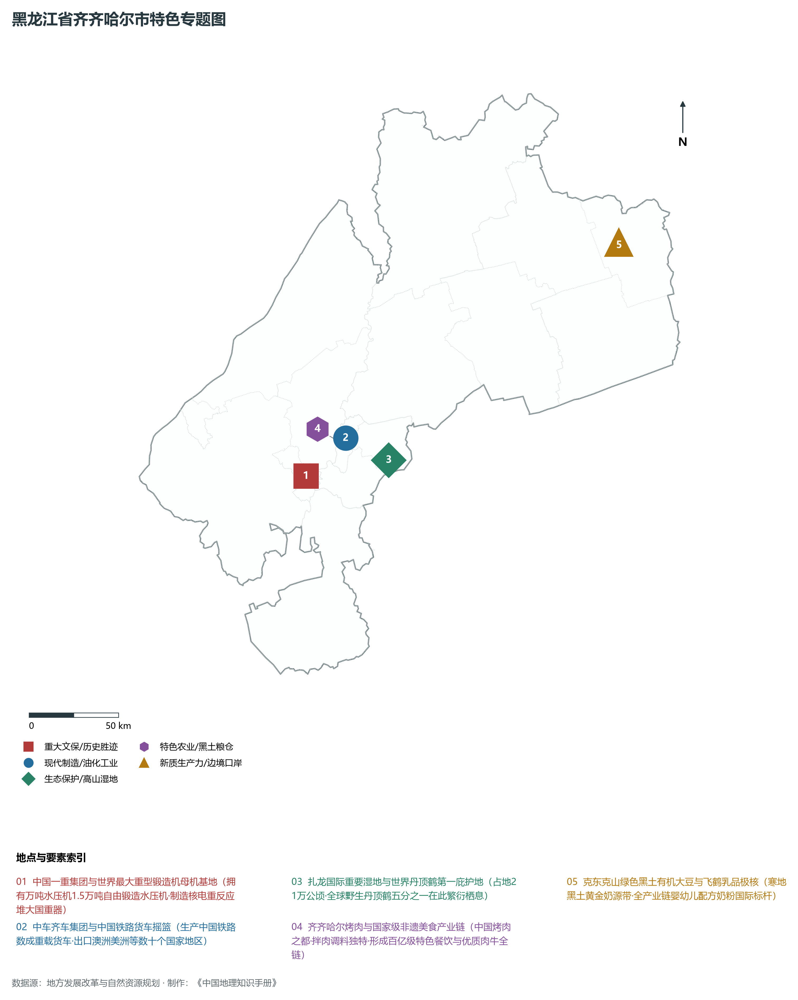
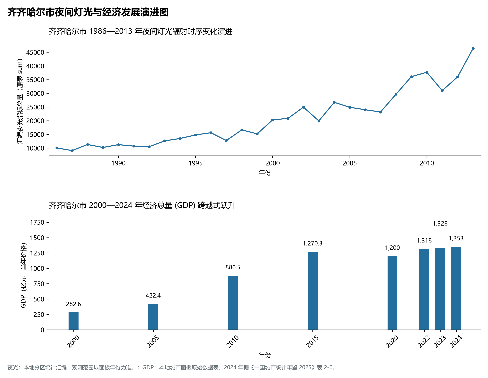

# 7.2 齐齐哈尔市

齐齐哈尔市，位于黑龙江省，其战略定位与特色概括为：**“鹤城”丹顶鹤故乡·国家装备制造业“母机”基地·嫩江流域中心城市与齐齐哈尔烤肉名城**。2024 年常住人口 **373 万人**，常住人口城镇化率 **56.9%**，地区生产总值 **1,353 亿元**（当年价格），人均地区生产总值 **35,656 元**，三次产业构成为 **29.01 : 17.99 : 53**。

---

## 一、自然地理底盘与地貌水系机理

区域骨干控制性山脉与地形高程极点包括：

- **碾子山金长城峰 (560m 齐齐哈尔最高地貌)**（坐标约东经 122.880°、北纬 47.530°，高程约 560.0 m）；
- **龙沙公园揽胜阁 (高台地标)**（坐标约东经 123.950°、北纬 47.325°，高程约 150.0 m）；

水系与水文网络方面，齐齐哈尔市地表水资源丰富，骨干江河湖泊纵横穿流：

- **嫩江干流 (横贯齐齐哈尔全境)**（流经约东经 123.900°、北纬 47.300° 水域）；
- **乌裕尔河 (形成扎龙闭流湿地)**（流经约东经 124.200°、北纬 47.250° 水域）；
- **雅鲁河 (流经碾子山入嫩江)**（流经约东经 123.400°、北纬 47.400° 水域）；
- **扎龙国家级湿地水系**（流经约东经 124.250°、北纬 47.200° 水域）；

---

## 二、行政区划沿革与城镇空间体系

齐齐哈尔市历史文脉积淀深厚，建置沿革源远流长。新中国成立以来，伴随国家老工业基地建设、大庆石油会战、林区综合开发与现代农垦城镇化战略推进，形成了梯次鲜明、产城紧密融合的市辖区与县级行政单元空间组织体系：

- **齐齐哈尔市委市政府 (建华区)**（驻地坐标：123.955°E, 47.360°N）；
- **龙沙区政府 (龙沙公园)**（驻地坐标：123.950°E, 47.320°N）；
- **铁锋区政府 (火车站老区)**（驻地坐标：123.985°E, 47.345°N）；
- **富拉尔基区政府 (中国一重母机所在地)**（驻地坐标：123.630°E, 47.200°N）；
- **昂昂溪区政府 (中东铁路特色小镇)**（驻地坐标：123.820°E, 47.160°N）；
- **讷河市政府 (中国马铃薯之乡)**（驻地坐标：124.875°E, 48.480°N）；
- **克山县政府 (大豆马铃薯基地)**（驻地坐标：125.875°E, 48.030°N）；
- **克东县政府 (飞鹤乳业发祥地)**（驻地坐标：126.250°E, 48.040°N）；
- **富裕县政府**（驻地坐标：124.460°E, 47.800°N）；
- **泰来县政府**（驻地坐标：123.420°E, 46.390°N）；
- **龙江县政府**（驻地坐标：123.180°E, 47.330°N）；

在城镇空间总体布局上，齐齐哈尔市紧扣《国土空间总体规划》，坚持“极核集聚、轴带贯通、组团联动、绿色涵养”的总体思路，统筹协调中心城区扩容提质与县域城镇特色发展，构建多中心、网络化、集约型的空间发展格局。

---

## 三、综合立体交通网络与交通走廊

齐齐哈尔市地处东北地区立体交通网络关键节点，依托高速铁路、干线普速铁路、国家高速公路与边境口岸/民航机场，构筑了四通八达的现代化立体综合交通运输骨架：

**主要综合客运与货运物流交通枢纽节点：**

- **齐齐哈尔站 (百年干线大型特等客站)**（位置坐标：123.970°E, 47.340°N）；
- **齐齐哈尔南站 (哈齐高铁终点大枢纽)**（位置坐标：123.960°E, 47.260°N）；
- **三家子国际机场 (军民合用支线机场)**（位置坐标：123.915°E, 47.240°N）；

**核心干线铁路与高等级公路交通走廊：**

- **哈齐高速铁路 (高寒客运大通道)**（廊道控制点：124.200°E, 47.000°N）：对外快速互联互通的高速客货运通道；
- **齐通高铁/平齐铁路 (南北向干线)**（廊道控制点：123.800°E, 46.800°N）：对外快速互联互通的高速客货运通道；
- **绥满高速公路 (G10齐齐哈尔段)**（廊道控制点：123.700°E, 47.350°N）：对外快速互联互通的高速客货运通道；

---

## 四、现代重点产业布局与特色功能组团

在新时代推动东北全面振兴战略引领下，齐齐哈尔市紧扣高质量发展首要任务，深度融入全省“一圈一带三带”与“4567”现代产业空间新格局，加快传统工业数字化绿色化改造，培育壮大新兴战略性产业链群，全力打造特色鲜明的现代化产业高地：

**重点园区与现代化产业承载基地：**

- **中国一重集团总部及重型装备制造基地**（空间分布：123.630°E, 47.200°N）；
- **中车齐齐哈尔车辆有限公司 (铁路货车基地)**（空间分布：123.970°E, 47.350°N）；
- **齐齐哈尔高新技术产业开发区**（空间分布：123.930°E, 47.310°N）；
- **飞鹤乳业克东/齐齐哈尔现代化产业园**（空间分布：124.000°E, 47.400°N）；

**代表性特色地标与战略支撑维度：**

- **中国一重集团与世界最大重型锻造机母机基地**（123.630°E, 47.200°N）：拥有万吨水压机1.5万吨自由锻造水压机·制造核电重反应堆大国重器；
- **中车齐车集团与中国铁路货车摇篮**（123.970°E, 47.350°N）：生产中国铁路数成重载货车·出口澳洲美洲等数十个国家地区；
- **扎龙国际重要湿地与世界丹顶鹤第一庇护地**（124.250°E, 47.200°N）：占地21万公顷·全球野生丹顶鹤五分之一在此繁衍栖息；
- **齐齐哈尔烤肉与国家级非遗美食产业链**（123.950°E, 47.320°N）：中国烤肉之都·拌肉调料独特·形成百亿级特色餐饮与优质肉牛全链；
- **克东克山绿色黑土有机大豆与飞鹤乳品极核**（126.250°E, 48.040°N）：寒地黑土黄金奶源带·全产业链婴幼儿配方奶粉国际标杆；

---

## 五、1986—2013年夜间灯光演变与经济变化分析

本节夜光图的观测年份为 1986—2013 年，指标为行政区汇总值（原表 sum）。

2024 年齐齐哈尔市全市地区生产总值为 1,353 亿元（当年价格）。

| 年份 | 地区生产总值（亿元，当年价格） |
|:---|---:|
| 2000 年 | 282.6 |
| 2005 年 | 422.4 |
| 2010 年 | 880.5 |
| 2015 年 | 1,270.3 |
| 2020 年 | 1,200 |
| 2022 年 | 1,318 |
| 2023 年 | 1,328 |
| 2024 年 | 1,353 |

---

## 六、文化旅游名胜、生态屏障与可持续人地共生

齐齐哈尔市高度注重统筹经济高质量发展与高水平生态环境保护，筑牢绿色生态底盘，弘扬优秀历史文化：

- **扎龙国家级自然保护区 (5A·世界丹顶鹤家园)**（位置坐标：124.250°E, 47.200°N）；
- **明月岛国家森林公园 (嫩江江心绿洲)**（位置坐标：123.850°E, 47.380°N）；
- **昂昂溪新石器遗址与中东铁路民居群**（位置坐标：123.820°E, 47.160°N）；
- **碾子山金长城国家遗址公园**（位置坐标：122.880°E, 47.530°N）；

在人地协调机制方面，齐齐哈尔市统筹推进山水林田湖草沙一体化保护与系统治理，坚决打好蓝天、碧水、净土保卫战，筑牢大界江大森林大湿地生态屏障与平原黑土地粮仓，打造人与自然和谐共生的生态宜居美丽家园。

---

## 七、齐齐哈尔市关键地理统计指标速查矩阵

| 统计指标项 | 统计数值 / 口径标准 | 空间特征与全省位次说明 |
|:---|:---|:---|
| **行政区划代码** | `230200` | 国家民政部标准行政区划编号 |
| **辖区陆地面积** | **42,469.0** km² | 土地利用类型兼具山地、丘陵、平原与城镇工矿 |
| **常住人口规模** | 373 万人 | 2024 年，全市；年鉴公布口径 |
| **常住人口城镇化率** | 56.9% | 2024 年，全市；年鉴公布口径 |
| **地区生产总值 (2024)** | 1,353 亿元 | 2024 年，全市；年鉴公布口径 |
| **人均 GDP 水平** | 35,656 元/人 | 2024 年，全市；年鉴公布口径 |
| **三次产业结构比** | 29.01 : 17.99 : 53 | 2024 年，全市；年鉴公布口径 |
| **地表极限高程** | **120.0 m ～ 560.0 m** | 形成极具特色的立体地貌剖面格局 |

2024 年统计来源：《中国城市统计年鉴 2025》表 2-1、2-6、2-7（2024 年，全市）。其他年份 GDP 据本地城市面板“原始数据”表，单位为亿元、当年价格。
