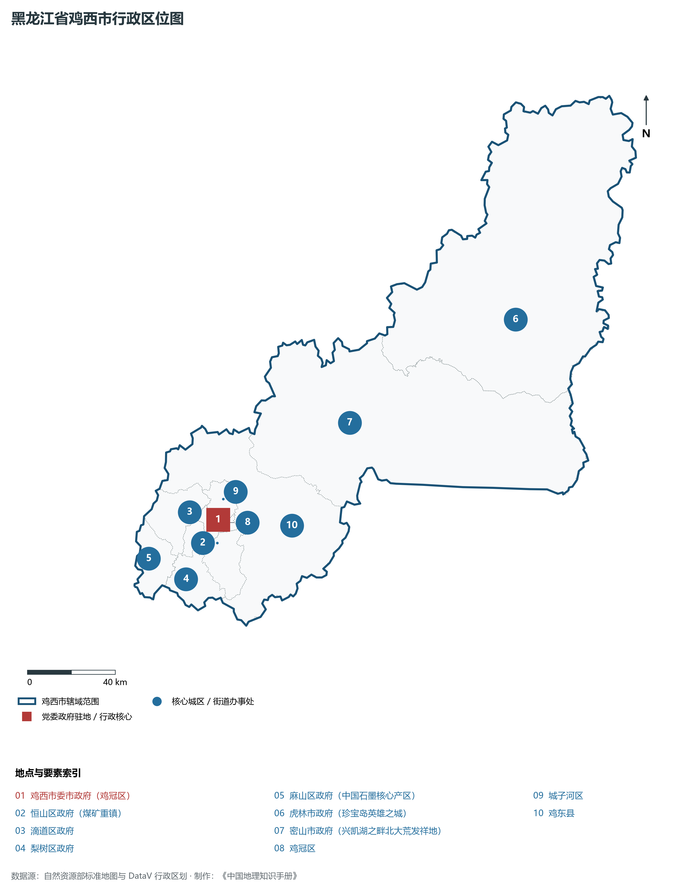
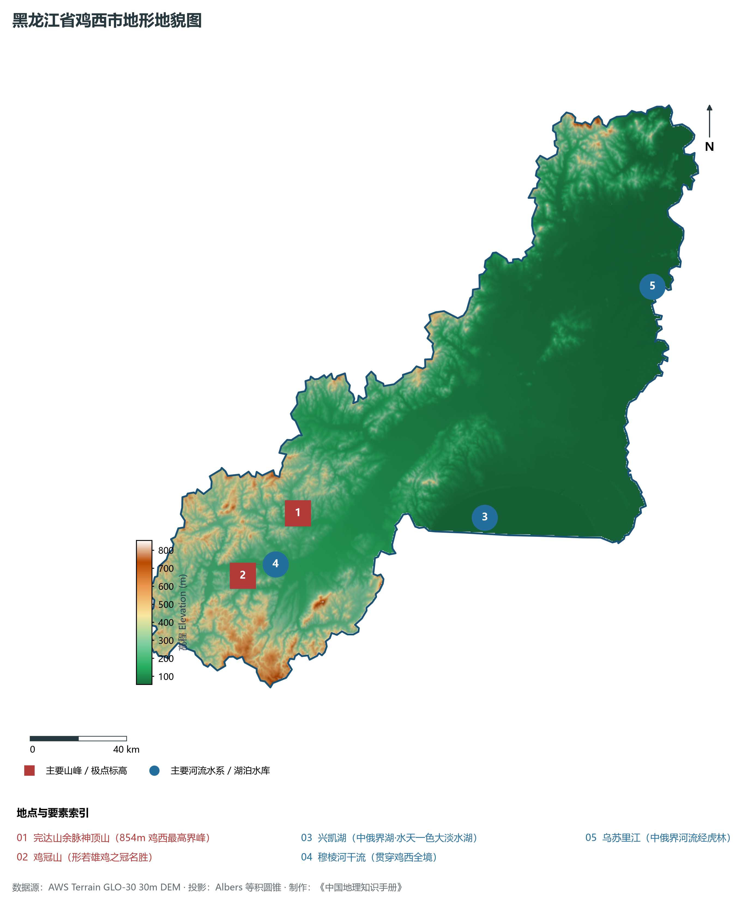
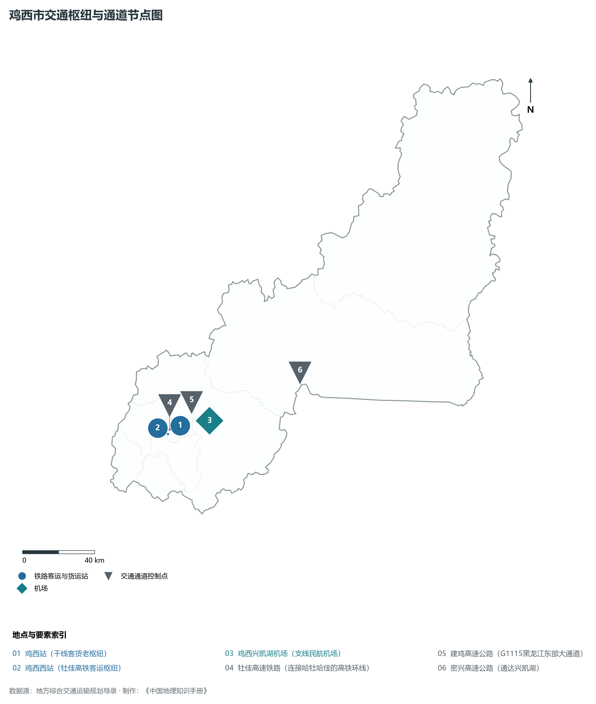
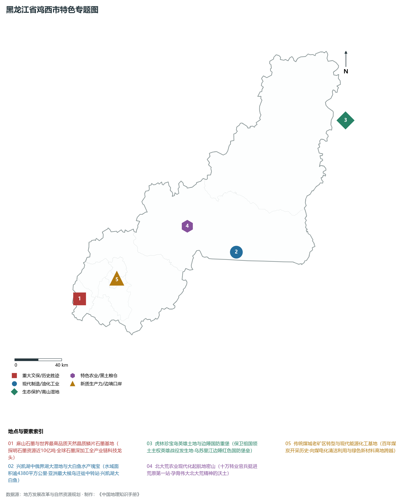
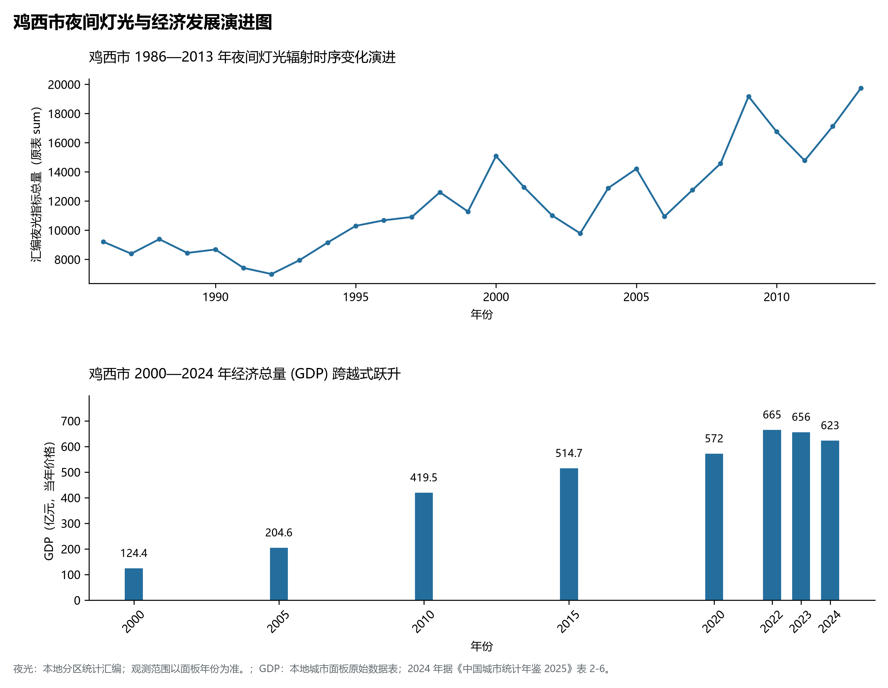

# 7.3 鸡西市

鸡西市，位于黑龙江省，其战略定位与特色概括为：**“中国石墨之都”·兴凯湖畔生态名城·老煤城绿色转型典范·穆棱河流域工矿中枢**。2024 年常住人口 **140 万人**，常住人口城镇化率 **76%**，地区生产总值 **623 亿元**（当年价格），人均地区生产总值 **44,157 元**，三次产业构成为 **32.55 : 18.67 : 48.79**。

---

## 一、自然地理底盘与地貌水系机理

区域骨干控制性山脉与地形高程极点包括：

- **完达山余脉神顶山 (854m 鸡西最高界峰)**（坐标约东经 131.350°、北纬 45.450°，高程约 854.0 m）；
- **鸡冠山 (形若雄鸡之冠名胜)**（坐标约东经 130.980°、北纬 45.280°，高程约 420.0 m）；

水系与水文网络方面，鸡西市地表水资源丰富，骨干江河湖泊纵横穿流：

- **兴凯湖 (中俄界湖·水天一色大淡水湖)**（流经约东经 132.300°、北纬 45.250° 水域）；
- **穆棱河干流 (贯穿鸡西全境)**（流经约东经 131.000°、北纬 45.320° 水域）；
- **乌苏里江 (中俄界河流经虎林)**（流经约东经 133.500°、北纬 45.900° 水域）；

---

## 二、行政区划沿革与城镇空间体系

鸡西市历史文脉积淀深厚，建置沿革源远流长。新中国成立以来，伴随国家老工业基地建设、大庆石油会战、林区综合开发与现代农垦城镇化战略推进，形成了梯次鲜明、产城紧密融合的市辖区与县级行政单元空间组织体系：

- **鸡西市委市政府 (鸡冠区)**（驻地坐标：130.970°E, 45.300°N）；
- **恒山区政府 (煤矿重镇)**（驻地坐标：130.930°E, 45.210°N）；
- **滴道区政府**（驻地坐标：130.820°E, 45.360°N）；
- **梨树区政府**（驻地坐标：130.700°E, 45.100°N）；
- **麻山区政府 (中国石墨核心产区)**（驻地坐标：130.520°E, 45.220°N）；
- **虎林市政府 (珍宝岛英雄之城)**（驻地坐标：132.960°E, 45.760°N）；
- **密山市政府 (兴凯湖之畔北大荒发祥地)**（驻地坐标：131.860°E, 45.540°N）；

在城镇空间总体布局上，鸡西市紧扣《国土空间总体规划》，坚持“极核集聚、轴带贯通、组团联动、绿色涵养”的总体思路，统筹协调中心城区扩容提质与县域城镇特色发展，构建多中心、网络化、集约型的空间发展格局。

---

## 三、综合立体交通网络与交通走廊

鸡西市地处东北地区立体交通网络关键节点，依托高速铁路、干线普速铁路、国家高速公路与边境口岸/民航机场，构筑了四通八达的现代化立体综合交通运输骨架：

**主要综合客运与货运物流交通枢纽节点：**

- **鸡西站 (干线客货老枢纽)**（位置坐标：130.980°E, 45.305°N）；
- **鸡西西站 (牡佳高铁客运枢纽)**（位置坐标：130.880°E, 45.280°N）；
- **鸡西兴凯湖机场 (支线民航机场)**（位置坐标：131.190°E, 45.290°N）；

**核心干线铁路与高等级公路交通走廊：**

- **牡佳高速铁路 (连接哈牡哈佳的高铁环线)**（廊道控制点：130.900°E, 45.300°N）：对外快速互联互通的高速客货运通道；
- **建鸡高速公路 (G1115黑龙江东部大通道)**（廊道控制点：131.100°E, 45.400°N）：对外快速互联互通的高速客货运通道；
- **密兴高速公路 (通达兴凯湖)**（廊道控制点：131.900°E, 45.400°N）：对外快速互联互通的高速客货运通道；

---

## 四、现代重点产业布局与特色功能组团

在新时代推动东北全面振兴战略引领下，鸡西市紧扣高质量发展首要任务，深度融入全省“一圈一带三带”与“4567”现代产业空间新格局，加快传统工业数字化绿色化改造，培育壮大新兴战略性产业链群，全力打造特色鲜明的现代化产业高地：

**重点园区与现代化产业承载基地：**

- **麻山石墨新材料产业园区 (国家级石墨新材料基地)**（空间分布：130.520°E, 45.220°N）；
- **龙煤集团鸡西矿业有限责任公司**（空间分布：130.950°E, 45.280°N）；
- **密山经济开发区与食品加工基地**（空间分布：131.850°E, 45.520°N）；
- **虎林乌苏里江现代制药与绿色食品产业园**（空间分布：132.950°E, 45.740°N）；

**代表性特色地标与战略支撑维度：**

- **麻山石墨与世界最高品质天然晶质鳞片石墨基地**（130.520°E, 45.220°N）：探明石墨资源近10亿吨·全球石墨深加工全产业链科技龙头；
- **兴凯湖中俄界湖大湿地与大白鱼水产瑰宝**（132.300°E, 45.250°N）：水域面积逾4380平方公里·亚洲最大候鸟迁徙中转站·兴凯湖大白鱼；
- **虎林珍宝岛英雄土地与边陲国防重堡**（133.850°E, 45.980°N）：保卫祖国领土主权英雄战役发生地·乌苏里江边陲红色国防堡垒；
- **北大荒农业现代化起航地密山**（131.860°E, 45.540°N）：十万转业官兵挺进荒原第一站·孕育伟大北大荒精神的沃土；
- **传统煤城老矿区转型与现代能源化工基地**（130.970°E, 45.300°N）：百年煤炭开采历史·向煤电化清洁利用与绿色新材料高地跨越；

---

## 五、1986—2013年夜间灯光演变与经济变化分析

本节夜光图的观测年份为 1986—2013 年，指标为行政区汇总值（原表 sum）。

2024 年鸡西市全市地区生产总值为 623 亿元（当年价格）。

| 年份 | 地区生产总值（亿元，当年价格） |
|:---|---:|
| 2000 年 | 124.4 |
| 2005 年 | 204.6 |
| 2010 年 | 419.5 |
| 2015 年 | 514.7 |
| 2020 年 | 572 |
| 2022 年 | 665 |
| 2023 年 | 656 |
| 2024 年 | 623 |

---

## 六、文化旅游名胜、生态屏障与可持续人地共生

鸡西市高度注重统筹经济高质量发展与高水平生态环境保护，筑牢绿色生态底盘，弘扬优秀历史文化：

- **兴凯湖国家级自然保护区 (大白鱼与湿地胜境)**（位置坐标：132.300°E, 45.250°N）；
- **珍宝岛革命历史遗址 (中苏边界红色地标)**（位置坐标：133.850°E, 45.980°N）；
- **北大荒书法长廊与密山北大荒开发纪念馆**（位置坐标：131.820°E, 45.500°N）；
- **虎头要塞遗址博物馆 (二战终结地)**（位置坐标：133.650°E, 45.850°N）；

在人地协调机制方面，鸡西市统筹推进山水林田湖草沙一体化保护与系统治理，坚决打好蓝天、碧水、净土保卫战，筑牢大界江大森林大湿地生态屏障与平原黑土地粮仓，打造人与自然和谐共生的生态宜居美丽家园。

---

## 七、鸡西市关键地理统计指标速查矩阵

| 统计指标项 | 统计数值 / 口径标准 | 空间特征与全省位次说明 |
|:---|:---|:---|
| **行政区划代码** | `230300` | 国家民政部标准行政区划编号 |
| **辖区陆地面积** | **22,551.0** km² | 土地利用类型兼具山地、丘陵、平原与城镇工矿 |
| **常住人口规模** | 140 万人 | 2024 年，全市；年鉴公布口径 |
| **常住人口城镇化率** | 76% | 2024 年，全市；年鉴公布口径 |
| **地区生产总值 (2024)** | 623 亿元 | 2024 年，全市；年鉴公布口径 |
| **人均 GDP 水平** | 44,157 元/人 | 2024 年，全市；年鉴公布口径 |
| **三次产业结构比** | 32.55 : 18.67 : 48.79 | 2024 年，全市；年鉴公布口径 |
| **地表极限高程** | **55.0 m ～ 854.0 m** | 形成极具特色的立体地貌剖面格局 |

2024 年统计来源：《中国城市统计年鉴 2025》表 2-1、2-6、2-7（2024 年，全市）。其他年份 GDP 据本地城市面板“原始数据”表，单位为亿元、当年价格。
