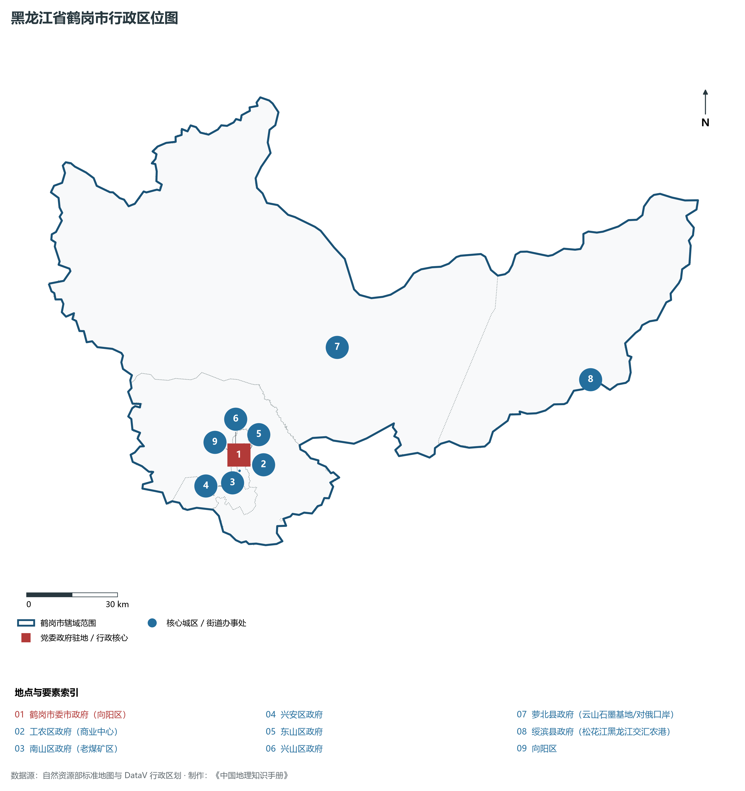
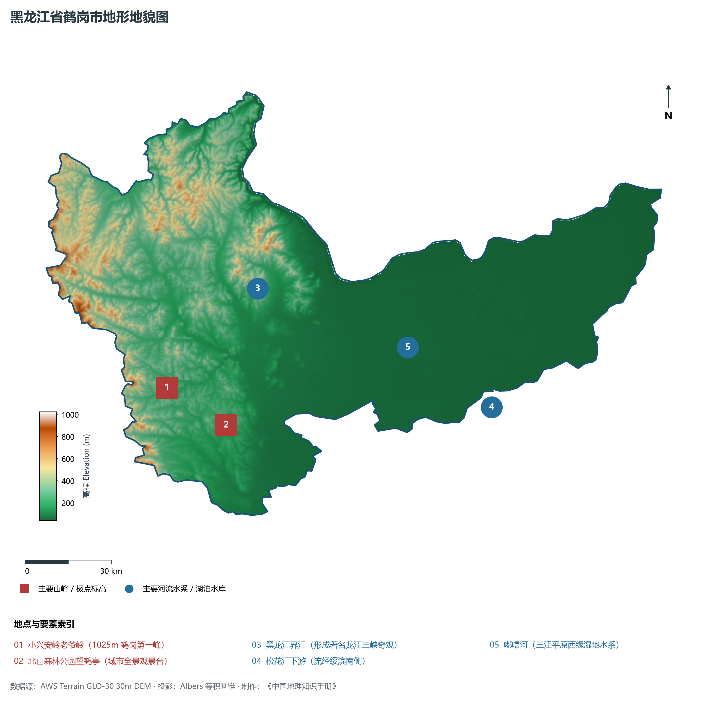
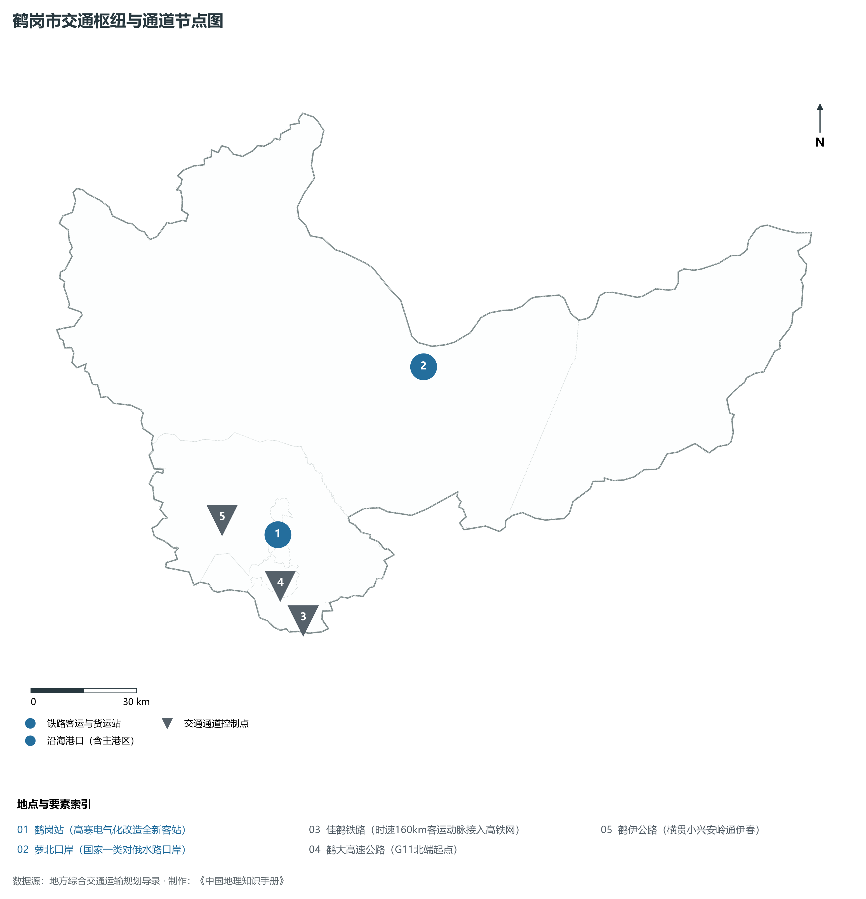
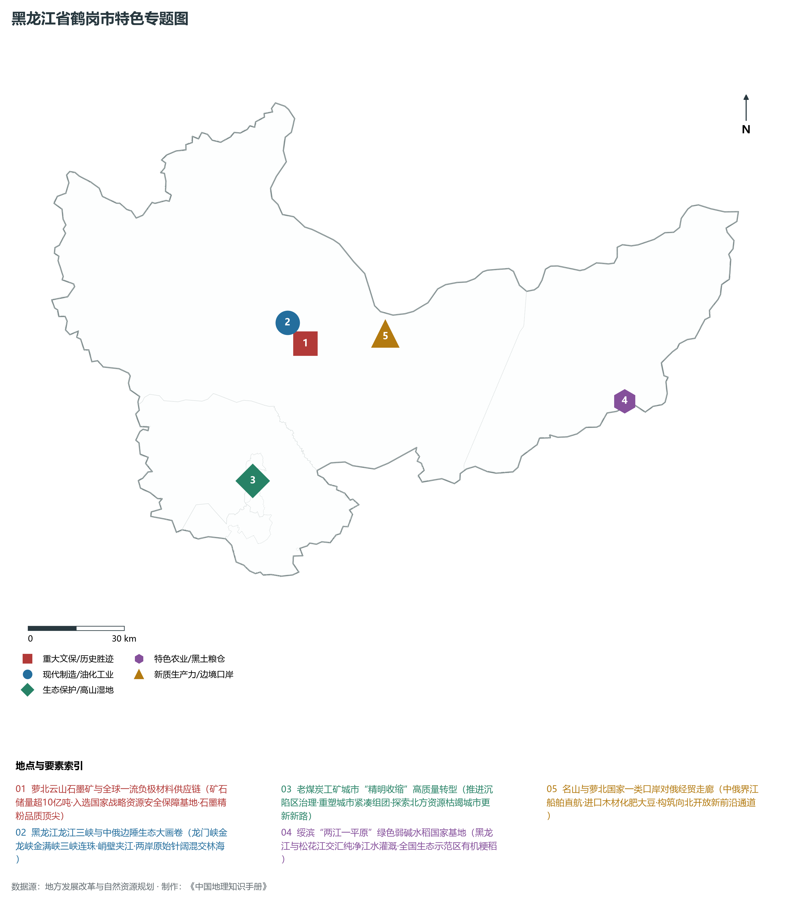
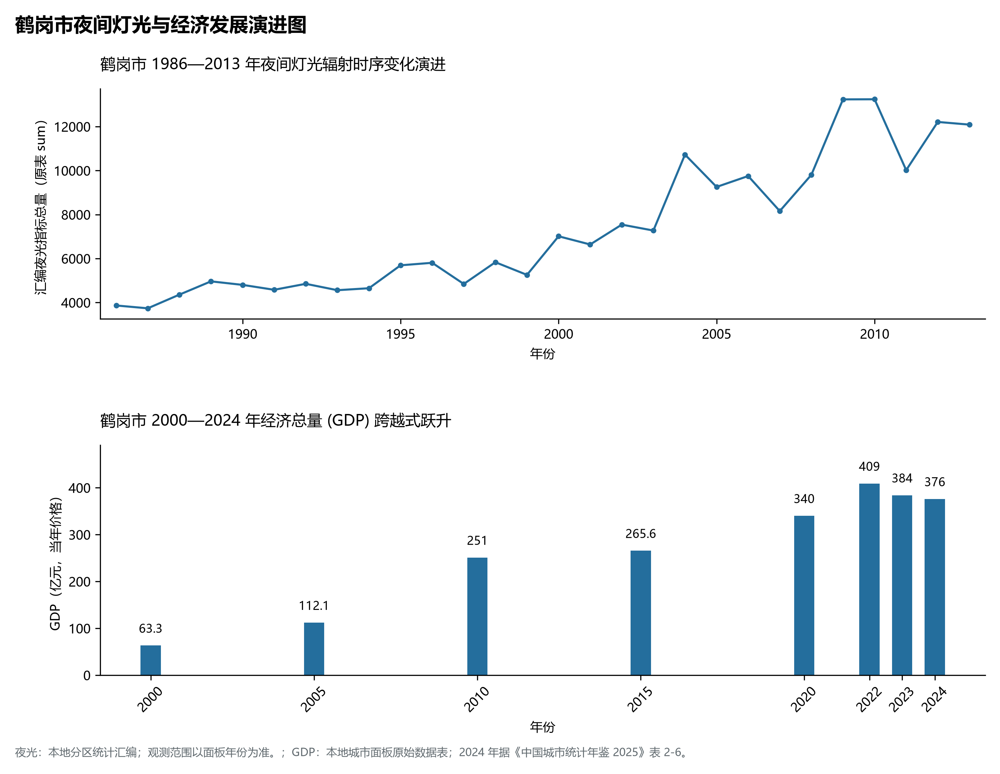

# 7.4 鹤岗市

鹤岗市，位于黑龙江省，其战略定位与特色概括为：**小兴安岭东麓生态矿城·“中国石墨之都”主力极·黑龙江界江龙江三峡·精明收缩转型样板**。2024 年常住人口 **83 万人**，常住人口城镇化率 **85.86%**，地区生产总值 **376 亿元**（当年价格），人均地区生产总值 **44,800 元**，三次产业构成为 **25.33 : 22.31 : 52.37**。

---

## 一、自然地理底盘与地貌水系机理

区域骨干控制性山脉与地形高程极点包括：

- **小兴安岭老爷岭 (1025m 鹤岗第一峰)**（坐标约东经 130.080°、北纬 47.520°，高程约 1025.0 m）；
- **北山森林公园望鹤亭 (城市全景观景台)**（坐标约东经 130.300°、北纬 47.360°，高程约 280.0 m）；

水系与水文网络方面，鹤岗市地表水资源丰富，骨干江河湖泊纵横穿流：

- **黑龙江界江 (形成著名龙江三峡奇观)**（流经约东经 130.600°、北纬 47.750° 水域）；
- **松花江下游 (流经绥滨南侧)**（流经约东经 131.500°、北纬 47.200° 水域）；
- **嘟噜河 (三江平原西缘湿地水系)**（流经约东经 131.200°、北纬 47.450° 水域）；

---

## 二、行政区划沿革与城镇空间体系

鹤岗市历史文脉积淀深厚，建置沿革源远流长。新中国成立以来，伴随国家老工业基地建设、大庆石油会战、林区综合开发与现代农垦城镇化战略推进，形成了梯次鲜明、产城紧密融合的市辖区与县级行政单元空间组织体系：

- **鹤岗市委市政府 (向阳区)**（驻地坐标：130.295°E, 47.345°N）；
- **工农区政府 (商业中心)**（驻地坐标：130.270°E, 47.320°N）；
- **南山区政府 (老煤矿区)**（驻地坐标：130.280°E, 47.300°N）；
- **兴安区政府**（驻地坐标：130.240°E, 47.260°N）；
- **东山区政府**（驻地坐标：130.315°E, 47.330°N）；
- **兴山区政府**（驻地坐标：130.290°E, 47.370°N）；
- **萝北县政府 (云山石墨基地/对俄口岸)**（驻地坐标：130.830°E, 47.580°N）；
- **绥滨县政府 (松花江黑龙江交汇农港)**（驻地坐标：131.860°E, 47.290°N）；

在城镇空间总体布局上，鹤岗市紧扣《国土空间总体规划》，坚持“极核集聚、轴带贯通、组团联动、绿色涵养”的总体思路，统筹协调中心城区扩容提质与县域城镇特色发展，构建多中心、网络化、集约型的空间发展格局。

---

## 三、综合立体交通网络与交通走廊

鹤岗市地处东北地区立体交通网络关键节点，依托高速铁路、干线普速铁路、国家高速公路与边境口岸/民航机场，构筑了四通八达的现代化立体综合交通运输骨架：

**主要综合客运与货运物流交通枢纽节点：**

- **鹤岗站 (高寒电气化改造全新客站)**（位置坐标：130.290°E, 47.330°N）；
- **萝北口岸 (国家一类对俄水路口岸)**（位置坐标：130.980°E, 47.650°N）；

**核心干线铁路与高等级公路交通走廊：**

- **佳鹤铁路 (时速160km客运动脉接入高铁网)**（廊道控制点：130.300°E, 47.100°N）：对外快速互联互通的高速客货运通道；
- **鹤大高速公路 (G11北端起点)**（廊道控制点：130.250°E, 47.200°N）：对外快速互联互通的高速客货运通道；
- **鹤伊公路 (横贯小兴安岭通伊春)**（廊道控制点：130.100°E, 47.400°N）：对外快速互联互通的高速客货运通道；

---

## 四、现代重点产业布局与特色功能组团

在新时代推动东北全面振兴战略引领下，鹤岗市紧扣高质量发展首要任务，深度融入全省“一圈一带三带”与“4567”现代产业空间新格局，加快传统工业数字化绿色化改造，培育壮大新兴战略性产业链群，全力打造特色鲜明的现代化产业高地：

**重点园区与现代化产业承载基地：**

- **萝北云山石墨产业园区 (亚洲最大天然晶质石墨)**（空间分布：130.650°E, 47.680°N）；
- **龙煤鹤岗矿业有限责任公司**（空间分布：130.280°E, 47.280°N）；
- **鹤岗市现代农业与绿色大米产业带 (绥滨/萝北)**（空间分布：131.400°E, 47.350°N）；

**代表性特色地标与战略支撑维度：**

- **萝北云山石墨矿与全球一流负极材料供应链**（130.650°E, 47.680°N）：矿石储量超10亿吨·入选国家战略资源安全保障基地·石墨精粉品质顶尖；
- **黑龙江龙江三峡与中俄边陲生态大画卷**（130.600°E, 47.750°N）：龙门峡金龙峡金满峡三峡连珠·峭壁夹江·两岸原始针阔混交林海；
- **老煤炭工矿城市“精明收缩”高质量转型**（130.295°E, 47.345°N）：推进沉陷区治理·重塑城市紧凑组团·探索北方资源枯竭城市更新新路；
- **绥滨“两江一平原”绿色弱碱水稻国家基地**（131.860°E, 47.290°N）：黑龙江与松花江交汇纯净江水灌溉·全国生态示范区有机粳稻；
- **名山与萝北国家一类口岸对俄经贸走廊**（130.980°E, 47.650°N）：中俄界江船舶直航·进口木材化肥大豆·构筑向北开放新前沿通道；

---

## 五、1986—2013年夜间灯光演变与经济变化分析

本节夜光图的观测年份为 1986—2013 年，指标为行政区汇总值（原表 sum）。

2024 年鹤岗市全市地区生产总值为 376 亿元（当年价格）。

| 年份 | 地区生产总值（亿元，当年价格） |
|:---|---:|
| 2000 年 | 63.3 |
| 2005 年 | 112.1 |
| 2010 年 | 251 |
| 2015 年 | 265.6 |
| 2020 年 | 340 |
| 2022 年 | 409 |
| 2023 年 | 384 |
| 2024 年 | 376 |

---

## 六、文化旅游名胜、生态屏障与可持续人地共生

鹤岗市高度注重统筹经济高质量发展与高水平生态环境保护，筑牢绿色生态底盘，弘扬优秀历史文化：

- **龙江三峡国家森林公园 (黑龙江峡谷画廊)**（位置坐标：130.600°E, 47.750°N）；
- **太平沟风景区与清代胭脂沟金矿旧址**（位置坐标：130.550°E, 47.800°N）；
- **名山岛中俄界江旅游区 (4A)**（位置坐标：130.980°E, 47.650°N）；
- **嘟噜河湿地自然保护区**（位置坐标：131.200°E, 47.450°N）；

在人地协调机制方面，鹤岗市统筹推进山水林田湖草沙一体化保护与系统治理，坚决打好蓝天、碧水、净土保卫战，筑牢大界江大森林大湿地生态屏障与平原黑土地粮仓，打造人与自然和谐共生的生态宜居美丽家园。

---

## 七、鹤岗市关键地理统计指标速查矩阵

| 统计指标项 | 统计数值 / 口径标准 | 空间特征与全省位次说明 |
|:---|:---|:---|
| **行政区划代码** | `230400` | 国家民政部标准行政区划编号 |
| **辖区陆地面积** | **14,680.0** km² | 土地利用类型兼具山地、丘陵、平原与城镇工矿 |
| **常住人口规模** | 83 万人 | 2024 年，全市；年鉴公布口径 |
| **常住人口城镇化率** | 85.86% | 2024 年，全市；年鉴公布口径 |
| **地区生产总值 (2024)** | 376 亿元 | 2024 年，全市；年鉴公布口径 |
| **人均 GDP 水平** | 44,800 元/人 | 2024 年，全市；年鉴公布口径 |
| **三次产业结构比** | 25.33 : 22.31 : 52.37 | 2024 年，全市；年鉴公布口径 |
| **地表极限高程** | **45.0 m ～ 1025.0 m** | 形成极具特色的立体地貌剖面格局 |

2024 年统计来源：《中国城市统计年鉴 2025》表 2-1、2-6、2-7（2024 年，全市）。其他年份 GDP 据本地城市面板“原始数据”表，单位为亿元、当年价格。
