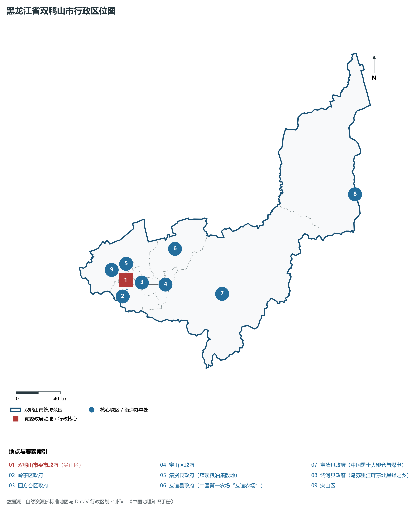
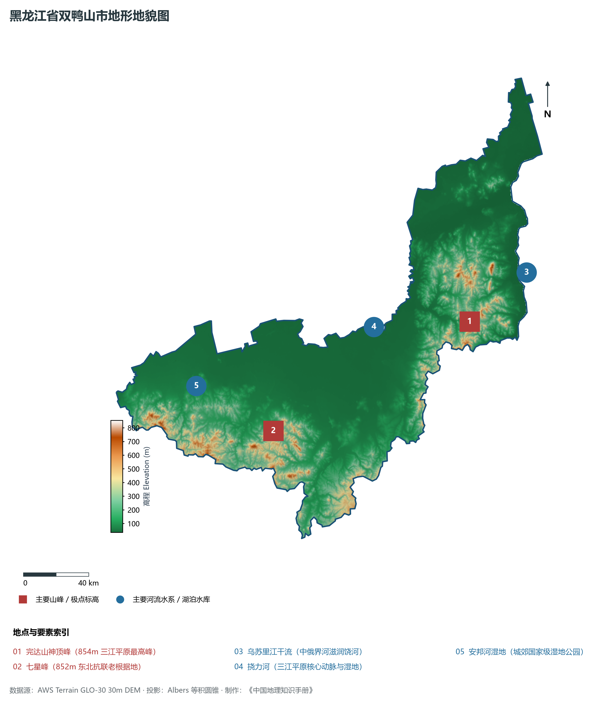
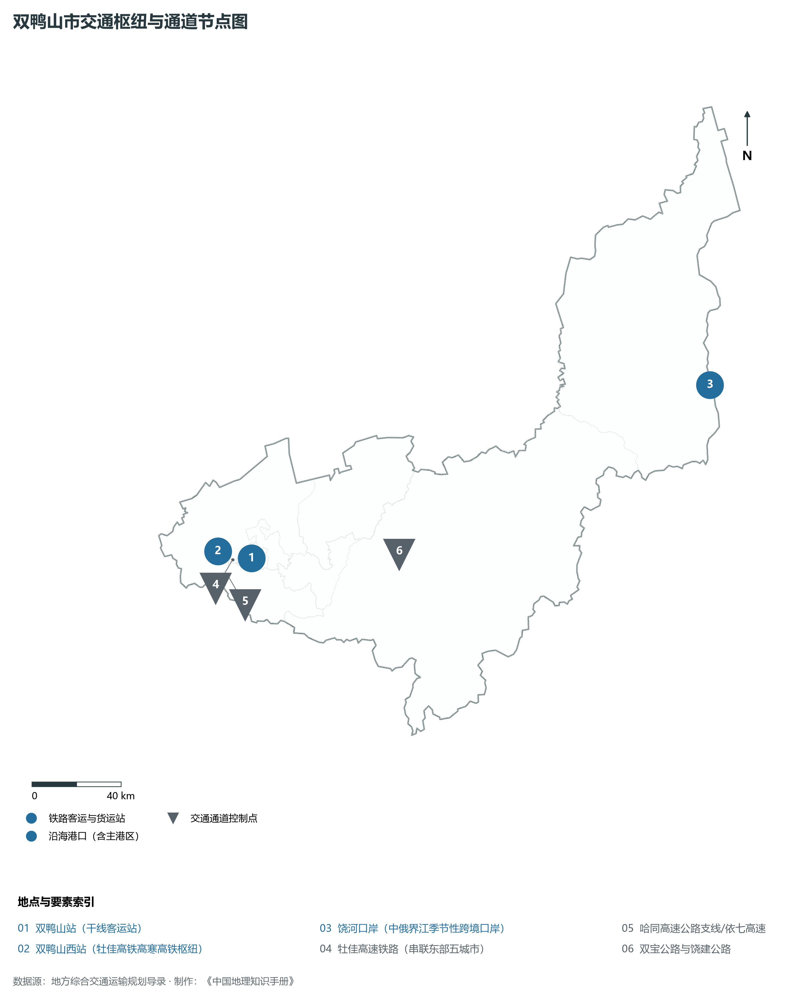
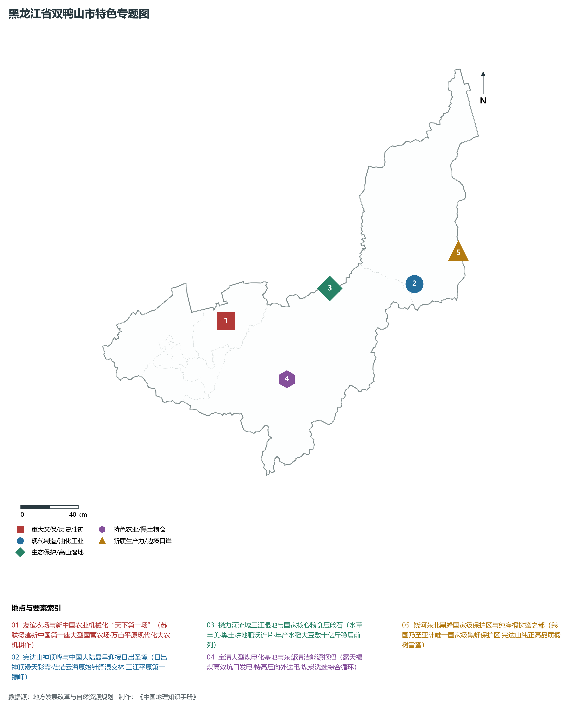
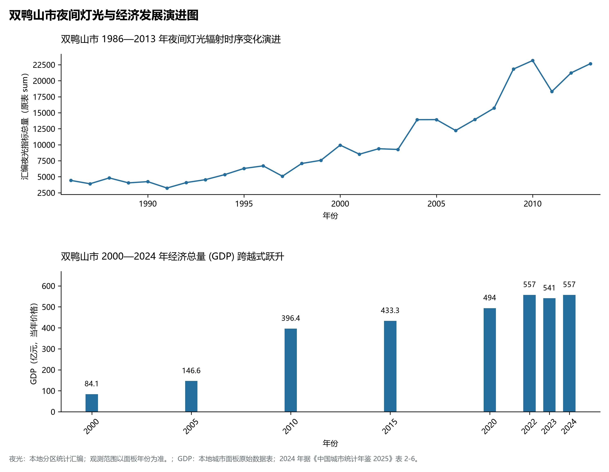

# 7.5 双鸭山市

双鸭山市，位于黑龙江省，其战略定位与特色概括为：**三江平原生态粮仓腹地·完达山神顶峰之乡·现代煤电化一体化基地·乌苏里江边防重屏**。2024 年常住人口 **113 万人**，常住人口城镇化率 **71.9%**，地区生产总值 **557 亿元**（当年价格），人均地区生产总值 **48,898 元**，三次产业构成为 **35.19 : 21.43 : 43.39**。

---

## 一、自然地理底盘与地貌水系机理

区域骨干控制性山脉与地形高程极点包括：

- **完达山神顶峰 (854m 三江平原最高峰)**（坐标约东经 133.550°、北纬 46.680°，高程约 854.0 m）；
- **七星峰 (852m 东北抗联老根据地)**（坐标约东经 131.800°、北纬 46.400°，高程约 852.0 m）；

水系与水文网络方面，双鸭山市地表水资源丰富，骨干江河湖泊纵横穿流：

- **乌苏里江干流 (中俄界河滋润饶河)**（流经约东经 134.100°、北纬 46.850° 水域）；
- **挠力河 (三江平原核心动脉与湿地)**（流经约东经 132.800°、北纬 46.800° 水域）；
- **安邦河湿地 (城郊国家级湿地公园)**（流经约东经 131.300°、北纬 46.750° 水域）；

---

## 二、行政区划沿革与城镇空间体系

双鸭山市历史文脉积淀深厚，建置沿革源远流长。新中国成立以来，伴随国家老工业基地建设、大庆石油会战、林区综合开发与现代农垦城镇化战略推进，形成了梯次鲜明、产城紧密融合的市辖区与县级行政单元空间组织体系：

- **双鸭山市委市政府 (尖山区)**（驻地坐标：131.155°E, 46.640°N）；
- **岭东区政府**（驻地坐标：131.140°E, 46.570°N）；
- **四方台区政府**（驻地坐标：131.330°E, 46.590°N）；
- **宝山区政府**（驻地坐标：131.400°E, 46.560°N）；
- **集贤县政府 (煤炭粮油集散地)**（驻地坐标：131.140°E, 46.720°N）；
- **友谊县政府 (中国第一农场“友谊农场”)**（驻地坐标：131.810°E, 46.780°N）；
- **宝清县政府 (中国黑土大粮仓与煤电)**（驻地坐标：132.200°E, 46.330°N）；
- **饶河县政府 (乌苏里江畔东北黑蜂之乡)**（驻地坐标：134.020°E, 46.800°N）；

在城镇空间总体布局上，双鸭山市紧扣《国土空间总体规划》，坚持“极核集聚、轴带贯通、组团联动、绿色涵养”的总体思路，统筹协调中心城区扩容提质与县域城镇特色发展，构建多中心、网络化、集约型的空间发展格局。

---

## 三、综合立体交通网络与交通走廊

双鸭山市地处东北地区立体交通网络关键节点，依托高速铁路、干线普速铁路、国家高速公路与边境口岸/民航机场，构筑了四通八达的现代化立体综合交通运输骨架：

**主要综合客运与货运物流交通枢纽节点：**

- **双鸭山站 (干线客运站)**（位置坐标：131.160°E, 46.645°N）；
- **双鸭山西站 (牡佳高铁高寒高铁枢纽)**（位置坐标：131.050°E, 46.660°N）；
- **饶河口岸 (中俄界江季节性跨境口岸)**（位置坐标：134.030°E, 46.810°N）；

**核心干线铁路与高等级公路交通走廊：**

- **牡佳高速铁路 (串联东部五城市)**（廊道控制点：131.050°E, 46.660°N）：对外快速互联互通的高速客货运通道；
- **哈同高速公路支线/依七高速**（廊道控制点：131.000°E, 46.600°N）：对外快速互联互通的高速客货运通道；
- **双宝公路与饶建公路**（廊道控制点：132.000°E, 46.500°N）：对外快速互联互通的高速客货运通道；

---

## 四、现代重点产业布局与特色功能组团

在新时代推动东北全面振兴战略引领下，双鸭山市紧扣高质量发展首要任务，深度融入全省“一圈一带三带”与“4567”现代产业空间新格局，加快传统工业数字化绿色化改造，培育壮大新兴战略性产业链群，全力打造特色鲜明的现代化产业高地：

**重点园区与现代化产业承载基地：**

- **龙煤双鸭山矿业有限责任公司**（空间分布：131.150°E, 46.620°N）；
- **国能宝清煤电化一体化示范基地**（空间分布：132.300°E, 46.250°N）；
- **友谊农场现代智能大农业核心区**（空间分布：131.800°E, 46.800°N）；
- **国家级饶河东北黑蜂国家级自然保护区**（空间分布：133.900°E, 46.750°N）；

**代表性特色地标与战略支撑维度：**

- **友谊农场与新中国农业机械化“天下第一场”**（131.810°E, 46.780°N）：苏联援建新中国第一座大型国营农场·万亩平原现代化大农机耕作；
- **完达山神顶峰与中国大陆最早迎接日出圣境**（133.550°E, 46.680°N）：日出神顶漫天彩霞·茫茫云海原始针阔混交林·三江平原第一巅峰；
- **挠力河流域三江湿地与国家核心粮食压舱石**（132.800°E, 46.800°N）：水草丰美·黑土耕地肥沃连片·年产水稻大豆数十亿斤稳居前列；
- **宝清大型煤电化基地与东部清洁能源枢纽**（132.200°E, 46.330°N）：露天褐煤高效坑口发电·特高压向外送电·煤炭洗选综合循环；
- **饶河东北黑蜂国家级保护区与纯净椴树蜜之都**（134.020°E, 46.800°N）：我国乃至亚洲唯一国家级黑蜂保护区·完达山纯正高品质椴树雪蜜；

---

## 五、1986—2013年夜间灯光演变与经济变化分析

本节夜光图的观测年份为 1986—2013 年，指标为行政区汇总值（原表 sum）。

2024 年双鸭山市全市地区生产总值为 557 亿元（当年价格）。

| 年份 | 地区生产总值（亿元，当年价格） |
|:---|---:|
| 2000 年 | 84.1 |
| 2005 年 | 146.6 |
| 2010 年 | 396.4 |
| 2015 年 | 433.3 |
| 2020 年 | 494 |
| 2022 年 | 557 |
| 2023 年 | 541 |
| 2024 年 | 557 |

---

## 六、文化旅游名胜、生态屏障与可持续人地共生

双鸭山市高度注重统筹经济高质量发展与高水平生态环境保护，筑牢绿色生态底盘，弘扬优秀历史文化：

- **完达山神顶峰国家森林公园 (第一缕阳光照射地)**（位置坐标：133.550°E, 46.680°N）；
- **友谊农场现代农业示范园区与北大荒农机博览园**（位置坐标：131.810°E, 46.780°N）；
- **安邦河国家湿地公园 (4A)**（位置坐标：131.350°E, 46.780°N）；
- **饶河乌苏里江国家湿地公园**（位置坐标：134.020°E, 46.800°N）；

在人地协调机制方面，双鸭山市统筹推进山水林田湖草沙一体化保护与系统治理，坚决打好蓝天、碧水、净土保卫战，筑牢大界江大森林大湿地生态屏障与平原黑土地粮仓，打造人与自然和谐共生的生态宜居美丽家园。

---

## 七、双鸭山市关键地理统计指标速查矩阵

| 统计指标项 | 统计数值 / 口径标准 | 空间特征与全省位次说明 |
|:---|:---|:---|
| **行政区划代码** | `230500` | 国家民政部标准行政区划编号 |
| **辖区陆地面积** | **22,483.0** km² | 土地利用类型兼具山地、丘陵、平原与城镇工矿 |
| **常住人口规模** | 113 万人 | 2024 年，全市；年鉴公布口径 |
| **常住人口城镇化率** | 71.9% | 2024 年，全市；年鉴公布口径 |
| **地区生产总值 (2024)** | 557 亿元 | 2024 年，全市；年鉴公布口径 |
| **人均 GDP 水平** | 48,898 元/人 | 2024 年，全市；年鉴公布口径 |
| **三次产业结构比** | 35.19 : 21.43 : 43.39 | 2024 年，全市；年鉴公布口径 |
| **地表极限高程** | **35.0 m ～ 854.0 m** | 形成极具特色的立体地貌剖面格局 |

2024 年统计来源：《中国城市统计年鉴 2025》表 2-1、2-6、2-7（2024 年，全市）。其他年份 GDP 据本地城市面板“原始数据”表，单位为亿元、当年价格。
