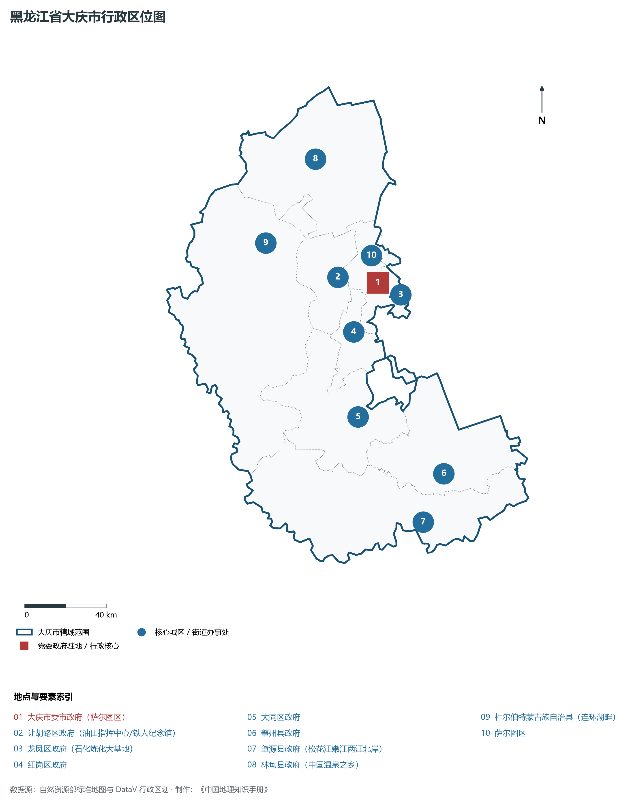
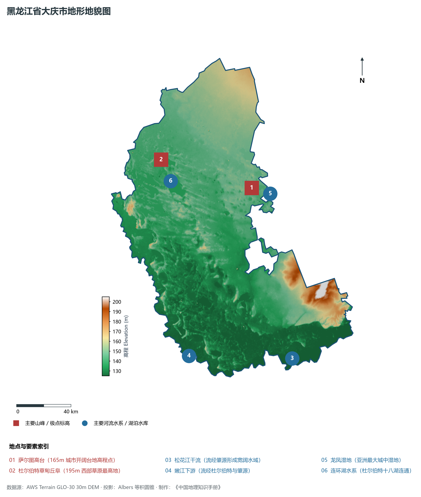
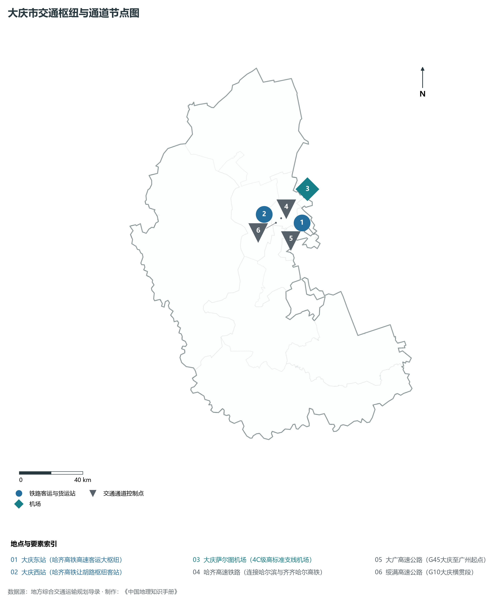
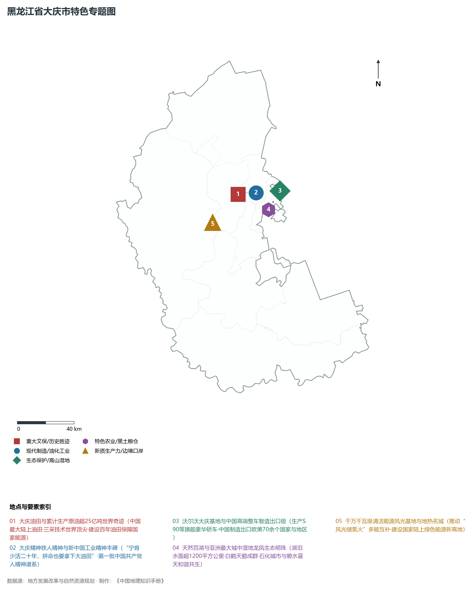
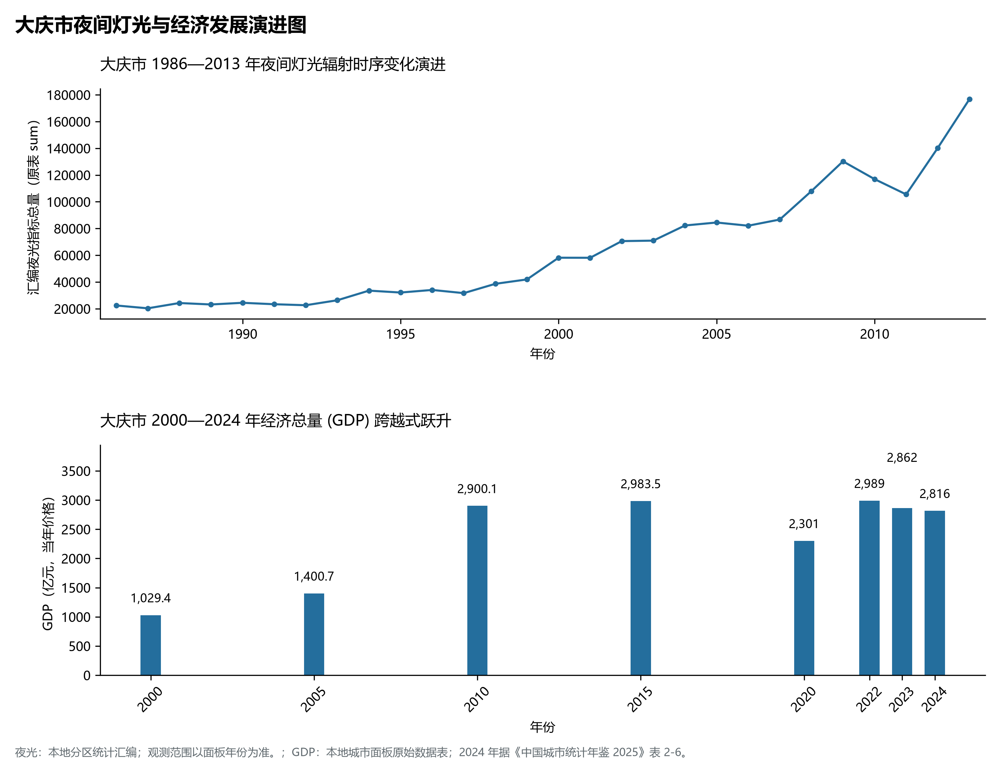

# 7.6 大庆市

大庆市，位于黑龙江省，其战略定位与特色概括为：**“绿色油化之都”·中国最大石油工业基地·“天然百湖之城”·大庆精神发祥地与新能源名城**。2024 年常住人口 **267 万人**，常住人口城镇化率 **74.96%**，地区生产总值 **2,816 亿元**（当年价格），人均地区生产总值 **105,008 元**，三次产业构成为 **8.35 : 52.52 : 39.13**。

---

## 一、自然地理底盘与地貌水系机理

区域骨干控制性山脉与地形高程极点包括：

- **萨尔图高台 (165m 城市开阔台地高程点)**（坐标约东经 125.100°、北纬 46.600°，高程约 165.0 m）；
- **杜尔伯特草甸丘阜 (195m 西部草原最高地)**（坐标约东经 124.300°、北纬 46.900°，高程约 195.0 m）；

水系与水文网络方面，大庆市地表水资源丰富，骨干江河湖泊纵横穿流：

- **松花江干流 (流经肇源形成宽阔水域)**（流经约东经 125.150°、北纬 45.450° 水域）；
- **嫩江下游 (流经杜尔伯特与肇源)**（流经约东经 124.200°、北纬 45.600° 水域）；
- **龙凤湿地 (亚洲最大城中湿地)**（流经约东经 125.180°、北纬 46.550° 水域）；
- **连环湖水系 (杜尔伯特十八湖连通)**（流经约东经 124.350°、北纬 46.750° 水域）；

---

## 二、行政区划沿革与城镇空间体系

大庆市历史文脉积淀深厚，建置沿革源远流长。新中国成立以来，伴随国家老工业基地建设、大庆石油会战、林区综合开发与现代农垦城镇化战略推进，形成了梯次鲜明、产城紧密融合的市辖区与县级行政单元空间组织体系：

- **大庆市委市政府 (萨尔图区)**（驻地坐标：125.105°E, 46.590°N）；
- **让胡路区政府 (油田指挥中心/铁人纪念馆)**（驻地坐标：124.860°E, 46.650°N）；
- **龙凤区政府 (石化炼化大基地)**（驻地坐标：125.150°E, 46.530°N）；
- **红岗区政府**（驻地坐标：124.890°E, 46.400°N）；
- **大同区政府**（驻地坐标：124.810°E, 46.030°N）；
- **肇州县政府**（驻地坐标：125.270°E, 45.710°N）；
- **肇源县政府 (松花江嫩江两江北岸)**（驻地坐标：125.080°E, 45.520°N）；
- **林甸县政府 (中国温泉之乡)**（驻地坐标：124.870°E, 47.180°N）；
- **杜尔伯特蒙古族自治县 (连环湖畔)**（驻地坐标：124.450°E, 46.860°N）；

在城镇空间总体布局上，大庆市紧扣《国土空间总体规划》，坚持“极核集聚、轴带贯通、组团联动、绿色涵养”的总体思路，统筹协调中心城区扩容提质与县域城镇特色发展，构建多中心、网络化、集约型的空间发展格局。

---

## 三、综合立体交通网络与交通走廊

大庆市地处东北地区立体交通网络关键节点，依托高速铁路、干线普速铁路、国家高速公路与边境口岸/民航机场，构筑了四通八达的现代化立体综合交通运输骨架：

**主要综合客运与货运物流交通枢纽节点：**

- **大庆东站 (哈齐高铁高速客运大枢纽)**（位置坐标：125.160°E, 46.570°N）；
- **大庆西站 (哈齐高铁让胡路枢纽客站)**（位置坐标：124.870°E, 46.660°N）；
- **大庆萨尔图机场 (4C级高标准支线机场)**（位置坐标：125.260°E, 46.750°N）；

**核心干线铁路与高等级公路交通走廊：**

- **哈齐高速铁路 (连接哈尔滨与齐齐哈尔高铁)**（廊道控制点：125.000°E, 46.620°N）：对外快速互联互通的高速客货运通道；
- **大广高速公路 (G45大庆至广州起点)**（廊道控制点：125.120°E, 46.500°N）：对外快速互联互通的高速客货运通道；
- **绥满高速公路 (G10大庆横贯段)**（廊道控制点：124.950°E, 46.600°N）：对外快速互联互通的高速客货运通道；

---

## 四、现代重点产业布局与特色功能组团

在新时代推动东北全面振兴战略引领下，大庆市紧扣高质量发展首要任务，深度融入全省“一圈一带三带”与“4567”现代产业空间新格局，加快传统工业数字化绿色化改造，培育壮大新兴战略性产业链群，全力打造特色鲜明的现代化产业高地：

**重点园区与现代化产业承载基地：**

- **中国石油天然气股份有限公司大庆油田公司**（空间分布：124.880°E, 46.640°N）；
- **中国石油大庆石化公司炼化一体化基地**（空间分布：125.150°E, 46.530°N）；
- **沃尔沃汽车大庆制造基地 (SPA高端平台)**（空间分布：125.180°E, 46.620°N）；
- **大庆高新技术产业开发区 (国家级)**（空间分布：125.130°E, 46.600°N）；
- **大庆大型光伏治沙与新能源微网示范区**（空间分布：124.600°E, 46.500°N）；

**代表性特色地标与战略支撑维度：**

- **大庆油田与累计生产原油超25亿吨世界奇迹**（124.880°E, 46.640°N）：中国最大陆上油田·三采技术世界顶尖·建设百年油田保障国家能源；
- **大庆精神铁人精神与新中国工业精神丰碑**（124.880°E, 46.650°N）：“宁肯少活二十年，拼命也要拿下大油田”·第一批中国共产党人精神谱系；
- **沃尔沃大庆基地与中国高端整车智造出口极**（125.180°E, 46.620°N）：生产S90等旗舰豪华轿车·中国制造出口欧美70余个国家与地区；
- **天然百湖与亚洲最大城中湿地龙凤生态明珠**（125.180°E, 46.550°N）：湖泊水面超1200平方公里·白鹤天鹅成群·石化城市与碧水蓝天和谐共生；
- **千万千瓦级清洁能源风光基地与地热名城**（124.600°E, 46.500°N）：推动“风光储氢火”多能互补·建设国家陆上绿色能源新高地；

---

## 五、1986—2013年夜间灯光演变与经济变化分析

本节夜光图的观测年份为 1986—2013 年，指标为行政区汇总值（原表 sum）。

2024 年大庆市全市地区生产总值为 2,816 亿元（当年价格）。

| 年份 | 地区生产总值（亿元，当年价格） |
|:---|---:|
| 2000 年 | 1,029.4 |
| 2005 年 | 1,400.7 |
| 2010 年 | 2,900.1 |
| 2015 年 | 2,983.5 |
| 2020 年 | 2,301 |
| 2022 年 | 2,989 |
| 2023 年 | 2,862 |
| 2024 年 | 2,816 |

---

## 六、文化旅游名胜、生态屏障与可持续人地共生

大庆市高度注重统筹经济高质量发展与高水平生态环境保护，筑牢绿色生态底盘，弘扬优秀历史文化：

- **铁人王进喜纪念馆 (全国爱国主义教育示范基地)**（位置坐标：124.880°E, 46.650°N）；
- **大庆龙凤湿地自然保护区 (国家级城市湿地)**（位置坐标：125.180°E, 46.550°N）；
- **连环湖温泉景区 (4A·蒙元文化湿地温泉)**（位置坐标：124.350°E, 46.750°N）；
- **松基三井纪念地 (大庆油田发现井·全国文保)**（位置坐标：124.950°E, 46.420°N）；

在人地协调机制方面，大庆市统筹推进山水林田湖草沙一体化保护与系统治理，坚决打好蓝天、碧水、净土保卫战，筑牢大界江大森林大湿地生态屏障与平原黑土地粮仓，打造人与自然和谐共生的生态宜居美丽家园。

---

## 七、大庆市关键地理统计指标速查矩阵

| 统计指标项 | 统计数值 / 口径标准 | 空间特征与全省位次说明 |
|:---|:---|:---|
| **行政区划代码** | `230600` | 国家民政部标准行政区划编号 |
| **辖区陆地面积** | **21,219.0** km² | 土地利用类型兼具山地、丘陵、平原与城镇工矿 |
| **常住人口规模** | 267 万人 | 2024 年，全市；年鉴公布口径 |
| **常住人口城镇化率** | 74.96% | 2024 年，全市；年鉴公布口径 |
| **地区生产总值 (2024)** | 2,816 亿元 | 2024 年，全市；年鉴公布口径 |
| **人均 GDP 水平** | 105,008 元/人 | 2024 年，全市；年鉴公布口径 |
| **三次产业结构比** | 8.35 : 52.52 : 39.13 | 2024 年，全市；年鉴公布口径 |
| **地表极限高程** | **125.0 m ～ 205.0 m** | 形成极具特色的立体地貌剖面格局 |

2024 年统计来源：《中国城市统计年鉴 2025》表 2-1、2-6、2-7（2024 年，全市）。其他年份 GDP 据本地城市面板“原始数据”表，单位为亿元、当年价格。
