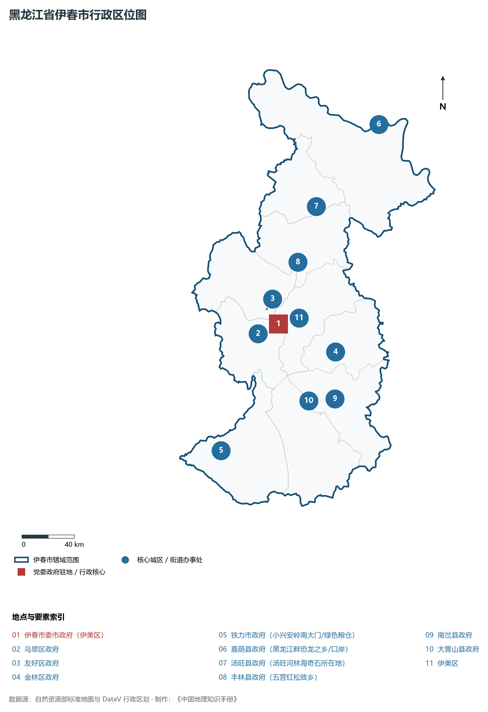
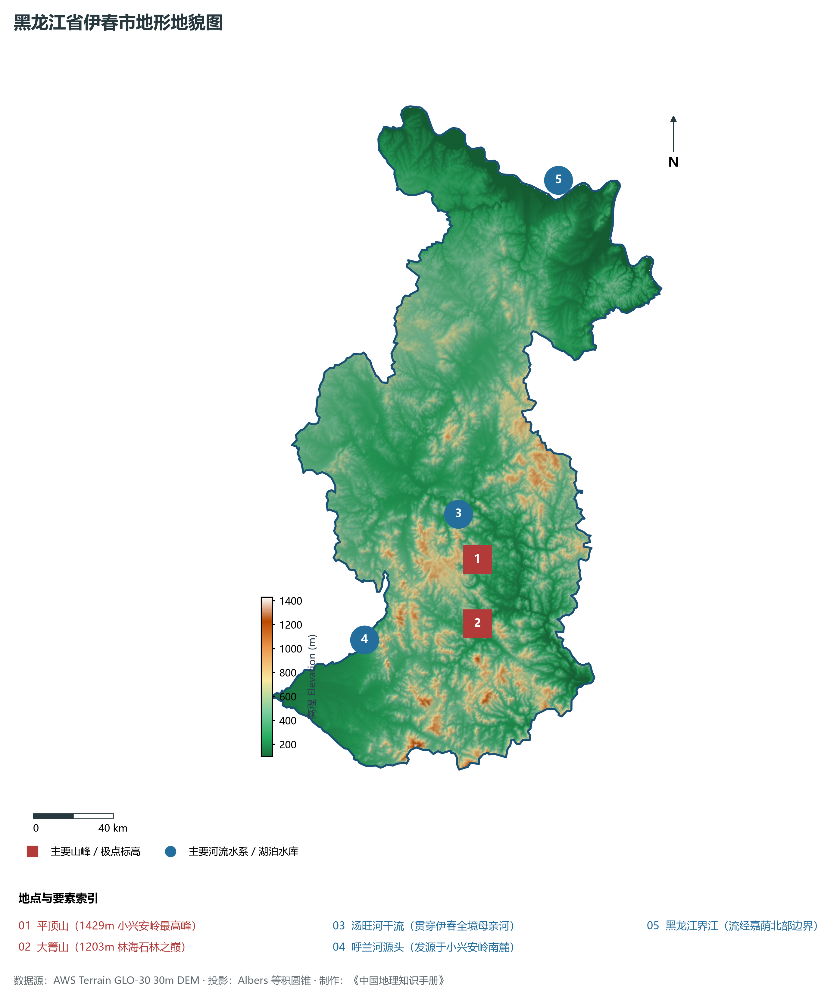
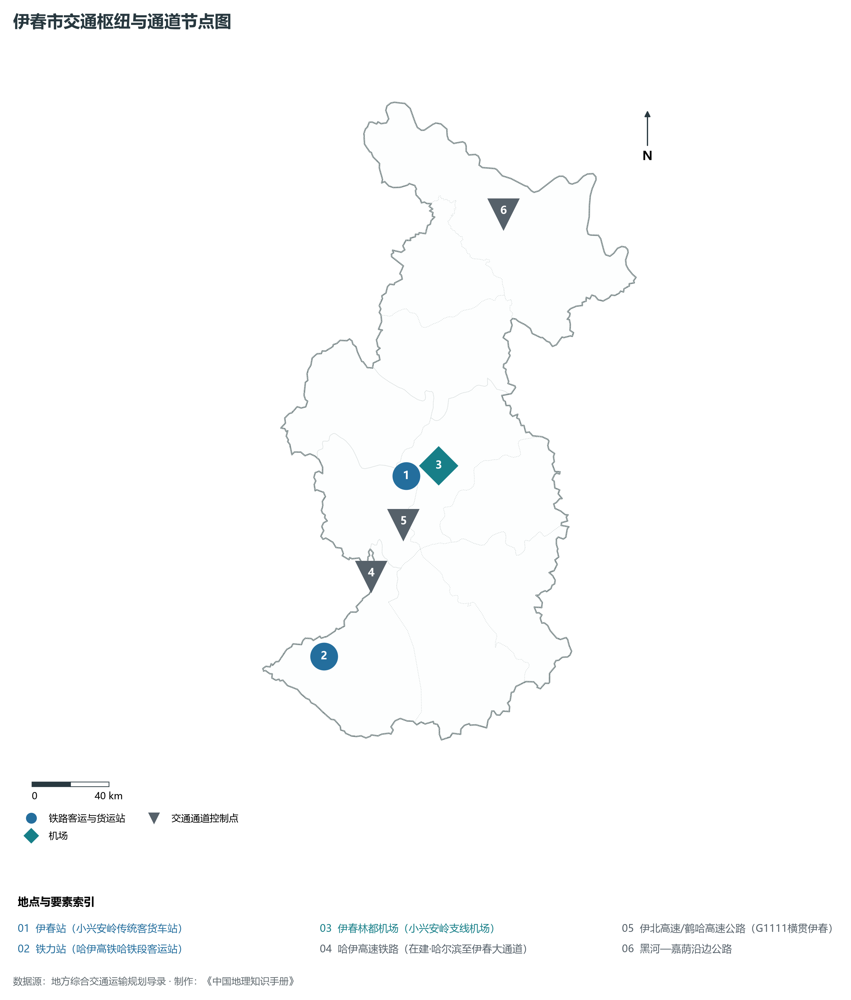
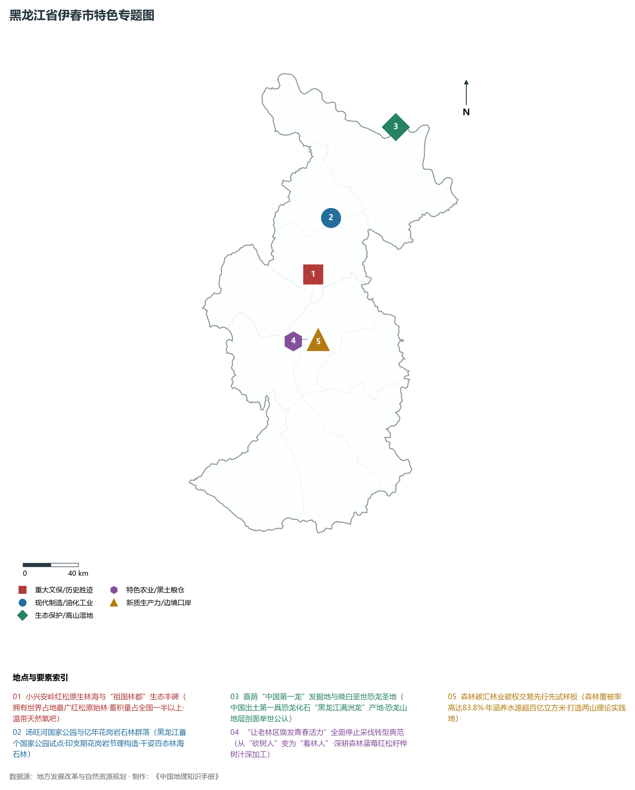
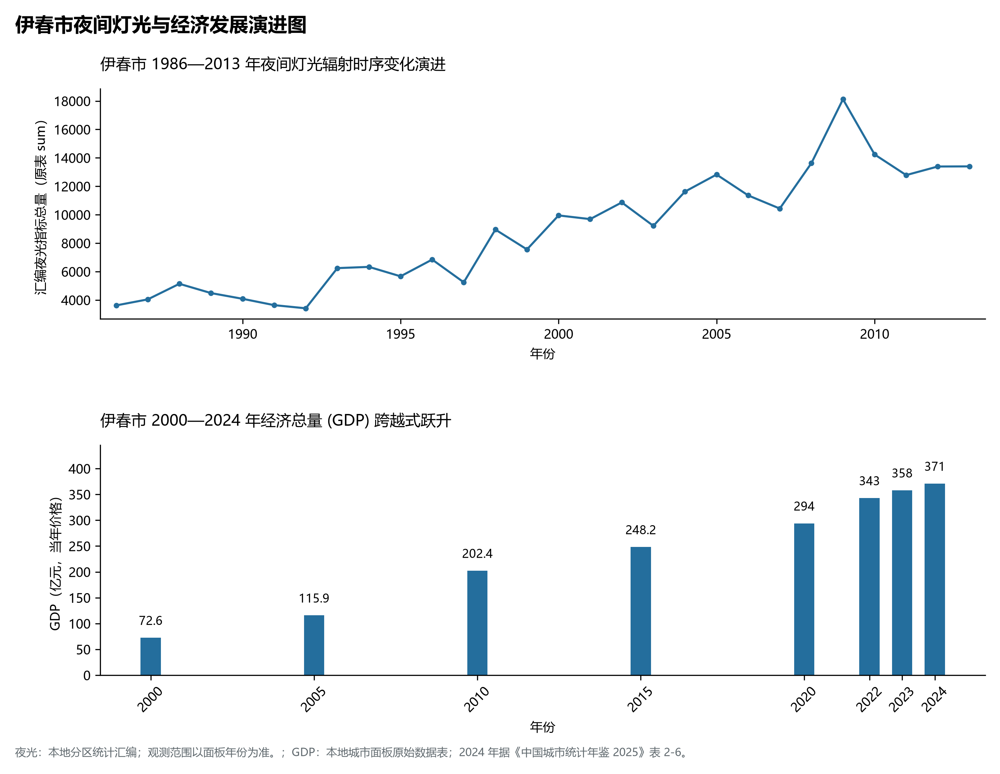

# 7.7 伊春市

伊春市，位于黑龙江省，其战略定位与特色概括为：**“祖国林都”·“红松故乡”·小兴安岭生态安全水塔·世界级森林康养旅游胜地**。2024 年常住人口 **81 万人**，常住人口城镇化率 **86.4%**，地区生产总值 **371 亿元**（当年价格），人均地区生产总值 **45,512 元**，三次产业构成为 **33.77 : 18.92 : 47.29**。

---

## 一、自然地理底盘与地貌水系机理

区域骨干控制性山脉与地形高程极点包括：

- **平顶山 (1429m 小兴安岭最高峰)**（坐标约东经 129.150°、北纬 47.380°，高程约 1429.0 m）；
- **大箐山 (1203m 林海石林之巅)**（坐标约东经 129.050°、北纬 47.100°，高程约 1203.0 m）；

水系与水文网络方面，伊春市地表水资源丰富，骨干江河湖泊纵横穿流：

- **汤旺河干流 (贯穿伊春全境母亲河)**（流经约东经 129.100°、北纬 47.600° 水域）；
- **呼兰河源头 (发源于小兴安岭南麓)**（流经约东经 128.300°、北纬 47.150° 水域）；
- **黑龙江界江 (流经嘉荫北部边界)**（流经约东经 130.300°、北纬 48.950° 水域）；

---

## 二、行政区划沿革与城镇空间体系

伊春市历史文脉积淀深厚，建置沿革源远流长。新中国成立以来，伴随国家老工业基地建设、大庆石油会战、林区综合开发与现代农垦城镇化战略推进，形成了梯次鲜明、产城紧密融合的市辖区与县级行政单元空间组织体系：

- **伊春市委市政府 (伊美区)**（驻地坐标：128.910°E, 47.730°N）；
- **乌翠区政府**（驻地坐标：128.800°E, 47.680°N）；
- **友好区政府**（驻地坐标：128.830°E, 47.850°N）；
- **金林区政府**（驻地坐标：129.400°E, 47.450°N）；
- **铁力市政府 (小兴安岭南大门/绿色粮仓)**（驻地坐标：128.050°E, 46.980°N）；
- **嘉荫县政府 (黑龙江畔恐龙之乡/口岸)**（驻地坐标：130.400°E, 48.890°N）；
- **汤旺县政府 (汤旺河林海奇石所在地)**（驻地坐标：129.570°E, 48.450°N）；
- **丰林县政府 (五营红松故乡)**（驻地坐标：129.250°E, 48.110°N）；
- **南岔县政府**（驻地坐标：129.280°E, 47.140°N）；
- **大箐山县政府**（驻地坐标：129.020°E, 47.170°N）；

在城镇空间总体布局上，伊春市紧扣《国土空间总体规划》，坚持“极核集聚、轴带贯通、组团联动、绿色涵养”的总体思路，统筹协调中心城区扩容提质与县域城镇特色发展，构建多中心、网络化、集约型的空间发展格局。

---

## 三、综合立体交通网络与交通走廊

伊春市地处东北地区立体交通网络关键节点，依托高速铁路、干线普速铁路、国家高速公路与边境口岸/民航机场，构筑了四通八达的现代化立体综合交通运输骨架：

**主要综合客运与货运物流交通枢纽节点：**

- **伊春站 (小兴安岭传统客货车站)**（位置坐标：128.900°E, 47.720°N）；
- **铁力站 (哈伊高铁哈铁段客运站)**（位置坐标：128.060°E, 46.990°N）；
- **伊春林都机场 (小兴安岭支线机场)**（位置坐标：129.020°E, 47.750°N）；

**核心干线铁路与高等级公路交通走廊：**

- **哈伊高速铁路 (在建·哈尔滨至伊春大通道)**（廊道控制点：128.500°E, 47.300°N）：对外快速互联互通的高速客货运通道；
- **伊北高速/鹤哈高速公路 (G1111横贯伊春)**（廊道控制点：128.800°E, 47.500°N）：对外快速互联互通的高速客货运通道；
- **黑河—嘉荫沿边公路**（廊道控制点：130.000°E, 48.800°N）：对外快速互联互通的高速客货运通道；

---

## 四、现代重点产业布局与特色功能组团

在新时代推动东北全面振兴战略引领下，伊春市紧扣高质量发展首要任务，深度融入全省“一圈一带三带”与“4567”现代产业空间新格局，加快传统工业数字化绿色化改造，培育壮大新兴战略性产业链群，全力打造特色鲜明的现代化产业高地：

**重点园区与现代化产业承载基地：**

- **伊春国家农业科技园区与绿色林下食品加工基地**（空间分布：128.880°E, 47.700°N）；
- **铁力现代中草药与大豆水稻特色产业园**（空间分布：128.080°E, 47.020°N）；
- **伊春林业集团林碳经济与碳汇交易中心**（空间分布：128.920°E, 47.740°N）；

**代表性特色地标与战略支撑维度：**

- **小兴安岭红松原生林海与“祖国林都”生态丰碑**（129.250°E, 48.120°N）：拥有世界占地最广红松原始林·蓄积量占全国一半以上·温带天然氧吧；
- **汤旺河国家公园与亿年花岗岩石林群落**（129.550°E, 48.450°N）：黑龙江首个国家公园试点·印支期花岗岩节理构造·千姿百态林海石林；
- **嘉荫“中国第一龙”发掘地与晚白垩世恐龙圣地**（130.380°E, 48.920°N）：中国出土第一具恐龙化石“黑龙江满洲龙”产地·恐龙山地层剖面举世公认；
- **“让老林区焕发青春活力”全面停止采伐转型典范**（128.910°E, 47.730°N）：从“砍树人”变为“看林人”·深耕森林蓝莓红松籽桦树汁深加工；
- **森林碳汇林业碳权交易先行先试样板**（128.920°E, 47.740°N）：森林覆被率高达83.8%·年涵养水源超百亿立方米·打造两山理论实践地；

---

## 五、1986—2013年夜间灯光演变与经济变化分析

本节夜光图的观测年份为 1986—2013 年，指标为行政区汇总值（原表 sum）。

2024 年伊春市全市地区生产总值为 371 亿元（当年价格）。

| 年份 | 地区生产总值（亿元，当年价格） |
|:---|---:|
| 2000 年 | 72.6 |
| 2005 年 | 115.9 |
| 2010 年 | 202.4 |
| 2015 年 | 248.2 |
| 2020 年 | 294 |
| 2022 年 | 343 |
| 2023 年 | 358 |
| 2024 年 | 371 |

---

## 六、文化旅游名胜、生态屏障与可持续人地共生

伊春市高度注重统筹经济高质量发展与高水平生态环境保护，筑牢绿色生态底盘，弘扬优秀历史文化：

- **汤旺河林海奇石风景区 (5A·花岗岩石林自然奇观)**（位置坐标：129.550°E, 48.450°N）；
- **五营国家森林公园 (4A·亚洲最大红松原始森林)**（位置坐标：129.250°E, 48.120°N）；
- **嘉荫恐龙国家地质公园 (中国最早发现恐龙化石处)**（位置坐标：130.380°E, 48.920°N）；
- **茅兰沟国家森林公园 (小兴安岭九寨沟)**（位置坐标：130.150°E, 48.880°N）；

在人地协调机制方面，伊春市统筹推进山水林田湖草沙一体化保护与系统治理，坚决打好蓝天、碧水、净土保卫战，筑牢大界江大森林大湿地生态屏障与平原黑土地粮仓，打造人与自然和谐共生的生态宜居美丽家园。

---

## 七、伊春市关键地理统计指标速查矩阵

| 统计指标项 | 统计数值 / 口径标准 | 空间特征与全省位次说明 |
|:---|:---|:---|
| **行政区划代码** | `230700` | 国家民政部标准行政区划编号 |
| **辖区陆地面积** | **32,800.0** km² | 土地利用类型兼具山地、丘陵、平原与城镇工矿 |
| **常住人口规模** | 81 万人 | 2024 年，全市；年鉴公布口径 |
| **常住人口城镇化率** | 86.4% | 2024 年，全市；年鉴公布口径 |
| **地区生产总值 (2024)** | 371 亿元 | 2024 年，全市；年鉴公布口径 |
| **人均 GDP 水平** | 45,512 元/人 | 2024 年，全市；年鉴公布口径 |
| **三次产业结构比** | 33.77 : 18.92 : 47.29 | 2024 年，全市；年鉴公布口径 |
| **地表极限高程** | **100.0 m ～ 1429.0 m** | 形成极具特色的立体地貌剖面格局 |

2024 年统计来源：《中国城市统计年鉴 2025》表 2-1、2-6、2-7（2024 年，全市）。其他年份 GDP 据本地城市面板“原始数据”表，单位为亿元、当年价格。
