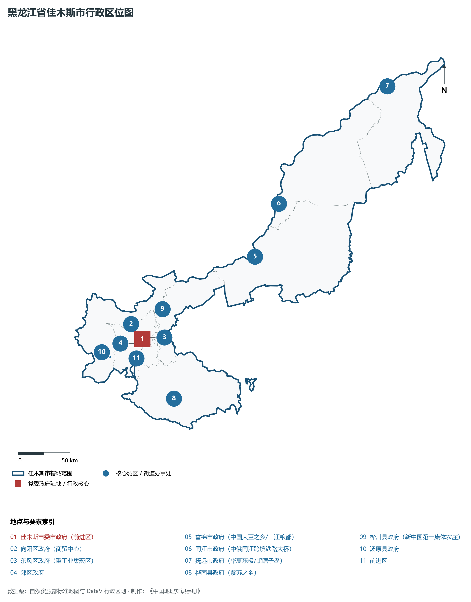
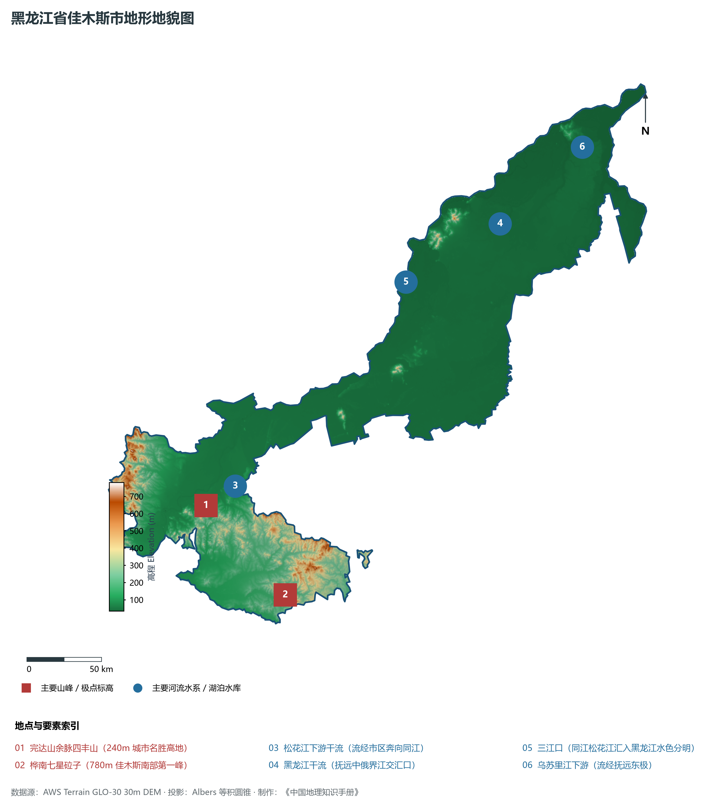
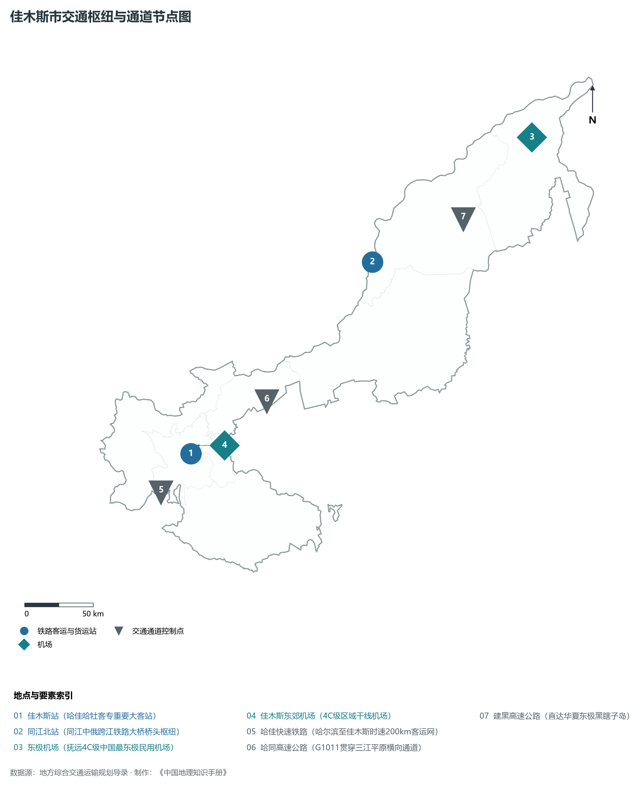
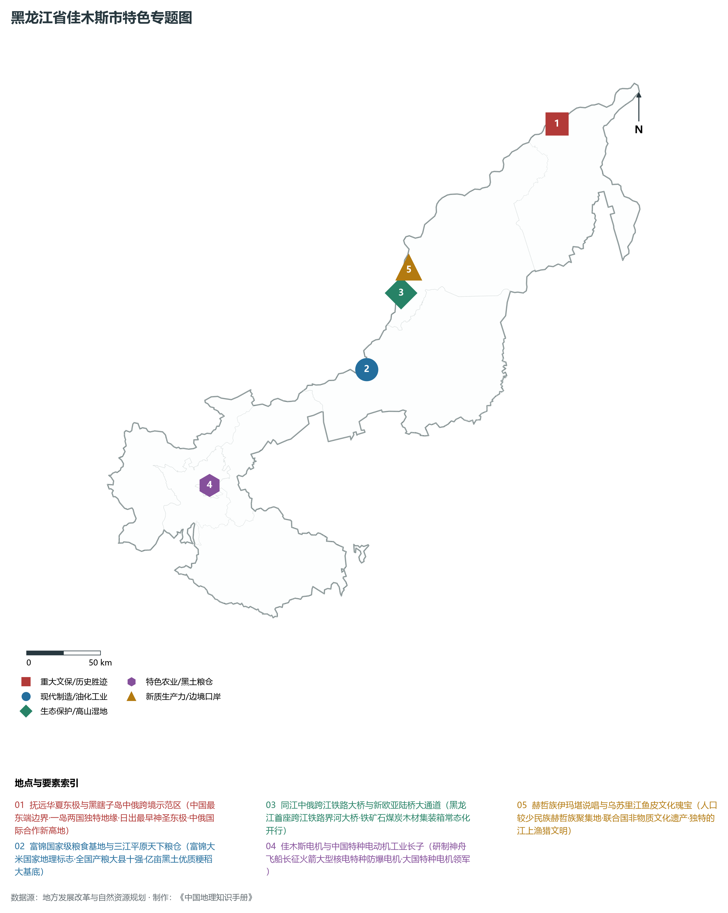
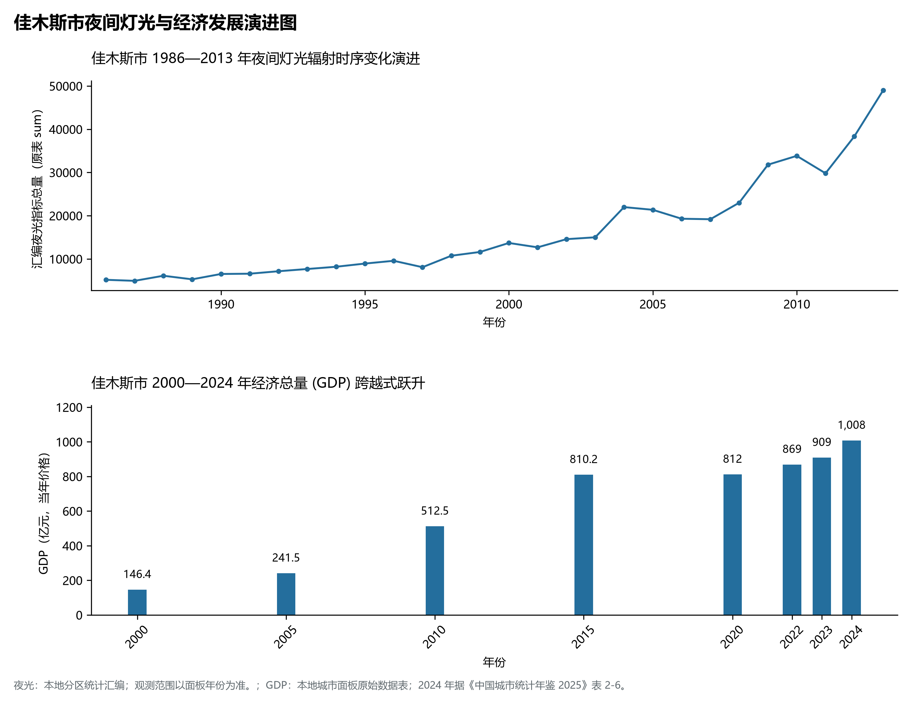

# 7.8 佳木斯市

佳木斯市，位于黑龙江省，其战略定位与特色概括为：**“华夏东极”抚远·三江平原核心大粮仓·国家大型现代农机基地·对俄经贸国际通道**。2024 年常住人口 **207 万人**，常住人口城镇化率 **67.22%**，地区生产总值 **1,008 亿元**（当年价格），人均地区生产总值 **48,565 元**，三次产业构成为 **40.36 : 9.57 : 50.07**。

---

## 一、自然地理底盘与地貌水系机理

区域骨干控制性山脉与地形高程极点包括：

- **完达山余脉四丰山 (240m 城市名胜高地)**（坐标约东经 130.330°、北纬 46.740°，高程约 240.0 m）；
- **桦南七星砬子 (780m 佳木斯南部第一峰)**（坐标约东经 130.800°、北纬 46.100°，高程约 780.0 m）；

水系与水文网络方面，佳木斯市地表水资源丰富，骨干江河湖泊纵横穿流：

- **松花江下游干流 (流经市区奔向同江)**（流经约东经 130.500°、北纬 46.830° 水域）；
- **黑龙江干流 (抚远中俄界江交汇口)**（流经约东经 133.500°、北纬 47.900° 水域）；
- **三江口 (同江松花江汇入黑龙江水色分明)**（流经约东经 132.550°、北纬 47.720° 水域）；
- **乌苏里江下游 (流经抚远东极)**（流经约东经 134.400°、北纬 48.200° 水域）；

---

## 二、行政区划沿革与城镇空间体系

佳木斯市历史文脉积淀深厚，建置沿革源远流长。新中国成立以来，伴随国家老工业基地建设、大庆石油会战、林区综合开发与现代农垦城镇化战略推进，形成了梯次鲜明、产城紧密融合的市辖区与县级行政单元空间组织体系：

- **佳木斯市委市政府 (前进区)**（驻地坐标：130.365°E, 46.810°N）；
- **向阳区政府 (商贸中心)**（驻地坐标：130.340°E, 46.800°N）；
- **东风区政府 (重工业集聚区)**（驻地坐标：130.400°E, 46.820°N）；
- **郊区政府**（驻地坐标：130.320°E, 46.780°N）；
- **富锦市政府 (中国大豆之乡/三江粮都)**（驻地坐标：132.030°E, 47.250°N）；
- **同江市政府 (中俄同江跨境铁路大桥)**（驻地坐标：132.510°E, 47.640°N）；
- **抚远市政府 (华夏东极/黑瞎子岛)**（驻地坐标：134.290°E, 48.360°N）；
- **桦南县政府 (紫苏之乡)**（驻地坐标：130.560°E, 46.240°N）；
- **桦川县政府 (新中国第一集体农庄)**（驻地坐标：130.710°E, 47.020°N）；
- **汤原县政府**（驻地坐标：129.910°E, 46.730°N）；

在城镇空间总体布局上，佳木斯市紧扣《国土空间总体规划》，坚持“极核集聚、轴带贯通、组团联动、绿色涵养”的总体思路，统筹协调中心城区扩容提质与县域城镇特色发展，构建多中心、网络化、集约型的空间发展格局。

---

## 三、综合立体交通网络与交通走廊

佳木斯市地处东北地区立体交通网络关键节点，依托高速铁路、干线普速铁路、国家高速公路与边境口岸/民航机场，构筑了四通八达的现代化立体综合交通运输骨架：

**主要综合客运与货运物流交通枢纽节点：**

- **佳木斯站 (哈佳哈牡客专重要大客站)**（位置坐标：130.370°E, 46.800°N）；
- **同江北站 (同江中俄跨江铁路大桥桥头枢纽)**（位置坐标：132.540°E, 47.700°N）；
- **东极机场 (抚远4C级中国最东极民用机场)**（位置坐标：134.370°E, 48.190°N）；
- **佳木斯东郊机场 (4C级区域干线机场)**（位置坐标：130.460°E, 46.840°N）；

**核心干线铁路与高等级公路交通走廊：**

- **哈佳快速铁路 (哈尔滨至佳木斯时速200km客运网)**（廊道控制点：130.000°E, 46.600°N）：对外快速互联互通的高速客货运通道；
- **哈同高速公路 (G1011贯穿三江平原横向通道)**（廊道控制点：131.200°E, 47.000°N）：对外快速互联互通的高速客货运通道；
- **建黑高速公路 (直达华夏东极黑瞎子岛)**（廊道控制点：133.500°E, 47.800°N）：对外快速互联互通的高速客货运通道；

---

## 四、现代重点产业布局与特色功能组团

在新时代推动东北全面振兴战略引领下，佳木斯市紧扣高质量发展首要任务，深度融入全省“一圈一带三带”与“4567”现代产业空间新格局，加快传统工业数字化绿色化改造，培育壮大新兴战略性产业链群，全力打造特色鲜明的现代化产业高地：

**重点园区与现代化产业承载基地：**

- **佳木斯电机股份有限公司 (特种防爆电机摇篮)**（空间分布：130.410°E, 46.820°N）；
- **佳木斯大型高端智能农机产业集群**（空间分布：130.350°E, 46.770°N）；
- **富锦国家级现代农业产业园与象屿水稻精深加工**（空间分布：132.050°E, 47.240°N）；
- **同江跨江中俄铁路大桥进出口综合保税加工区**（空间分布：132.520°E, 47.680°N）；

**代表性特色地标与战略支撑维度：**

- **抚远华夏东极与黑瞎子岛中俄跨境示范区**（134.290°E, 48.360°N）：中国最东端边界·一岛两国独特地缘·日出最早神圣东极·中俄国际合作新高地；
- **富锦国家级粮食基地与三江平原天下粮仓**（132.030°E, 47.250°N）：富锦大米国家地理标志·全国产粮大县十强·亿亩黑土优质粳稻大基底；
- **同江中俄跨江铁路大桥与新欧亚陆桥大通道**（132.510°E, 47.640°N）：黑龙江首座跨江铁路界河大桥·铁矿石煤炭木材集装箱常态化开行；
- **佳木斯电机与中国特种电动机工业长子**（130.410°E, 46.820°N）：研制神舟飞船长征火箭大型核电特种防爆电机·大国特种电机领军；
- **赫哲族伊玛堪说唱与乌苏里江鱼皮文化瑰宝**（132.550°E, 47.720°N）：人口较少民族赫哲族聚集地·联合国非物质文化遗产·独特的江上渔猎文明；

---

## 五、1986—2013年夜间灯光演变与经济变化分析

本节夜光图的观测年份为 1986—2013 年，指标为行政区汇总值（原表 sum）。

2024 年佳木斯市全市地区生产总值为 1,008 亿元（当年价格）。

| 年份 | 地区生产总值（亿元，当年价格） |
|:---|---:|
| 2000 年 | 146.4 |
| 2005 年 | 241.5 |
| 2010 年 | 512.5 |
| 2015 年 | 810.2 |
| 2020 年 | 812 |
| 2022 年 | 869 |
| 2023 年 | 909 |
| 2024 年 | 1,008 |

---

## 六、文化旅游名胜、生态屏障与可持续人地共生

佳木斯市高度注重统筹经济高质量发展与高水平生态环境保护，筑牢绿色生态底盘，弘扬优秀历史文化：

- **抚远黑瞎子岛中俄边界湿地公园 (一岛两国)**（位置坐标：134.650°E, 48.330°N）；
- **华夏东极太阳广场 (中国大陆最早迎接日出之角)**（位置坐标：134.780°E, 48.250°N）；
- **同江三江口风景区 (松黑汇流两色江水奇观)**（位置坐标：132.550°E, 47.720°N）；
- **富锦国家湿地公园 (4A·植物王国候鸟天堂)**（位置坐标：131.650°E, 47.050°N）；

在人地协调机制方面，佳木斯市统筹推进山水林田湖草沙一体化保护与系统治理，坚决打好蓝天、碧水、净土保卫战，筑牢大界江大森林大湿地生态屏障与平原黑土地粮仓，打造人与自然和谐共生的生态宜居美丽家园。

---

## 七、佳木斯市关键地理统计指标速查矩阵

| 统计指标项 | 统计数值 / 口径标准 | 空间特征与全省位次说明 |
|:---|:---|:---|
| **行政区划代码** | `230800` | 国家民政部标准行政区划编号 |
| **辖区陆地面积** | **32,700.0** km² | 土地利用类型兼具山地、丘陵、平原与城镇工矿 |
| **常住人口规模** | 207 万人 | 2024 年，全市；年鉴公布口径 |
| **常住人口城镇化率** | 67.22% | 2024 年，全市；年鉴公布口径 |
| **地区生产总值 (2024)** | 1,008 亿元 | 2024 年，全市；年鉴公布口径 |
| **人均 GDP 水平** | 48,565 元/人 | 2024 年，全市；年鉴公布口径 |
| **三次产业结构比** | 40.36 : 9.57 : 50.07 | 2024 年，全市；年鉴公布口径 |
| **地表极限高程** | **34.0 m ～ 780.0 m** | 形成极具特色的立体地貌剖面格局 |

2024 年统计来源：《中国城市统计年鉴 2025》表 2-1、2-6、2-7（2024 年，全市）。其他年份 GDP 据本地城市面板“原始数据”表，单位为亿元、当年价格。
