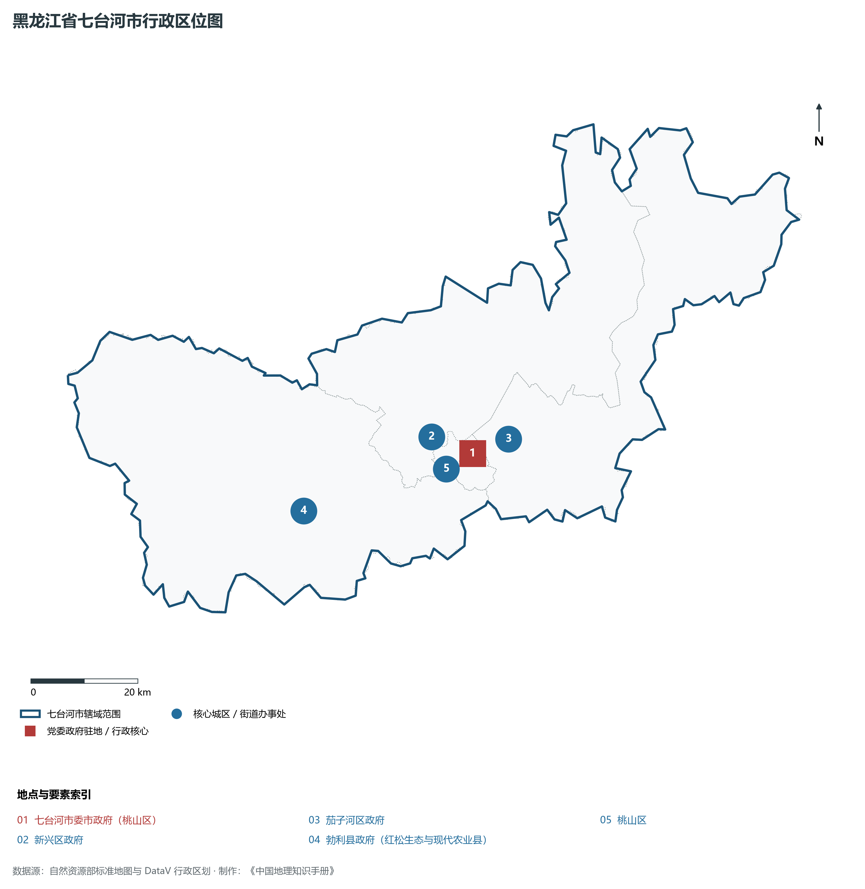
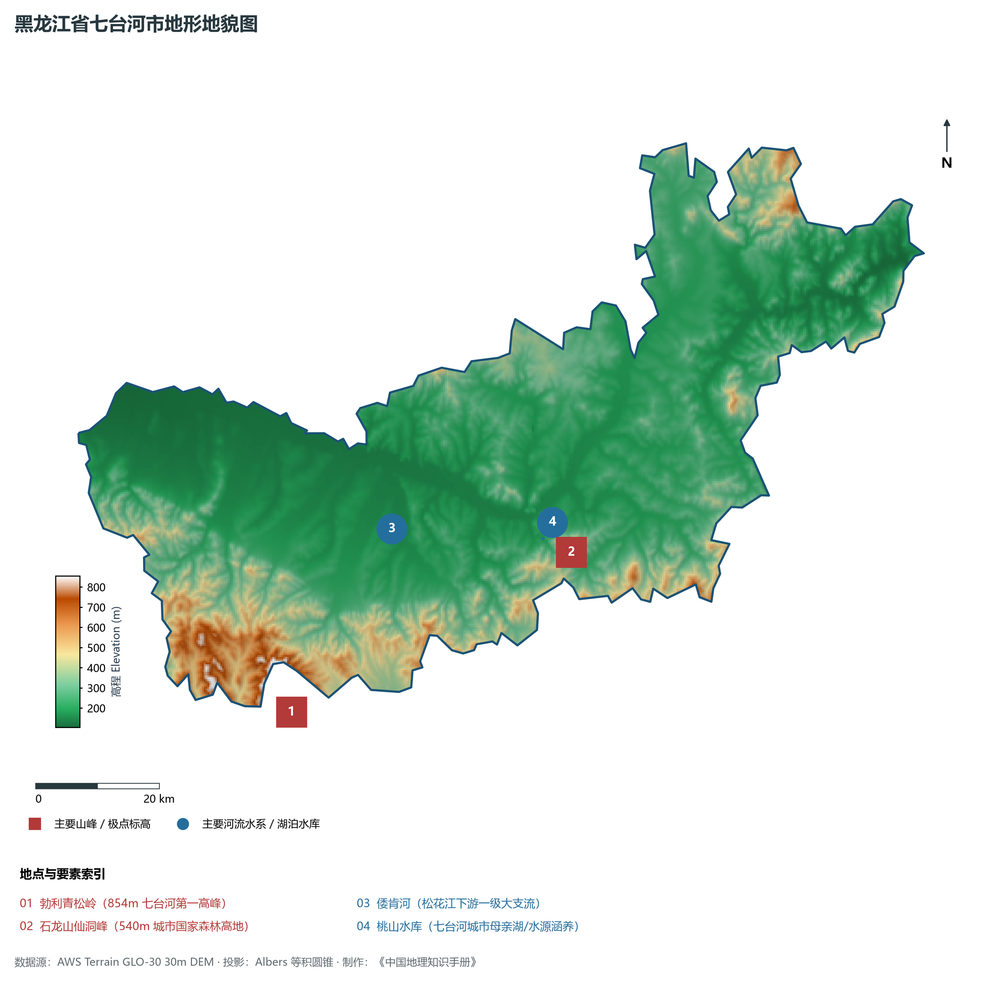
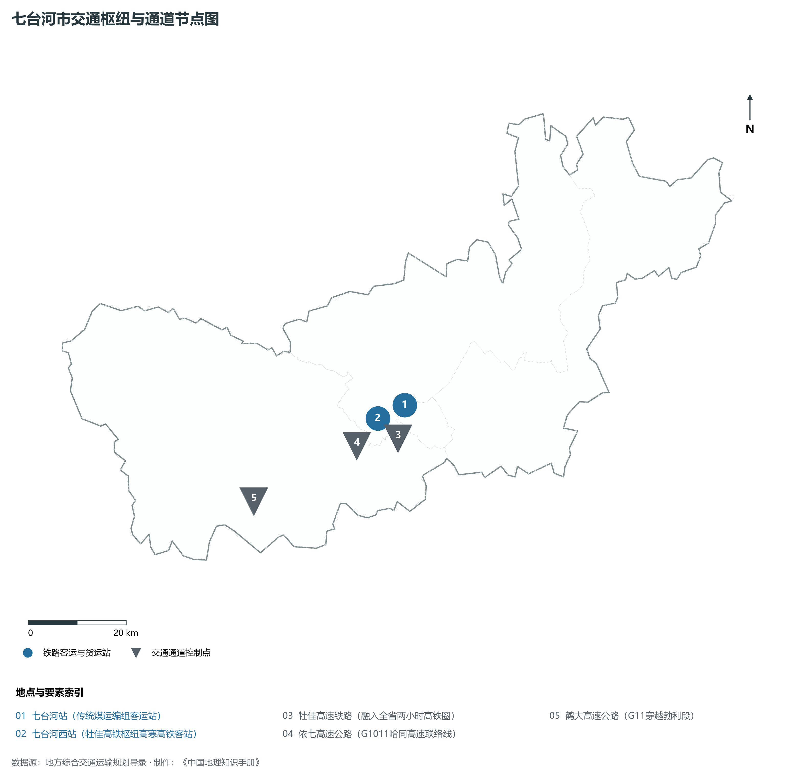
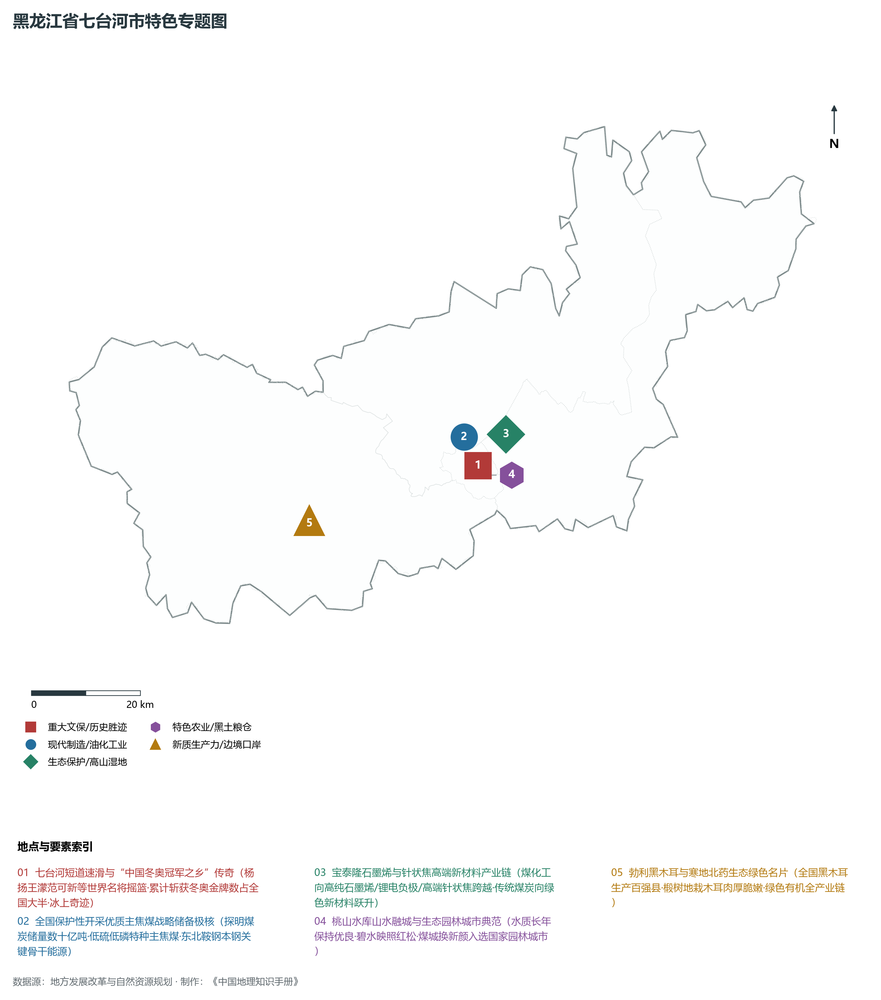
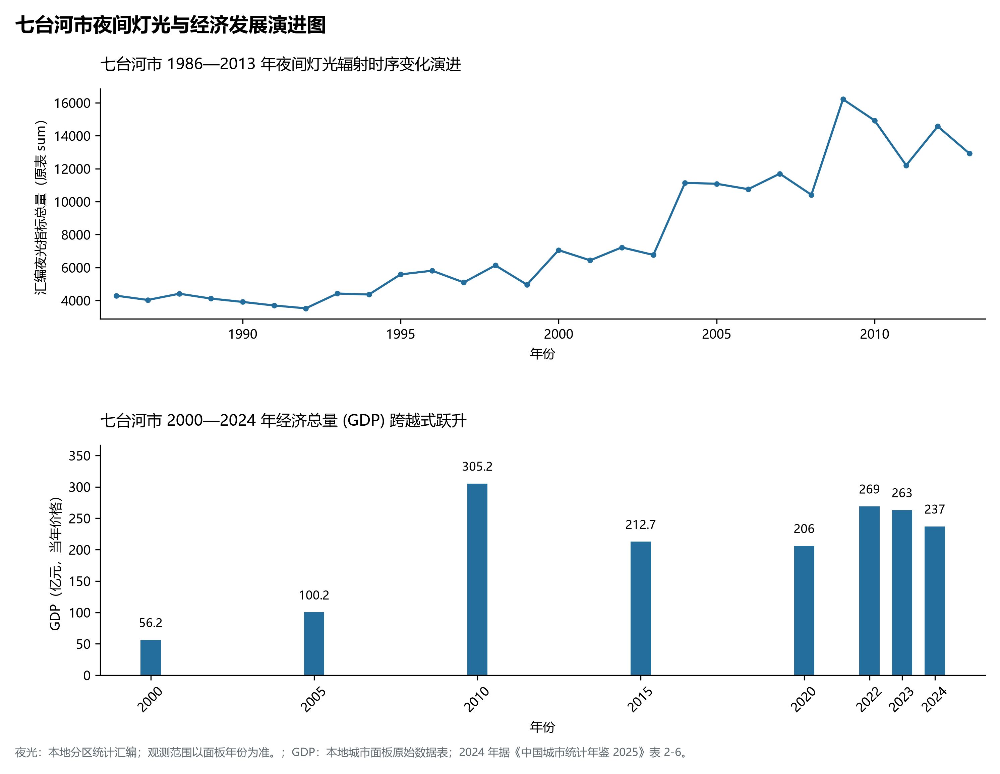

# 7.9 七台河市

七台河市，位于黑龙江省，其战略定位与特色概括为：**“中国冬奥冠军之乡”·东北优质主焦煤之都·石墨烯高新技术产业基地·倭肯河流域山水名城**。2024 年常住人口 **65 万人**，常住人口城镇化率 **80.14%**，地区生产总值 **237 亿元**（当年价格），人均地区生产总值 **36,119 元**，三次产业构成为 **16.34 : 26.4 : 57.26**。

---

## 一、自然地理底盘与地貌水系机理

区域骨干控制性山脉与地形高程极点包括：

- **勃利青松岭 (854m 七台河第一高峰)**（坐标约东经 130.400°、北纬 45.600°，高程约 854.0 m）；
- **石龙山仙洞峰 (540m 城市国家森林高地)**（坐标约东经 131.050°、北纬 45.720°，高程约 540.0 m）；

水系与水文网络方面，七台河市地表水资源丰富，骨干江河湖泊纵横穿流：

- **倭肯河 (松花江下游一级大支流)**（流经约东经 130.700°、北纬 45.820° 水域）；
- **桃山水库 (七台河城市母亲湖/水源涵养)**（流经约东经 131.000°、北纬 45.750° 水域）；

---

## 二、行政区划沿革与城镇空间体系

七台河市历史文脉积淀深厚，建置沿革源远流长。新中国成立以来，伴随国家老工业基地建设、大庆石油会战、林区综合开发与现代农垦城镇化战略推进，形成了梯次鲜明、产城紧密融合的市辖区与县级行政单元空间组织体系：

- **七台河市委市政府 (桃山区)**（驻地坐标：131.015°E, 45.770°N）；
- **新兴区政府**（驻地坐标：130.930°E, 45.815°N）；
- **茄子河区政府**（驻地坐标：131.070°E, 45.785°N）；
- **勃利县政府 (红松生态与现代农业县)**（驻地坐标：130.585°E, 45.750°N）；

在城镇空间总体布局上，七台河市紧扣《国土空间总体规划》，坚持“极核集聚、轴带贯通、组团联动、绿色涵养”的总体思路，统筹协调中心城区扩容提质与县域城镇特色发展，构建多中心、网络化、集约型的空间发展格局。

---

## 三、综合立体交通网络与交通走廊

七台河市地处东北地区立体交通网络关键节点，依托高速铁路、干线普速铁路、国家高速公路与边境口岸/民航机场，构筑了四通八达的现代化立体综合交通运输骨架：

**主要综合客运与货运物流交通枢纽节点：**

- **七台河站 (传统煤运编组客运站)**（位置坐标：130.950°E, 45.800°N）；
- **七台河西站 (牡佳高铁枢纽高寒高铁客站)**（位置坐标：130.900°E, 45.770°N）；

**核心干线铁路与高等级公路交通走廊：**

- **牡佳高速铁路 (融入全省两小时高铁圈)**（廊道控制点：130.900°E, 45.770°N）：对外快速互联互通的高速客货运通道；
- **依七高速公路 (G1011哈同高速联络线)**（廊道控制点：130.800°E, 45.750°N）：对外快速互联互通的高速客货运通道；
- **鹤大高速公路 (G11穿越勃利段)**（廊道控制点：130.500°E, 45.700°N）：对外快速互联互通的高速客货运通道；

---

## 四、现代重点产业布局与特色功能组团

在新时代推动东北全面振兴战略引领下，七台河市紧扣高质量发展首要任务，深度融入全省“一圈一带三带”与“4567”现代产业空间新格局，加快传统工业数字化绿色化改造，培育壮大新兴战略性产业链群，全力打造特色鲜明的现代化产业高地：

**重点园区与现代化产业承载基地：**

- **龙煤七台河矿业有限责任公司**（空间分布：130.980°E, 45.790°N）；
- **七台河国家级高新区石墨烯新材料产业基地**（空间分布：130.950°E, 45.760°N）；
- **宝泰隆新材料股份有限公司 (针状焦/石墨烯龙头)**（空间分布：131.050°E, 45.810°N）；
- **勃利黑木耳与现代特色中药材加工园**（空间分布：130.600°E, 45.740°N）；

**代表性特色地标与战略支撑维度：**

- **七台河短道速滑与“中国冬奥冠军之乡”传奇**（131.005°E, 45.765°N）：杨扬王濛范可新等世界名将摇篮·累计斩获冬奥金牌数占全国大半·冰上奇迹；
- **全国保护性开采优质主焦煤战略储备极核**（130.980°E, 45.790°N）：探明煤炭储量数十亿吨·低硫低磷特种主焦煤·东北鞍钢本钢关键骨干能源；
- **宝泰隆石墨烯与针状焦高端新材料产业链**（131.050°E, 45.810°N）：煤化工向高纯石墨烯/锂电负极/高端针状焦跨越·传统煤炭向绿色新材料跃升；
- **桃山水库山水融城与生态园林城市典范**（131.000°E, 45.750°N）：水质长年保持优良·碧水映照红松·煤城换新颜入选国家园林城市；
- **勃利黑木耳与寒地北药生态绿色名片**（130.585°E, 45.750°N）：全国黑木耳生产百强县·椴树地栽木耳肉厚脆嫩·绿色有机全产业链；

---

## 五、1986—2013年夜间灯光演变与经济变化分析

本节夜光图的观测年份为 1986—2013 年，指标为行政区汇总值（原表 sum）。

2024 年七台河市全市地区生产总值为 237 亿元（当年价格）。

| 年份 | 地区生产总值（亿元，当年价格） |
|:---|---:|
| 2000 年 | 56.2 |
| 2005 年 | 100.2 |
| 2010 年 | 305.2 |
| 2015 年 | 212.7 |
| 2020 年 | 206 |
| 2022 年 | 269 |
| 2023 年 | 263 |
| 2024 年 | 237 |

---

## 六、文化旅游名胜、生态屏障与可持续人地共生

七台河市高度注重统筹经济高质量发展与高水平生态环境保护，筑牢绿色生态底盘，弘扬优秀历史文化：

- **七台河短道速滑冠军馆 (国家级冰雪体育名片)**（位置坐标：131.005°E, 45.765°N）；
- **桃山湖国家湿地公园 (城市环湖生态景观)**（位置坐标：131.020°E, 45.745°N）；
- **石龙山国家森林公园 (4A)**（位置坐标：131.080°E, 45.700°N）；
- **西大圈国家森林公园 (原始红松针阔林海)**（位置坐标：130.250°E, 45.550°N）；

在人地协调机制方面，七台河市统筹推进山水林田湖草沙一体化保护与系统治理，坚决打好蓝天、碧水、净土保卫战，筑牢大界江大森林大湿地生态屏障与平原黑土地粮仓，打造人与自然和谐共生的生态宜居美丽家园。

---

## 七、七台河市关键地理统计指标速查矩阵

| 统计指标项 | 统计数值 / 口径标准 | 空间特征与全省位次说明 |
|:---|:---|:---|
| **行政区划代码** | `230900` | 国家民政部标准行政区划编号 |
| **辖区陆地面积** | **6,221.0** km² | 土地利用类型兼具山地、丘陵、平原与城镇工矿 |
| **常住人口规模** | 65 万人 | 2024 年，全市；年鉴公布口径 |
| **常住人口城镇化率** | 80.14% | 2024 年，全市；年鉴公布口径 |
| **地区生产总值 (2024)** | 237 亿元 | 2024 年，全市；年鉴公布口径 |
| **人均 GDP 水平** | 36,119 元/人 | 2024 年，全市；年鉴公布口径 |
| **三次产业结构比** | 16.34 : 26.4 : 57.26 | 2024 年，全市；年鉴公布口径 |
| **地表极限高程** | **105.0 m ～ 854.0 m** | 形成极具特色的立体地貌剖面格局 |

2024 年统计来源：《中国城市统计年鉴 2025》表 2-1、2-6、2-7（2024 年，全市）。其他年份 GDP 据本地城市面板“原始数据”表，单位为亿元、当年价格。
