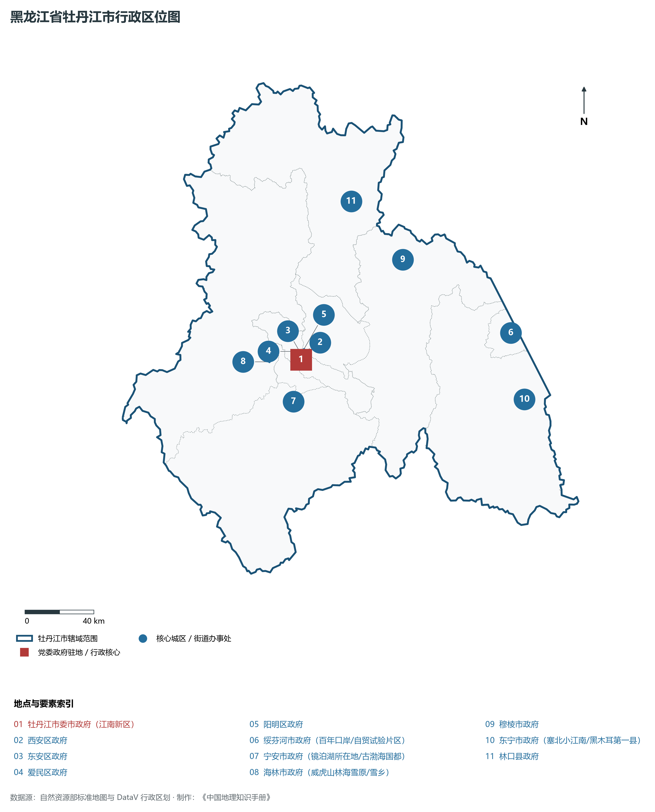
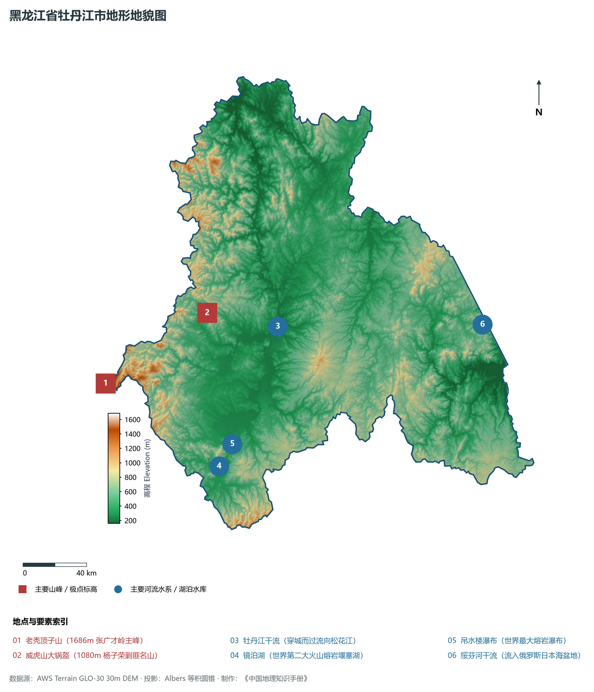
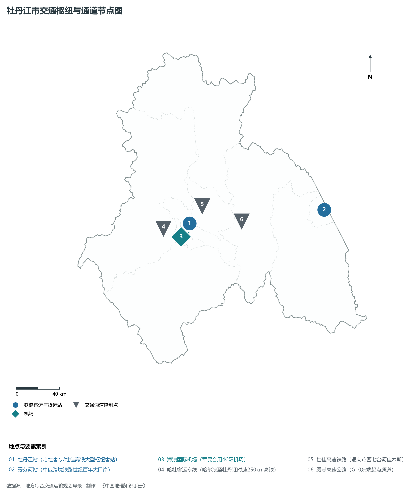
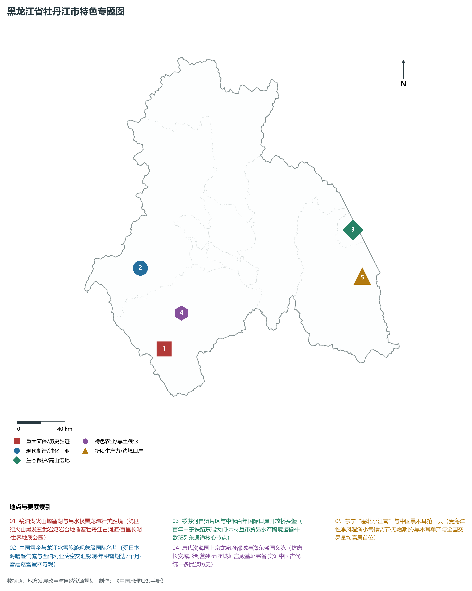
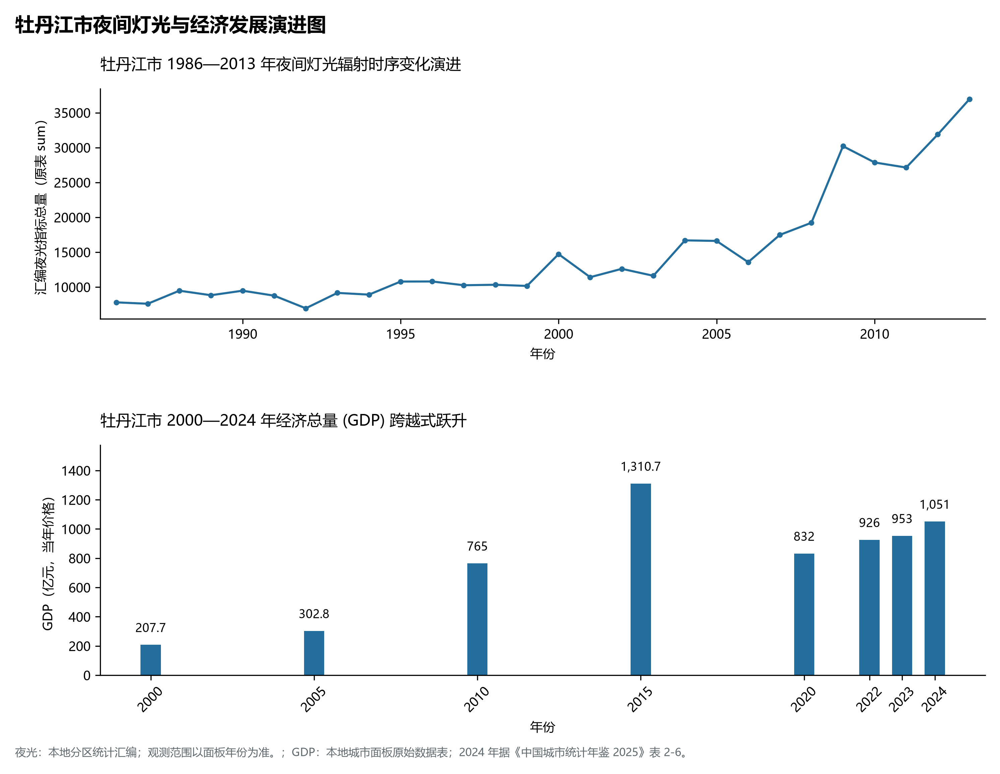

# 7.10 牡丹江市

牡丹江市，位于黑龙江省，其战略定位与特色概括为：**“雪城”牡丹江·镜泊湖火山堰塞湖·林海雪原英雄故地·绥芬河中俄边境开放前沿**。2024 年常住人口 **218 万人**，常住人口城镇化率 **68.27%**，地区生产总值 **1,051 亿元**（当年价格），人均地区生产总值 **47,789 元**，三次产业构成为 **19.55 : 18.08 : 62.37**。

---

## 一、自然地理底盘与地貌水系机理

区域骨干控制性山脉与地形高程极点包括：

- **老秃顶子山 (1686m 张广才岭主峰)**（坐标约东经 128.180°、北纬 44.500°，高程约 1686.0 m）；
- **威虎山大锅盔 (1080m 杨子荣剿匪名山)**（坐标约东经 129.100°、北纬 44.750°，高程约 1080.0 m）；

水系与水文网络方面，牡丹江市地表水资源丰富，骨干江河湖泊纵横穿流：

- **牡丹江干流 (穿城而过流向松花江)**（流经约东经 129.620°、北纬 44.580° 水域）；
- **镜泊湖 (世界第二大火山熔岩堰塞湖)**（流经约东经 128.900°、北纬 43.900° 水域）；
- **吊水楼瀑布 (世界最大熔岩瀑布)**（流经约东经 128.950°、北纬 44.020° 水域）；
- **绥芬河干流 (流入俄罗斯日本海盆地)**（流经约东经 131.200°、北纬 44.300° 水域）；

---

## 二、行政区划沿革与城镇空间体系

牡丹江市历史文脉积淀深厚，建置沿革源远流长。新中国成立以来，伴随国家老工业基地建设、大庆石油会战、林区综合开发与现代农垦城镇化战略推进，形成了梯次鲜明、产城紧密融合的市辖区与县级行政单元空间组织体系：

- **牡丹江市委市政府 (江南新区)**（驻地坐标：129.610°E, 44.550°N）；
- **西安区政府**（驻地坐标：129.590°E, 44.575°N）；
- **东安区政府**（驻地坐标：129.620°E, 44.580°N）；
- **爱民区政府**（驻地坐标：129.580°E, 44.600°N）；
- **阳明区政府**（驻地坐标：129.650°E, 44.600°N）；
- **绥芬河市政府 (百年口岸/自贸试验片区)**（驻地坐标：131.150°E, 44.410°N）；
- **宁安市政府 (镜泊湖所在地/古渤海国都)**（驻地坐标：129.480°E, 44.350°N）；
- **海林市政府 (威虎山林海雪原/雪乡)**（驻地坐标：129.380°E, 44.580°N）；
- **穆棱市政府**（驻地坐标：130.520°E, 44.920°N）；
- **东宁市政府 (塞北小江南/黑木耳第一县)**（驻地坐标：131.120°E, 44.060°N）；
- **林口县政府**（驻地坐标：130.260°E, 45.280°N）；

在城镇空间总体布局上，牡丹江市紧扣《国土空间总体规划》，坚持“极核集聚、轴带贯通、组团联动、绿色涵养”的总体思路，统筹协调中心城区扩容提质与县域城镇特色发展，构建多中心、网络化、集约型的空间发展格局。

---

## 三、综合立体交通网络与交通走廊

牡丹江市地处东北地区立体交通网络关键节点，依托高速铁路、干线普速铁路、国家高速公路与边境口岸/民航机场，构筑了四通八达的现代化立体综合交通运输骨架：

**主要综合客运与货运物流交通枢纽节点：**

- **牡丹江站 (哈牡客专/牡佳高铁大型枢纽客站)**（位置坐标：129.610°E, 44.590°N）；
- **绥芬河站 (中俄跨境铁路世纪百年大口岸)**（位置坐标：131.160°E, 44.420°N）；
- **海浪国际机场 (军民合用4C级机场)**（位置坐标：129.570°E, 44.520°N）；

**核心干线铁路与高等级公路交通走廊：**

- **哈牡客运专线 (哈尔滨至牡丹江时速250km高铁)**（廊道控制点：129.300°E, 44.600°N）：对外快速互联互通的高速客货运通道；
- **牡佳高速铁路 (通向鸡西七台河佳木斯)**（廊道控制点：129.800°E, 44.700°N）：对外快速互联互通的高速客货运通道；
- **绥满高速公路 (G10东端起点通道)**（廊道控制点：130.200°E, 44.500°N）：对外快速互联互通的高速客货运通道；

---

## 四、现代重点产业布局与特色功能组团

在新时代推动东北全面振兴战略引领下，牡丹江市紧扣高质量发展首要任务，深度融入全省“一圈一带三带”与“4567”现代产业空间新格局，加快传统工业数字化绿色化改造，培育壮大新兴战略性产业链群，全力打造特色鲜明的现代化产业高地：

**重点园区与现代化产业承载基地：**

- **中国(黑龙江)自由贸易试验区绥芬河片区**（空间分布：131.150°E, 44.410°N）；
- **牡丹江恒丰纸业股份有限公司 (特种薄纸龙头)**（空间分布：129.600°E, 44.570°N）；
- **东宁国家级黑木耳现代农业产业园**（空间分布：131.120°E, 44.060°N）；
- **海林中俄林木与绿色食品加工自贸基地**（空间分布：129.360°E, 44.570°N）；

**代表性特色地标与战略支撑维度：**

- **镜泊湖火山堰塞湖与吊水楼黑龙潭壮美胜境**（128.900°E, 43.900°N）：第四纪火山爆发玄武岩熔岩台地堵塞牡丹江古河道·百里长湖·世界地质公园；
- **中国雪乡与龙江冰雪旅游现象级国际名片**（128.860°E, 44.530°N）：受日本海暖湿气流与西伯利亚冷空交汇影响·年积雪期达7个月·雪蘑菇雪蛋糕奇观；
- **绥芬河自贸片区与中俄百年国际口岸开放桥头堡**（131.150°E, 44.410°N）：百年中东铁路东端大门·木材互市贸易水产跨境运输·中欧班列东通道核心节点；
- **唐代渤海国上京龙泉府都城与海东盛国文脉**（129.170°E, 44.130°N）：仿唐长安城形制营建·五座城垣宫殿基址完备·实证中国古代统一多民族历史；
- **东宁“塞北小江南”与中国黑木耳第一县**（131.120°E, 44.060°N）：受海洋性季风湿润小气候调节·无霜期长·黑木耳单产与全国交易量均高居首位；

---

## 五、1986—2013年夜间灯光演变与经济变化分析

本节夜光图的观测年份为 1986—2013 年，指标为行政区汇总值（原表 sum）。

2024 年牡丹江市全市地区生产总值为 1,051 亿元（当年价格）。

| 年份 | 地区生产总值（亿元，当年价格） |
|:---|---:|
| 2000 年 | 207.7 |
| 2005 年 | 302.8 |
| 2010 年 | 765 |
| 2015 年 | 1,310.7 |
| 2020 年 | 832 |
| 2022 年 | 926 |
| 2023 年 | 953 |
| 2024 年 | 1,051 |

---

## 六、文化旅游名胜、生态屏障与可持续人地共生

牡丹江市高度注重统筹经济高质量发展与高水平生态环境保护，筑牢绿色生态底盘，弘扬优秀历史文化：

- **镜泊湖国家级风景名胜区 (5A·吊水楼瀑布/地下森林)**（位置坐标：128.900°E, 43.900°N）；
- **中国雪乡风景区 (双峰林场·梦幻雪屋)**（位置坐标：128.860°E, 44.530°N）；
- **渤海国上京龙泉府遗址 (唐代东北海东盛国都城)**（位置坐标：129.170°E, 44.130°N）；
- **绥芬河国门风景区 (百年对俄铁路大门)**（位置坐标：131.180°E, 44.420°N）；

在人地协调机制方面，牡丹江市统筹推进山水林田湖草沙一体化保护与系统治理，坚决打好蓝天、碧水、净土保卫战，筑牢大界江大森林大湿地生态屏障与平原黑土地粮仓，打造人与自然和谐共生的生态宜居美丽家园。

---

## 七、牡丹江市关键地理统计指标速查矩阵

| 统计指标项 | 统计数值 / 口径标准 | 空间特征与全省位次说明 |
|:---|:---|:---|
| **行政区划代码** | `231000` | 国家民政部标准行政区划编号 |
| **辖区陆地面积** | **38,827.0** km² | 土地利用类型兼具山地、丘陵、平原与城镇工矿 |
| **常住人口规模** | 218 万人 | 2024 年，全市；年鉴公布口径 |
| **常住人口城镇化率** | 68.27% | 2024 年，全市；年鉴公布口径 |
| **地区生产总值 (2024)** | 1,051 亿元 | 2024 年，全市；年鉴公布口径 |
| **人均 GDP 水平** | 47,789 元/人 | 2024 年，全市；年鉴公布口径 |
| **三次产业结构比** | 19.55 : 18.08 : 62.37 | 2024 年，全市；年鉴公布口径 |
| **地表极限高程** | **160.0 m ～ 1686.0 m** | 形成极具特色的立体地貌剖面格局 |

2024 年统计来源：《中国城市统计年鉴 2025》表 2-1、2-6、2-7（2024 年，全市）。其他年份 GDP 据本地城市面板“原始数据”表，单位为亿元、当年价格。
