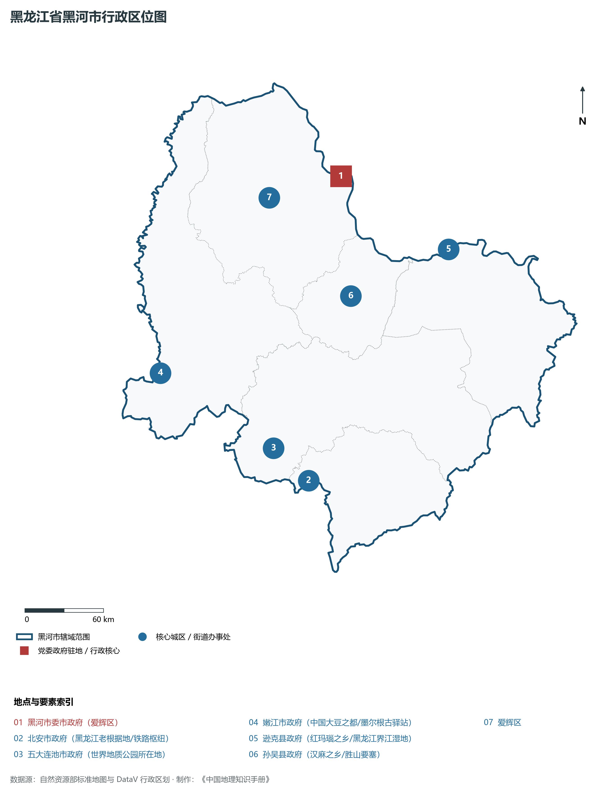
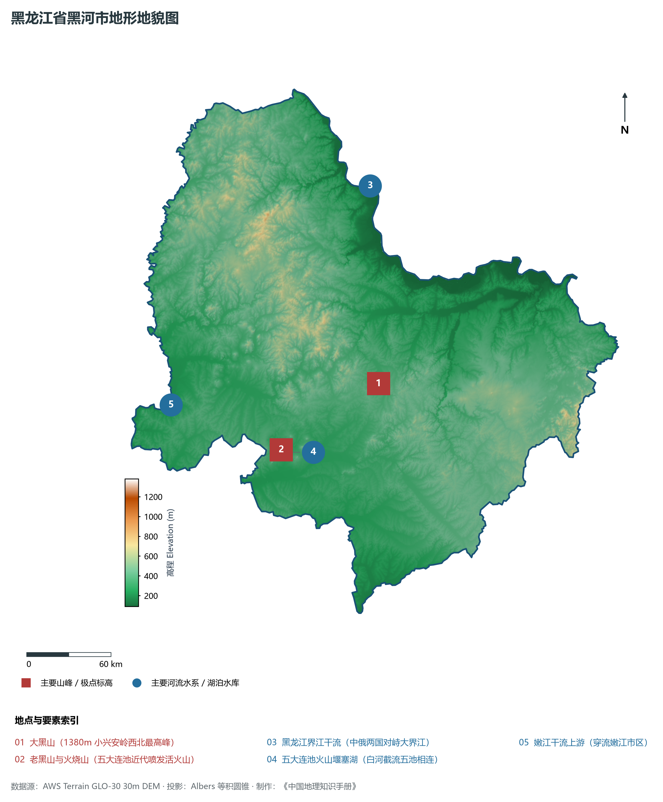
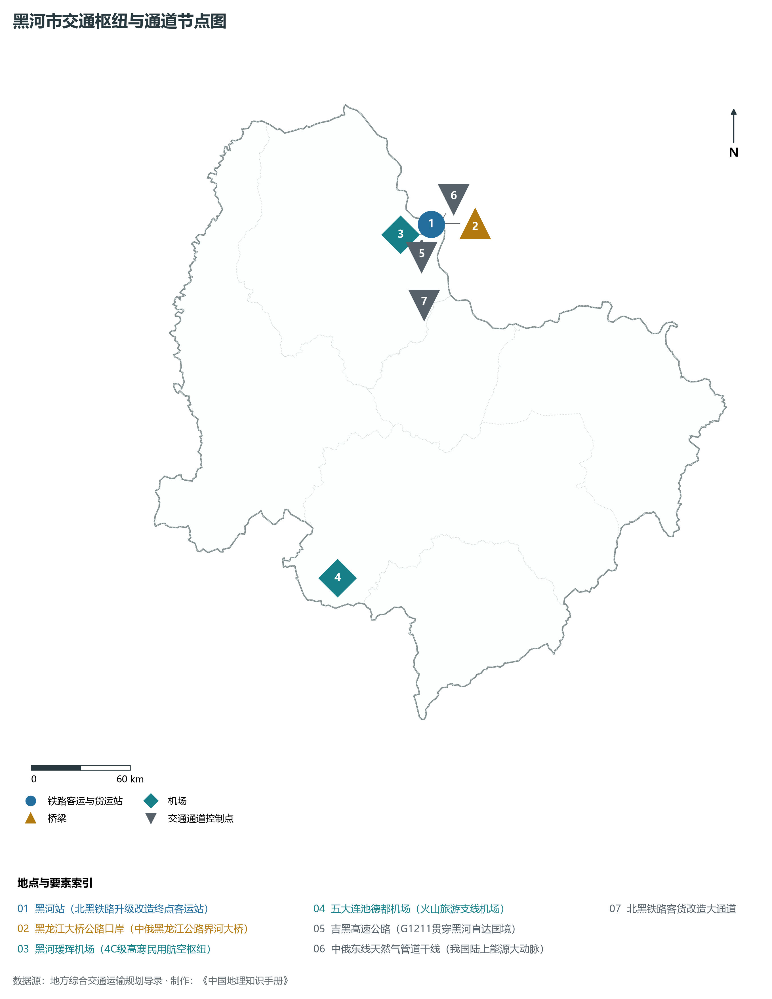
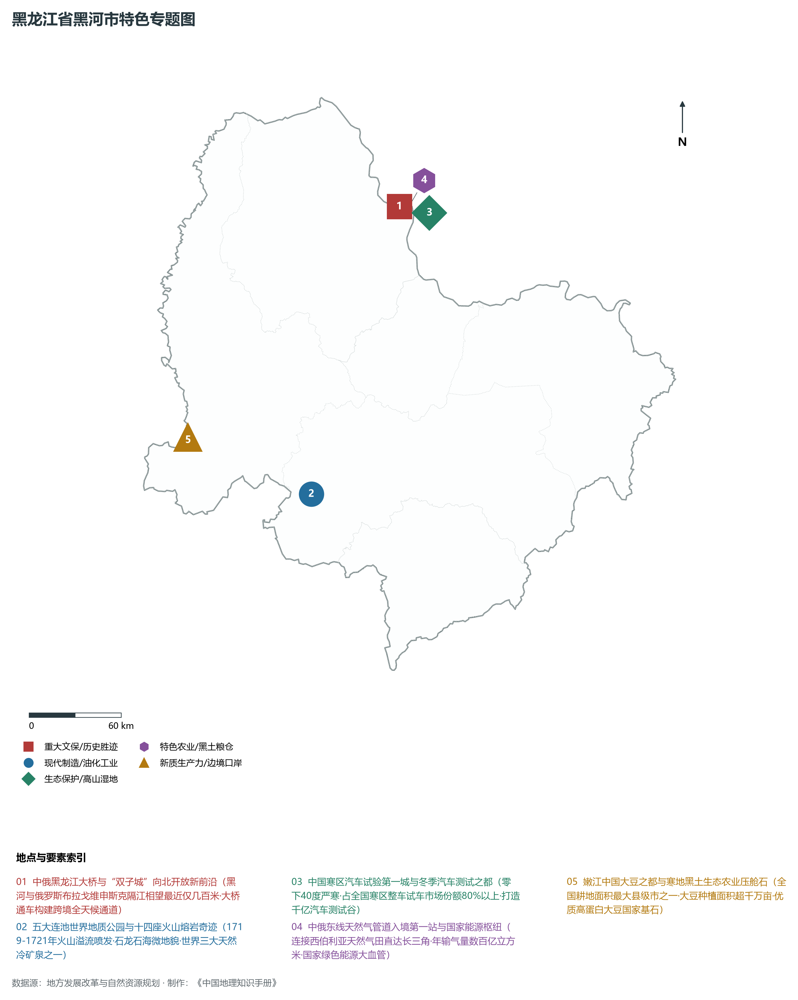
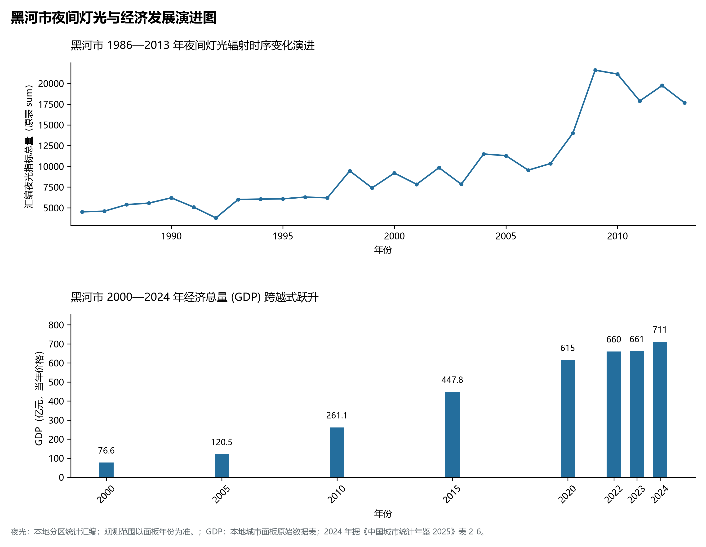

# 7.11 黑河市

黑河市，位于黑龙江省，其战略定位与特色概括为：**中俄边陲“双子城”·中俄黑龙江公路大桥·五大连池火山博物馆·极寒汽车测试之都与天然气东线枢纽**。2024 年常住人口 **121 万人**，常住人口城镇化率 **68.1%**，地区生产总值 **711 亿元**（当年价格），人均地区生产总值 **58,312 元**，三次产业构成为 **31.79 : 14.91 : 53.3**。

---

## 一、自然地理底盘与地貌水系机理

区域骨干控制性山脉与地形高程极点包括：

- **大黑山 (1380m 小兴安岭西北最高峰)**（坐标约东经 127.200°、北纬 49.000°，高程约 1380.0 m）；
- **老黑山与火烧山 (五大连池近代喷发活火山)**（坐标约东经 126.150°、北纬 48.720°，高程约 515.0 m）；

水系与水文网络方面，黑河市地表水资源丰富，骨干江河湖泊纵横穿流：

- **黑龙江界江干流 (中俄两国对峙大界江)**（流经约东经 127.550°、北纬 50.260° 水域）；
- **五大连池火山堰塞湖 (白河截流五池相连)**（流经约东经 126.180°、北纬 48.700° 水域）；
- **嫩江干流上游 (穿流嫩江市区)**（流经约东经 125.200°、北纬 49.150° 水域）；

---

## 二、行政区划沿革与城镇空间体系

黑河市历史文脉积淀深厚，建置沿革源远流长。新中国成立以来，伴随国家老工业基地建设、大庆石油会战、林区综合开发与现代农垦城镇化战略推进，形成了梯次鲜明、产城紧密融合的市辖区与县级行政单元空间组织体系：

- **黑河市委市政府 (爱辉区)**（驻地坐标：127.500°E, 50.245°N）；
- **北安市政府 (黑龙江老根据地/铁路枢纽)**（驻地坐标：126.480°E, 48.240°N）；
- **五大连池市政府 (世界地质公园所在地)**（驻地坐标：126.200°E, 48.510°N）；
- **嫩江市政府 (中国大豆之都/墨尔根古驿站)**（驻地坐标：125.220°E, 49.180°N）；
- **逊克县政府 (红玛瑙之乡/黑龙江界江湿地)**（驻地坐标：128.420°E, 49.580°N）；
- **孙吴县政府 (汉麻之乡/胜山要塞)**（驻地坐标：127.320°E, 49.420°N）；

在城镇空间总体布局上，黑河市紧扣《国土空间总体规划》，坚持“极核集聚、轴带贯通、组团联动、绿色涵养”的总体思路，统筹协调中心城区扩容提质与县域城镇特色发展，构建多中心、网络化、集约型的空间发展格局。

---

## 三、综合立体交通网络与交通走廊

黑河市地处东北地区立体交通网络关键节点，依托高速铁路、干线普速铁路、国家高速公路与边境口岸/民航机场，构筑了四通八达的现代化立体综合交通运输骨架：

**主要综合客运与货运物流交通枢纽节点：**

- **黑河站 (北黑铁路升级改造终点客运站)**（位置坐标：127.510°E, 50.230°N）；
- **黑龙江大桥公路口岸 (中俄黑龙江公路界河大桥)**（位置坐标：127.600°E, 50.220°N）；
- **黑河瑷珲机场 (4C级高寒民用航空枢纽)**（位置坐标：127.510°E, 50.170°N）；
- **五大连池德都机场 (火山旅游支线机场)**（位置坐标：126.120°E, 48.440°N）；

**核心干线铁路与高等级公路交通走廊：**

- **吉黑高速公路 (G1211贯穿黑河直达国境)**（廊道控制点：127.400°E, 50.150°N）：对外快速互联互通的高速客货运通道；
- **中俄东线天然气管道干线 (我国陆上能源大动脉)**（廊道控制点：127.550°E, 50.200°N）：对外快速互联互通的高速客货运通道；
- **北黑铁路客货改造大通道**（廊道控制点：127.300°E, 49.800°N）：对外快速互联互通的高速客货运通道；

---

## 四、现代重点产业布局与特色功能组团

在新时代推动东北全面振兴战略引领下，黑河市紧扣高质量发展首要任务，深度融入全省“一圈一带三带”与“4567”现代产业空间新格局，加快传统工业数字化绿色化改造，培育壮大新兴战略性产业链群，全力打造特色鲜明的现代化产业高地：

**重点园区与现代化产业承载基地：**

- **中国(黑龙江)自由贸易试验区黑河片区**（空间分布：127.500°E, 50.240°N）；
- **黑河国家寒区汽车试验基地 (全国寒区测试领军)**（空间分布：127.480°E, 50.210°N）；
- **中俄东线天然气管道首站与压气站**（空间分布：127.580°E, 50.230°N）；
- **嫩江百万亩绿色非转基因大豆国家繁育基地**（空间分布：125.250°E, 49.200°N）；

**代表性特色地标与战略支撑维度：**

- **中俄黑龙江大桥与“双子城”向北开放新前沿**（127.500°E, 50.245°N）：黑河与俄罗斯布拉戈维申斯克隔江相望最近仅几百米·大桥通车构建跨境全天候通道；
- **五大连池世界地质公园与十四座火山熔岩奇迹**（126.180°E, 48.700°N）：1719-1721年火山溢流喷发·石龙石海微地貌·世界三大天然冷矿泉之一；
- **中国寒区汽车试验第一城与冬季汽车测试之都**（127.480°E, 50.210°N）：零下40度严寒·占全国寒区整车试车市场份额80%以上·打造千亿汽车测试谷；
- **中俄东线天然气管道入境第一站与国家能源枢纽**（127.580°E, 50.230°N）：连接西伯利亚天然气田直达长三角·年输气量数百亿立方米·国家绿色能源大血管；
- **嫩江中国大豆之都与寒地黑土生态农业压舱石**（125.220°E, 49.180°N）：全国耕地面积最大县级市之一·大豆种植面积超千万亩·优质高蛋白大豆国家基石；

---

## 五、1986—2013年夜间灯光演变与经济变化分析

本节夜光图的观测年份为 1986—2013 年，指标为行政区汇总值（原表 sum）。

2024 年黑河市全市地区生产总值为 711 亿元（当年价格）。

| 年份 | 地区生产总值（亿元，当年价格） |
|:---|---:|
| 2000 年 | 76.6 |
| 2005 年 | 120.5 |
| 2010 年 | 261.1 |
| 2015 年 | 447.8 |
| 2020 年 | 615 |
| 2022 年 | 660 |
| 2023 年 | 661 |
| 2024 年 | 711 |

---

## 六、文化旅游名胜、生态屏障与可持续人地共生

黑河市高度注重统筹经济高质量发展与高水平生态环境保护，筑牢绿色生态底盘，弘扬优秀历史文化：

- **五大连池风景区 (5A·世界地质公园·天然火山博物馆)**（位置坐标：126.180°E, 48.700°N）；
- **瑷珲历史陈列馆与瑷珲新城遗址 (国家一级馆)**（位置坐标：127.480°E, 49.980°N）；
- **中俄黑龙江公路大桥观光区**（位置坐标：127.600°E, 50.220°N）；
- **知青博物馆与胜山要塞国家森林公园**（位置坐标：127.350°E, 49.450°N）；

在人地协调机制方面，黑河市统筹推进山水林田湖草沙一体化保护与系统治理，坚决打好蓝天、碧水、净土保卫战，筑牢大界江大森林大湿地生态屏障与平原黑土地粮仓，打造人与自然和谐共生的生态宜居美丽家园。

---

## 七、黑河市关键地理统计指标速查矩阵

| 统计指标项 | 统计数值 / 口径标准 | 空间特征与全省位次说明 |
|:---|:---|:---|
| **行政区划代码** | `231100` | 国家民政部标准行政区划编号 |
| **辖区陆地面积** | **68,285.0** km² | 土地利用类型兼具山地、丘陵、平原与城镇工矿 |
| **常住人口规模** | 121 万人 | 2024 年，全市；年鉴公布口径 |
| **常住人口城镇化率** | 68.1% | 2024 年，全市；年鉴公布口径 |
| **地区生产总值 (2024)** | 711 亿元 | 2024 年，全市；年鉴公布口径 |
| **人均 GDP 水平** | 58,312 元/人 | 2024 年，全市；年鉴公布口径 |
| **三次产业结构比** | 31.79 : 14.91 : 53.3 | 2024 年，全市；年鉴公布口径 |
| **地表极限高程** | **90.0 m ～ 1380.0 m** | 形成极具特色的立体地貌剖面格局 |

2024 年统计来源：《中国城市统计年鉴 2025》表 2-1、2-6、2-7（2024 年，全市）。其他年份 GDP 据本地城市面板“原始数据”表，单位为亿元、当年价格。
