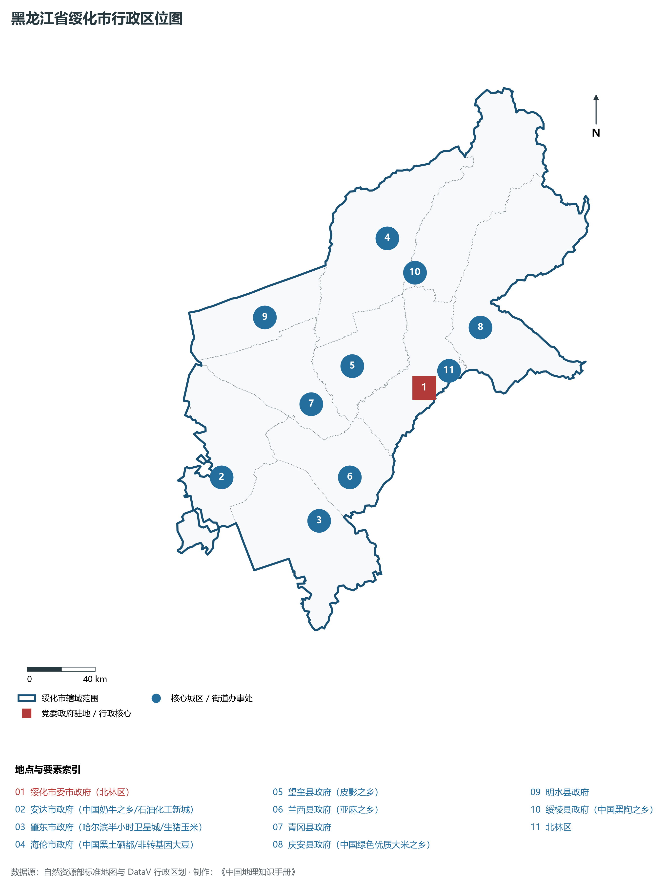
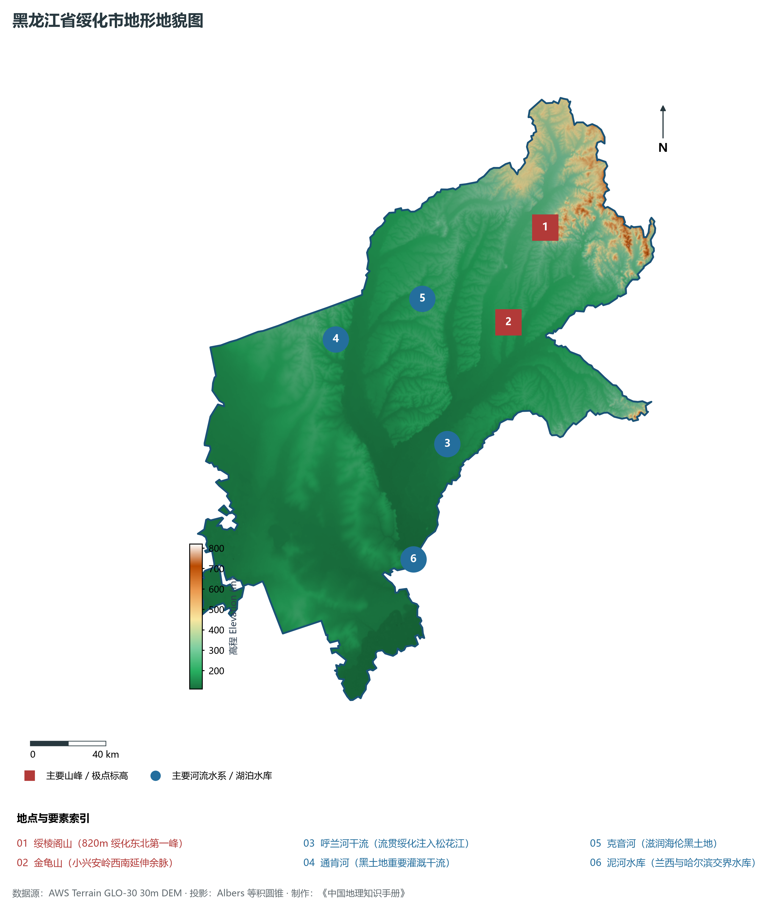
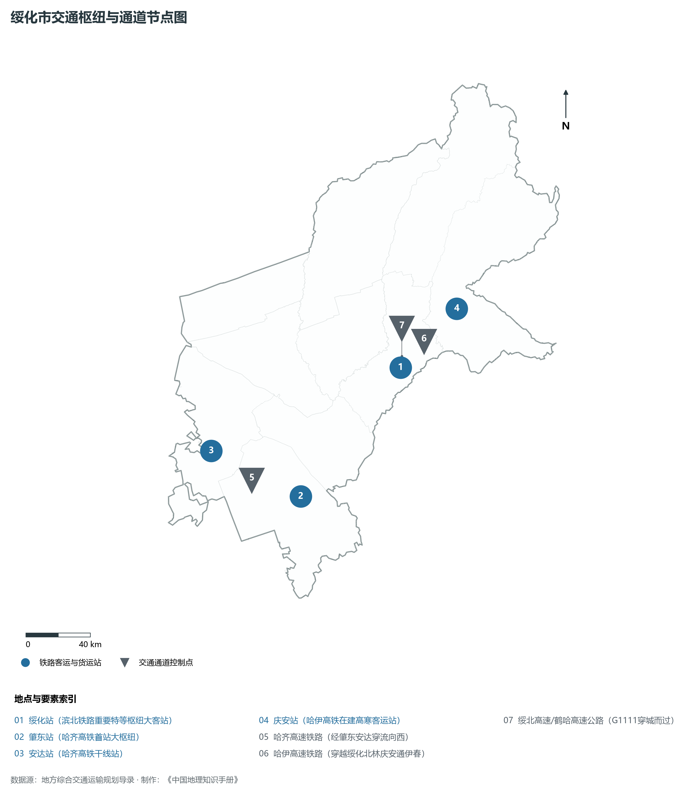
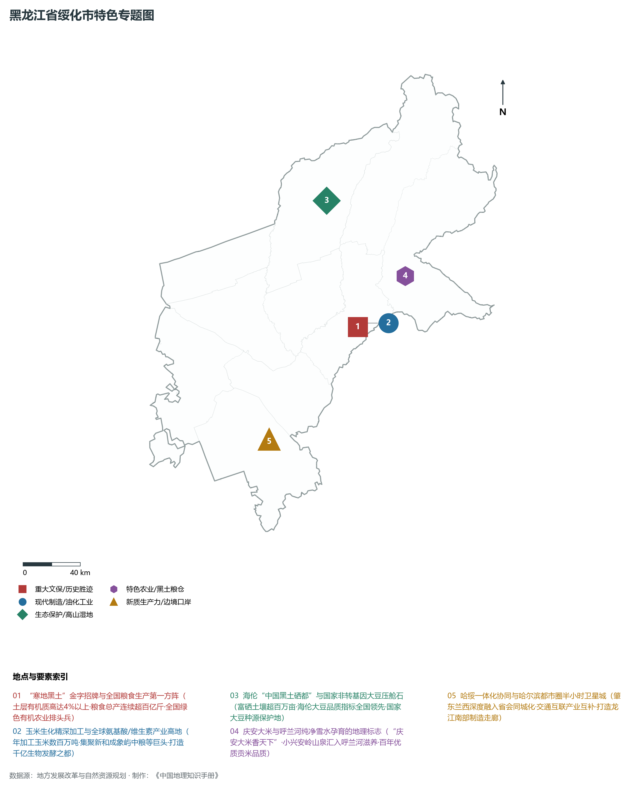
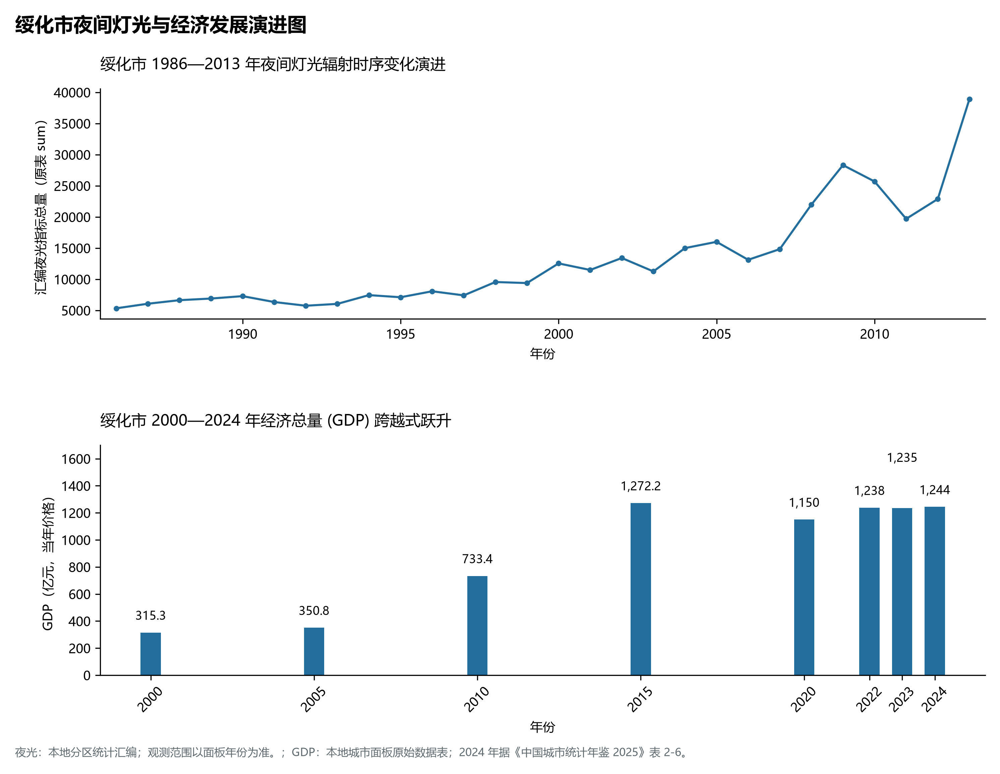

# 7.12 绥化市

绥化市，位于黑龙江省，其战略定位与特色概括为：**“寒地黑土”核心区·松嫩平原与小兴安岭过渡地带·全国农业大市·玉米水稻精深加工基地与哈绥一体化**。2024 年常住人口 **346 万人**，常住人口城镇化率 **46.79%**，地区生产总值 **1,244 亿元**（当年价格），人均地区生产总值 **35,441 元**，三次产业构成为 **41.29 : 13.54 : 45.16**。

---

## 一、自然地理底盘与地貌水系机理

区域骨干控制性山脉与地形高程极点包括：

- **绥棱阁山 (820m 绥化东北第一峰)**（坐标约东经 127.800°、北纬 47.500°，高程约 820.0 m）；
- **金龟山 (小兴安岭西南延伸余脉)**（坐标约东经 127.400°、北纬 47.100°，高程约 450.0 m）；

水系与水文网络方面，绥化市地表水资源丰富，骨干江河湖泊纵横穿流：

- **呼兰河干流 (流贯绥化注入松花江)**（流经约东经 126.800°、北纬 46.600° 水域）；
- **通肯河 (黑土地重要灌溉干流)**（流经约东经 126.200°、北纬 47.200° 水域）；
- **克音河 (滋润海伦黑土地)**（流经约东经 126.850°、北纬 47.300° 水域）；
- **泥河水库 (兰西与哈尔滨交界水库)**（流经约东经 126.400°、北纬 46.100° 水域）；

---

## 二、行政区划沿革与城镇空间体系

绥化市历史文脉积淀深厚，建置沿革源远流长。新中国成立以来，伴随国家老工业基地建设、大庆石油会战、林区综合开发与现代农垦城镇化战略推进，形成了梯次鲜明、产城紧密融合的市辖区与县级行政单元空间组织体系：

- **绥化市委市政府 (北林区)**（驻地坐标：126.985°E, 46.635°N）；
- **安达市政府 (中国奶牛之乡/石油化工新城)**（驻地坐标：125.320°E, 46.400°N）；
- **肇东市政府 (哈尔滨半小时卫星城/生猪玉米)**（驻地坐标：125.980°E, 46.070°N）；
- **海伦市政府 (中国黑土硒都/非转基因大豆)**（驻地坐标：126.960°E, 47.450°N）；
- **望奎县政府 (皮影之乡)**（驻地坐标：126.480°E, 46.830°N）；
- **兰西县政府 (亚麻之乡)**（驻地坐标：126.280°E, 46.260°N）；
- **青冈县政府**（驻地坐标：126.110°E, 46.680°N）；
- **庆安县政府 (中国绿色优质大米之乡)**（驻地坐标：127.510°E, 46.880°N）；
- **明水县政府**（驻地坐标：125.900°E, 47.180°N）；
- **绥棱县政府 (中国黑陶之乡)**（驻地坐标：127.110°E, 47.240°N）；

在城镇空间总体布局上，绥化市紧扣《国土空间总体规划》，坚持“极核集聚、轴带贯通、组团联动、绿色涵养”的总体思路，统筹协调中心城区扩容提质与县域城镇特色发展，构建多中心、网络化、集约型的空间发展格局。

---

## 三、综合立体交通网络与交通走廊

绥化市地处东北地区立体交通网络关键节点，依托高速铁路、干线普速铁路、国家高速公路与边境口岸/民航机场，构筑了四通八达的现代化立体综合交通运输骨架：

**主要综合客运与货运物流交通枢纽节点：**

- **绥化站 (滨北铁路重要特等枢纽大客站)**（位置坐标：126.970°E, 46.640°N）；
- **肇东站 (哈齐高铁首站大枢纽)**（位置坐标：125.960°E, 46.060°N）；
- **安达站 (哈齐高铁干线站)**（位置坐标：125.330°E, 46.410°N）；
- **庆安站 (哈伊高铁在建高寒客运站)**（位置坐标：127.520°E, 46.890°N）；

**核心干线铁路与高等级公路交通走廊：**

- **哈齐高速铁路 (经肇东安达穿流向西)**（廊道控制点：125.600°E, 46.200°N）：对外快速互联互通的高速客货运通道；
- **哈伊高速铁路 (穿越绥化北林庆安通伊春)**（廊道控制点：127.200°E, 46.750°N）：对外快速互联互通的高速客货运通道；
- **绥北高速/鹤哈高速公路 (G1111穿城而过)**（廊道控制点：127.000°E, 46.700°N）：对外快速互联互通的高速客货运通道；

---

## 四、现代重点产业布局与特色功能组团

在新时代推动东北全面振兴战略引领下，绥化市紧扣高质量发展首要任务，深度融入全省“一圈一带三带”与“4567”现代产业空间新格局，加快传统工业数字化绿色化改造，培育壮大新兴战略性产业链群，全力打造特色鲜明的现代化产业高地：

**重点园区与现代化产业承载基地：**

- **绥化国家级高新技术产业开发区**（空间分布：127.020°E, 46.620°N）；
- **新和成/象屿大型现代玉米生物发酵产业园**（空间分布：127.050°E, 46.650°N）；
- **肇东中粮生化与绿色食品加工集聚区**（空间分布：125.970°E, 46.080°N）；
- **海伦原生态非转基因大豆与现代农业硅谷**（空间分布：126.950°E, 47.460°N）；

**代表性特色地标与战略支撑维度：**

- **“寒地黑土”金字招牌与全国粮食生产第一方阵**（126.985°E, 46.635°N）：土层有机质高达4%以上·粮食总产连续超百亿斤·全国绿色有机农业排头兵；
- **玉米生化精深加工与全球氨基酸/维生素产业高地**（127.050°E, 46.650°N）：年加工玉米数百万吨·集聚新和成象屿中粮等巨头·打造千亿生物发酵之都；
- **海伦“中国黑土硒都”与国家非转基因大豆压舱石**（126.960°E, 47.450°N）：富硒土壤超百万亩·海伦大豆品质指标全国领先·国家大豆种源保护地；
- **庆安大米与呼兰河纯净雪水孕育的地理标志**（127.510°E, 46.880°N）：“庆安大米香天下”·小兴安岭山泉汇入呼兰河滋养·百年优质贡米品质；
- **哈绥一体化协同与哈尔滨都市圈半小时卫星城**（125.980°E, 46.070°N）：肇东兰西深度融入省会同城化·交通互联产业互补·打造龙江南部制造走廊；

---

## 五、1986—2013年夜间灯光演变与经济变化分析

本节夜光图的观测年份为 1986—2013 年，指标为行政区汇总值（原表 sum）。

2024 年绥化市全市地区生产总值为 1,244 亿元（当年价格）。

| 年份 | 地区生产总值（亿元，当年价格） |
|:---|---:|
| 2000 年 | 315.3 |
| 2005 年 | 350.8 |
| 2010 年 | 733.4 |
| 2015 年 | 1,272.2 |
| 2020 年 | 1,150 |
| 2022 年 | 1,238 |
| 2023 年 | 1,235 |
| 2024 年 | 1,244 |

---

## 六、文化旅游名胜、生态屏障与可持续人地共生

绥化市高度注重统筹经济高质量发展与高水平生态环境保护，筑牢绿色生态底盘，弘扬优秀历史文化：

- **庆安国家现代农业示范区与千亩稻海**（位置坐标：127.510°E, 46.880°N）；
- **海伦黑土湿地国家级自然保护区**（位置坐标：126.900°E, 47.400°N）；
- **兰西东盟生态农业旅游观光区**（位置坐标：126.300°E, 46.250°N）；
- **绥棱白马石风景区与黑陶文化馆**（位置坐标：127.150°E, 47.250°N）；

在人地协调机制方面，绥化市统筹推进山水林田湖草沙一体化保护与系统治理，坚决打好蓝天、碧水、净土保卫战，筑牢大界江大森林大湿地生态屏障与平原黑土地粮仓，打造人与自然和谐共生的生态宜居美丽家园。

---

## 七、绥化市关键地理统计指标速查矩阵

| 统计指标项 | 统计数值 / 口径标准 | 空间特征与全省位次说明 |
|:---|:---|:---|
| **行政区划代码** | `231200` | 国家民政部标准行政区划编号 |
| **辖区陆地面积** | **35,211.0** km² | 土地利用类型兼具山地、丘陵、平原与城镇工矿 |
| **常住人口规模** | 346 万人 | 2024 年，全市；年鉴公布口径 |
| **常住人口城镇化率** | 46.79% | 2024 年，全市；年鉴公布口径 |
| **地区生产总值 (2024)** | 1,244 亿元 | 2024 年，全市；年鉴公布口径 |
| **人均 GDP 水平** | 35,441 元/人 | 2024 年，全市；年鉴公布口径 |
| **三次产业结构比** | 41.29 : 13.54 : 45.16 | 2024 年，全市；年鉴公布口径 |
| **地表极限高程** | **110.0 m ～ 820.0 m** | 形成极具特色的立体地貌剖面格局 |

2024 年统计来源：《中国城市统计年鉴 2025》表 2-1、2-6、2-7（2024 年，全市）。其他年份 GDP 据本地城市面板“原始数据”表，单位为亿元、当年价格。
