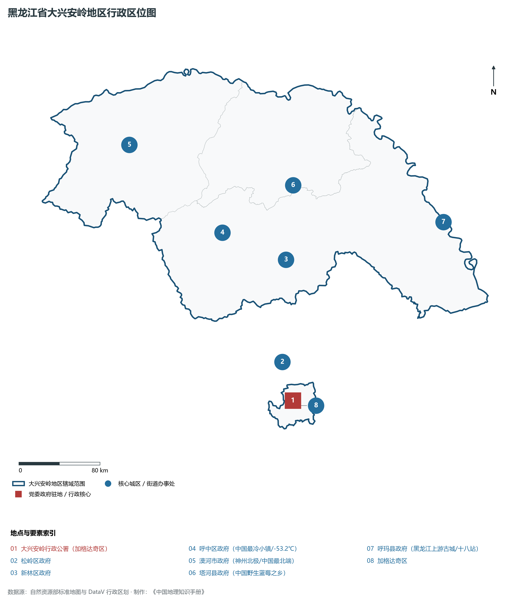
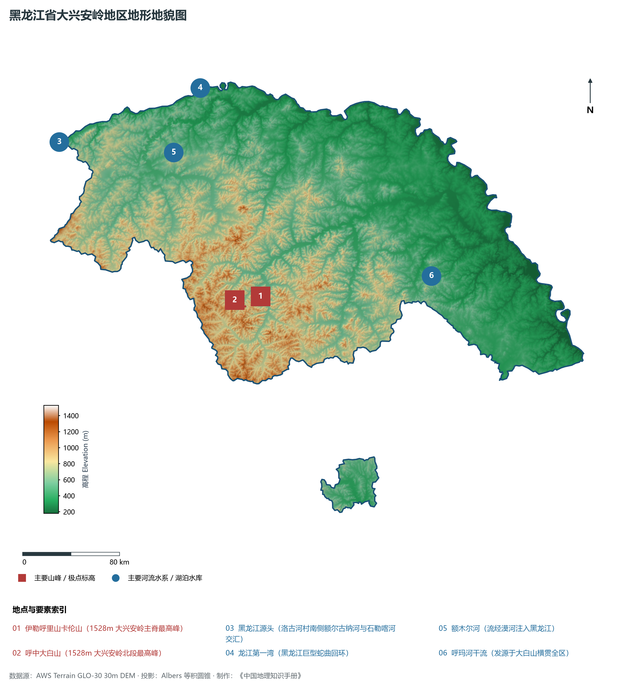
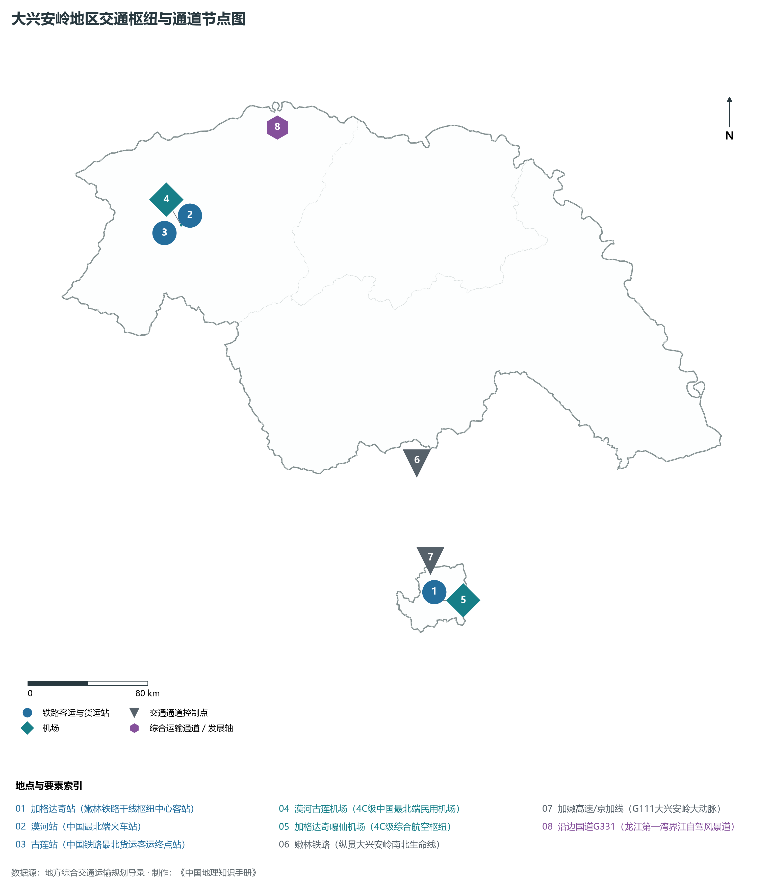
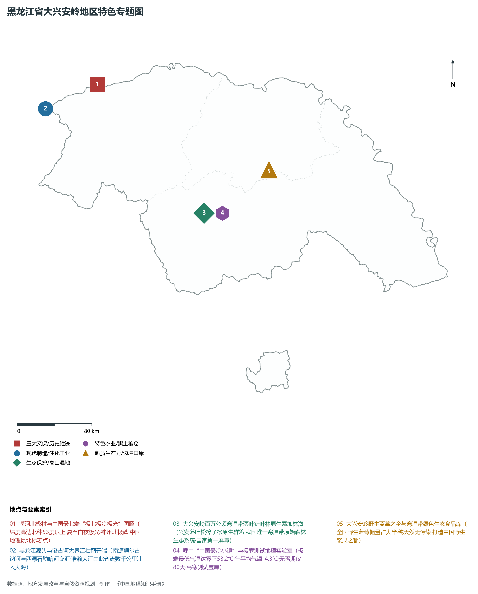
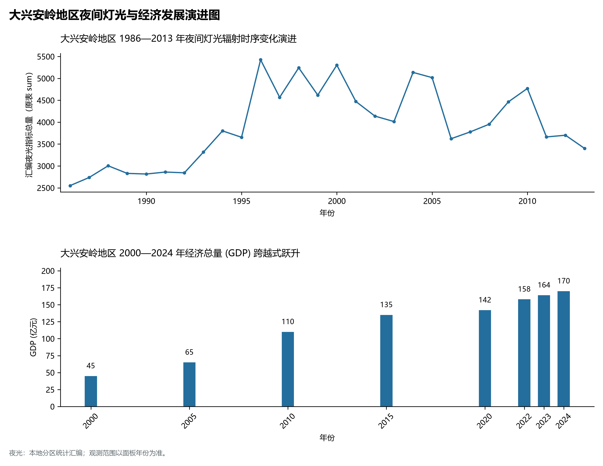

# 7.13 大兴安岭地区

大兴安岭地区，位于黑龙江省，其战略定位与特色概括为：**“神州北极”漠河·中国最北生态安全屏障·国家最大原始针叶林区·黑龙江源头与极光圣地**。全境土地总面积达 **82,729.0 km²**，截至 2024 年末常住人口约 **32.0** 万人，常住人口城镇化率达 **81.0%**。2024 年实现地区生产总值（GDP）约 **170.0** 亿元，人均 GDP 约 **53,100** 元，三次产业结构比为 **42.0 : 13.5 : 44.5**。全境地表高程极值跨度介于 **180.0 m ～ 1528.0 m** 之间，展现出雄浑壮阔的北国地理生境底盘与实力雄厚的大国重器现代产业基石。

---

## 一、自然地理底盘与地貌水系机理

区域骨干控制性山脉与地形高程极点包括：

- **伊勒呼里山卡伦山 (1528m 大兴安岭主脊最高峰)**（坐标约东经 123.500°、北纬 51.900°，高程约 1528.0 m）；
- **呼中大白山 (1528m 大兴安岭北段最高峰)**（坐标约东经 123.300°、北纬 51.850°，高程约 1528.0 m）；

水系与水文网络方面，大兴安岭地区地表水资源丰富，骨干江河湖泊纵横穿流：

- **黑龙江源头 (洛古河村南侧额尔古纳河与石勒喀河交汇)**（流经约东经 121.480°、北纬 53.330° 水域）；
- **龙江第一湾 (黑龙江巨型蛇曲回环)**（流经约东经 123.250°、北纬 53.550° 水域）；
- **额木尔河 (流经漠河注入黑龙江)**（流经约东经 122.800°、北纬 53.100° 水域）；
- **呼玛河干流 (发源于大白山横贯全区)**（流经约东经 125.500°、北纬 51.800° 水域）；

---

## 二、行政区划沿革与城镇空间体系

大兴安岭地区历史文脉积淀深厚，建置沿革源远流长。新中国成立以来，伴随国家老工业基地建设、大庆石油会战、林区综合开发与现代农垦城镇化战略推进，形成了梯次鲜明、产城紧密融合的市辖区与县级行政单元空间组织体系：

- **大兴安岭行政公署 (加格达奇区)**（驻地坐标：124.120°E, 50.420°N）；
- **松岭区政府**（驻地坐标：124.080°E, 50.780°N）；
- **新林区政府**（驻地坐标：124.400°E, 51.680°N）；
- **呼中区政府 (中国最冷小镇/-53.2℃)**（驻地坐标：123.600°E, 52.030°N）；
- **漠河市政府 (神州北极/中国最北端)**（驻地坐标：122.535°E, 52.970°N）；
- **塔河县政府 (中国野生蓝莓之乡)**（驻地坐标：124.700°E, 52.330°N）；
- **呼玛县政府 (黑龙江上游古城/十八站)**（驻地坐标：126.650°E, 51.720°N）；

在城镇空间总体布局上，大兴安岭地区紧扣《国土空间总体规划》，坚持“极核集聚、轴带贯通、组团联动、绿色涵养”的总体思路，统筹协调中心城区扩容提质与县域城镇特色发展，构建多中心、网络化、集约型的空间发展格局。

---

## 三、综合立体交通网络与交通走廊

大兴安岭地区地处东北地区立体交通网络关键节点，依托高速铁路、干线普速铁路、国家高速公路与边境口岸/民航机场，构筑了四通八达的现代化立体综合交通运输骨架：

**主要综合客运与货运物流交通枢纽节点：**

- **加格达奇站 (嫩林铁路干线枢纽中心客站)**（位置坐标：124.130°E, 50.410°N）；
- **漠河站 (中国最北端火车站)**（位置坐标：122.520°E, 52.960°N）；
- **古莲站 (中国铁路最北货运客运终点站)**（位置坐标：122.250°E, 52.880°N）；
- **漠河古莲机场 (4C级中国最北端民用机场)**（位置坐标：122.420°E, 52.910°N）；
- **加格达奇嘎仙机场 (4C级综合航空枢纽)**（位置坐标：124.110°E, 50.360°N）；

**核心干线铁路与高等级公路交通走廊：**

- **嫩林铁路 (纵贯大兴安岭南北生命线)**（廊道控制点：124.200°E, 51.200°N）：对外快速互联互通的高速客货运通道；
- **加嫩高速/京加线 (G111大兴安岭大动脉)**（廊道控制点：124.150°E, 50.600°N）：对外快速互联互通的高速客货运通道；
- **沿边国道G331 (龙江第一湾界江自驾风景道)**（廊道控制点：123.500°E, 53.400°N）：对外快速互联互通的高速客货运通道；

---

## 四、现代重点产业布局与特色功能组团

在新时代推动东北全面振兴战略引领下，大兴安岭地区紧扣高质量发展首要任务，深度融入全省“一圈一带三带”与“4567”现代产业空间新格局，加快传统工业数字化绿色化改造，培育壮大新兴战略性产业链群，全力打造特色鲜明的现代化产业高地：

**重点园区与现代化产业承载基地：**

- **大兴安岭林业集团公司林业生态产业集群**（空间分布：124.120°E, 50.430°N）；
- **大兴安岭野生浆果(蓝莓/蔓越莓)精深加工产业基地**（空间分布：124.700°E, 52.340°N）；
- **漠河极寒气候车辆与电子装备野外测试基地**（空间分布：122.500°E, 52.950°N）；
- **呼玛十八站中药材与北药种质资源库**（空间分布：125.500°E, 52.100°N）；

**代表性特色地标与战略支撑维度：**

- **漠河北极村与中国最北端“极北极冷极光”图腾**（122.340°E, 53.480°N）：纬度高达北纬53度以上·夏至白夜极光·神州北极碑·中国地理最北标志点；
- **黑龙江源头与洛古河大界江壮丽开端**（121.480°E, 53.330°N）：南源额尔古纳河与西源石勒喀河交汇·浩瀚大江由此奔流数千公里注入大海；
- **大兴安岭百万公顷寒温带落叶针叶林原生泰加林海**（123.600°E, 52.030°N）：兴安落叶松樟子松原生群落·我国唯一寒温带原始森林生态系统·国家第一屏障；
- **呼中“中国最冷小镇”与极寒测试地理实验室**（123.600°E, 52.030°N）：极端最低气温达零下53.2℃·年平均气温-4.3℃·无霜期仅80天·高寒测试宝库；
- **大兴安岭野生蓝莓之乡与寒温带绿色生态食品库**（124.700°E, 52.330°N）：全国野生蓝莓储量占大半·纯天然无污染·打造中国野生浆果之都；

---

## 五、1986—2013年夜间灯光演变与经济变化分析

本节夜光图的观测年份为 1986—2013 年，指标为行政区汇总值（原表 sum）。

| 年份 | 地区生产总值 (GDP, 亿元) | 发展阶段特征与重大战略工程推进 |
|:---|:---|:---|
| 2000年 | **45.0** | 社会主义市场经济体制初步确立，传统工矿农业结构深度调整 |
| 2005年 | **65.0** | 国家实施振兴东北老工业基地重大战略，重大产业改造与基础设施全面铺开 |
| 2010年 | **110.0** | 国家实施振兴东北老工业基地重大战略，重大产业改造与基础设施全面铺开 |
| 2015年 | **135.0** | 新旧动能加速转换，高质量发展与全面振兴新突破进入攻坚突破期 |
| 2020年 | **142.0** | 新旧动能加速转换，高质量发展与全面振兴新突破进入攻坚突破期 |
| 2022年 | **158.0** | 新旧动能加速转换，高质量发展与全面振兴新突破进入攻坚突破期 |
| 2023年 | **164.0** | 新旧动能加速转换，高质量发展与全面振兴新突破进入攻坚突破期 |
| 2024年 | **170.0** | 新旧动能加速转换，高质量发展与全面振兴新突破进入攻坚突破期 |

## 六、文化旅游名胜、生态屏障与可持续人地共生

大兴安岭地区高度注重统筹经济高质量发展与高水平生态环境保护，筑牢绿色生态底盘，弘扬优秀历史文化：

- **漠河北极村旅游区 (5A·神州北极点/北望垭口)**（位置坐标：122.340°E, 53.480°N）；
- **龙江第一湾风景区 (黑龙江欧米伽巨大回环蛇曲)**（位置坐标：123.250°E, 53.550°N）；
- **呼中大白山国家级自然保护区 (原始泰加林冻土)**（位置坐标：123.300°E, 51.850°N）；
- **北红村 (中国最北端真正地理位置自然村)**（位置坐标：123.120°E, 53.500°N）；

在人地协调机制方面，大兴安岭地区统筹推进山水林田湖草沙一体化保护与系统治理，坚决打好蓝天、碧水、净土保卫战，筑牢大界江大森林大湿地生态屏障与平原黑土地粮仓，打造人与自然和谐共生的生态宜居美丽家园。

---

## 七、大兴安岭地区关键地理统计指标速查矩阵

| 统计指标项 | 统计数值 / 口径标准 | 空间特征与全省位次说明 |
|:---|:---|:---|
| **行政区划代码** | `232700` | 国家民政部标准行政区划编号 |
| **辖区陆地面积** | **82,729.0** km² | 土地利用类型兼具山地、丘陵、平原与城镇工矿 |
| **常住人口规模** | **32.0** 万人 | 区域核心人口聚集极核 |
| **常住人口城镇化率** | **81.0%** | 工业化基础扎实，非农人口集聚度较高 |
| **地区生产总值 (2024)** | **170.0** 亿元 | 综合经济实力支撑全省高质量发展大局 |
| **人均 GDP 水平** | 约 **53,100** 元/人 | 居民综合富裕度与要素产出效率指标 |
| **三次产业结构比** | **42.0 : 13.5 : 44.5** | 二产与三产双轮驱动的现代化产业格局 |
| **地表极限高程** | **180.0 m ～ 1528.0 m** | 形成极具特色的立体地貌剖面格局 |
