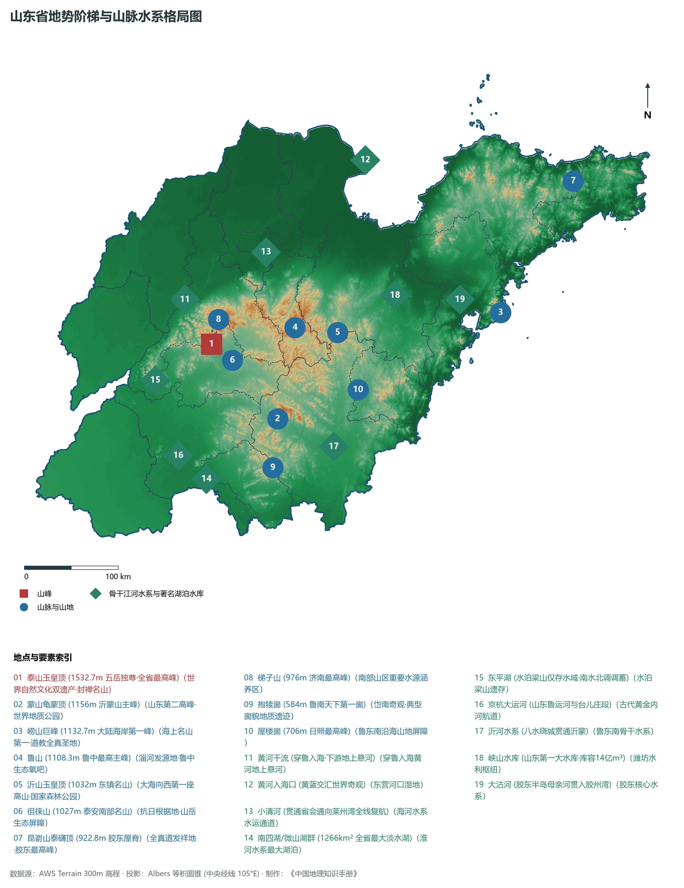
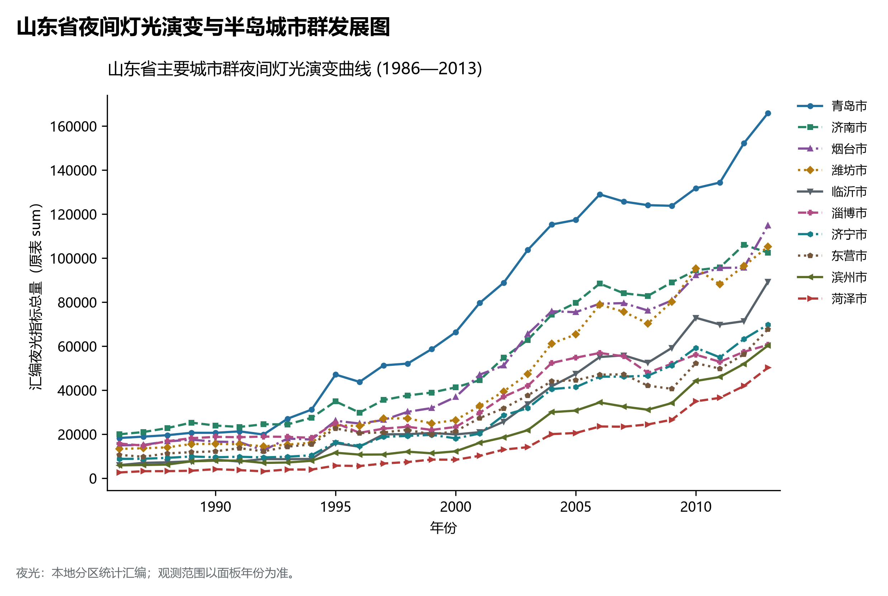
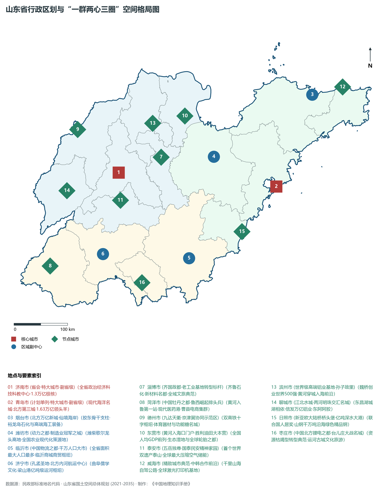
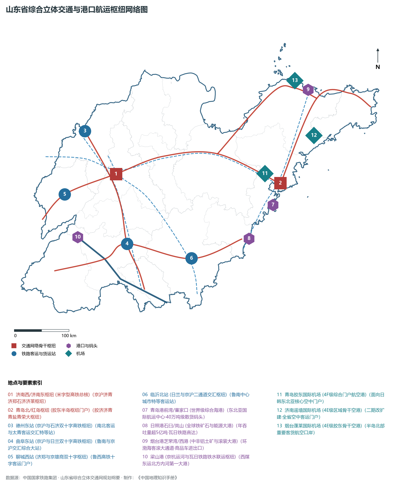
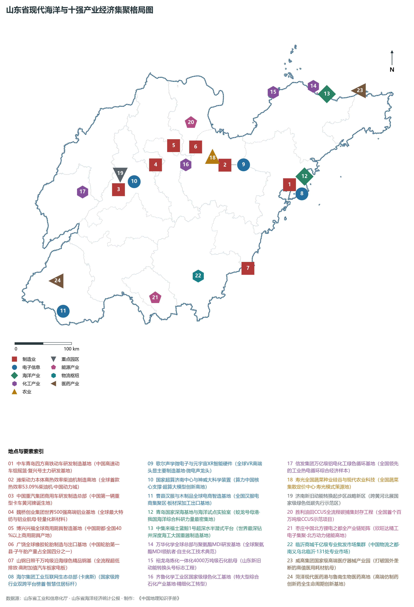

# 8.0 山东省地理统揽

山东省，简称“鲁”，省会济南市，位于中国东部沿海、黄河下游，东临渤海与黄海，与朝鲜半岛、日本列岛隔海相望，西接中原内陆，南连长江三角洲，北扼京津冀与东北出海门户，地处东经 114° 48' ～ 122° 42'、北纬 34° 23' ～ 38° 24' 之间。全省陆地总面积达 15.8 × 10⁴ km²，大陆海岸线长达 3345 km，占全国大陆海岸线的近六分之一，位居全国第 6 位；毗连海域面积近 16 × 10⁴ km²，呈现陆海相依、半岛突出、内陆广袤的复合型地缘空间形态。山东自古为海岱名邦、齐鲁之邦，是孔孟儒家思想的摇篮、中华文明的核心发祥地之一，更是我国沿海经济大省、人口大省、文化大省和工业农业大省。

全省地貌宏观上呈现极为典型的**“半岛-内陆双向统筹、中部高突、东西低平”总体地貌格局**。中部以泰山、沂山、鲁山、蒙山等泰沂山地为脊梁拔地通天；东部胶东半岛为低缓波状丘陵与滨海湾岬，崂山傲立海岸第一峰；西部与北部为广袤平坦的黄河冲积泛滥平原与黄河三角洲，南四湖（微山湖群）与东平湖宛若内陆双明珠。全省现辖 16 个地级市（济南市、青岛市、淄博市、枣庄市、东营市、烟台市、潍坊市、济宁市、泰安市、威海市、日照市、临沂市、德州市、聊城市、滨州市、菏泽市），其中包括副省级特大城市济南市、计划单列副省级特大城市青岛市。截至 2024 年末，全省常住人口约 1.012 亿人，常住人口城镇化率达 65.5%。2024 年全省实现地区生产总值（GDP）突破 **9.8 万亿元**，连续稳居全国第三位、北方各省份第一位，人均 GDP 突破 9.7 万元。山东不仅是全国首个农业总产值破万亿、工业总产值突破数万亿的双料工业与农业巨擘，当前更被党中央、国务院赋予建设**全国首个“绿色低碳高质量发展先行区”**与推进**黄河流域生态保护和高质量发展核心增长极**的国家重大战略使命。

---

## 一、地质构造演化与“半岛-内陆双向统筹”宏观地貌格局

山东省地质构造演化历史漫长复杂，跨越了华北克拉通与苏鲁超高压变质带两大一级构造单元。大地构造以沂沭断裂带（郯庐断裂带山东段）为天然分界线：断裂带以西为古老坚硬的鲁西陆块（早前寒武纪结晶基底与巨厚古生代碳酸盐岩盖层），经历了华力西期、燕山期强烈的断块垂直差异升降，形成了以泰山、鲁山、沂山、蒙山为核心的断块隆起地垒山系，以及两侧巨厚的华北石炭二叠纪煤系与中生代陆相断陷盆地；断裂带以东为胶东地块，中生代受古太平洋板块深俯冲改造，岩浆广泛侵入喷发，孕育了闻名全球的超大型胶东型金矿床与昆嵛山、崂山等花岗岩奇秀山岳。第四纪以来，黄河携带千亿吨泥沙在鲁西北、鲁西南大范围泛滥堆积，塑造了平展如砥的黄淮海冲积平原，并在渤海湾西南岸以年均万亩的速度推进出极为年轻的黄河三角洲新生陆地。

山东省地表高程极值跨度由黄河入海口及滨海滩涂的 **0 m** 跃升至泰山极顶的 **1532.7 m**，全省宏观地势呈现“中部高突、西南与西北低洼、东部缓丘起伏”的阶梯状分布特征：

- **全省最高极顶**：位于泰安市境内的五岳之首——**泰山玉皇顶（海拔 1532.7 m）**，属于典型的断块复式地垒单斜山，基底岩石由形成于 28 亿年前的泰山杂岩（变质花岗质岩石）构成，傲立于鲁中平原之上，相对高差达 1300 余米，被誉为“天下第一山”，是联合国教科文组织评定的我国首个世界文化与自然双重遗产。
- **全省最低极点**：位于东营市垦利区黄河入海口及渤海莱州湾沿岸的**滨海潮间带滩涂（海拔近 0 m）**，地势极低平，每年随黄河泥沙沉积向渤海延伸数千米，为共和国最年轻的土地。

依据地貌成因类型与空间组合，全省宏观地貌可划分为三大鲜明对比的地貌单元：

1. **鲁中南低山丘陵区**：以泰沂山地为核心骨架，主要分布于济南南部、泰安、淄博南部、临沂、济宁东部及日照西部。泰山（1532.7 m）、蒙山龟蒙顶（1156 m）、鲁山（1108.3 m）、沂山玉皇顶（1032 m）、徂徕山（1027 m）等连绵耸峙。南部临沂、枣庄一带广泛发育由寒武系石灰岩平缓产状经长期水平剥蚀坍塌形成的“沂蒙七十二崮”（顶部平坦如削、四周峭壁如削、下坡平缓），如抱犊崮（584 m）、孟良崮等，构成中国独特的崮貌地貌国家级地质遗迹。
2. **鲁西北与鲁西南冲积平原区**：包括德州、聊城、菏泽、滨州以及济南、东营、济宁的大部分区域，属于华北平原东南部及黄泛平原。地势平坦低平，海拔多在 15～ 60 m 之间。第四纪松散沉积物厚达数百米，土层深厚肥沃，为暖温带典型潮土与褐土分布区。黄河自河南兰考进入菏泽东明后，横穿鲁西至鲁北，在下游形成宽达数公里的地上悬河，两岸发育古河道高地、浅平洼地与扇缘泛滥平原交替微地貌。
3. **胶东半岛低缓波状丘陵区**：位于沂沭断裂带以东，包括青岛、烟台、威海全部及潍坊东部、日照沿海。由古老变质岩与中生代花岗岩构成，平均海拔在 100～ 400 m 之间，地势波状起伏，山地丘陵占半岛面积的三分之二以上。崂山巨峰（1132.7 m）拔海而立，为我国大陆海岸线第一高峰；昆嵛山泰礴顶（922.8 m）雄踞胶东屋脊；艾山、大泽山环抱半岛内陆。半岛海岸线曲折，基岩港湾、岬角、沙滩与庙岛群岛扼守渤海海峡咽喉。

**山东省宏观地势阶梯与陆海统筹剖面示意表**

| 鲁西冲积大平原 | 泰沂中低山隆起 | 胶莱低平沉降区 | 胶东花岗岩丘陵 |
| --- | --- | --- | --- |
| (菏泽/聊城/德州)；黄河故道·深厚沃土 | (泰山 1532.7m)；蒙山/鲁山/沂山脊 | (潍坊/青州平原)；连通渤海与黄海槽 | (崂山 1132.7m)；昆嵛山·千里海岸线 |

西 (鲁西黄泛平原) · → 中 (鲁中泰沂山地) · → 中东 (胶莱平原) · → 东 (胶东半岛滨海)；海拔 15~60m · 海拔 400~1533m · 海拔 10~80m · 海拔 0~1133m；天下粮仓·功能糖都 · 中华民族精神地标 · 现代动力·高端装备 · 现代海洋·港口航运

---

## 二、暖温带季风气候与大河大湖大河口湿地水系

山东省属于典型的**暖温带半湿润大陆性季风气候**，兼具海洋性向内陆过渡的显著季风气候特征：

- **水热特征与四季分明**：全省年平均气温在 11°C ～ 14.5°C 之间，自南向北、自沿海向内陆略有递增。无霜期在 180～ 220 d，全省年日照时数达 2300～ 2800 h，太阳辐射充沛。夏季受西太平洋副热带高压与夏季风主导，温热多雨；冬季受西伯利亚蒙古冷高压控制，寒冷干燥且多偏北风；春秋两季短促而干湿分明。光温水同季的气候资源为冬小麦、夏玉米一年两熟高产稳产提供了优越自然条件。
- **降水空间格局**：全省年平均降水量在 550～ 950 mm 之间。降水空间分布呈现自东南向西北递减的总趋势：鲁东南沿海及鲁南迎风山地（日照、青岛南部、临沂）年降水量可达 800～ 950 mm，属于全省湿润高值中心；而鲁西北及黄河三角洲（德州、东营、滨州）降水量降至 500～ 600 mm。降水年际变化大且年内分配高度集中，汛期（6—9月）降水占全年的 70% ～ 80%，极易形成“旱涝急转”的天然水文节律。

全省河流湖泊以中部泰沂山地为分水岭，形成放射状向四周分流排泄的水系格局，分属黄河、淮河、海河三大流域及胶东半岛诸河水系：

1. **黄河干流山东段（中华民族母亲河穿省入海）**：
   - 黄河自菏泽东明县进入山东，流经菏泽、济宁、泰安、聊城、济南、德州、滨州、淄博、东营 9 市 25 个县市区，在垦利区注入渤海，在山东境内河道全长达 **628 km**。因大量泥沙在河床淤积，黄河下游山东段普遍形成高出两岸地面 3～ 5 m、局部达 10 m 的典型“地上悬河”，防汛保安全责任重于泰山。黄河水是沿黄 9 市最重要的工农业灌溉与城乡生活骨干水源，滋养了齐鲁大地；
2. **小清河（全省陆海联动黄金水运大通道）**：
   - 发源于济南泉群与南部山区，横贯济南、滨州、淄博、东营、潍坊 5 市，全长 237 km，东入渤海莱州湾。小清河不仅是胶济平原北部的泄洪排涝与生态大动脉，2023 年更是全面完成复航工程验收，成为黄河流域首条实现河海直达、公铁水联运的现代化高等级内河航道；
3. **淮河水系南四湖与沂沭河水网**：
   - **南四湖群**：位于鲁西南微山、鱼台、任城境内，由微山湖、昭阳湖、独山湖、南阳湖 4 个相连湖泊组成，南北长达 126 km，湖面总面积达 **1266 km²**，为全省最大淡水湖泊群、北方第一大淡水湖群。南四湖承纳鲁苏豫皖 34 条河流来水，总库容超 47 亿立方米，不仅是江北著名的荷花水乡与鱼米之乡，更是国家南水北调东线工程的核心调蓄水库与重要输水大通道；
   - **沂河与沭河**：发源于泰沂山地南麓，自北向南纵贯临沂全境入江苏注入黄海。沂河全长 574 km，穿临沂主城而过，在市区形成水域宽阔的巨型拦河生态湖，被誉为“八水绕城”的水生态建设范例；
4. **海河水系（徒骇河、马颊河、漳卫新河）**：
   - 纵贯鲁西北聊城、德州、滨州各县，是保障鲁西北低平原排洪排涝、引黄调蓄防盐碱的核心水利网络；
5. **胶东半岛水系与东平湖**：
   - **大沽河**：胶东半岛第一大河，全长 179.9 km，由北向南穿莱西、平度、即墨、胶州注入胶州湾，被誉为青岛母亲河；
   - **东平湖**：全省第二大淡水湖，总面积约 627 km²，常年蓄水面积 124 km²，是水泊梁山水域八百里仅存的天然活态遗存，也是黄河下游极为关键的蓄滞洪区和南水北调调蓄水库；
   - **峡山水库**：位于潍坊潍河中游，总库容超 14 亿 m³，水面面积达 144 km²，为全省第一大人工水库。

---

## 三、行政区划、人口与“一群两心三圈”空间格局

山东省行政区划在历史演进中形成了高度严整完备的现代空间治理架构。全省现辖 16 个地级市，下辖 58 个市辖区、26 个县级市、52 个县，共 136 个县级行政区。2024 年末全省常住人口达到 1.012 亿人，为全国第二人口大省，百强县数量高居全国前列。

按照《山东省国土空间总体规划（2021—2035年）》与山东半岛城市群高质量发展规划，山东深入实施“强省会”与“强龙头”双核驱动战略，全面构建**“一群两心三圈”**的区域协同空间发展新格局：

1. **“一群”：山东半岛城市群**：
   - 覆盖全省 16 市全域，构筑黄河流域生态保护和高质量发展的核心龙头与现代化沿海开放城市群；
2. **“两心”：济南与青岛双核极化引领**：
   - **济南（强省会）**：建设黄河流域中心城市、北方科创高地与现代服务业中心，做大新旧动能转换起步区；
   - **青岛（强龙头）**：建设国家中心城市、国际航运贸易金融创新中心与全球现代海洋城市，引领胶东经济圈走向世界；
3. **“三圈”：省会经济圈、胶东经济圈、鲁南经济圈三圈联动**：
   - **省会经济圈（7市：济南、淄博、泰安、德州、聊城、滨州、东营）**：黄河流域绿色生态轴带与智造大走廊，做大做强“济南都市圈”，深化济滨、济德、济淄一体化同城化发展；
   - **胶东经济圈（5市：青岛、烟台、潍坊、威海、日照）**：全省经济体量最大、外向型最高的核心板块，陆海统筹发展先行区，烟台跨入万亿新城，潍坊先进制造领跑，推进青潍、烟威、青日一体化；
   - **鲁南经济圈（4市：临沂、济宁、菏泽、枣庄）**：鲁南高铁经济带与转型跨越发展增长极，发挥商贸物流、新能源锂电、文化旅游与内河航运复合优势，打造乡村振兴与动能转换示范带。

| 行政区划单元 | 驻地区县 | 陆地面积 (km²) | 常住人口 (万人) | 城镇化率 (%) | 2024 GDP (亿元) | 发展定位与核心功能优势 |
|:---|:---|:---|:---|:---|:---|:---|
| **济南市** | 历下区 | 10,244 | 951 | 76.24 | 13,528 | 省会、副省级特大城市、“泉城”、黄河中心城市、综合交通枢纽、重汽/超算 |
| **青岛市** | 市南区 | 11,293 | 1,044 | 78.87 | 16,719 | 计划单列、副省级特大城市、现代海洋名城、中车四方/海尔海信、全球枢纽港 |
| **淄博市** | 张店区 | 5,965 | 464 | 76.19 | 4,884 | 齐国故都、全国新型工业化老工业转型标杆、齐鲁石化、新材料名都、全域文旅 |
| **枣庄市** | 薛城区 | 4,564 | 381 | 62.83 | 2,386 | 鲁南门户、“中国北方锂电之都”、台儿庄大战名城与运河古城、转型示范市 |
| **东营市** | 东城区 | 8,243 | 221 | 73.46 | 4,308 | 黄河入海口门户、胜利油田大本营、人均GDP全省前列、生态湿地、全球轮胎之都 |
| **烟台市** | 莱山区 | 13,864 | 704 | 70.11 | 10,783 | 北方万亿之城、国家历史文化名城、“仙境海岸”、万华化学、裕龙岛、深水海工 |
| **潍坊市** | 奎文区 | 16,167 | 932 | 67.08 | 8,203 | “世界风筝都”、全国农业现代化样板、先进制造业单项冠军之都、潍柴动力/歌尔 |
| **济宁市** | 太白湖区 | 11,187 | 819 | 64.13 | 5,867 | 东方圣城、孔孟之乡、“运河之都”、北方内河航运中心、山推股份/梁山港 |
| **泰安市** | 泰山区 | 7,762 | 529 | 66.7 | 3,622 | “五岳之首”泰山、中华民族精神地标、首个世界双遗产、中科院全球储能示范基地 |
| **威海市** | 环翠区 | 5,797 | 291 | 73.58 | 3,729 | “千里海岸线”、中韩合作示范区、全国精致城市典范、威高集团、全球打印机基地 |
| **日照市** | 东港区 | 5,359 | 293 | 64.62 | 2,557 | “水上运动之都”、新亚欧大陆桥桥头堡、5亿吨级深水大港、山钢千万吨沿海钢基 |
| **临沂市** | 兰山区 | 17,191 | 1,085 | 59.27 | 6,556 | 沂蒙精神发源地、“中国物流之都”、临沂商城全国批发中心、全省面积人口第一 |
| **德州市** | 德城区 | 10,356 | 548 | 57.29 | 4,048 | “九达天衢·神京门户”、京津冀协同示范区、双高铁十字大枢纽、泰山体育/功能糖 |
| **聊城市** | 东昌府区 | 8,628 | 580 | 57.05 | 3,168 | “江北水城·两河明珠”、京杭运河名城、信发集团万亿级铝业循环航母、东阿阿胶 |
| **滨州市** | 滨城区 | 9,660 | 387 | 63.03 | 3,405 | “孙子故里”、世界级高端铝业基地、魏桥创业集团500强航母、博兴中国厨都 |
| **菏泽市** | 牡丹区 | 12,239 | 851 | 54.64 | 4,803 | “中国牡丹之都”、黄河入鲁第一大市、鲁西崛起增长极、现代医药港、曹县电商 |

---

## 四、综合立体交通网与沿海世界级港口群枢纽

山东省地处我国东部南北交通咽喉与海陆联运十字要冲，依托国家重大交通基础设施战略推进，构建了由“高速铁路、高速公路、世界级现代化港口群、骨干民用航空港与内河航道”有机交织的综合立体交通网络：

1. **“四横六纵”高速铁路主骨架全域成环成网**：
   - 全省高铁运营里程突破 **3000 km**，稳居全国前列。
   - **南北主走廊**：京沪高速铁路纵贯德州、济南、泰安、曲阜、枣庄；京雄商高铁连接聊城、菏泽；津潍高铁与京沪辅助通道打通滨州、东营、潍坊、临沂；青盐铁路沿黄海滨海延伸；
   - **东西横向干线**：济青高速铁路与胶济客运专线构筑百里胶济城镇繁茂大走廊；日兰高速铁路（菏泽—济宁—临沂—日照）全线贯通，实现鲁南城市群与黄海深水大港两小时直达；济郑高速铁路全线运营，打通鲁豫晋陕沿黄快捷大通道；青荣城际铁路与潍烟高铁闭合成环，实现烟威半岛沿海环线公交化开行；
2. **“九纵五横一环七射”高速公路大通道**：
   - 高速公路通车总里程突破 **8300 km**，实现“县县通高速”，且主干线双向六车道及以上八车道改扩建里程居全国首位。京沪高速（G2）、京台高速（G3）、沈海高速（G15）、青银高速（G20）、青兰高速（G22）、日兰高速（G1511）、荣乌高速（G18）横竖交织；
3. **沿海世界级亿吨海港群（山东省港口集团一体化）**：
   - 沿海港口年货物吞吐量突破 **20 亿吨**，居全国各省份前列：
   - **青岛港**：东北亚国际航运枢纽母港，拥有全自动化集装箱集装作业码头与董家口 40 万吨级世界最大铁矿石散货码头，集装箱吞吐量稳居世界前列；
   - **日照港**：全球最大大宗散货枢纽港之一，铁矿石、大豆、原木、炼焦煤下水吞吐规模位居全国首位，瓦日重载铁路与新石铁路双双直连港区；
   - **烟台港**：中非铝土矿全程物流第一港、全国第三大商品车滚装码头及环渤海最大客滚运输大通道；
   - **东营港、威海港、滨州港、潍坊港**：形成特色鲜明的现代石化、中韩客滚、循环经济专业化港口群；
4. **内河黄金水道与国际空港门户**：
   - **京杭运河千吨级航道与梁山港**：京杭大运河济宁段至台儿庄段常年通航千吨级驳船，梁山港实现瓦日铁路煤炭与运河航运公铁水无缝联运，形成“北煤南运”低碳大通道；
   - **空港集群**：青岛胶东国际机场（最高等级 4F 级综合枢纽空港）、济南遥墙国际机场（4E 级骨干空港，二期工程超前推进）、烟台蓬莱、威海大水泊、临沂启阳、日照山字河、济宁大安、菏泽牡丹等支线机场协同成网。

---

## 五、现代化“十强”优势产业集群与绿色低碳高质量发展先行区

作为全国工业门类最齐全、体系最完备的省份之一，山东拥有全部 41 个工业大类，制造业规模体量庞大。当前全省正以壮士断腕的决心加快新旧动能转换，聚力培育做强“十强现代优势产业集群”（新一代信息技术、高端装备、先进材料、现代海洋、医养健康、高端化工、现代高效农业、文化创意、精品旅游、现代金融），加快构建绿色低碳现代产业体系：

1. **大国重器与世界一流高端装备制造集群**：
   - **高速动车组与轨道交通**：青岛中车四方机车股份有限公司，作为中国高铁摇篮与“复兴号”主研主造基地，全国 60% 的动车组和 25% 的地铁车辆产自青岛；
   - **重型柴油内燃机**：潍坊潍柴动力股份有限公司，研制生产出全球首款本体热效率突破 53.09% 的重型柴油机，引领全球内燃机节能技术极限；
   - **重型商用卡车**：中国重型汽车集团（济南），新中国第一辆重型卡车“黄河牌”诞生地，重卡产销量与出口规模领跑全球；
   - **超深水海工钻井大国重器**：中集来福士（烟台），设计制造的“蓝鲸1号”、“蓝鲸2号”超深水双钻塔半潜式钻井平台，创造了南海天然气水合物（可燃冰）试采世界纪录；
2. **万亿级绿色石化、高端铝材与新材料领航航母**：
   - **万华化学集团（烟台）**：全球最大聚氨酯 MDI 研发与制造航母，技术完全自主创新，实现现代化工向高附加值功能化学品彻底跃升；
   - **裕龙岛炼化一体化项目（龙口）**：4000 万吨级世界级炼化一体化基地，重构全国石化原料供应与产业升级大棋局；
   - **魏桥创业集团（滨州邹平）**：世界 500 强企业，全球最大高端铝业与特种轻量化材料基地，推动中国铝业走向汽车轻量化与航空航天材料巅峰；
   - **信发集团（聊城茌平）**：构建全球领先的“热电—电解铝—碳素—精细化工—固废综合利用”超大型绿色循环经济闭环；
3. **数字经济、工业互联网与新质生产力**：
   - **海尔卡奥斯 COSMOPlat 工业互联网平台（青岛）**：国家级跨行业双跨平台长期位居首位，向全球数万家企业输出大规模定制化转型经验；
   - **歌尔股份有限公司（潍坊）**：全球微电子声学器件第一梯队，高端 VR/AR 元宇宙智能头显硬件代工占据全球 80% 以上市场份额；
   - **国家超级计算济南中心**：神威 E 级超级计算机研制依托单位，为黄河重大战略与国家重大科学工程构筑顶尖算力底座；
4. **全国现代农业“金字招牌”与现代海洋强省格局**：
   - **全国农业看山东**：全省农林牧渔业总产值常年稳居全国首位。寿光市作为中国蔬菜之乡与种业硅谷，塑造了“寿光模式”；寿光大棚蔬菜、金乡大蒜、烟台苹果、章丘大葱、沾化冬枣、东阿阿胶驰名中外；
   - **耕海牧渔建设海洋强省**：海洋生产总值突破 1.8 万亿元，位居全国第二位。青岛集聚了全国近三分之一的高层次海洋科研人才与国家深海基地；深远海智能大型网箱“深蓝1号”等现代化海洋牧场星罗棋布，打造现代“海上粮仓”。

地市统计来源：《中国城市统计年鉴 2025》表 2-1、2-6、2-7（2024 年，全市）。
