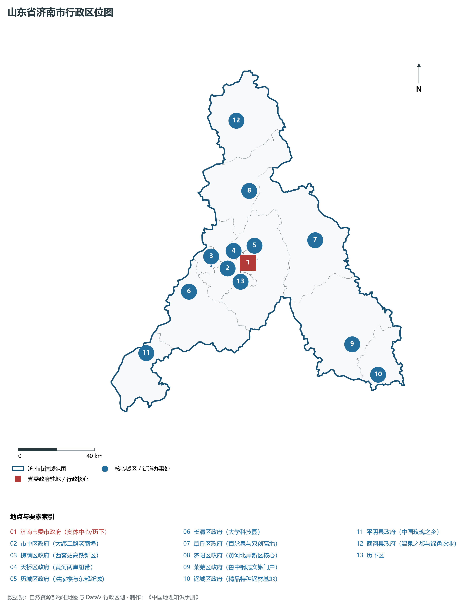
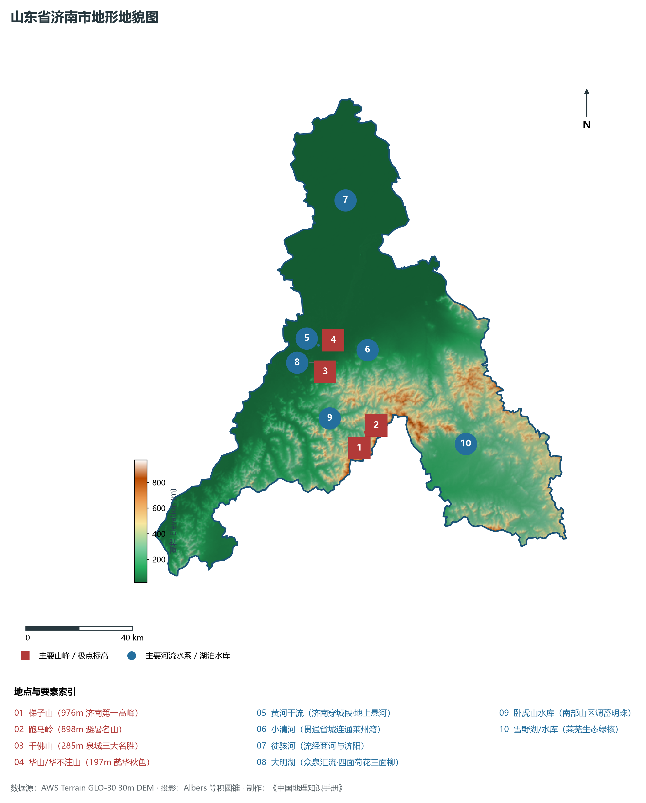
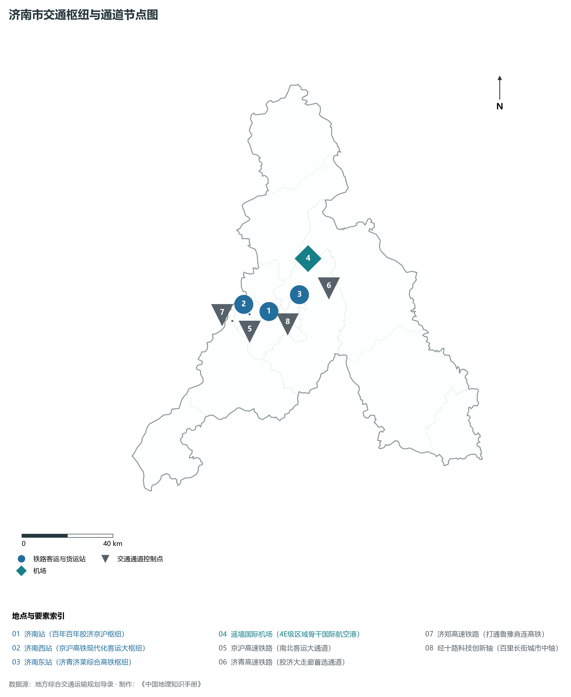
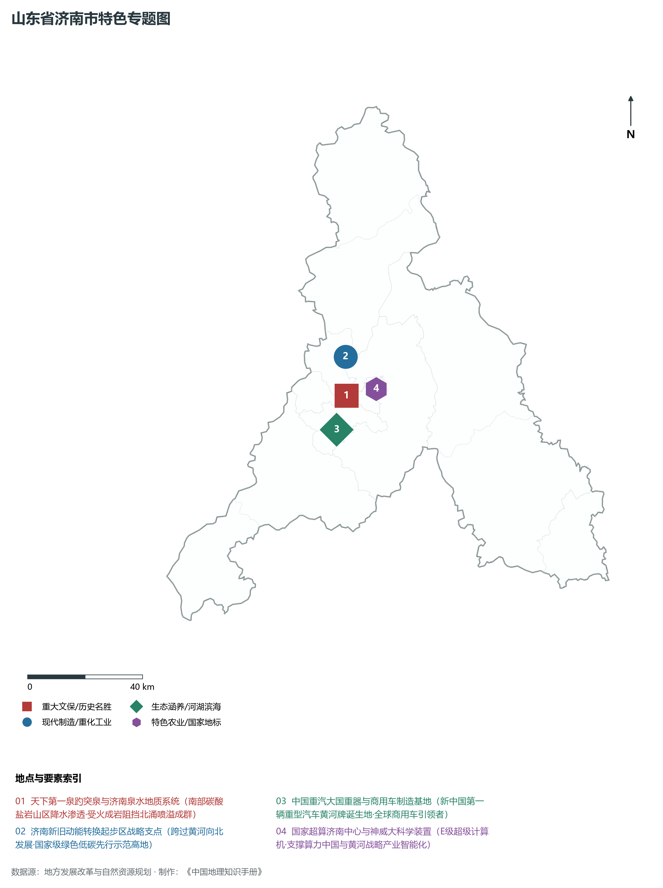
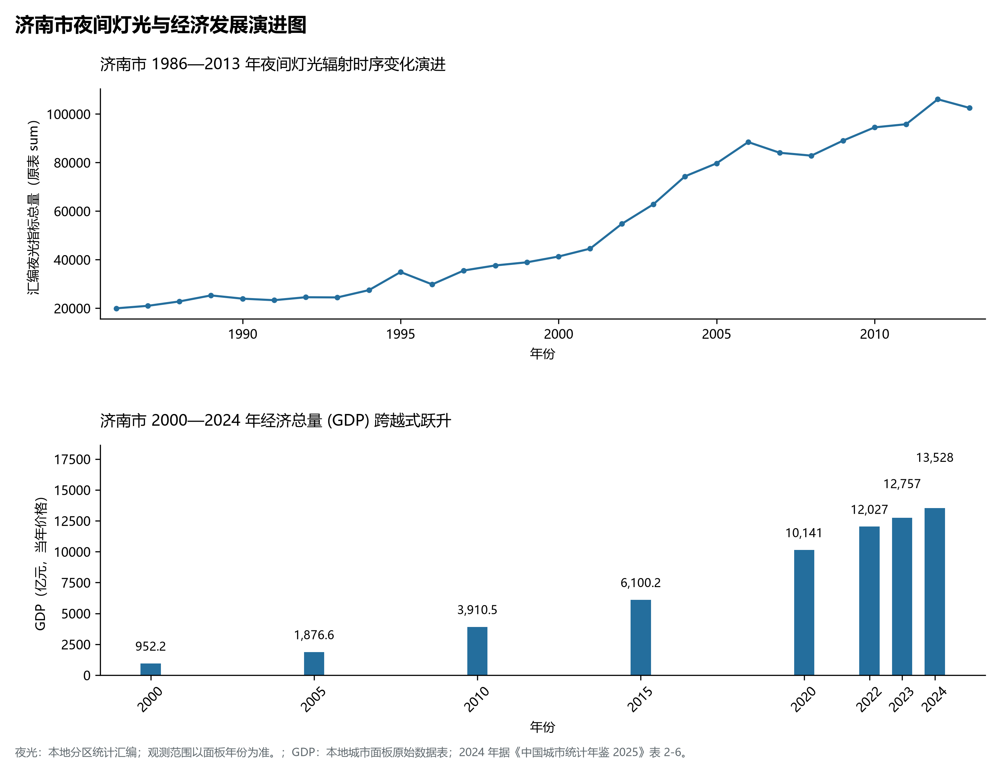

# 8.1 济南市

济南市，位于山东省，其城市功能定位与发展愿景概括为：**省会·副省级特大城市·“泉城”·黄河流域中心城市·综合交通枢纽与科教文卫中心**。2024 年常住人口 **951 万人**，常住人口城镇化率 **76.24%**，地区生产总值 **13,528 亿元**（当年价格），人均地区生产总值 **142,760 元**，三次产业构成为 **3.25 : 33.41 : 63.34**。

---

## 一、自然地理底盘与地貌水系机理

济南市在大地构造演化史上地处华北克拉通陆块演化关键带，构造活动剧烈，断块升降与岩浆喷发侵入历史源远流长，塑造了丘陵起伏、山水相融或平原开阔的自然地理底盘。全境地表高程最低为 **20.0 m**，最高隆起山峰或高地海拔达 **976.0 m**，地势梯级起伏与垂直微地貌分异构筑了层次鲜明的生态水文环境与战略资源承载力。

区域骨干控制性山脉与地形高程极点包括：

- **梯子山 (976m 济南第一高峰)**（坐标约东经 117.130°、北纬 36.380°，高程约 976.0 m）：构成区域地形骨架与水系分水岭的关键高程控制点；
- **跑马岭 (898m 避暑名山)**（坐标约东经 117.160°、北纬 36.430°，高程约 898.0 m）：构成区域地形骨架与水系分水岭的关键高程控制点；
- **千佛山 (285m 泉城三大名胜)**（坐标约东经 117.025°、北纬 36.645°，高程约 285.0 m）：构成区域地形骨架与水系分水岭的关键高程控制点；
- **华山/华不注山 (197m 鹊华秋色)**（坐标约东经 117.075°、北纬 36.745°，高程约 197.0 m）：构成区域地形骨架与水系分水岭的关键高程控制点；

水系与水文网络方面，济南市地表水资源丰富，骨干江河湖库穿流浸润：

- **黄河干流 (济南穿城段·地上悬河)**（流经约东经 117.010°、北纬 36.735° 水域）：对全市工农业供水、生态水系构建及防汛抗旱减灾发挥核心支撑调蓄作用；
- **小清河 (贯通省城连通莱州湾)**（流经约东经 117.100°、北纬 36.710° 水域）：对全市工农业供水、生态水系构建及防汛抗旱减灾发挥核心支撑调蓄作用；
- **徒骇河 (流经商河与济阳)**（流经约东经 117.200°、北纬 37.200° 水域）：对全市工农业供水、生态水系构建及防汛抗旱减灾发挥核心支撑调蓄作用；
- **大明湖 (众泉汇流·四面荷花三面柳)**（流经约东经 117.025°、北纬 36.675° 水域）：对全市工农业供水、生态水系构建及防汛抗旱减灾发挥核心支撑调蓄作用；
- **卧虎山水库 (南部山区调蓄明珠)**（流经约东经 117.020°、北纬 36.490° 水域）：对全市工农业供水、生态水系构建及防汛抗旱减灾发挥核心支撑调蓄作用；
- **雪野湖/水库 (莱芜生态绿核)**（流经约东经 117.580°、北纬 36.350° 水域）：对全市工农业供水、生态水系构建及防汛抗旱减灾发挥核心支撑调蓄作用；

---

## 二、行政区划沿革与城镇空间体系

济南市历史文脉积淀深厚，建置沿革久远。新中国成立以来，伴随国家现代工业化进程推进、沿海开放战略落地与新型城镇化纵深发展，形成了市辖区高效协同、县域特色支撑、产城高度融合的市辖区与县级行政单元空间组织体系：

- **济南市委市政府 (奥体中心/历下)**（驻地坐标：117.120°E, 36.650°N）；
- **市中区政府 (大纬二路老商埠)**（驻地坐标：116.995°E, 36.635°N）；
- **槐荫区政府 (西客站高铁新区)**（驻地坐标：116.900°E, 36.655°N）；
- **天桥区政府 (黄河两岸纽带)**（驻地坐标：116.990°E, 36.695°N）；
- **历城区政府 (洪家楼与东部新城)**（驻地坐标：117.065°E, 36.690°N）；
- **长清区政府 (大学科技园)**（驻地坐标：116.750°E, 36.550°N）；
- **章丘区政府 (百脉泉与双创高地)**（驻地坐标：117.535°E, 36.715°N）；
- **济阳区政府 (黄河北岸新区核心)**（驻地坐标：117.180°E, 36.980°N）；
- **莱芜区政府 (鲁中钢城文旅门户)**（驻地坐标：117.675°E, 36.215°N）；
- **钢城区政府 (精品特种钢材基地)**（驻地坐标：117.805°E, 36.060°N）；
- **平阴县政府 (中国玫瑰之乡)**（驻地坐标：116.455°E, 36.290°N）；
- **商河县政府 (温泉之都与绿色农业)**（驻地坐标：117.155°E, 37.310°N）；

在城镇空间总体布局上，济南市紧扣《国土空间总体规划》，坚持“极核集聚、轴带贯通、组团联动、陆海协同”的战略方针，做优做精中心城区核心能级，提升县域经济特色承载能力，构筑紧凑集约、生态宜居的现代城乡空间组织体系。

---

## 三、综合立体交通网络与交通走廊

济南市地处齐鲁综合立体交通网络重要节点，依托高速铁路、骨干干线铁路、国家高速公路与沿海深水海港/内河大港/航空机场，构筑了四通八达的现代化立体综合交通运输骨架：

**主要综合客运与货运物流交通枢纽节点：**

- **济南站 (百年百年胶济京沪枢纽)**（位置坐标：116.988°E, 36.670°N）；
- **济南西站 (京沪高铁现代化客运大枢纽)**（位置坐标：116.890°E, 36.668°N）；
- **济南东站 (济青济莱综合高铁枢纽)**（位置坐标：117.150°E, 36.720°N）；
- **遥墙国际机场 (4E级区域骨干国际航空港)**（位置坐标：117.215°E, 36.855°N）；

**核心干线铁路与高等级公路交通走廊：**

- **京沪高速铁路 (南北客运大通道)**（廊道控制点：116.880°E, 36.600°N）：对外快速互联互通的高速客货运通道；
- **济青高速铁路 (胶济大走廊首选通道)**（廊道控制点：117.300°E, 36.730°N）：对外快速互联互通的高速客货运通道；
- **济郑高速铁路 (打通鲁豫直连高铁)**（廊道控制点：116.800°E, 36.650°N）：对外快速互联互通的高速客货运通道；
- **经十路科技创新轴 (百里长街城市中轴)**（廊道控制点：117.080°E, 36.655°N）：对外快速互联互通的高速客货运通道；

---

## 四、现代产业体系与新质生产力布局

济南市坚定践行新发展理念，以绿色低碳高质量发展为主线，大力推进传统优势产业数智化改造，培育壮大战略性新兴产业集群，构建具有区域核心竞争力的现代产业新格局：

**核心先进制造业园区与高新技术创新集聚区：**

- **齐鲁软件园与国家超级计算济南中心**（园区坐标：117.135°E, 36.670°N）：区域重大产业创新与先进制造业集群承载核心平台；
- **济南新旧动能转换起步区直管区**（园区坐标：117.030°E, 36.780°N）：区域重大产业创新与先进制造业集群承载核心平台；
- **中国重汽集团研发制造总部**（园区坐标：116.960°E, 36.560°N）：区域重大产业创新与先进制造业集群承载核心平台；
- **济南生物医药港与生命科学城**（园区坐标：117.230°E, 36.675°N）：区域重大产业创新与先进制造业集群承载核心平台；
- **山东莱钢集团特种钢生产基地**（园区坐标：117.810°E, 36.050°N）：区域重大产业创新与先进制造业集群承载核心平台；

**标志性特色主题要素与领航龙头优势：**

- **天下第一泉趵突泉与济南泉水地质系统**（空间坐标：117.015°E, 36.660°N）：南部碳酸盐岩山区降水渗透·受火成岩阻挡北涌喷溢成群；
- **济南新旧动能转换起步区战略支点**（空间坐标：117.030°E, 36.780°N）：跨过黄河向北发展·国家级绿色低碳先行示范高地；
- **中国重汽大国重器与商用车制造基地**（空间坐标：116.960°E, 36.560°N）：新中国第一辆重型汽车黄河牌诞生地·全球商用车引领者；
- **国家超算济南中心与神威大科学装置**（空间坐标：117.135°E, 36.670°N）：E级超级计算机·支撑算力中国与黄河战略产业智能化；

---

## 五、历史文化底蕴、名胜古迹与全域文旅地理

济南市人杰地灵、文脉昌盛，自然风光雄奇秀美，人文古迹璀璨夺目。全境汇聚了高等级风景名胜区、全国重点文物保护单位与国家非物质文化遗产代表作：

- **趵突泉景区 (5A·天下第一泉)**（地标坐标：117.015°E, 36.660°N）：享誉国内外的标志性风景名胜与国家级文旅高地；
- **大明湖国家级名胜区 (5A)**（地标坐标：117.030°E, 36.675°N）：享誉国内外的标志性风景名胜与国家级文旅高地；
- **灵岩寺 (全国重点文保·海内四大名刹之首)**（地标坐标：116.980°E, 36.365°N）：享誉国内外的标志性风景名胜与国家级文旅高地；
- **章丘百脉泉公园 (清泉喷涌)**（地标坐标：117.530°E, 36.720°N）：享誉国内外的标志性风景名胜与国家级文旅高地；

济南市坚持以文塑旅、以旅彰文，全面推进“文旅+生态+制造+乡村”深度融合，持续优化全域旅游产品体系与消费场景，打造高辨识度文旅品牌。

---

## 六、夜间灯光辐射与经济变化时序演进

本节夜光图的观测年份为 1986—2013 年，指标为行政区汇总值（原表 sum）。

| 年份 | 地区生产总值（亿元，当年价格） |
|:---|---:|
| 2000 年 | 952.2 |
| 2005 年 | 1,876.6 |
| 2010 年 | 3,910.5 |
| 2015 年 | 6,100.2 |
| 2020 年 | 10,141 |
| 2022 年 | 12,027 |
| 2023 年 | 12,757 |
| 2024 年 | 13,528 |

- **1996 年前后**：泉城路大明湖主城商圈与工业南路传统片区；
- **2005 年前后**：高新区东拓·经十东路科创走廊初具雏形；
- **2013 年前后**：CBD奥体核心成型·黄河北岸起步区战略破局；

---

2024 年统计来源：《中国城市统计年鉴 2025》表 2-1、2-6、2-7（2024 年，全市）。其他年份 GDP 据本地城市面板“原始数据”表，单位为亿元、当年价格。
