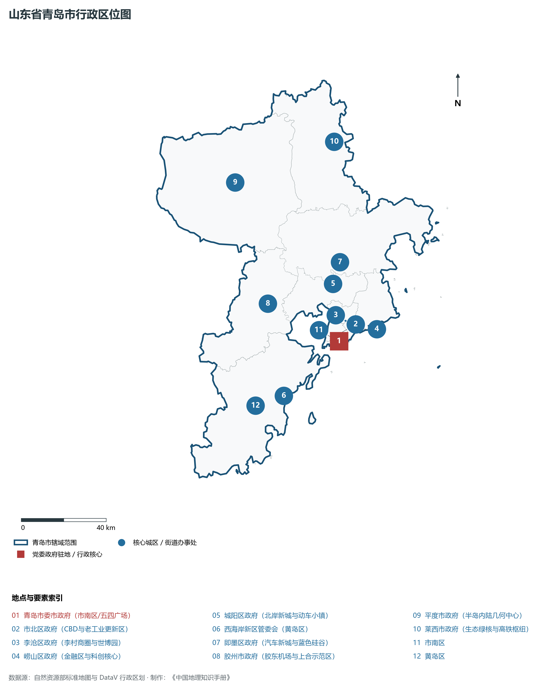
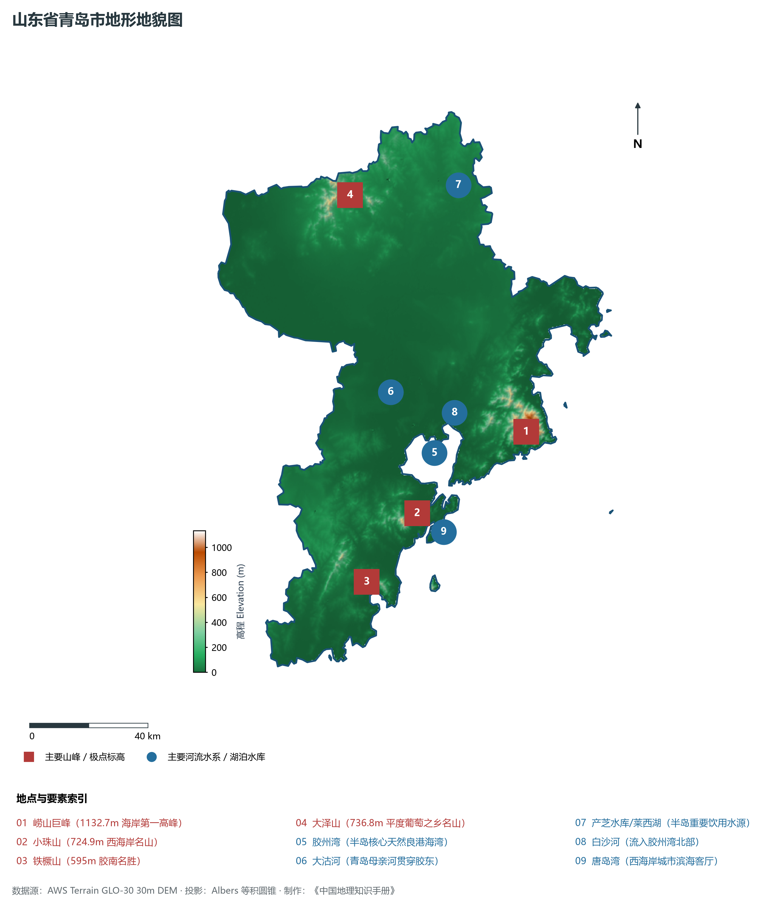
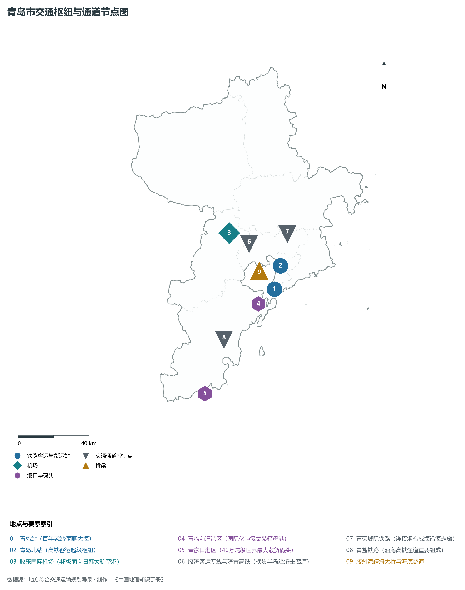
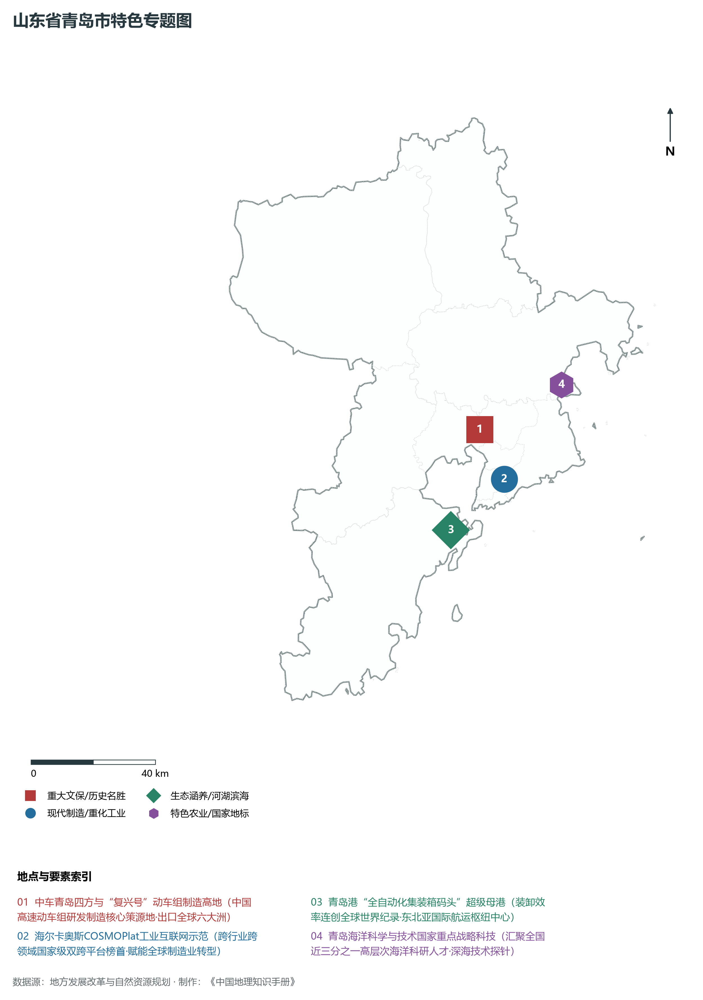
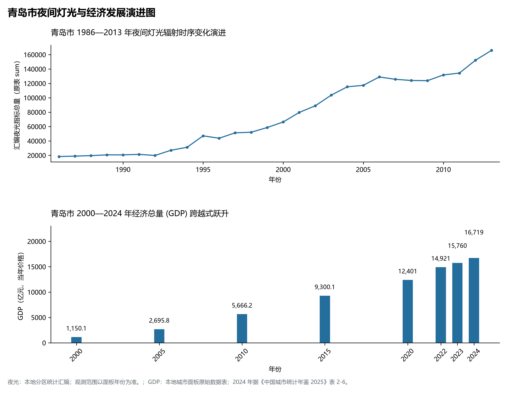

# 8.2 青岛市

青岛市，位于山东省，其城市功能定位与发展愿景概括为：**计划单列市·副省级特大城市·国家中心城市创建城·国际航运贸易金融中心·全球现代海洋名城**。2024 年常住人口 **1,044 万人**，常住人口城镇化率 **78.87%**，地区生产总值 **16,719 亿元**（当年价格），人均地区生产总值 **160,656 元**，三次产业构成为 **3 : 34.23 : 62.77**。

---

## 一、自然地理底盘与地貌水系机理

青岛市在大地构造演化史上地处华北克拉通陆块演化关键带，构造活动剧烈，断块升降与岩浆喷发侵入历史源远流长，塑造了丘陵起伏、山水相融或平原开阔的自然地理底盘。全境地表高程最低为 **0.0 m**，最高隆起山峰或高地海拔达 **1132.7 m**，地势梯级起伏与垂直微地貌分异构筑了层次鲜明的生态水文环境与战略资源承载力。

区域骨干控制性山脉与地形高程极点包括：

- **崂山巨峰 (1132.7m 海岸第一高峰)**（坐标约东经 120.610°、北纬 36.170°，高程约 1132.7 m）：构成区域地形骨架与水系分水岭的关键高程控制点；
- **小珠山 (724.9m 西海岸名山)**（坐标约东经 120.150°、北纬 35.980°，高程约 724.9 m）：构成区域地形骨架与水系分水岭的关键高程控制点；
- **铁橛山 (595m 胶南名胜)**（坐标约东经 119.920°、北纬 35.800°，高程约 595.0 m）：构成区域地形骨架与水系分水岭的关键高程控制点；
- **大泽山 (736.8m 平度葡萄之乡名山)**（坐标约东经 120.080°、北纬 36.950°，高程约 736.8 m）：构成区域地形骨架与水系分水岭的关键高程控制点；

水系与水文网络方面，青岛市地表水资源丰富，骨干江河湖库穿流浸润：

- **胶州湾 (半岛核心天然良港海湾)**（流经约东经 120.250°、北纬 36.150° 水域）：对全市工农业供水、生态水系构建及防汛抗旱减灾发挥核心支撑调蓄作用；
- **大沽河 (青岛母亲河贯穿胶东)**（流经约东经 120.120°、北纬 36.350° 水域）：对全市工农业供水、生态水系构建及防汛抗旱减灾发挥核心支撑调蓄作用；
- **产芝水库/莱西湖 (半岛重要饮用水源)**（流经约东经 120.500°、北纬 36.930° 水域）：对全市工农业供水、生态水系构建及防汛抗旱减灾发挥核心支撑调蓄作用；
- **白沙河 (流入胶州湾北部)**（流经约东经 120.350°、北纬 36.260° 水域）：对全市工农业供水、生态水系构建及防汛抗旱减灾发挥核心支撑调蓄作用；
- **唐岛湾 (西海岸城市滨海客厅)**（流经约东经 120.180°、北纬 35.920° 水域）：对全市工农业供水、生态水系构建及防汛抗旱减灾发挥核心支撑调蓄作用；

---

## 二、行政区划沿革与城镇空间体系

青岛市历史文脉积淀深厚，建置沿革久远。新中国成立以来，伴随国家现代工业化进程推进、沿海开放战略落地与新型城镇化纵深发展，形成了市辖区高效协同、县域特色支撑、产城高度融合的市辖区与县级行政单元空间组织体系：

- **青岛市委市政府 (市南区/五四广场)**（驻地坐标：120.380°E, 36.065°N）；
- **市北区政府 (CBD与老工业更新区)**（驻地坐标：120.370°E, 36.090°N）；
- **李沧区政府 (李村商圈与世博园)**（驻地坐标：120.430°E, 36.145°N）；
- **崂山区政府 (金融区与科创核心)**（驻地坐标：120.470°E, 36.105°N）；
- **城阳区政府 (北岸新城与动车小镇)**（驻地坐标：120.395°E, 36.305°N）；
- **西海岸新区管委会 (黄岛区)**（驻地坐标：120.045°E, 35.875°N）；
- **即墨区政府 (汽车新城与蓝色硅谷)**（驻地坐标：120.450°E, 36.390°N）；
- **胶州市政府 (胶东机场与上合示范区)**（驻地坐标：120.035°E, 36.265°N）；
- **平度市政府 (半岛内陆几何中心)**（驻地坐标：119.960°E, 36.785°N）；
- **莱西市政府 (生态绿核与高铁枢纽)**（驻地坐标：120.520°E, 36.890°N）；

在城镇空间总体布局上，青岛市紧扣《国土空间总体规划》，坚持“极核集聚、轴带贯通、组团联动、陆海协同”的战略方针，做优做精中心城区核心能级，提升县域经济特色承载能力，构筑紧凑集约、生态宜居的现代城乡空间组织体系。

---

## 三、综合立体交通网络与交通走廊

青岛市地处齐鲁综合立体交通网络重要节点，依托高速铁路、骨干干线铁路、国家高速公路与沿海深水海港/内河大港/航空机场，构筑了四通八达的现代化立体综合交通运输骨架：

**主要综合客运与货运物流交通枢纽节点：**

- **青岛站 (百年老站·面朝大海)**（位置坐标：120.315°E, 36.060°N）；
- **青岛北站 (高铁客运超级枢纽)**（位置坐标：120.375°E, 36.170°N）；
- **胶东国际机场 (4F级面向日韩大航空港)**（位置坐标：120.085°E, 36.370°N）；
- **青岛前湾港区 (国际亿吨级集装箱母港)**（位置坐标：120.200°E, 36.000°N）；
- **董家口港区 (40万吨级世界最大散货码头)**（位置坐标：119.780°E, 35.600°N）；

**核心干线铁路与高等级公路交通走廊：**

- **胶济客运专线与济青高铁 (横贯半岛经济主廊道)**（廊道控制点：120.200°E, 36.300°N）：对外快速互联互通的高速客货运通道；
- **青荣城际铁路 (连接烟台威海沿海走廊)**（廊道控制点：120.450°E, 36.320°N）：对外快速互联互通的高速客货运通道；
- **青盐铁路 (沿海高铁通道重要组成)**（廊道控制点：119.950°E, 35.850°N）：对外快速互联互通的高速客货运通道；
- **胶州湾跨海大桥与海底隧道**（廊道控制点：120.260°E, 36.120°N）：对外快速互联互通的高速客货运通道；

---

## 四、现代产业体系与新质生产力布局

青岛市坚定践行新发展理念，以绿色低碳高质量发展为主线，大力推进传统优势产业数智化改造，培育壮大战略性新兴产业集群，构建具有区域核心竞争力的现代产业新格局：

**核心先进制造业园区与高新技术创新集聚区：**

- **中车青岛四方机车 (中国高铁研发制造总部)**（园区坐标：120.360°E, 36.270°N）：区域重大产业创新与先进制造业集群承载核心平台；
- **海尔集团工业智能物联网总部 (生态园)**（园区坐标：120.420°E, 36.120°N）：区域重大产业创新与先进制造业集群承载核心平台；
- **海信集团研发中心与产业园**（园区坐标：120.450°E, 36.110°N）：区域重大产业创新与先进制造业集群承载核心平台；
- **青岛国家海洋科学研究中心/蓝谷**（园区坐标：120.680°E, 36.360°N）：区域重大产业创新与先进制造业集群承载核心平台；
- **中国-上海合作组织地方经贸合作示范区**（园区坐标：120.080°E, 36.210°N）：区域重大产业创新与先进制造业集群承载核心平台；

**标志性特色主题要素与领航龙头优势：**

- **中车青岛四方与“复兴号”动车组制造高地**（空间坐标：120.360°E, 36.270°N）：中国高速动车组研发制造核心策源地·出口全球六大洲；
- **海尔卡奥斯COSMOPlat工业互联网示范**（空间坐标：120.420°E, 36.120°N）：跨行业跨领域国家级双跨平台榜首·赋能全球制造业转型；
- **青岛港“全自动化集装箱码头”超级母港**（空间坐标：120.200°E, 36.000°N）：装卸效率连创全球世界纪录·东北亚国际航运枢纽中心；
- **青岛海洋科学与技术国家重点战略科技**（空间坐标：120.680°E, 36.360°N）：汇聚全国近三分之一高层次海洋科研人才·深海技术探针；

---

## 五、历史文化底蕴、名胜古迹与全域文旅地理

青岛市人杰地灵、文脉昌盛，自然风光雄奇秀美，人文古迹璀璨夺目。全境汇聚了高等级风景名胜区、全国重点文物保护单位与国家非物质文化遗产代表作：

- **崂山国家级风景名胜区 (5A·道教名山)**（地标坐标：120.610°E, 36.170°N）：享誉国内外的标志性风景名胜与国家级文旅高地；
- **栈桥与八大关近代建筑群 (全国重点文保)**（地标坐标：120.320°E, 36.050°N）：享誉国内外的标志性风景名胜与国家级文旅高地；
- **青岛啤酒博物馆与登州路历史街区**（地标坐标：120.350°E, 36.075°N）：享誉国内外的标志性风景名胜与国家级文旅高地；
- **奥帆中心与五四广场城市会客厅**（地标坐标：120.390°E, 36.060°N）：享誉国内外的标志性风景名胜与国家级文旅高地；
- **琅琊台风景区 (秦汉琅琊遗址)**（地标坐标：119.890°E, 35.650°N）：享誉国内外的标志性风景名胜与国家级文旅高地；

青岛市坚持以文塑旅、以旅彰文，全面推进“文旅+生态+制造+乡村”深度融合，持续优化全域旅游产品体系与消费场景，打造高辨识度文旅品牌。

---

## 六、夜间灯光辐射与经济变化时序演进

本节夜光图的观测年份为 1986—2013 年，指标为行政区汇总值（原表 sum）。

| 年份 | 地区生产总值（亿元，当年价格） |
|:---|---:|
| 2000 年 | 1,150.1 |
| 2005 年 | 2,695.8 |
| 2010 年 | 5,666.2 |
| 2015 年 | 9,300.1 |
| 2020 年 | 12,401 |
| 2022 年 | 14,921 |
| 2023 年 | 15,760 |
| 2024 年 | 16,719 |

- **1996 年前后**：前海老城中山路·四方老工业区核心连绵；
- **2005 年前后**：东部新城CBD拔地而起·西海岸黄岛港区初成；
- **2013 年前后**：胶州湾大桥海底隧道全通·西海岸新区全面跃升；

---

2024 年统计来源：《中国城市统计年鉴 2025》表 2-1、2-6、2-7（2024 年，全市）。其他年份 GDP 据本地城市面板“原始数据”表，单位为亿元、当年价格。
