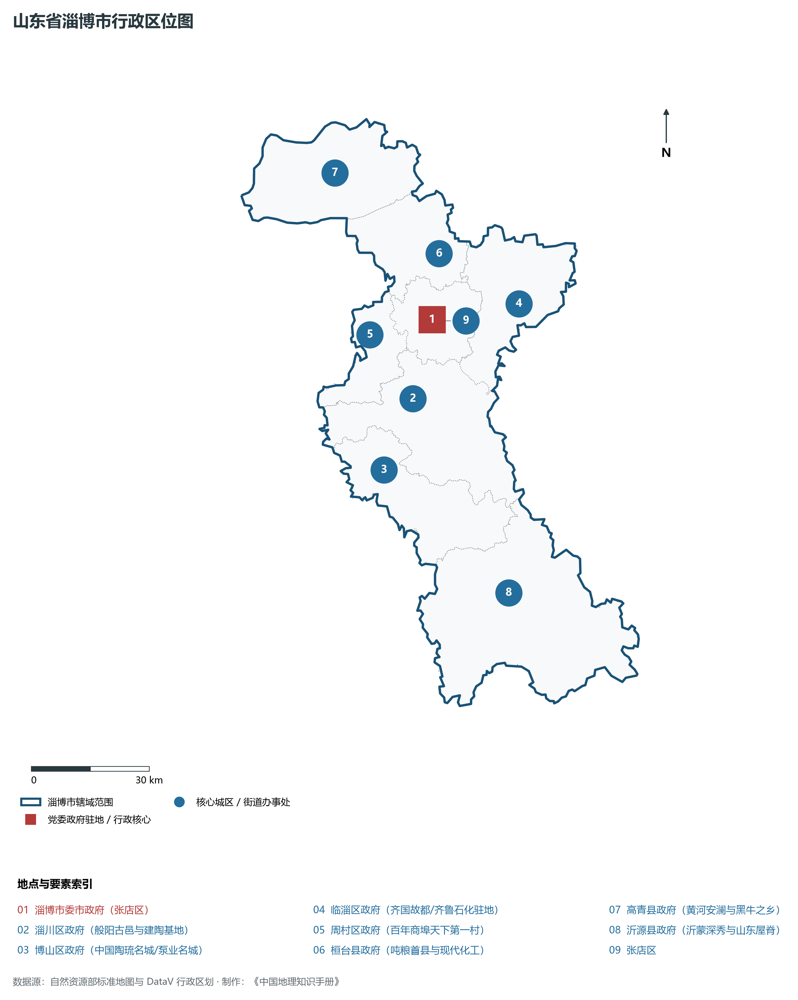
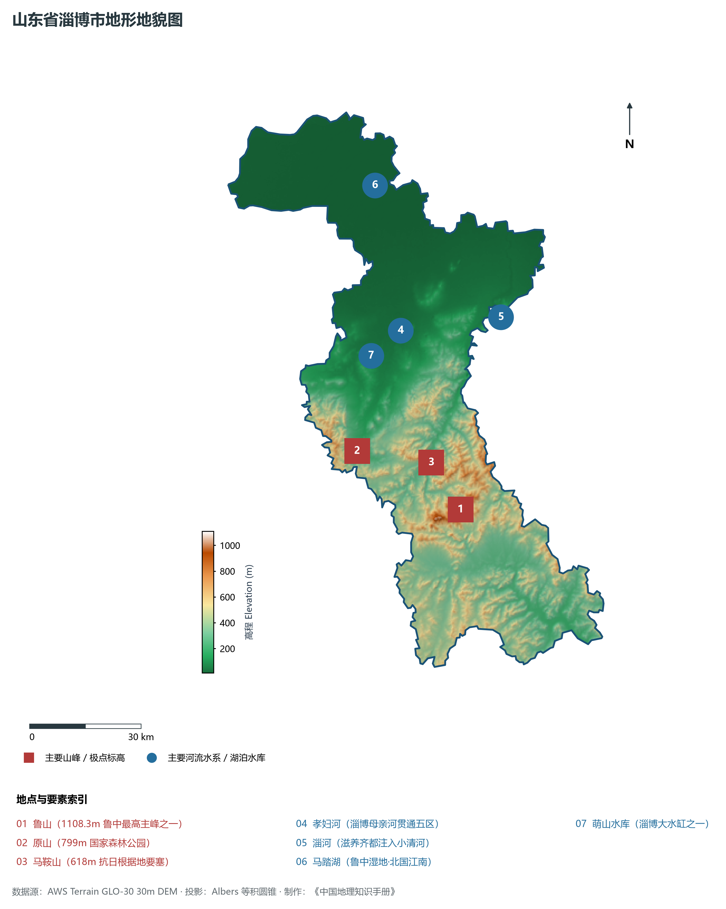
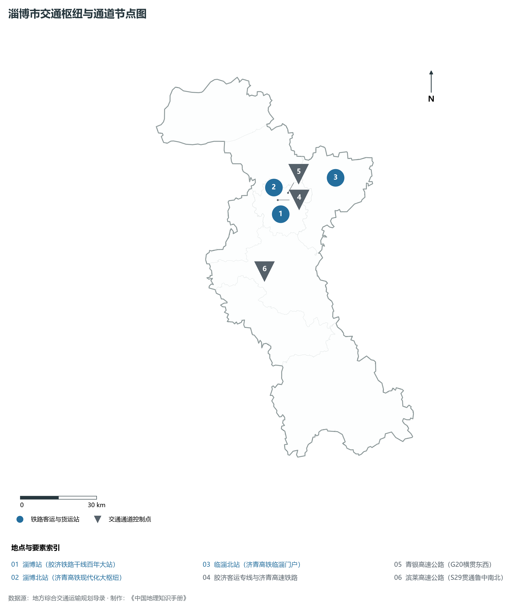
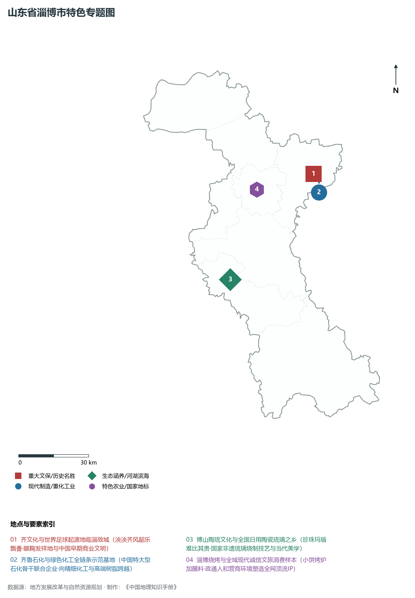
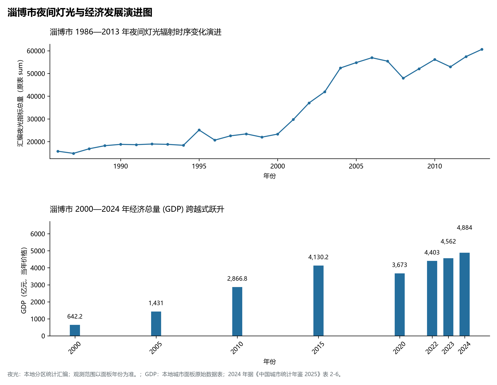

# 8.3 淄博市

淄博市，位于山东省，其城市功能定位与发展愿景概括为：**鲁中工业名城·齐国故都与齐文化发祥地·新材料名都与转型示范城·。2024 年常住人口 **464 万人**，常住人口城镇化率 **76.19%**，地区生产总值 **4,884 亿元**（当年价格），人均地区生产总值 **104,913 元**，三次产业构成为 **4.12 : 46.87 : 49.01**。

---

## 一、自然地理底盘与地貌水系机理

淄博市在大地构造演化史上地处华北克拉通陆块演化关键带，构造活动剧烈，断块升降与岩浆喷发侵入历史源远流长，塑造了丘陵起伏、山水相融或平原开阔的自然地理底盘。全境地表高程最低为 **10.0 m**，最高隆起山峰或高地海拔达 **1108.3 m**，地势梯级起伏与垂直微地貌分异构筑了层次鲜明的生态水文环境与战略资源承载力。

区域骨干控制性山脉与地形高程极点包括：

- **鲁山 (1108.3m 鲁中最高主峰之一)**（坐标约东经 118.130°、北纬 36.310°，高程约 1108.3 m）：构成区域地形骨架与水系分水岭的关键高程控制点；
- **原山 (799m 国家森林公园)**（坐标约东经 117.840°、北纬 36.480°，高程约 799.0 m）：构成区域地形骨架与水系分水岭的关键高程控制点；
- **马鞍山 (618m 抗日根据地要塞)**（坐标约东经 118.060°、北纬 36.430°，高程约 618.0 m）：构成区域地形骨架与水系分水岭的关键高程控制点；

水系与水文网络方面，淄博市地表水资源丰富，骨干江河湖库穿流浸润：

- **孝妇河 (淄博母亲河贯通五区)**（流经约东经 118.020°、北纬 36.750° 水域）：对全市工农业供水、生态水系构建及防汛抗旱减灾发挥核心支撑调蓄作用；
- **淄河 (滋养齐都注入小清河)**（流经约东经 118.330°、北纬 36.750° 水域）：对全市工农业供水、生态水系构建及防汛抗旱减灾发挥核心支撑调蓄作用；
- **马踏湖 (鲁中湿地·北国江南)**（流经约东经 118.000°、北纬 37.100° 水域）：对全市工农业供水、生态水系构建及防汛抗旱减灾发挥核心支撑调蓄作用；
- **萌山水库 (淄博大水缸之一)**（流经约东经 117.920°、北纬 36.700° 水域）：对全市工农业供水、生态水系构建及防汛抗旱减灾发挥核心支撑调蓄作用；

---

## 二、行政区划沿革与城镇空间体系

淄博市历史文脉积淀深厚，建置沿革久远。新中国成立以来，伴随国家现代工业化进程推进、沿海开放战略落地与新型城镇化纵深发展，形成了市辖区高效协同、县域特色支撑、产城高度融合的市辖区与县级行政单元空间组织体系：

- **淄博市委市政府 (张店区)**（驻地坐标：118.055°E, 36.815°N）；
- **淄川区政府 (般阳古邑与建陶基地)**（驻地坐标：117.970°E, 36.645°N）；
- **博山区政府 (中国陶琉名城/泵业名城)**（驻地坐标：117.860°E, 36.495°N）；
- **临淄区政府 (齐国故都/齐鲁石化驻地)**（驻地坐标：118.310°E, 36.825°N）；
- **周村区政府 (百年商埠天下第一村)**（驻地坐标：117.870°E, 36.800°N）；
- **桓台县政府 (吨粮首县与现代化工)**（驻地坐标：118.100°E, 36.960°N）；
- **高青县政府 (黄河安澜与黑牛之乡)**（驻地坐标：117.830°E, 37.170°N）；
- **沂源县政府 (沂蒙深秀与山东屋脊)**（驻地坐标：118.170°E, 36.185°N）；

在城镇空间总体布局上，淄博市紧扣《国土空间总体规划》，坚持“极核集聚、轴带贯通、组团联动、陆海协同”的战略方针，做优做精中心城区核心能级，提升县域经济特色承载能力，构筑紧凑集约、生态宜居的现代城乡空间组织体系。

---

## 三、综合立体交通网络与交通走廊

淄博市地处齐鲁综合立体交通网络重要节点，依托高速铁路、骨干干线铁路、国家高速公路与沿海深水海港/内河大港/航空机场，构筑了四通八达的现代化立体综合交通运输骨架：

**主要综合客运与货运物流交通枢纽节点：**

- **淄博站 (胶济铁路干线百年大站)**（位置坐标：118.055°E, 36.790°N）；
- **淄博北站 (济青高铁现代化大枢纽)**（位置坐标：118.040°E, 36.885°N）；
- **临淄北站 (济青高铁临淄门户)**（位置坐标：118.320°E, 36.890°N）；

**核心干线铁路与高等级公路交通走廊：**

- **胶济客运专线与济青高速铁路**（廊道控制点：118.050°E, 36.840°N）：对外快速互联互通的高速客货运通道；
- **青银高速公路 (G20横贯东西)**（廊道控制点：118.100°E, 36.860°N）：对外快速互联互通的高速客货运通道；
- **滨莱高速公路 (S29贯通鲁中南北)**（廊道控制点：117.950°E, 36.600°N）：对外快速互联互通的高速客货运通道；

---

## 四、现代产业体系与新质生产力布局

淄博市坚定践行新发展理念，以绿色低碳高质量发展为主线，大力推进传统优势产业数智化改造，培育壮大战略性新兴产业集群，构建具有区域核心竞争力的现代产业新格局：

**核心先进制造业园区与高新技术创新集聚区：**

- **齐鲁化学工业区 (国家级专业化工园区)**（园区坐标：118.360°E, 36.810°N）：区域重大产业创新与先进制造业集群承载核心平台；
- **淄博高新技术产业开发区 (新材料名都核心)**（园区坐标：118.080°E, 36.865°N）：区域重大产业创新与先进制造业集群承载核心平台；
- **博山机电泵业先进制造产业园**（园区坐标：117.880°E, 36.510°N）：区域重大产业创新与先进制造业集群承载核心平台；
- **周村现代不锈钢及纺织产业园**（园区坐标：117.850°E, 36.780°N）：区域重大产业创新与先进制造业集群承载核心平台；

**标志性特色主题要素与领航龙头优势：**

- **齐文化与世界足球起源地临淄故城**（空间坐标：118.340°E, 36.845°N）：泱泱齐风韶乐飘香·蹴鞠发祥地与中国早期商业文明；
- **齐鲁石化与绿色化工全链条示范基地**（空间坐标：118.360°E, 36.810°N）：中国特大型石化骨干联合企业·向精细化工与高端树脂跨越；
- **博山陶琉文化与全国日用陶瓷琉璃之乡**（空间坐标：117.870°E, 36.490°N）：珍珠玛瑙难比其贵·国家非遗琉璃烧制技艺与当代美学；
- **淄博烧烤与全域现代诚信文旅消费样本**（空间坐标：118.055°E, 36.815°N）：小饼烤炉加蘸料·政通人和营商环境塑造全网顶流IP；

---

## 五、历史文化底蕴、名胜古迹与全域文旅地理

淄博市人杰地灵、文脉昌盛，自然风光雄奇秀美，人文古迹璀璨夺目。全境汇聚了高等级风景名胜区、全国重点文物保护单位与国家非物质文化遗产代表作：

- **齐国故城遗址博物馆 (全国重点文保)**（地标坐标：118.340°E, 36.845°N）：享誉国内外的标志性风景名胜与国家级文旅高地；
- **周村古商城 (4A·天下第一村/旱码头)**（地标坐标：117.865°E, 36.805°N）：享誉国内外的标志性风景名胜与国家级文旅高地；
- **博山陶琉大观园与颜神古镇**（地标坐标：117.870°E, 36.490°N）：享誉国内外的标志性风景名胜与国家级文旅高地；
- **原山国家森林公园 (5A级生态典范)**（地标坐标：117.830°E, 36.480°N）：享誉国内外的标志性风景名胜与国家级文旅高地；

淄博市坚持以文塑旅、以旅彰文，全面推进“文旅+生态+制造+乡村”深度融合，持续优化全域旅游产品体系与消费场景，打造高辨识度文旅品牌。

---

## 六、夜间灯光辐射与经济变化时序演进

本节夜光图的观测年份为 1986—2013 年，指标为行政区汇总值（原表 sum）。

| 年份 | 地区生产总值（亿元，当年价格） |
|:---|---:|
| 2000 年 | 642.2 |
| 2005 年 | 1,431 |
| 2010 年 | 2,866.8 |
| 2015 年 | 4,130.2 |
| 2020 年 | 3,673 |
| 2022 年 | 4,403 |
| 2023 年 | 4,562 |
| 2024 年 | 4,884 |

- **1996 年前后**：张店中心城区与齐鲁石化临淄片区双核高亮；
- **2005 年前后**：淄川博山老工矿与桓台平原工业多点繁茂；
- **2013 年前后**：高新区现代产业集聚·组团式城市骨架紧凑贯通；

---

2024 年统计来源：《中国城市统计年鉴 2025》表 2-1、2-6、2-7（2024 年，全市）。其他年份 GDP 据本地城市面板“原始数据”表，单位为亿元、当年价格。
