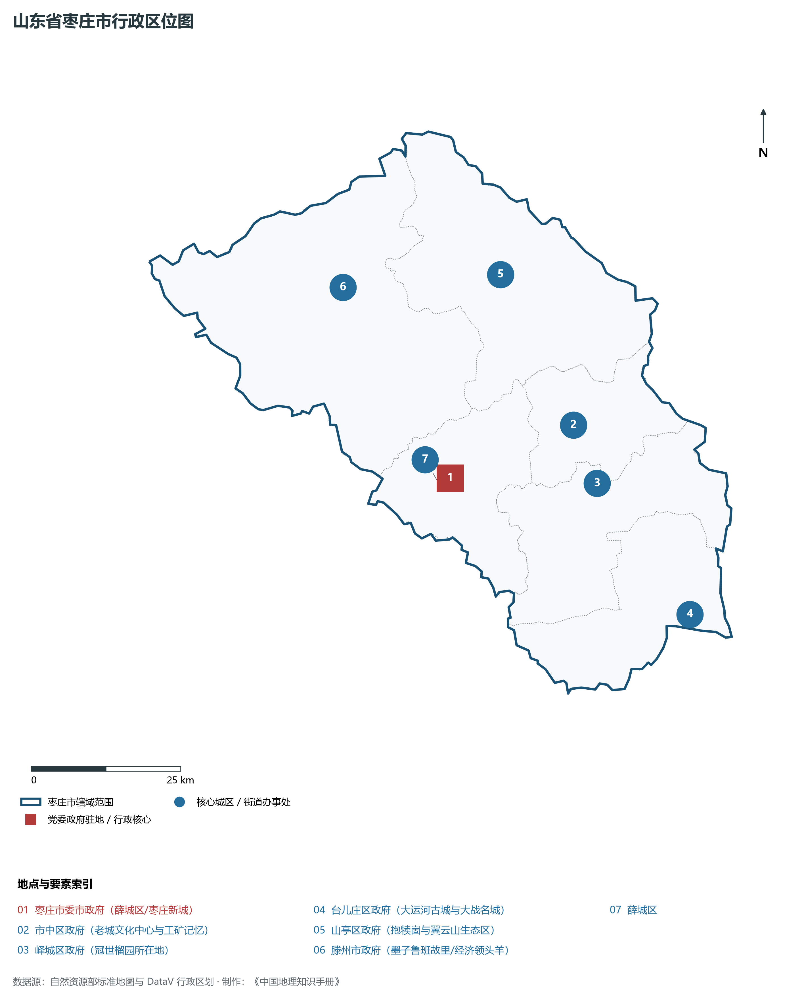
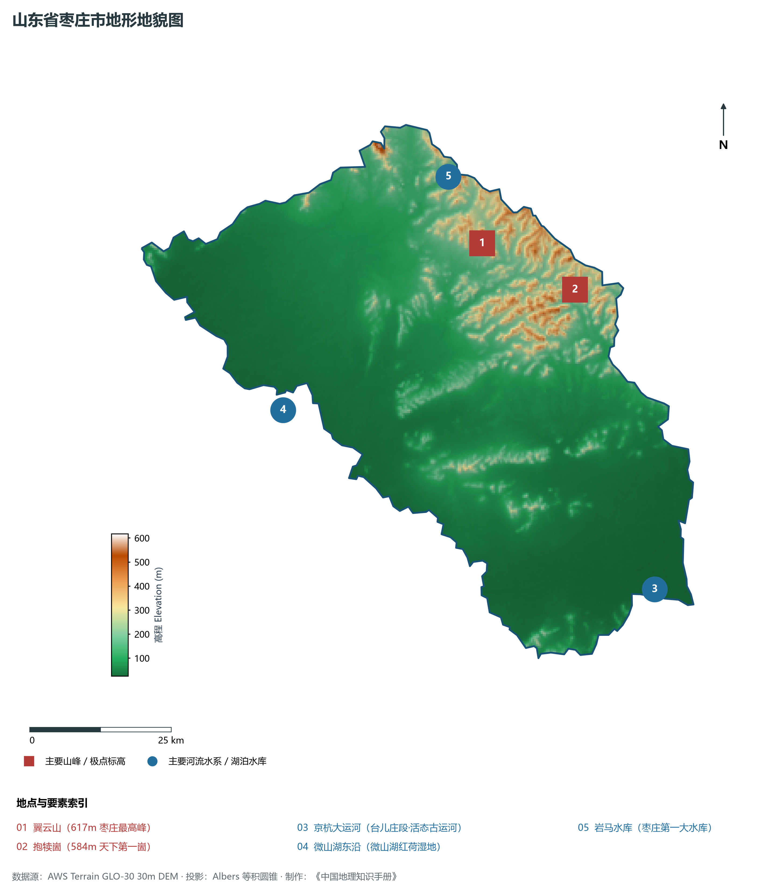
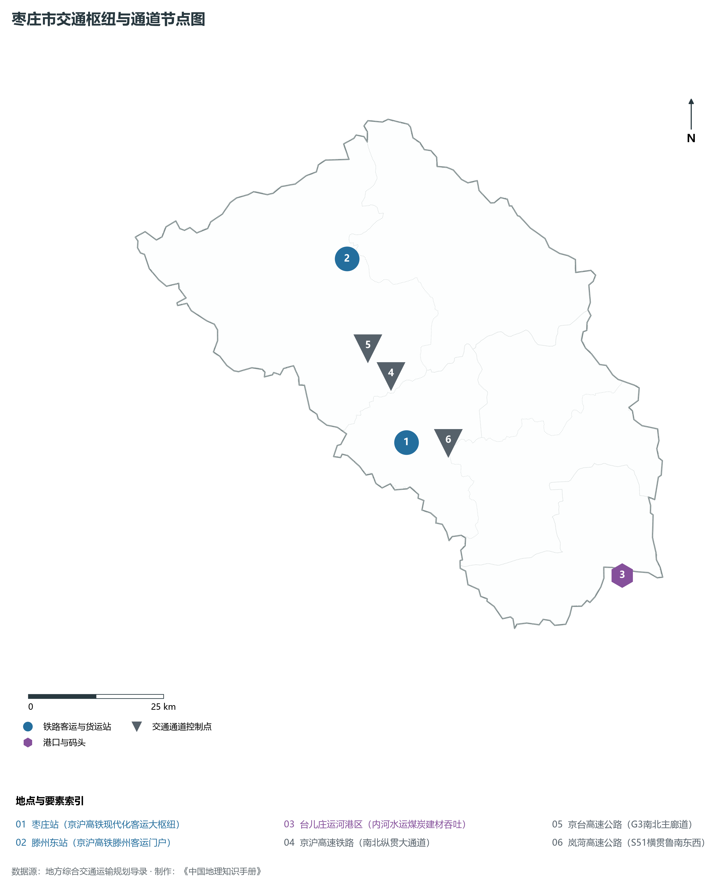
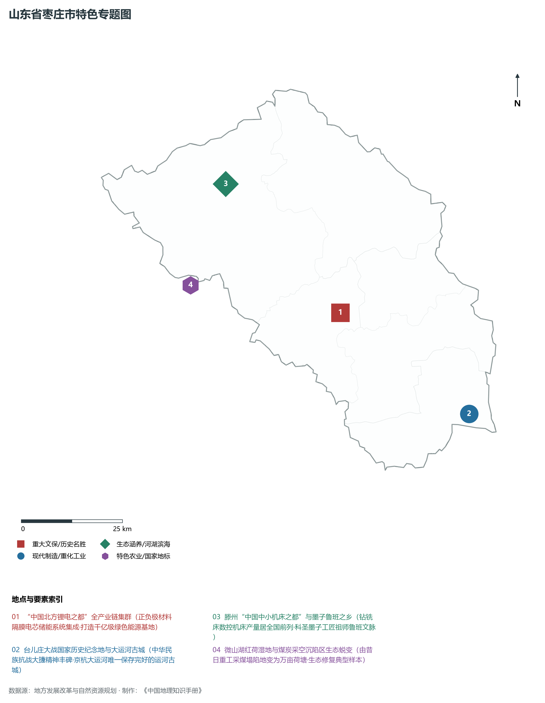
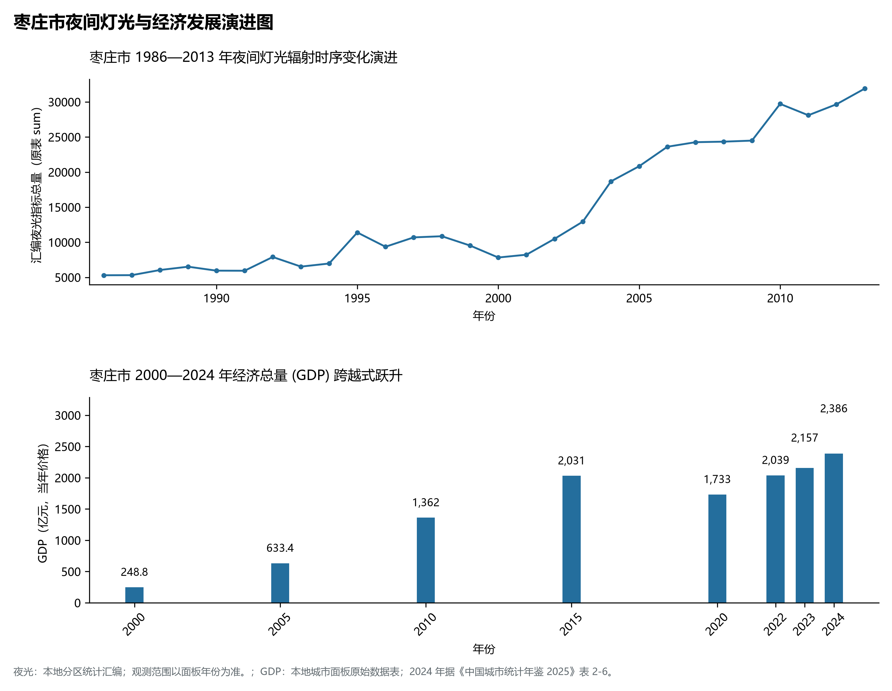

# 8.4 枣庄市

枣庄市，位于山东省，其城市功能定位与发展愿景概括为：**鲁南门户·“中国北方锂电之都”·台儿庄大战名城与运河古城·转型发展示范市**。2024 年常住人口 **381 万人**，常住人口城镇化率 **62.83%**，地区生产总值 **2,386 亿元**（当年价格），人均地区生产总值 **62,678 元**，三次产业构成为 **8.61 : 38.56 : 52.83**。

---

## 一、自然地理底盘与地貌水系机理

枣庄市在大地构造演化史上地处华北克拉通陆块演化关键带，构造活动剧烈，断块升降与岩浆喷发侵入历史源远流长，塑造了丘陵起伏、山水相融或平原开阔的自然地理底盘。全境地表高程最低为 **25.0 m**，最高隆起山峰或高地海拔达 **617.0 m**，地势梯级起伏与垂直微地貌分异构筑了层次鲜明的生态水文环境与战略资源承载力。

区域骨干控制性山脉与地形高程极点包括：

- **翼云山 (617m 枣庄最高峰)**（坐标约东经 117.480°、北纬 35.120°，高程约 617.0 m）：构成区域地形骨架与水系分水岭的关键高程控制点；
- **抱犊崮 (584m 天下第一崮)**（坐标约东经 117.650°、北纬 35.030°，高程约 584.0 m）：构成区域地形骨架与水系分水岭的关键高程控制点；

水系与水文网络方面，枣庄市地表水资源丰富，骨干江河湖库穿流浸润：

- **京杭大运河 (台儿庄段·活态古运河)**（流经约东经 117.730°、北纬 34.550° 水域）：对全市工农业供水、生态水系构建及防汛抗旱减灾发挥核心支撑调蓄作用；
- **微山湖东沿 (微山湖红荷湿地)**（流经约东经 117.050°、北纬 34.900° 水域）：对全市工农业供水、生态水系构建及防汛抗旱减灾发挥核心支撑调蓄作用；
- **岩马水库 (枣庄第一大水库)**（流经约东经 117.430°、北纬 35.230° 水域）：对全市工农业供水、生态水系构建及防汛抗旱减灾发挥核心支撑调蓄作用；

---

## 二、行政区划沿革与城镇空间体系

枣庄市历史文脉积淀深厚，建置沿革久远。新中国成立以来，伴随国家现代工业化进程推进、沿海开放战略落地与新型城镇化纵深发展，形成了市辖区高效协同、县域特色支撑、产城高度融合的市辖区与县级行政单元空间组织体系：

- **枣庄市委市政府 (薛城区/枣庄新城)**（驻地坐标：117.320°E, 34.805°N）；
- **市中区政府 (老城文化中心与工矿记忆)**（驻地坐标：117.560°E, 34.860°N）；
- **峄城区政府 (冠世榴园所在地)**（驻地坐标：117.590°E, 34.770°N）；
- **台儿庄区政府 (大运河古城与大战名城)**（驻地坐标：117.730°E, 34.560°N）；
- **山亭区政府 (抱犊崮与翼云山生态区)**（驻地坐标：117.460°E, 35.095°N）；
- **滕州市政府 (墨子鲁班故里/经济领头羊)**（驻地坐标：117.165°E, 35.105°N）；

在城镇空间总体布局上，枣庄市紧扣《国土空间总体规划》，坚持“极核集聚、轴带贯通、组团联动、陆海协同”的战略方针，做优做精中心城区核心能级，提升县域经济特色承载能力，构筑紧凑集约、生态宜居的现代城乡空间组织体系。

---

## 三、综合立体交通网络与交通走廊

枣庄市地处齐鲁综合立体交通网络重要节点，依托高速铁路、骨干干线铁路、国家高速公路与沿海深水海港/内河大港/航空机场，构筑了四通八达的现代化立体综合交通运输骨架：

**主要综合客运与货运物流交通枢纽节点：**

- **枣庄站 (京沪高铁现代化客运大枢纽)**（位置坐标：117.315°E, 34.790°N）；
- **滕州东站 (京沪高铁滕州客运门户)**（位置坐标：117.240°E, 35.100°N）；
- **台儿庄运河港区 (内河水运煤炭建材吞吐)**（位置坐标：117.720°E, 34.530°N）；

**核心干线铁路与高等级公路交通走廊：**

- **京沪高速铁路 (南北纵贯大通道)**（廊道控制点：117.300°E, 34.900°N）：对外快速互联互通的高速客货运通道；
- **京台高速公路 (G3南北主廊道)**（廊道控制点：117.260°E, 34.950°N）：对外快速互联互通的高速客货运通道；
- **岚菏高速公路 (S51横贯鲁南东西)**（廊道控制点：117.400°E, 34.780°N）：对外快速互联互通的高速客货运通道；

---

## 四、现代产业体系与新质生产力布局

枣庄市坚定践行新发展理念，以绿色低碳高质量发展为主线，大力推进传统优势产业数智化改造，培育壮大战略性新兴产业集群，构建具有区域核心竞争力的现代产业新格局：

**核心先进制造业园区与高新技术创新集聚区：**

- **枣庄国家高新技术产业开发区 (锂电主阵地)**（园区坐标：117.420°E, 34.820°N）：区域重大产业创新与先进制造业集群承载核心平台；
- **滕州机床产业集群与高端装备园**（园区坐标：117.150°E, 35.130°N）：区域重大产业创新与先进制造业集群承载核心平台；
- **欣旺达/精工电子大型动力锂电池基地**（园区坐标：117.380°E, 34.830°N）：区域重大产业创新与先进制造业集群承载核心平台；
- **薛城循环经济与现代煤焦化新材料基地**（园区坐标：117.280°E, 34.750°N）：区域重大产业创新与先进制造业集群承载核心平台；

**标志性特色主题要素与领航龙头优势：**

- **“中国北方锂电之都”全产业链集群**（空间坐标：117.420°E, 34.820°N）：正负极材料隔膜电芯储能系统集成·打造千亿级绿色能源基地；
- **台儿庄大战国家历史纪念地与大运河古城**（空间坐标：117.735°E, 34.565°N）：中华民族抗战大捷精神丰碑·京杭大运河唯一保存完好的运河古城；
- **滕州“中国中小机床之都”与墨子鲁班之乡**（空间坐标：117.150°E, 35.130°N）：钻铣床数控机床产量居全国前列·科圣墨子工匠祖师鲁班文脉；
- **微山湖红荷湿地与煤炭采空沉陷区生态蜕变**（空间坐标：117.020°E, 34.920°N）：由昔日重工采煤塌陷地变为万亩荷塘·生态修复典型样本；

---

## 五、历史文化底蕴、名胜古迹与全域文旅地理

枣庄市人杰地灵、文脉昌盛，自然风光雄奇秀美，人文古迹璀璨夺目。全境汇聚了高等级风景名胜区、全国重点文物保护单位与国家非物质文化遗产代表作：

- **台儿庄古城 (5A·天下第一庄)**（地标坐标：117.735°E, 34.565°N）：享誉国内外的标志性风景名胜与国家级文旅高地；
- **台儿庄大战纪念馆 (全国爱国主义教育基地)**（地标坐标：117.720°E, 34.560°N）：享誉国内外的标志性风景名胜与国家级文旅高地；
- **滕州微山湖红荷湿地风景区 (5A·中国荷都)**（地标坐标：117.020°E, 34.920°N）：享誉国内外的标志性风景名胜与国家级文旅高地；
- **冠世榴园风景区 (天下第一榴园)**（地标坐标：117.580°E, 34.740°N）：享誉国内外的标志性风景名胜与国家级文旅高地；

枣庄市坚持以文塑旅、以旅彰文，全面推进“文旅+生态+制造+乡村”深度融合，持续优化全域旅游产品体系与消费场景，打造高辨识度文旅品牌。

---

## 六、夜间灯光辐射与经济变化时序演进

本节夜光图的观测年份为 1986—2013 年，指标为行政区汇总值（原表 sum）。

| 年份 | 地区生产总值（亿元，当年价格） |
|:---|---:|
| 2000 年 | 248.8 |
| 2005 年 | 633.4 |
| 2010 年 | 1,362 |
| 2015 年 | 2,031 |
| 2020 年 | 1,733 |
| 2022 年 | 2,039 |
| 2023 年 | 2,157 |
| 2024 年 | 2,386 |

- **2005 年前后**：新城薛城西移·京沪高铁设站带动城市中心西扩；

---

2024 年统计来源：《中国城市统计年鉴 2025》表 2-1、2-6、2-7（2024 年，全市）。其他年份 GDP 据本地城市面板“原始数据”表，单位为亿元、当年价格。
