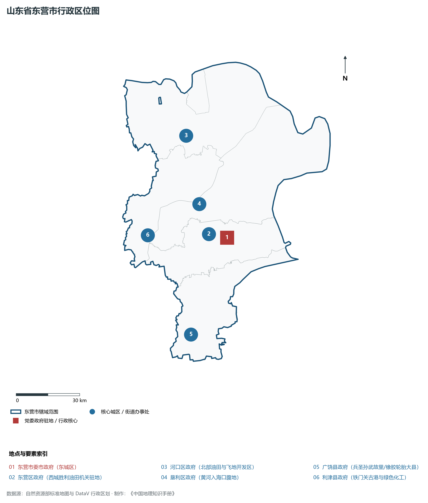
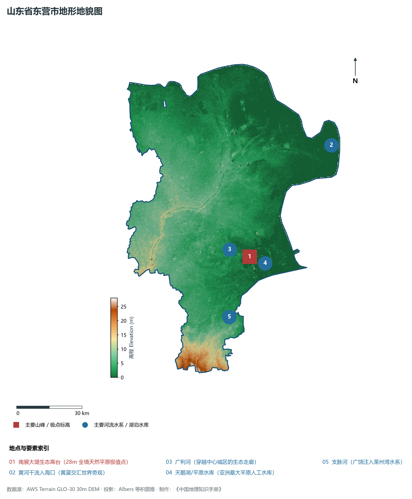
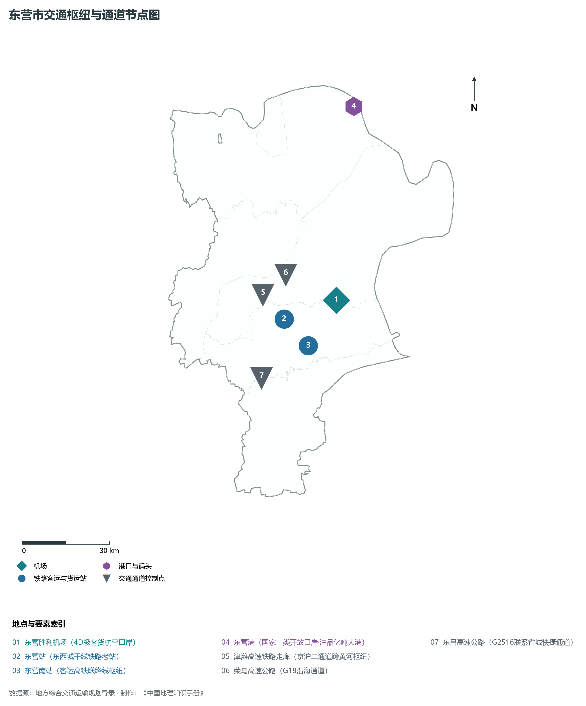
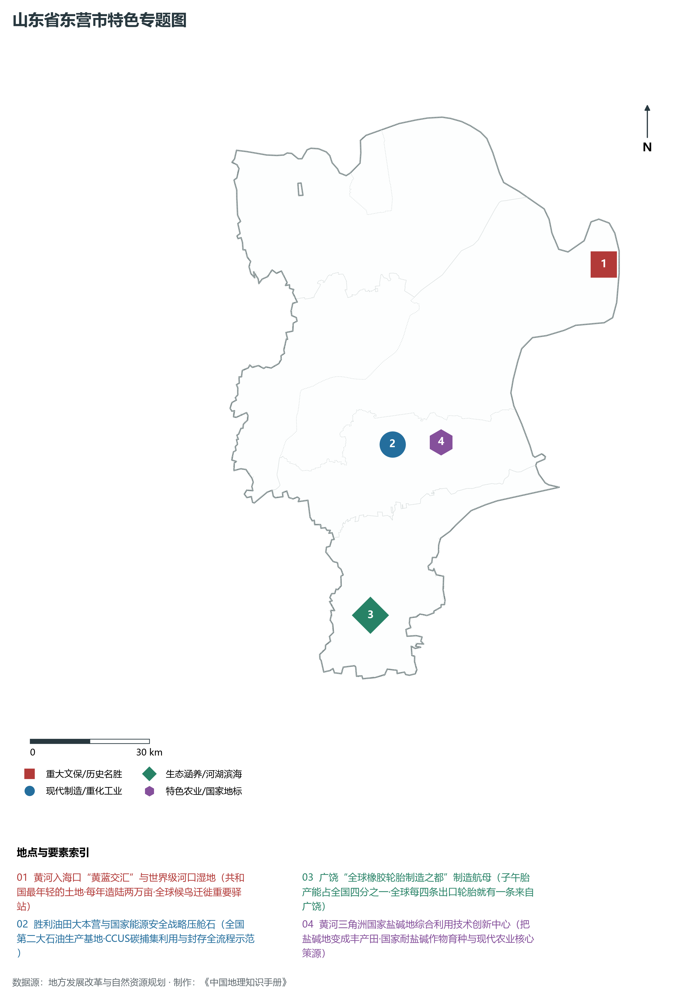
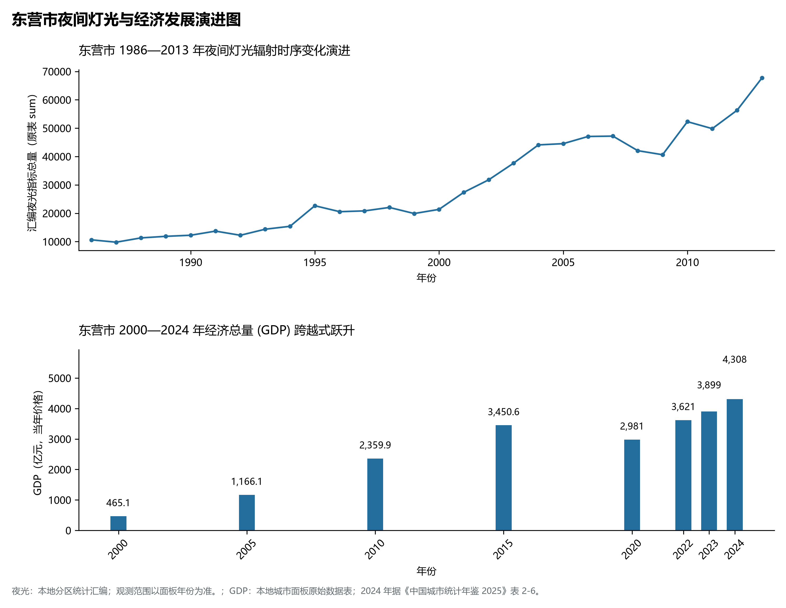

# 8.5 东营市

东营市，位于山东省，其城市功能定位与发展愿景概括为：**黄河入海口门户·胜利油田大本营·生态湿地典范·国家石化能源基地与绿色低碳生态城**。2024 年常住人口 **221 万人**，常住人口城镇化率 **73.46%**，地区生产总值 **4,308 亿元**（当年价格），人均地区生产总值 **195,170 元**，三次产业构成为 **4.57 : 59.45 : 35.98**。

---

## 一、自然地理底盘与地貌水系机理

东营市在大地构造演化史上地处华北克拉通陆块演化关键带，构造活动剧烈，断块升降与岩浆喷发侵入历史源远流长，塑造了丘陵起伏、山水相融或平原开阔的自然地理底盘。全境地表高程最低为 **0.0 m**，最高隆起山峰或高地海拔达 **28.0 m**，地势梯级起伏与垂直微地貌分异构筑了层次鲜明的生态水文环境与战略资源承载力。

区域骨干控制性山脉与地形高程极点包括：

- **南展大堤生态高台 (28m 全境天然平原极值点)**（坐标约东经 118.750°、北纬 37.380°，高程约 28.0 m）：构成区域地形骨架与水系分水岭的关键高程控制点；

水系与水文网络方面，东营市地表水资源丰富，骨干江河湖库穿流浸润：

- **黄河干流入海口 (黄蓝交汇世界奇观)**（流经约东经 119.260°、北纬 37.780° 水域）：对全市工农业供水、生态水系构建及防汛抗旱减灾发挥核心支撑调蓄作用；
- **广利河 (穿越中心城区的生态走廊)**（流经约东经 118.650°、北纬 37.420° 水域）：对全市工农业供水、生态水系构建及防汛抗旱减灾发挥核心支撑调蓄作用；
- **天鹅湖/平原水库 (亚洲最大平原人工水库)**（流经约东经 118.780°、北纬 37.350° 水域）：对全市工农业供水、生态水系构建及防汛抗旱减灾发挥核心支撑调蓄作用；
- **支脉河 (广饶注入莱州湾水系)**（流经约东经 118.600°、北纬 37.150° 水域）：对全市工农业供水、生态水系构建及防汛抗旱减灾发挥核心支撑调蓄作用；

---

## 二、行政区划沿革与城镇空间体系

东营市历史文脉积淀深厚，建置沿革久远。新中国成立以来，伴随国家现代工业化进程推进、沿海开放战略落地与新型城镇化纵深发展，形成了市辖区高效协同、县域特色支撑、产城高度融合的市辖区与县级行政单元空间组织体系：

- **东营市委市政府 (东城区)**（驻地坐标：118.675°E, 37.435°N）；
- **东营区政府 (西城胜利油田机关驻地)**（驻地坐标：118.580°E, 37.460°N）；
- **河口区政府 (北部油田与飞地开发区)**（驻地坐标：118.530°E, 37.880°N）；
- **垦利区政府 (黄河入海口腹地)**（驻地坐标：118.550°E, 37.590°N）；
- **广饶县政府 (兵圣孙武故里/橡胶轮胎大县)**（驻地坐标：118.410°E, 37.055°N）；
- **利津县政府 (铁门关古港与绿色化工)**（驻地坐标：118.250°E, 37.490°N）；

在城镇空间总体布局上，东营市紧扣《国土空间总体规划》，坚持“极核集聚、轴带贯通、组团联动、陆海协同”的战略方针，做优做精中心城区核心能级，提升县域经济特色承载能力，构筑紧凑集约、生态宜居的现代城乡空间组织体系。

---

## 三、综合立体交通网络与交通走廊

东营市地处齐鲁综合立体交通网络重要节点，依托高速铁路、骨干干线铁路、国家高速公路与沿海深水海港/内河大港/航空机场，构筑了四通八达的现代化立体综合交通运输骨架：

**主要综合客运与货运物流交通枢纽节点：**

- **东营胜利机场 (4D级客货航空口岸)**（位置坐标：118.785°E, 37.505°N）；
- **东营站 (东西城干线铁路老站)**（位置坐标：118.570°E, 37.470°N）；
- **东营南站 (客运高铁联络线枢纽)**（位置坐标：118.650°E, 37.380°N）；
- **东营港 (国家一类开放口岸·油品亿吨大港)**（位置坐标：118.960°E, 38.080°N）；

**核心干线铁路与高等级公路交通走廊：**

- **津潍高速铁路走廊 (京沪二通道跨黄河枢纽)**（廊道控制点：118.500°E, 37.550°N）：对外快速互联互通的高速客货运通道；
- **荣乌高速公路 (G18沿海通道)**（廊道控制点：118.600°E, 37.600°N）：对外快速互联互通的高速客货运通道；
- **东吕高速公路 (G2516联系省城快捷通道)**（廊道控制点：118.450°E, 37.300°N）：对外快速互联互通的高速客货运通道；

---

## 四、现代产业体系与新质生产力布局

东营市坚定践行新发展理念，以绿色低碳高质量发展为主线，大力推进传统优势产业数智化改造，培育壮大战略性新兴产业集群，构建具有区域核心竞争力的现代产业新格局：

**核心先进制造业园区与高新技术创新集聚区：**

- **东营经济技术开发区 (国家级高新技术产业基石)**（园区坐标：118.720°E, 37.440°N）：区域重大产业创新与先进制造业集群承载核心平台；
- **中国石化胜利油田勘探开发研究院**（园区坐标：118.580°E, 37.450°N）：区域重大产业创新与先进制造业集群承载核心平台；
- **广饶国际橡胶轮胎产业示范园**（园区坐标：118.450°E, 37.080°N）：区域重大产业创新与先进制造业集群承载核心平台；
- **东营港经济开发区现代石化产业基地**（园区坐标：118.940°E, 38.050°N）：区域重大产业创新与先进制造业集群承载核心平台；

**标志性特色主题要素与领航龙头优势：**

- **黄河入海口“黄蓝交汇”与世界级河口湿地**（空间坐标：119.260°E, 37.780°N）：共和国最年轻的土地·每年造陆两万亩·全球候鸟迁徙重要驿站；
- **胜利油田大本营与国家能源安全战略压舱石**（空间坐标：118.580°E, 37.450°N）：全国第二大石油生产基地·CCUS碳捕集利用与封存全流程示范；
- **广饶“全球橡胶轮胎制造之都”制造航母**（空间坐标：118.450°E, 37.080°N）：子午胎产能占全国四分之一·全球每四条出口轮胎就有一条来自广饶；
- **黄河三角洲国家盐碱地综合利用技术创新中心**（空间坐标：118.720°E, 37.440°N）：把盐碱地变成丰产田·国家耐盐碱作物育种与现代农业核心策源；

---

## 五、历史文化底蕴、名胜古迹与全域文旅地理

东营市人杰地灵、文脉昌盛，自然风光雄奇秀美，人文古迹璀璨夺目。全境汇聚了高等级风景名胜区、全国重点文物保护单位与国家非物质文化遗产代表作：

- **黄河三角洲国家级自然保护区 (5A·候鸟国际机场)**（地标坐标：119.180°E, 37.750°N）：享誉国内外的标志性风景名胜与国家级文旅高地；
- **华八井 (胜利油田发现井·全国文保)**（地标坐标：118.300°E, 37.520°N）：享誉国内外的标志性风景名胜与国家级文旅高地；
- **孙子文化旅游区 (广饶·兵圣故里)**（地标坐标：118.400°E, 37.040°N）：享誉国内外的标志性风景名胜与国家级文旅高地；
- **孤岛槐树林温泉旅游区**（地标坐标：118.850°E, 37.890°N）：享誉国内外的标志性风景名胜与国家级文旅高地；

东营市坚持以文塑旅、以旅彰文，全面推进“文旅+生态+制造+乡村”深度融合，持续优化全域旅游产品体系与消费场景，打造高辨识度文旅品牌。

---

## 六、夜间灯光辐射与经济变化时序演进

本节夜光图的观测年份为 1986—2013 年，指标为行政区汇总值（原表 sum）。

| 年份 | 地区生产总值（亿元，当年价格） |
|:---|---:|
| 2000 年 | 465.1 |
| 2005 年 | 1,166.1 |
| 2010 年 | 2,359.9 |
| 2015 年 | 3,450.6 |
| 2020 年 | 2,981 |
| 2022 年 | 3,621 |
| 2023 年 | 3,899 |
| 2024 年 | 4,308 |

- **1996 年前后**：东营东西城区油田生活区与钻井生产区连片；
- **2005 年前后**：广饶轮胎产业带崛起·东营港临港工业区启航；
- **2013 年前后**：现代石化产业带向沿海高度集聚·河口风电新能源拓宽；

---

2024 年统计来源：《中国城市统计年鉴 2025》表 2-1、2-6、2-7（2024 年，全市）。其他年份 GDP 据本地城市面板“原始数据”表，单位为亿元、当年价格。
