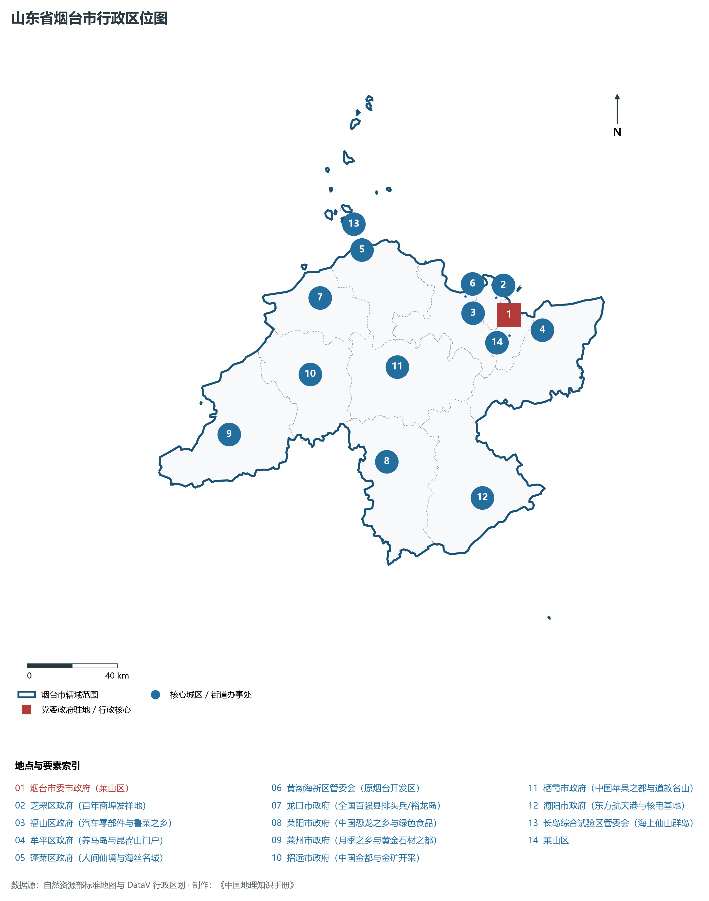
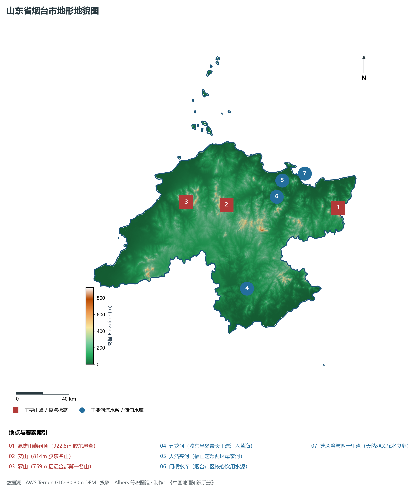
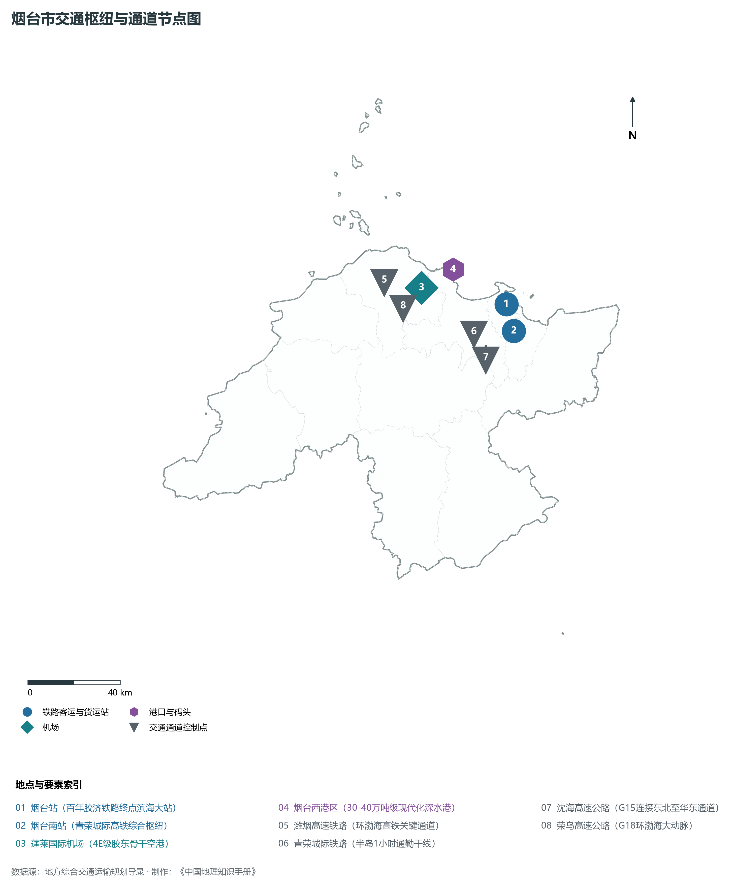
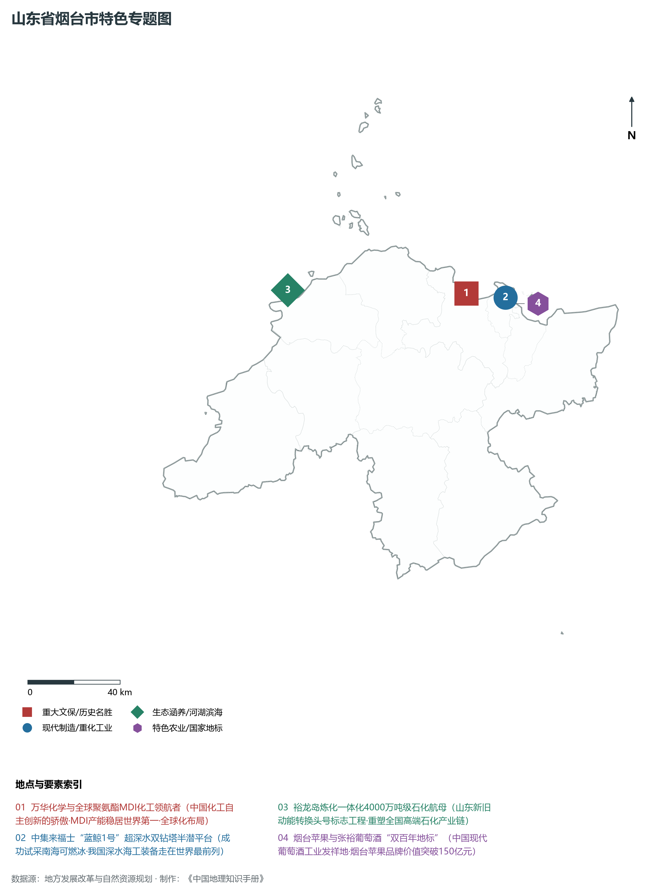
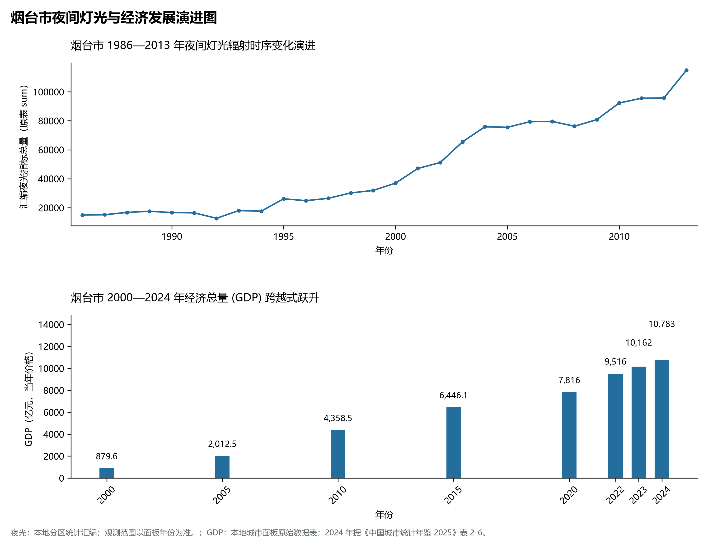

# 8.6 烟台市

烟台市，位于山东省，其城市功能定位与发展愿景概括为：**国家历史文化名城·环渤海重要港口城市·“仙境海岸·品重烟台”·先进制造高地与万亿新城**。2024 年常住人口 **704 万人**，常住人口城镇化率 **70.11%**，地区生产总值 **10,783 亿元**（当年价格），人均地区生产总值 **153,302 元**，三次产业构成为 **6.34 : 42.59 : 51.07**。

---

## 一、自然地理底盘与地貌水系机理

烟台市在大地构造演化史上地处华北克拉通陆块演化关键带，构造活动剧烈，断块升降与岩浆喷发侵入历史源远流长，塑造了丘陵起伏、山水相融或平原开阔的自然地理底盘。全境地表高程最低为 **0.0 m**，最高隆起山峰或高地海拔达 **922.8 m**，地势梯级起伏与垂直微地貌分异构筑了层次鲜明的生态水文环境与战略资源承载力。

区域骨干控制性山脉与地形高程极点包括：

- **昆嵛山泰礴顶 (922.8m 胶东屋脊)**（坐标约东经 121.740°、北纬 37.280°，高程约 922.8 m）：构成区域地形骨架与水系分水岭的关键高程控制点；
- **艾山 (814m 胶东名山)**（坐标约东经 120.790°、北纬 37.420°，高程约 814.0 m）：构成区域地形骨架与水系分水岭的关键高程控制点；
- **罗山 (759m 招远金都第一名山)**（坐标约东经 120.450°、北纬 37.480°，高程约 759.0 m）：构成区域地形骨架与水系分水岭的关键高程控制点；

水系与水文网络方面，烟台市地表水资源丰富，骨干江河湖库穿流浸润：

- **五龙河 (胶东半岛最长干流汇入黄海)**（流经约东经 120.850°、北纬 36.850° 水域）：对全市工农业供水、生态水系构建及防汛抗旱减灾发挥核心支撑调蓄作用；
- **大沽夹河 (福山芝罘两区母亲河)**（流经约东经 121.300°、北纬 37.520° 水域）：对全市工农业供水、生态水系构建及防汛抗旱减灾发挥核心支撑调蓄作用；
- **门楼水库 (烟台市区核心饮用水源)**（流经约东经 121.230°、北纬 37.420° 水域）：对全市工农业供水、生态水系构建及防汛抗旱减灾发挥核心支撑调蓄作用；
- **芝罘湾与四十里湾 (天然避风深水良港)**（流经约东经 121.430°、北纬 37.550° 水域）：对全市工农业供水、生态水系构建及防汛抗旱减灾发挥核心支撑调蓄作用；

---

## 二、行政区划沿革与城镇空间体系

烟台市历史文脉积淀深厚，建置沿革久远。新中国成立以来，伴随国家现代工业化进程推进、沿海开放战略落地与新型城镇化纵深发展，形成了市辖区高效协同、县域特色支撑、产城高度融合的市辖区与县级行政单元空间组织体系：

- **烟台市委市政府 (莱山区)**（驻地坐标：121.445°E, 37.465°N）；
- **芝罘区政府 (百年商埠发祥地)**（驻地坐标：121.395°E, 37.540°N）；
- **福山区政府 (汽车零部件与鲁菜之乡)**（驻地坐标：121.265°E, 37.495°N）；
- **牟平区政府 (养马岛与昆嵛山门户)**（驻地坐标：121.600°E, 37.385°N）；
- **蓬莱区政府 (人间仙境与海丝名城)**（驻地坐标：120.755°E, 37.810°N）；
- **黄渤海新区管委会 (原烟台开发区)**（驻地坐标：121.240°E, 37.565°N）；
- **龙口市政府 (全国百强县排头兵/裕龙岛)**（驻地坐标：120.505°E, 37.650°N）；
- **莱阳市政府 (中国恐龙之乡与绿色食品)**（驻地坐标：120.710°E, 36.975°N）；
- **莱州市政府 (月季之乡与黄金石材之都)**（驻地坐标：119.940°E, 37.175°N）；
- **招远市政府 (中国金都与金矿开采)**（驻地坐标：120.395°E, 37.360°N）；
- **栖霞市政府 (中国苹果之都与道教名山)**（驻地坐标：120.840°E, 37.335°N）；
- **海阳市政府 (东方航天港与核电基地)**（驻地坐标：121.160°E, 36.775°N）；
- **长岛综合试验区管委会 (海上仙山群岛)**（驻地坐标：120.735°E, 37.915°N）；

在城镇空间总体布局上，烟台市紧扣《国土空间总体规划》，坚持“极核集聚、轴带贯通、组团联动、陆海协同”的战略方针，做优做精中心城区核心能级，提升县域经济特色承载能力，构筑紧凑集约、生态宜居的现代城乡空间组织体系。

---

## 三、综合立体交通网络与交通走廊

烟台市地处齐鲁综合立体交通网络重要节点，依托高速铁路、骨干干线铁路、国家高速公路与沿海深水海港/内河大港/航空机场，构筑了四通八达的现代化立体综合交通运输骨架：

**主要综合客运与货运物流交通枢纽节点：**

- **烟台站 (百年胶济铁路终点滨海大站)**（位置坐标：121.385°E, 37.545°N）；
- **烟台南站 (青荣城际高铁综合枢纽)**（位置坐标：121.400°E, 37.440°N）；
- **蓬莱国际机场 (4E级胶东骨干空港)**（位置坐标：120.980°E, 37.660°N）；
- **烟台西港区 (30-40万吨级现代化深水港)**（位置坐标：121.150°E, 37.710°N）；

**核心干线铁路与高等级公路交通走廊：**

- **潍烟高速铁路 (环渤海高铁关键通道)**（廊道控制点：120.800°E, 37.700°N）：对外快速互联互通的高速客货运通道；
- **青荣城际铁路 (半岛1小时通勤干线)**（廊道控制点：121.200°E, 37.450°N）：对外快速互联互通的高速客货运通道；
- **沈海高速公路 (G15连接东北至华东通道)**（廊道控制点：121.250°E, 37.400°N）：对外快速互联互通的高速客货运通道；
- **荣乌高速公路 (G18环渤海大动脉)**（廊道控制点：120.800°E, 37.600°N）：对外快速互联互通的高速客货运通道；

---

## 四、现代产业体系与新质生产力布局

烟台市坚定践行新发展理念，以绿色低碳高质量发展为主线，大力推进传统优势产业数智化改造，培育壮大战略性新兴产业集群，构建具有区域核心竞争力的现代产业新格局：

**核心先进制造业园区与高新技术创新集聚区：**

- **万华化学全球研发中心与先进聚氨酯基地**（园区坐标：121.200°E, 37.610°N）：区域重大产业创新与先进制造业集群承载核心平台；
- **中集来福士海洋工程研发制造基地**（园区坐标：121.390°E, 37.570°N）：区域重大产业创新与先进制造业集群承载核心平台；
- **裕龙岛炼化一体化超大型石化基地 (龙口)**（园区坐标：120.320°E, 37.730°N）：区域重大产业创新与先进制造业集群承载核心平台；
- **东方航天港海上发射母港 (海阳)**（园区坐标：121.230°E, 36.720°N）：区域重大产业创新与先进制造业集群承载核心平台；
- **招远中国金都黄金精深加工产业集群**（园区坐标：120.400°E, 37.370°N）：区域重大产业创新与先进制造业集群承载核心平台；

**标志性特色主题要素与领航龙头优势：**

- **万华化学与全球聚氨酯MDI化工领航者**（空间坐标：121.200°E, 37.610°N）：中国化工自主创新的骄傲·MDI产能稳居世界第一·全球化布局；
- **中集来福士“蓝鲸1号”超深水双钻塔半潜平台**（空间坐标：121.390°E, 37.570°N）：成功试采南海可燃冰·我国深水海工装备走在世界最前列；
- **裕龙岛炼化一体化4000万吨级石化航母**（空间坐标：120.320°E, 37.730°N）：山东新旧动能转换头号标志工程·重塑全国高端石化产业链；
- **烟台苹果与张裕葡萄酒“双百年地标”**（空间坐标：121.400°E, 37.545°N）：中国现代葡萄酒工业发祥地·烟台苹果品牌价值突破150亿元；

---

## 五、历史文化底蕴、名胜古迹与全域文旅地理

烟台市人杰地灵、文脉昌盛，自然风光雄奇秀美，人文古迹璀璨夺目。全境汇聚了高等级风景名胜区、全国重点文物保护单位与国家非物质文化遗产代表作：

- **蓬莱阁国家级名胜区 (5A·八仙过海仙境)**（地标坐标：120.750°E, 37.825°N）：享誉国内外的标志性风景名胜与国家级文旅高地；
- **南山旅游景区 (5A·龙口巨佛)**（地标坐标：120.490°E, 37.560°N）：享誉国内外的标志性风景名胜与国家级文旅高地；
- **张裕酒文化博物馆 (中国第一家工业化葡萄酒庄)**（地标坐标：121.400°E, 37.545°N）：享誉国内外的标志性风景名胜与国家级文旅高地；
- **昆嵛山国家级自然保护区 (森林生态氧吧)**（地标坐标：121.730°E, 37.290°N）：享誉国内外的标志性风景名胜与国家级文旅高地；
- **长岛九丈崖与月牙湾国家地质公园**（地标坐标：120.720°E, 37.950°N）：享誉国内外的标志性风景名胜与国家级文旅高地；

烟台市坚持以文塑旅、以旅彰文，全面推进“文旅+生态+制造+乡村”深度融合，持续优化全域旅游产品体系与消费场景，打造高辨识度文旅品牌。

---

## 六、夜间灯光辐射与经济变化时序演进

本节夜光图的观测年份为 1986—2013 年，指标为行政区汇总值（原表 sum）。

| 年份 | 地区生产总值（亿元，当年价格） |
|:---|---:|
| 2000 年 | 879.6 |
| 2005 年 | 2,012.5 |
| 2010 年 | 4,358.5 |
| 2015 年 | 6,446.1 |
| 2020 年 | 7,816 |
| 2022 年 | 9,516 |
| 2023 年 | 10,162 |
| 2024 年 | 10,783 |

- **1996 年前后**：芝罘湾老港区·老城与福山老城区相向连片；
- **2005 年前后**：开发区万华富士康通用聚集·莱山高新区蓬勃崛起；

---

2024 年统计来源：《中国城市统计年鉴 2025》表 2-1、2-6、2-7（2024 年，全市）。其他年份 GDP 据本地城市面板“原始数据”表，单位为亿元、当年价格。
