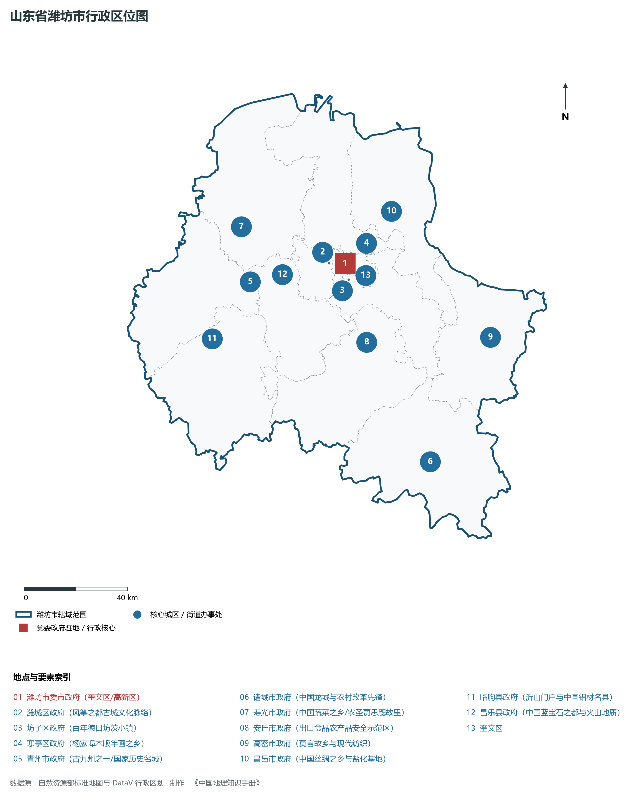
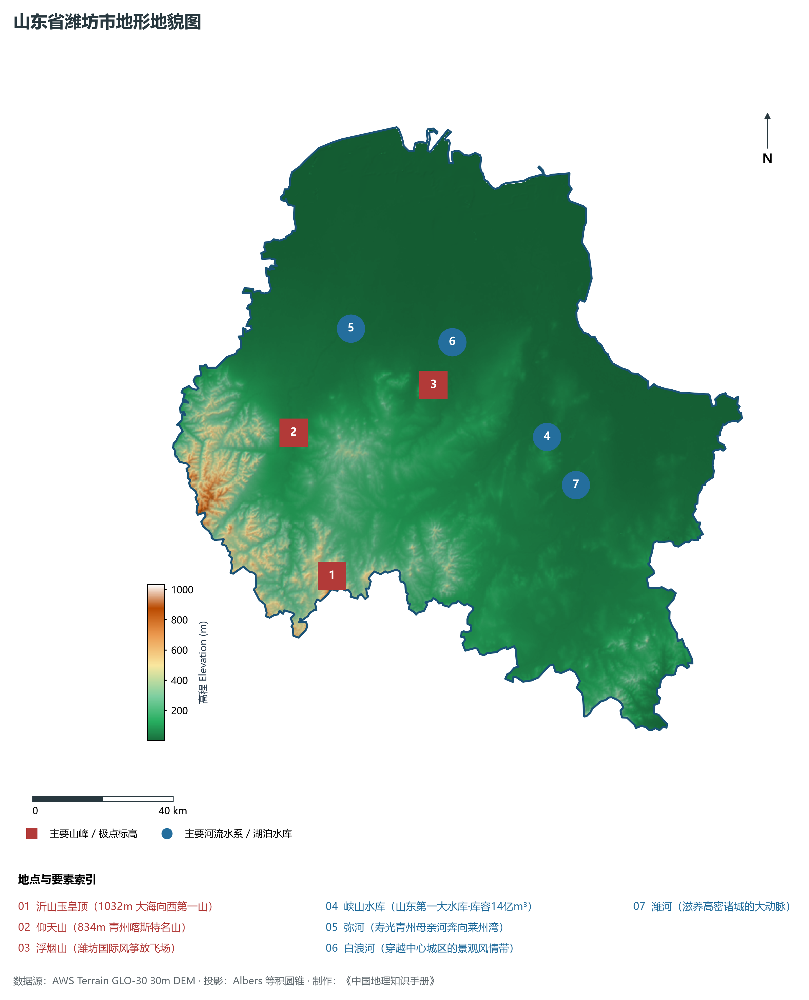
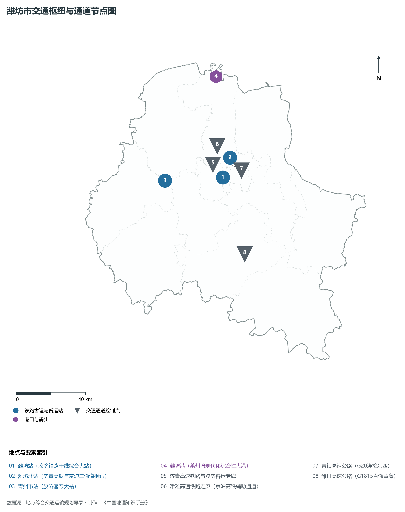
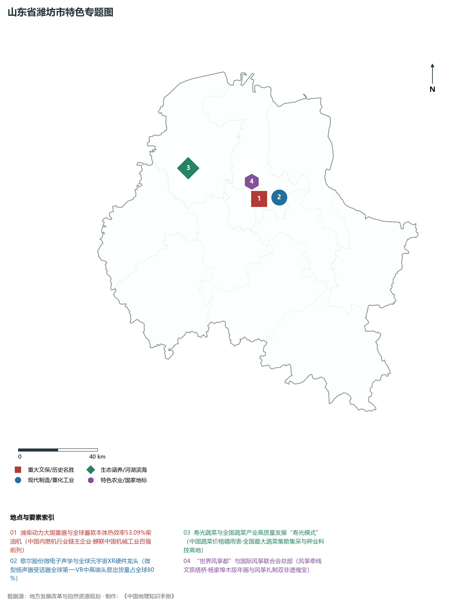
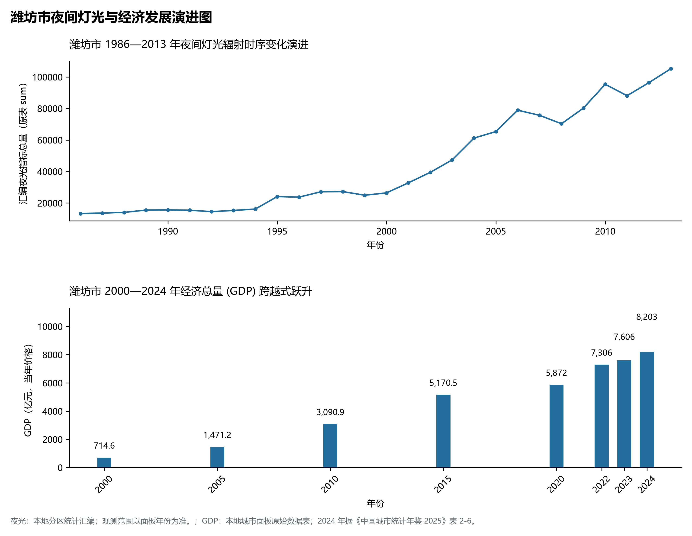

# 8.7 潍坊市

潍坊市，位于山东省，其城市功能定位与发展愿景概括为：**“世界风筝都”·中国农圣故里·先进制造业名城·全国制造业单项冠军之都与现代农业样板**。2024 年常住人口 **932 万人**，常住人口城镇化率 **67.08%**，地区生产总值 **8,203 亿元**（当年价格），人均地区生产总值 **87,784 元**，三次产业构成为 **8.54 : 42.35 : 49.1**。

---

## 一、自然地理底盘与地貌水系机理

潍坊市在大地构造演化史上地处华北克拉通陆块演化关键带，构造活动剧烈，断块升降与岩浆喷发侵入历史源远流长，塑造了丘陵起伏、山水相融或平原开阔的自然地理底盘。全境地表高程最低为 **1.0 m**，最高隆起山峰或高地海拔达 **1032.0 m**，地势梯级起伏与垂直微地貌分异构筑了层次鲜明的生态水文环境与战略资源承载力。

区域骨干控制性山脉与地形高程极点包括：

- **沂山玉皇顶 (1032m 大海向西第一山)**（坐标约东经 118.630°、北纬 36.210°，高程约 1032.0 m）：构成区域地形骨架与水系分水岭的关键高程控制点；
- **仰天山 (834m 青州喀斯特名山)**（坐标约东经 118.570°、北纬 36.580°，高程约 834.0 m）：构成区域地形骨架与水系分水岭的关键高程控制点；
- **浮烟山 (潍坊国际风筝放飞场)**（坐标约东经 119.040°、北纬 36.650°，高程约 160.0 m）：构成区域地形骨架与水系分水岭的关键高程控制点；

水系与水文网络方面，潍坊市地表水资源丰富，骨干江河湖库穿流浸润：

- **峡山水库 (山东第一大水库·库容14亿m³)**（流经约东经 119.380°、北纬 36.480° 水域）：对全市工农业供水、生态水系构建及防汛抗旱减灾发挥核心支撑调蓄作用；
- **弥河 (寿光青州母亲河奔向莱州湾)**（流经约东经 118.800°、北纬 36.820° 水域）：对全市工农业供水、生态水系构建及防汛抗旱减灾发挥核心支撑调蓄作用；
- **白浪河 (穿越中心城区的景观风情带)**（流经约东经 119.120°、北纬 36.750° 水域）：对全市工农业供水、生态水系构建及防汛抗旱减灾发挥核心支撑调蓄作用；
- **潍河 (滋养高密诸城的大动脉)**（流经约东经 119.450°、北纬 36.350° 水域）：对全市工农业供水、生态水系构建及防汛抗旱减灾发挥核心支撑调蓄作用；

---

## 二、行政区划沿革与城镇空间体系

潍坊市历史文脉积淀深厚，建置沿革久远。新中国成立以来，伴随国家现代工业化进程推进、沿海开放战略落地与新型城镇化纵深发展，形成了市辖区高效协同、县域特色支撑、产城高度融合的市辖区与县级行政单元空间组织体系：

- **潍坊市委市政府 (奎文区/高新区)**（驻地坐标：119.165°E, 36.705°N）；
- **潍城区政府 (风筝之都古城文化脉络)**（驻地坐标：119.095°E, 36.715°N）；
- **坊子区政府 (百年德日坊茨小镇)**（驻地坐标：119.170°E, 36.650°N）；
- **寒亭区政府 (杨家埠木版年画之乡)**（驻地坐标：119.215°E, 36.770°N）；
- **青州市政府 (古九州之一/国家历史名城)**（驻地坐标：118.740°E, 36.690°N）；
- **诸城市政府 (中国龙城与农村改革先锋)**（驻地坐标：119.410°E, 35.995°N）；
- **寿光市政府 (中国蔬菜之乡/农圣贾思勰故里)**（驻地坐标：118.735°E, 36.880°N）；
- **安丘市政府 (出口食品农产品安全示范区)**（驻地坐标：119.210°E, 36.430°N）；
- **高密市政府 (莫言故乡与现代纺织)**（驻地坐标：119.750°E, 36.385°N）；
- **昌邑市政府 (中国丝绸之乡与盐化基地)**（驻地坐标：119.400°E, 36.860°N）；
- **临朐县政府 (沂山门户与中国铝材名县)**（驻地坐标：118.540°E, 36.515°N）；
- **昌乐县政府 (中国蓝宝石之都与火山地质)**（驻地坐标：118.830°E, 36.705°N）；

在城镇空间总体布局上，潍坊市紧扣《国土空间总体规划》，坚持“极核集聚、轴带贯通、组团联动、陆海协同”的战略方针，做优做精中心城区核心能级，提升县域经济特色承载能力，构筑紧凑集约、生态宜居的现代城乡空间组织体系。

---

## 三、综合立体交通网络与交通走廊

潍坊市地处齐鲁综合立体交通网络重要节点，依托高速铁路、骨干干线铁路、国家高速公路与沿海深水海港/内河大港/航空机场，构筑了四通八达的现代化立体综合交通运输骨架：

**主要综合客运与货运物流交通枢纽节点：**

- **潍坊站 (胶济铁路干线综合大站)**（位置坐标：119.110°E, 36.705°N）；
- **潍坊北站 (济青高铁与京沪二通道枢纽)**（位置坐标：119.175°E, 36.800°N）；
- **青州市站 (胶济客专大站)**（位置坐标：118.730°E, 36.730°N）；
- **潍坊港 (莱州湾现代化综合性大港)**（位置坐标：119.160°E, 37.220°N）；

**核心干线铁路与高等级公路交通走廊：**

- **济青高速铁路与胶济客运专线**（廊道控制点：119.100°E, 36.750°N）：对外快速互联互通的高速客货运通道；
- **津潍高速铁路走廊 (京沪高铁辅助通道)**（廊道控制点：119.050°E, 36.850°N）：对外快速互联互通的高速客货运通道；
- **青银高速公路 (G20连接东西)**（廊道控制点：119.150°E, 36.780°N）：对外快速互联互通的高速客货运通道；
- **潍日高速公路 (G1815直通黄海)**（廊道控制点：119.180°E, 36.300°N）：对外快速互联互通的高速客货运通道；

---

## 四、现代产业体系与新质生产力布局

潍坊市坚定践行新发展理念，以绿色低碳高质量发展为主线，大力推进传统优势产业数智化改造，培育壮大战略性新兴产业集群，构建具有区域核心竞争力的现代产业新格局：

**核心先进制造业园区与高新技术创新集聚区：**

- **潍柴动力内燃机先进制造与研发总部**（园区坐标：119.140°E, 36.720°N）：区域重大产业创新与先进制造业集群承载核心平台；
- **歌尔股份有限公司全球智能制造中心**（园区坐标：119.200°E, 36.720°N）：区域重大产业创新与先进制造业集群承载核心平台；
- **寿光蔬菜高新技术示范区 (全国种业硅谷)**（园区坐标：118.760°E, 36.900°N）：区域重大产业创新与先进制造业集群承载核心平台；
- **豪迈集团高端精密轮胎模具制造基地**（园区坐标：119.700°E, 36.350°N）：区域重大产业创新与先进制造业集群承载核心平台；
- **诸城福田汽车时代商用车整车基地**（园区坐标：119.400°E, 36.030°N）：区域重大产业创新与先进制造业集群承载核心平台；

**标志性特色主题要素与领航龙头优势：**

- **潍柴动力大国重器与全球首款本体热效率53.09%柴油机**（空间坐标：119.140°E, 36.720°N）：中国内燃机行业链主企业·蝉联中国机械工业百强前列；
- **歌尔股份微电子声学与全球元宇宙XR硬件龙头**（空间坐标：119.200°E, 36.720°N）：微型扬声器受话器全球第一·VR中高端头显出货量占全球80%；
- **寿光蔬菜与全国蔬菜产业高质量发展“寿光模式”**（空间坐标：118.760°E, 36.900°N）：中国蔬菜价格晴雨表·全国最大蔬菜集散集采与种业科技高地；
- **“世界风筝都”与国际风筝联合会总部**（空间坐标：119.095°E, 36.715°N）：风筝牵线文旅搭桥·杨家埠木版年画与风筝扎制双非遗瑰宝；

---

## 五、历史文化底蕴、名胜古迹与全域文旅地理

潍坊市人杰地灵、文脉昌盛，自然风光雄奇秀美，人文古迹璀璨夺目。全境汇聚了高等级风景名胜区、全国重点文物保护单位与国家非物质文化遗产代表作：

- **青州古城风景区 (5A·十里古街·东方古秀)**（地标坐标：118.745°E, 36.685°N）：享誉国内外的标志性风景名胜与国家级文旅高地；
- **沂山国家级风景名胜区 (5A·东镇沂山)**（地标坐标：118.630°E, 36.210°N）：享誉国内外的标志性风景名胜与国家级文旅高地；
- **杨家埠民间艺术大观园 (年画与风筝)**（地标坐标：119.220°E, 36.775°N）：享誉国内外的标志性风景名胜与国家级文旅高地；
- **诸城恐龙国家地质公园 (世界暴龙之馆)**（地标坐标：119.420°E, 35.980°N）：享誉国内外的标志性风景名胜与国家级文旅高地；

潍坊市坚持以文塑旅、以旅彰文，全面推进“文旅+生态+制造+乡村”深度融合，持续优化全域旅游产品体系与消费场景，打造高辨识度文旅品牌。

---

## 六、夜间灯光辐射与经济变化时序演进

本节夜光图的观测年份为 1986—2013 年，指标为行政区汇总值（原表 sum）。

| 年份 | 地区生产总值（亿元，当年价格） |
|:---|---:|
| 2000 年 | 714.6 |
| 2005 年 | 1,471.2 |
| 2010 年 | 3,090.9 |
| 2015 年 | 5,170.5 |
| 2020 年 | 5,872 |
| 2022 年 | 7,306 |
| 2023 年 | 7,606 |
| 2024 年 | 8,203 |

- **1996 年前后**：潍城坊子老城中心与青州益都工业板块双峰；
- **2005 年前后**：潍柴动力与寿光蔬菜冷链物流带大幅拓展；
- **2013 年前后**：高新区歌尔产业园与诸城汽车制造全面高亮；

---

2024 年统计来源：《中国城市统计年鉴 2025》表 2-1、2-6、2-7（2024 年，全市）。其他年份 GDP 据本地城市面板“原始数据”表，单位为亿元、当年价格。
