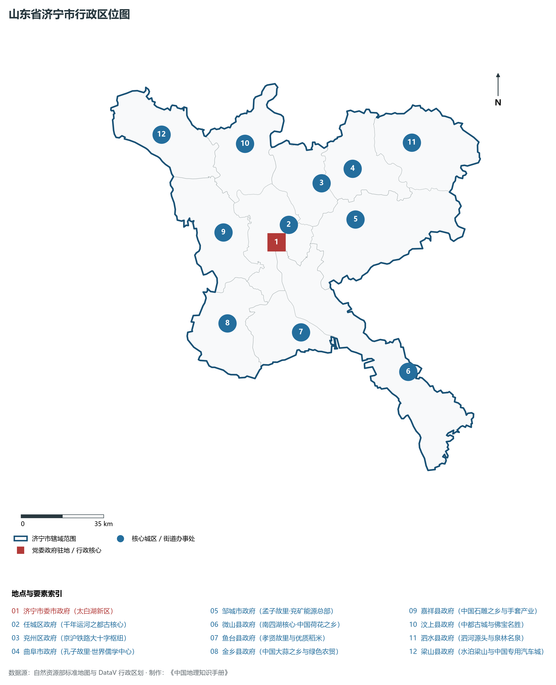
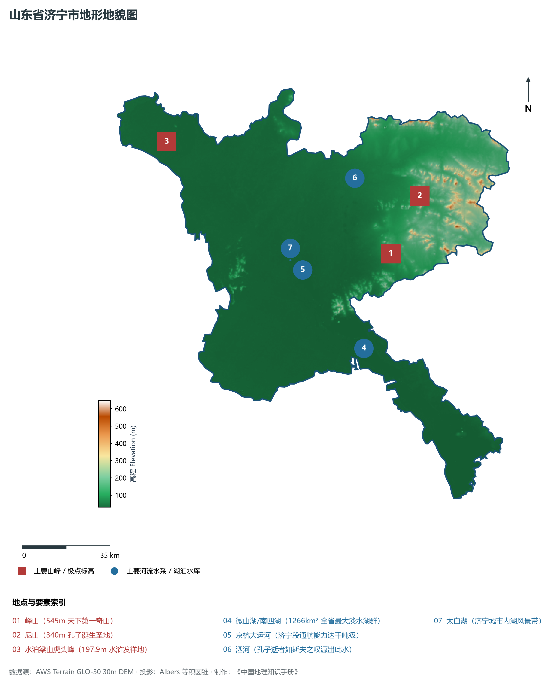
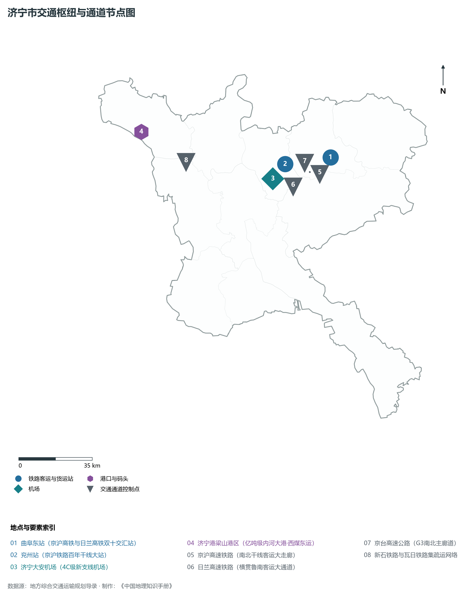
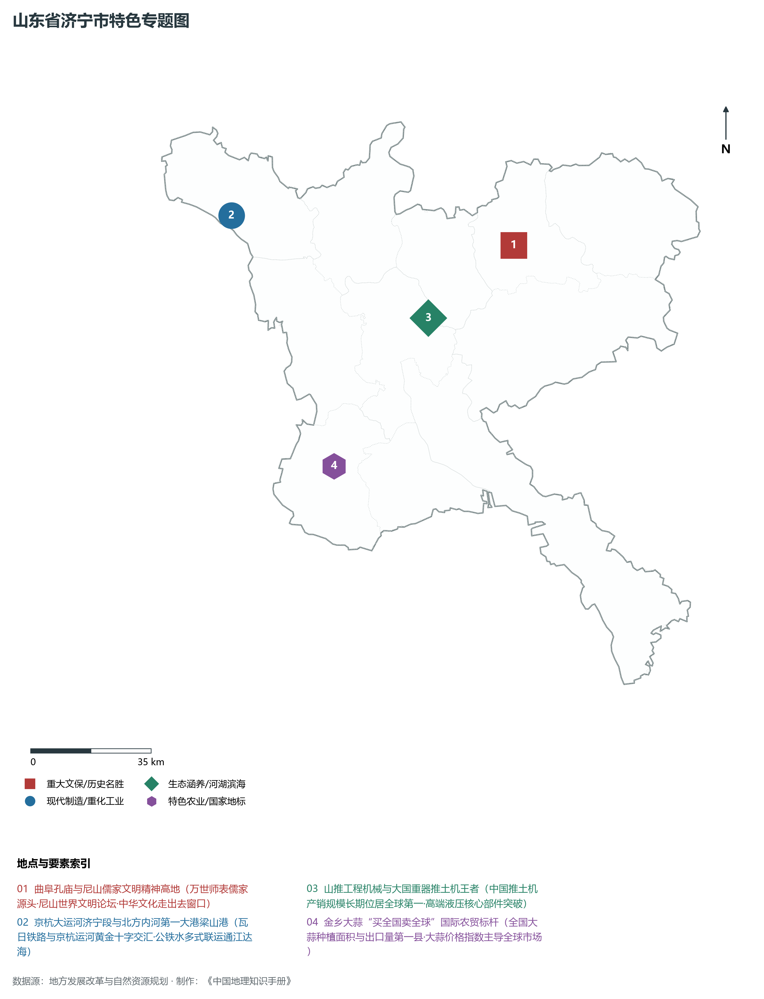
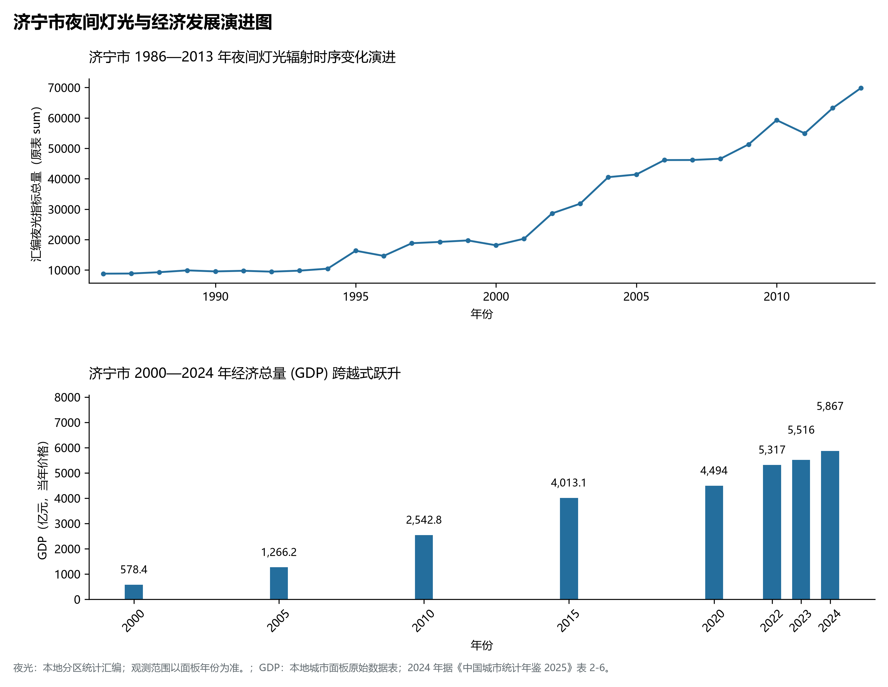

# 8.8 济宁市

济宁市，位于山东省，其城市功能定位与发展愿景概括为：**东方圣城·孔孟儒家发源地·“运河之都”·北方内河航运中心与高端装备制造基地**。2024 年常住人口 **819 万人**，常住人口城镇化率 **64.13%**，地区生产总值 **5,867 亿元**（当年价格），人均地区生产总值 **71,434 元**，三次产业构成为 **10.84 : 37.09 : 52.07**。

---

## 一、自然地理底盘与地貌水系机理

济宁市在大地构造演化史上地处华北克拉通陆块演化关键带，构造活动剧烈，断块升降与岩浆喷发侵入历史源远流长，塑造了丘陵起伏、山水相融或平原开阔的自然地理底盘。全境地表高程最低为 **30.0 m**，最高隆起山峰或高地海拔达 **648.0 m**，地势梯级起伏与垂直微地貌分异构筑了层次鲜明的生态水文环境与战略资源承载力。

区域骨干控制性山脉与地形高程极点包括：

- **峄山 (545m 天下第一奇山)**（坐标约东经 117.020°、北纬 35.320°，高程约 545.0 m）：构成区域地形骨架与水系分水岭的关键高程控制点；
- **尼山 (340m 孔子诞生圣地)**（坐标约东经 117.180°、北纬 35.510°，高程约 340.0 m）：构成区域地形骨架与水系分水岭的关键高程控制点；
- **水泊梁山虎头峰 (197.9m 水浒发祥地)**（坐标约东经 116.080°、北纬 35.805°，高程约 197.9 m）：构成区域地形骨架与水系分水岭的关键高程控制点；

水系与水文网络方面，济宁市地表水资源丰富，骨干江河湖库穿流浸润：

- **微山湖/南四湖 (1266km² 全省最大淡水湖群)**（流经约东经 116.850°、北纬 35.000° 水域）：对全市工农业供水、生态水系构建及防汛抗旱减灾发挥核心支撑调蓄作用；
- **京杭大运河 (济宁段通航能力达千吨级)**（流经约东经 116.620°、北纬 35.300° 水域）：对全市工农业供水、生态水系构建及防汛抗旱减灾发挥核心支撑调蓄作用；
- **泗河 (孔子逝者如斯夫之叹源出此水)**（流经约东经 116.900°、北纬 35.600° 水域）：对全市工农业供水、生态水系构建及防汛抗旱减灾发挥核心支撑调蓄作用；
- **太白湖 (济宁城市内湖风景带)**（流经约东经 116.570°、北纬 35.340° 水域）：对全市工农业供水、生态水系构建及防汛抗旱减灾发挥核心支撑调蓄作用；

---

## 二、行政区划沿革与城镇空间体系

济宁市历史文脉积淀深厚，建置沿革久远。新中国成立以来，伴随国家现代工业化进程推进、沿海开放战略落地与新型城镇化纵深发展，形成了市辖区高效协同、县域特色支撑、产城高度融合的市辖区与县级行政单元空间组织体系：

- **济宁市委市政府 (太白湖新区)**（驻地坐标：116.585°E, 35.350°N）；
- **任城区政府 (千年运河之都古核心)**（驻地坐标：116.600°E, 35.415°N）；
- **兖州区政府 (京沪铁路大十字枢纽)**（驻地坐标：116.830°E, 35.550°N）；
- **曲阜市政府 (孔子故里·世界儒学中心)**（驻地坐标：116.985°E, 35.590°N）；
- **邹城市政府 (孟子故里·兖矿能源总部)**（驻地坐标：116.970°E, 35.400°N）；
- **微山县政府 (南四湖核心·中国荷花之乡)**（驻地坐标：117.130°E, 34.810°N）；
- **鱼台县政府 (孝贤故里与优质稻米)**（驻地坐标：116.650°E, 35.005°N）；
- **金乡县政府 (中国大蒜之乡与绿色农贸)**（驻地坐标：116.310°E, 35.070°N）；
- **嘉祥县政府 (中国石雕之乡与手套产业)**（驻地坐标：116.340°E, 35.410°N）；
- **汶上县政府 (中都古城与佛宝名胜)**（驻地坐标：116.490°E, 35.730°N）；
- **泗水县政府 (泗河源头与泉林名泉)**（驻地坐标：117.280°E, 35.660°N）；
- **梁山县政府 (水泊梁山与中国专用汽车城)**（驻地坐标：116.100°E, 35.800°N）；

在城镇空间总体布局上，济宁市紧扣《国土空间总体规划》，坚持“极核集聚、轴带贯通、组团联动、陆海协同”的战略方针，做优做精中心城区核心能级，提升县域经济特色承载能力，构筑紧凑集约、生态宜居的现代城乡空间组织体系。

---

## 三、综合立体交通网络与交通走廊

济宁市地处齐鲁综合立体交通网络重要节点，依托高速铁路、骨干干线铁路、国家高速公路与沿海深水海港/内河大港/航空机场，构筑了四通八达的现代化立体综合交通运输骨架：

**主要综合客运与货运物流交通枢纽节点：**

- **曲阜东站 (京沪高铁与日兰高铁双十交汇站)**（位置坐标：117.070°E, 35.550°N）；
- **兖州站 (京沪铁路百年干线大站)**（位置坐标：116.825°E, 35.545°N）；
- **济宁大安机场 (4C级新支线机场)**（位置坐标：116.750°E, 35.490°N）；
- **济宁港梁山港区 (亿吨级内河大港·西煤东运)**（位置坐标：116.080°E, 35.750°N）；

**核心干线铁路与高等级公路交通走廊：**

- **京沪高速铁路 (南北干线客运大走廊)**（廊道控制点：117.050°E, 35.500°N）：对外快速互联互通的高速客货运通道；
- **日兰高速铁路 (横贯鲁南客运大通道)**（廊道控制点：116.800°E, 35.450°N）：对外快速互联互通的高速客货运通道；
- **京台高速公路 (G3南北主廊道)**（廊道控制点：116.950°E, 35.500°N）：对外快速互联互通的高速客货运通道；
- **新石铁路与瓦日铁路集疏运网络**（廊道控制点：116.300°E, 35.600°N）：对外快速互联互通的高速客货运通道；

---

## 四、现代产业体系与新质生产力布局

济宁市坚定践行新发展理念，以绿色低碳高质量发展为主线，大力推进传统优势产业数智化改造，培育壮大战略性新兴产业集群，构建具有区域核心竞争力的现代产业新格局：

**核心先进制造业园区与高新技术创新集聚区：**

- **山推工程机械总部及智能制造产业园**（园区坐标：116.680°E, 35.430°N）：区域重大产业创新与先进制造业集群承载核心平台；
- **兖矿能源集团总部及高端煤化工基地**（园区坐标：116.960°E, 35.410°N）：区域重大产业创新与先进制造业集群承载核心平台；
- **金乡大蒜国际物流中心与现代化深加工区**（园区坐标：116.320°E, 35.080°N）：区域重大产业创新与先进制造业集群承载核心平台；
- **梁山中国专用汽车产业集聚基地**（园区坐标：116.120°E, 35.780°N）：区域重大产业创新与先进制造业集群承载核心平台；

**标志性特色主题要素与领航龙头优势：**

- **曲阜孔庙与尼山儒家文明精神高地**（空间坐标：116.985°E, 35.590°N）：万世师表儒家源头·尼山世界文明论坛·中华文化走出去窗口；
- **京杭大运河济宁段与北方内河第一大港梁山港**（空间坐标：116.080°E, 35.750°N）：瓦日铁路与京杭运河黄金十字交汇·公铁水多式联运通江达海；
- **山推工程机械与大国重器推土机王者**（空间坐标：116.680°E, 35.430°N）：中国推土机产销规模长期位居全球第一·高端液压核心部件突破；
- **金乡大蒜“买全国卖全球”国际农贸标杆**（空间坐标：116.320°E, 35.080°N）：全国大蒜种植面积与出口量第一县·大蒜价格指数主导全球市场；

---

## 五、历史文化底蕴、名胜古迹与全域文旅地理

济宁市人杰地灵、文脉昌盛，自然风光雄奇秀美，人文古迹璀璨夺目。全境汇聚了高等级风景名胜区、全国重点文物保护单位与国家非物质文化遗产代表作：

- **曲阜三孔 (孔庙孔府孔林·5A·世界文化遗产)**（地标坐标：116.985°E, 35.590°N）：享誉国内外的标志性风景名胜与国家级文旅高地；
- **尼山圣境 (国家级文化产业示范园区)**（地标坐标：117.180°E, 35.510°N）：享誉国内外的标志性风景名胜与国家级文旅高地；
- **微山湖国家级旅游景区 (5A·红色渔乡)**（地标坐标：117.140°E, 34.800°N）：享誉国内外的标志性风景名胜与国家级文旅高地；
- **水泊梁山国家级风景名胜区 (4A)**（地标坐标：116.080°E, 35.805°N）：享誉国内外的标志性风景名胜与国家级文旅高地；
- **邹城三孟 (孟庙孟府孟林·全国重点文保)**（地标坐标：116.965°E, 35.395°N）：享誉国内外的标志性风景名胜与国家级文旅高地；

济宁市坚持以文塑旅、以旅彰文，全面推进“文旅+生态+制造+乡村”深度融合，持续优化全域旅游产品体系与消费场景，打造高辨识度文旅品牌。

---

## 六、夜间灯光辐射与经济变化时序演进

本节夜光图的观测年份为 1986—2013 年，指标为行政区汇总值（原表 sum）。

| 年份 | 地区生产总值（亿元，当年价格） |
|:---|---:|
| 2000 年 | 578.4 |
| 2005 年 | 1,266.2 |
| 2010 年 | 2,542.8 |
| 2015 年 | 4,013.1 |
| 2020 年 | 4,494 |
| 2022 年 | 5,317 |
| 2023 年 | 5,516 |
| 2024 年 | 5,867 |

- **1996 年前后**：任城老运河商贸区与曲阜邹城工矿带并立；
- **2005 年前后**：高新区山推与微山湖东岸煤炭基地高速放光；
- **2013 年前后**：曲阜高铁东站新城崛起·梁山沿湖港航产业延伸；

---

2024 年统计来源：《中国城市统计年鉴 2025》表 2-1、2-6、2-7（2024 年，全市）。其他年份 GDP 据本地城市面板“原始数据”表，单位为亿元、当年价格。
