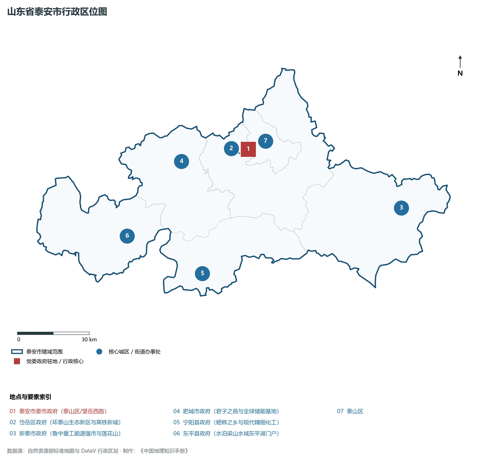
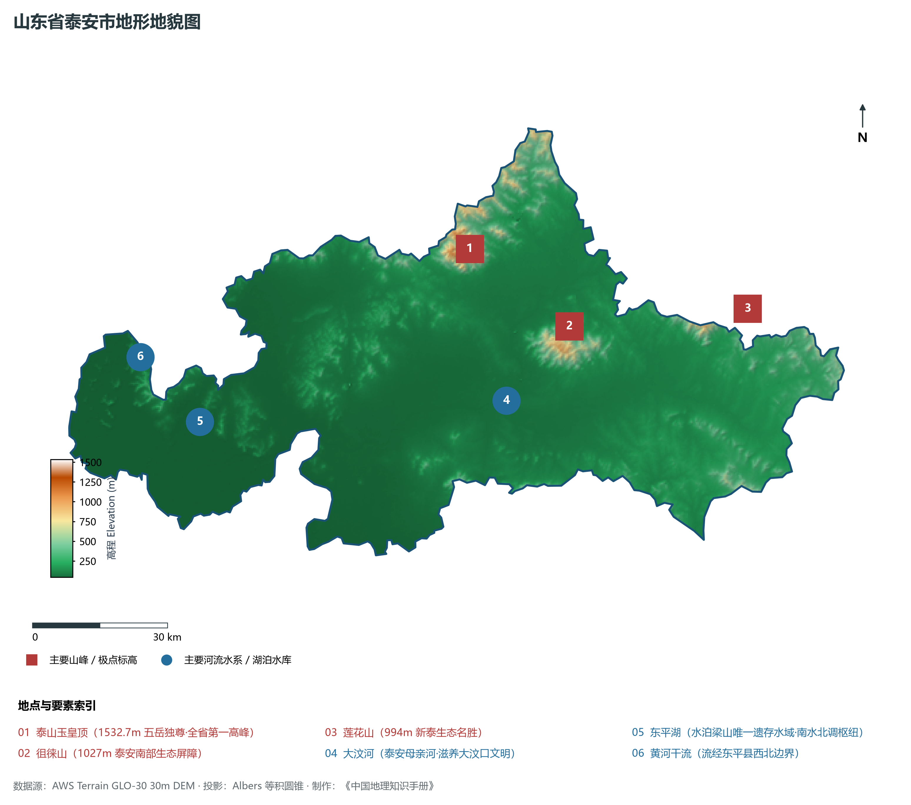
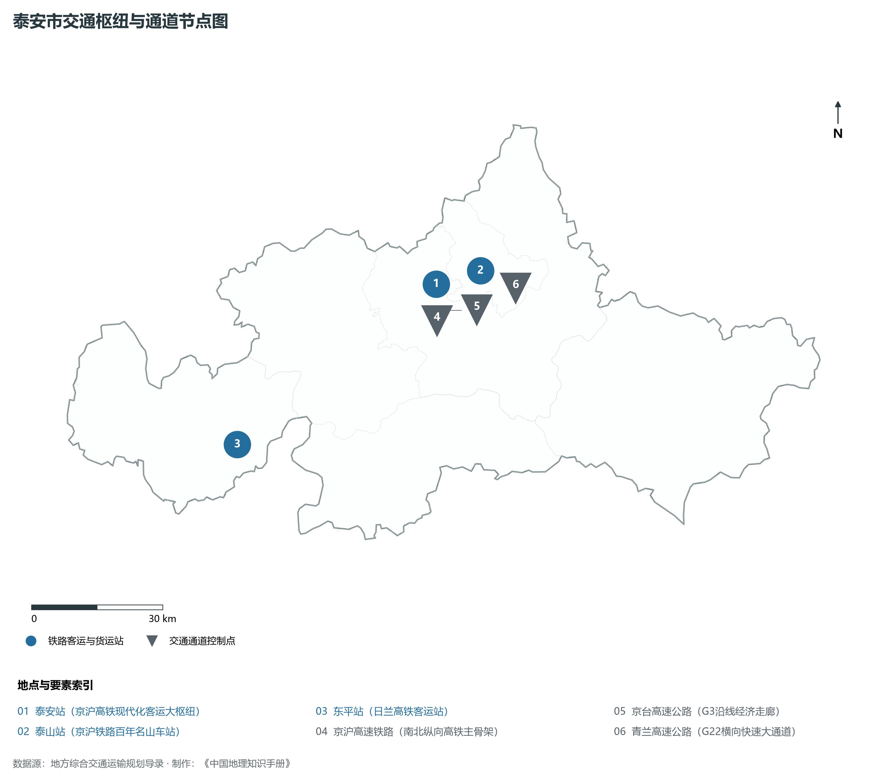
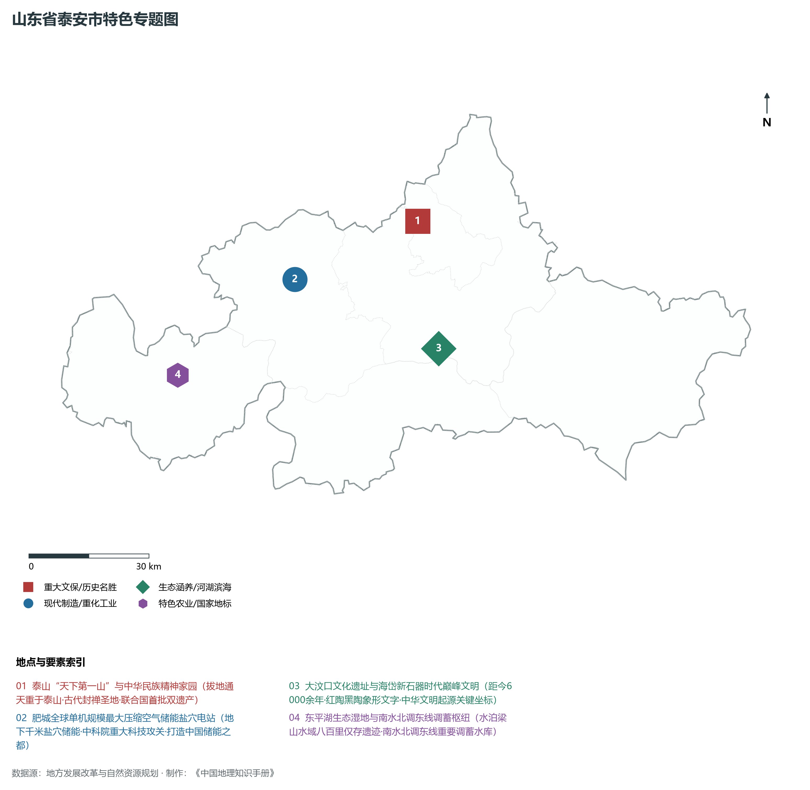
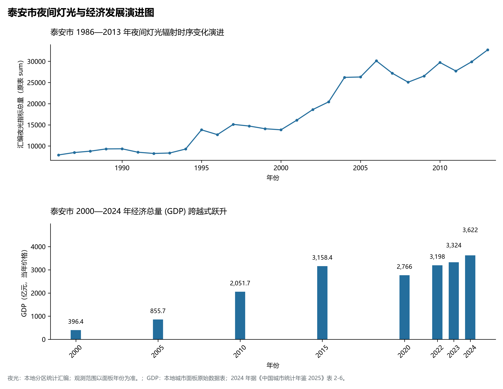

# 8.9 泰安市

泰安市，位于山东省，其城市功能定位与发展愿景概括为：**“五岳之首”泰山所在地·中华民族精神地标·国家历史文化名城·文旅康养与新型工业化强市**。2024 年常住人口 **529 万人**，常住人口城镇化率 **66.7%**，地区生产总值 **3,622 亿元**（当年价格），人均地区生产总值 **68,083 元**，三次产业构成为 **10.3 : 41.87 : 47.82**。

---

## 一、自然地理底盘与地貌水系机理

泰安市在大地构造演化史上地处华北克拉通陆块演化关键带，构造活动剧烈，断块升降与岩浆喷发侵入历史源远流长，塑造了丘陵起伏、山水相融或平原开阔的自然地理底盘。全境地表高程最低为 **45.0 m**，最高隆起山峰或高地海拔达 **1532.7 m**，地势梯级起伏与垂直微地貌分异构筑了层次鲜明的生态水文环境与战略资源承载力。

区域骨干控制性山脉与地形高程极点包括：

- **泰山玉皇顶 (1532.7m 五岳独尊·全省第一高峰)**（坐标约东经 117.105°、北纬 36.255°，高程约 1532.7 m）：构成区域地形骨架与水系分水岭的关键高程控制点；
- **徂徕山 (1027m 泰安南部生态屏障)**（坐标约东经 117.330°、北纬 36.080°，高程约 1027.0 m）：构成区域地形骨架与水系分水岭的关键高程控制点；
- **莲花山 (994m 新泰生态名胜)**（坐标约东经 117.780°、北纬 36.070°，高程约 994.0 m）：构成区域地形骨架与水系分水岭的关键高程控制点；

水系与水文网络方面，泰安市地表水资源丰富，骨干江河湖库穿流浸润：

- **大汶河 (泰安母亲河·滋养大汶口文明)**（流经约东经 117.150°、北纬 35.950° 水域）：对全市工农业供水、生态水系构建及防汛抗旱减灾发挥核心支撑调蓄作用；
- **东平湖 (水泊梁山唯一遗存水域·南水北调枢纽)**（流经约东经 116.380°、北纬 35.980° 水域）：对全市工农业供水、生态水系构建及防汛抗旱减灾发挥核心支撑调蓄作用；
- **黄河干流 (流经东平县西北边界)**（流经约东经 116.250°、北纬 36.120° 水域）：对全市工农业供水、生态水系构建及防汛抗旱减灾发挥核心支撑调蓄作用；

---

## 二、行政区划沿革与城镇空间体系

泰安市历史文脉积淀深厚，建置沿革久远。新中国成立以来，伴随国家现代工业化进程推进、沿海开放战略落地与新型城镇化纵深发展，形成了市辖区高效协同、县域特色支撑、产城高度融合的市辖区与县级行政单元空间组织体系：

- **泰安市委市政府 (泰山区/望岳西路)**（驻地坐标：117.085°E, 36.195°N）；
- **岱岳区政府 (环泰山生态新区与高铁新城)**（驻地坐标：117.040°E, 36.185°N）；
- **新泰市政府 (鲁中重工能源强市与莲花山)**（驻地坐标：117.765°E, 35.910°N）；
- **肥城市政府 (君子之邑与全球储能基地)**（驻地坐标：116.765°E, 36.180°N）；
- **宁阳县政府 (蟋蟀之乡与现代精细化工)**（驻地坐标：116.800°E, 35.760°N）；
- **东平县政府 (水泊梁山水域东平湖门户)**（驻地坐标：116.470°E, 35.930°N）；

在城镇空间总体布局上，泰安市紧扣《国土空间总体规划》，坚持“极核集聚、轴带贯通、组团联动、陆海协同”的战略方针，做优做精中心城区核心能级，提升县域经济特色承载能力，构筑紧凑集约、生态宜居的现代城乡空间组织体系。

---

## 三、综合立体交通网络与交通走廊

泰安市地处齐鲁综合立体交通网络重要节点，依托高速铁路、骨干干线铁路、国家高速公路与沿海深水海港/内河大港/航空机场，构筑了四通八达的现代化立体综合交通运输骨架：

**主要综合客运与货运物流交通枢纽节点：**

- **泰安站 (京沪高铁现代化客运大枢纽)**（位置坐标：117.040°E, 36.175°N）；
- **泰山站 (京沪铁路百年名山车站)**（位置坐标：117.115°E, 36.195°N）；
- **东平站 (日兰高铁客运站)**（位置坐标：116.480°E, 35.900°N）；

**核心干线铁路与高等级公路交通走廊：**

- **京沪高速铁路 (南北纵向高铁主骨架)**（廊道控制点：117.030°E, 36.100°N）：对外快速互联互通的高速客货运通道；
- **京台高速公路 (G3沿线经济走廊)**（廊道控制点：117.050°E, 36.120°N）：对外快速互联互通的高速客货运通道；
- **青兰高速公路 (G22横向快速大通道)**（廊道控制点：117.200°E, 36.150°N）：对外快速互联互通的高速客货运通道；

---

## 四、现代产业体系与新质生产力布局

泰安市坚定践行新发展理念，以绿色低碳高质量发展为主线，大力推进传统优势产业数智化改造，培育壮大战略性新兴产业集群，构建具有区域核心竞争力的现代产业新格局：

**核心先进制造业园区与高新技术创新集聚区：**

- **泰安国家高新技术产业开发区**（园区坐标：117.110°E, 36.130°N）：区域重大产业创新与先进制造业集群承载核心平台；
- **肥城先进压缩空气储能示范基地 (中科院示范)**（园区坐标：116.740°E, 36.160°N）：区域重大产业创新与先进制造业集群承载核心平台；
- **泰开集团特高压开关输变电产业园**（园区坐标：117.090°E, 36.150°N）：区域重大产业创新与先进制造业集群承载核心平台；
- **新泰循环经济产业示范区**（园区坐标：117.730°E, 35.880°N）：区域重大产业创新与先进制造业集群承载核心平台；

**标志性特色主题要素与领航龙头优势：**

- **泰山“天下第一山”与中华民族精神家园**（空间坐标：117.105°E, 36.255°N）：拔地通天重于泰山·古代封禅圣地·联合国首批双遗产；
- **肥城全球单机规模最大压缩空气储能盐穴电站**（空间坐标：116.740°E, 36.160°N）：地下千米盐穴储能·中科院重大科技攻关·打造中国储能之都；
- **大汶口文化遗址与海岱新石器时代巅峰文明**（空间坐标：117.120°E, 35.970°N）：距今6000余年·红陶黑陶象形文字·中华文明起源关键坐标；
- **东平湖生态湿地与南水北调东线调蓄枢纽**（空间坐标：116.380°E, 35.980°N）：水泊梁山水域八百里仅存遗迹·南水北调东线重要调蓄水库；

---

## 五、历史文化底蕴、名胜古迹与全域文旅地理

泰安市人杰地灵、文脉昌盛，自然风光雄奇秀美，人文古迹璀璨夺目。全境汇聚了高等级风景名胜区、全国重点文物保护单位与国家非物质文化遗产代表作：

- **泰山风景名胜区 (5A·首个世界自然与文化双遗产)**（地标坐标：117.105°E, 36.255°N）：享誉国内外的标志性风景名胜与国家级文旅高地；
- **岱庙 (全国重点文保·泰山第一大古建筑群)**（地标坐标：117.125°E, 36.195°N）：享誉国内外的标志性风景名胜与国家级文旅高地；
- **大汶口国家考古遗址公园**（地标坐标：117.120°E, 35.970°N）：享誉国内外的标志性风景名胜与国家级文旅高地；
- **东平湖风景名胜区与水浒影视城 (4A)**（地标坐标：116.360°E, 35.990°N）：享誉国内外的标志性风景名胜与国家级文旅高地；

泰安市坚持以文塑旅、以旅彰文，全面推进“文旅+生态+制造+乡村”深度融合，持续优化全域旅游产品体系与消费场景，打造高辨识度文旅品牌。

---

## 六、夜间灯光辐射与经济变化时序演进

本节夜光图的观测年份为 1986—2013 年，指标为行政区汇总值（原表 sum）。

| 年份 | 地区生产总值（亿元，当年价格） |
|:---|---:|
| 2000 年 | 396.4 |
| 2005 年 | 855.7 |
| 2010 年 | 2,051.7 |
| 2015 年 | 3,158.4 |
| 2020 年 | 2,766 |
| 2022 年 | 3,198 |
| 2023 年 | 3,324 |
| 2024 年 | 3,622 |

- **1996 年前后**：泰山南麓主城岱宗坊老街与新泰煤矿区集聚；
- **2005 年前后**：高新区南拓·肥城矿区转型与盐化工带延伸；
- **2013 年前后**：京沪高铁泰安站新城成网·东平湖生态示范带亮化；

---

2024 年统计来源：《中国城市统计年鉴 2025》表 2-1、2-6、2-7（2024 年，全市）。其他年份 GDP 据本地城市面板“原始数据”表，单位为亿元、当年价格。
