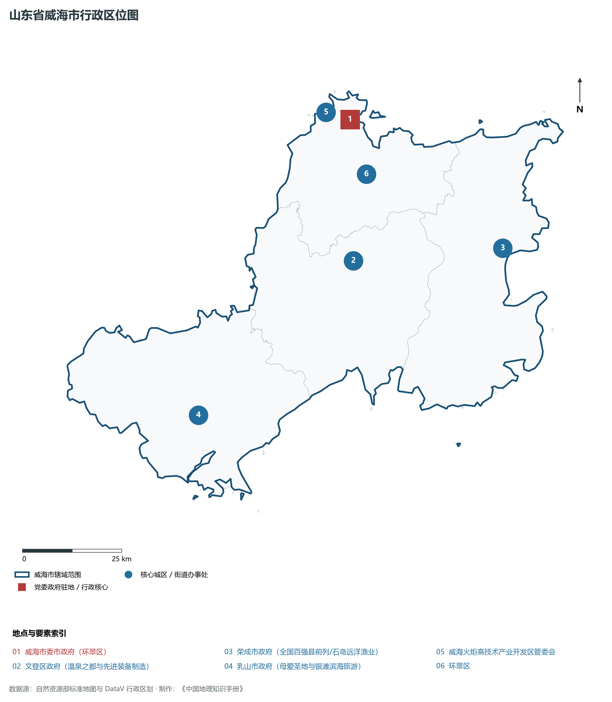
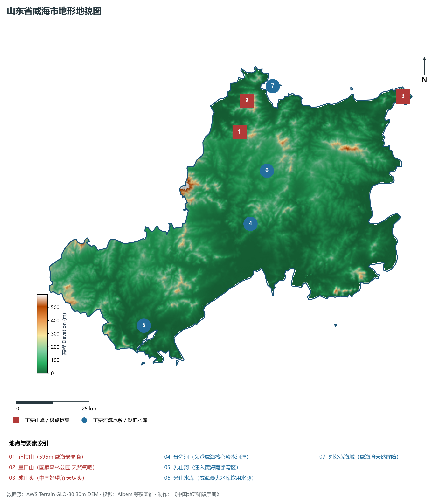
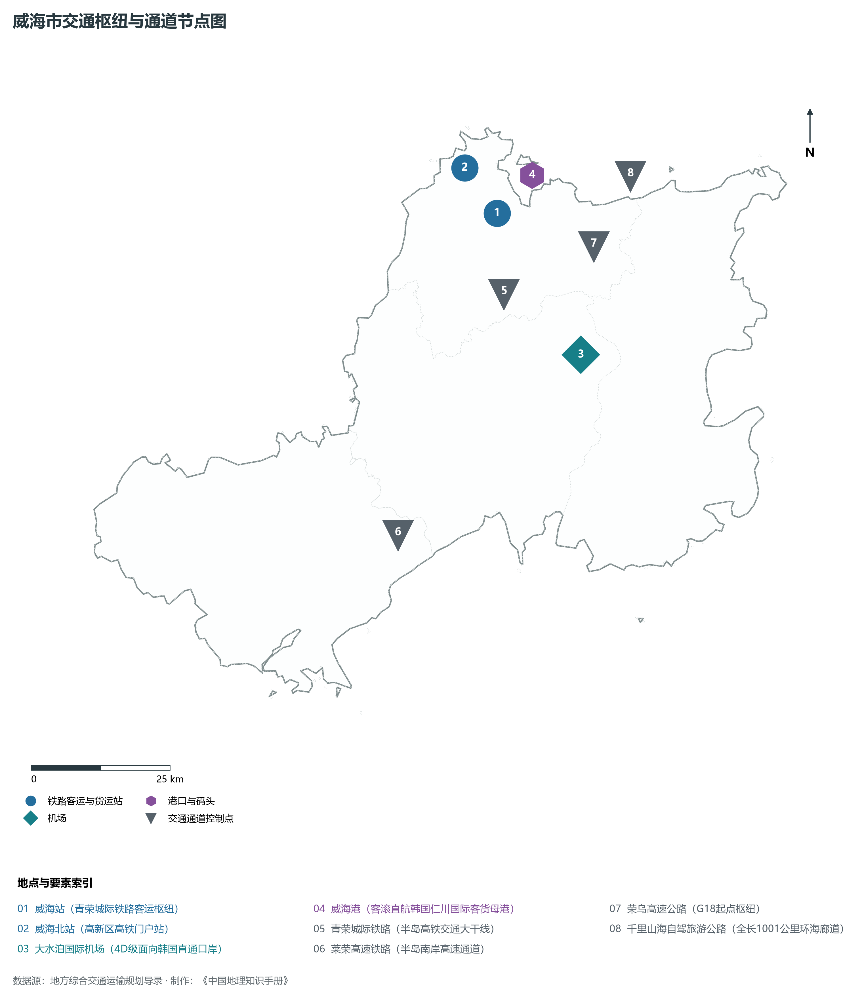
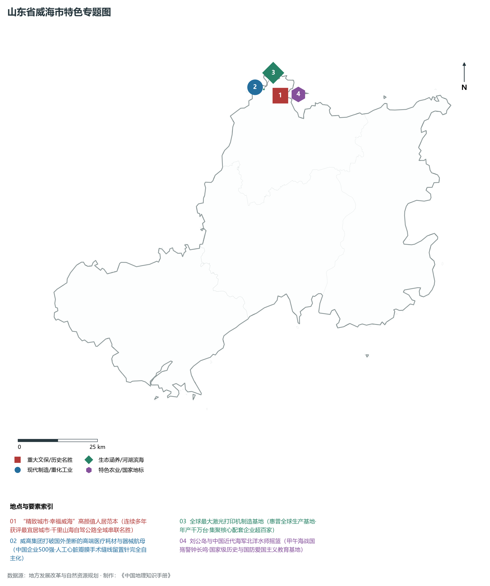
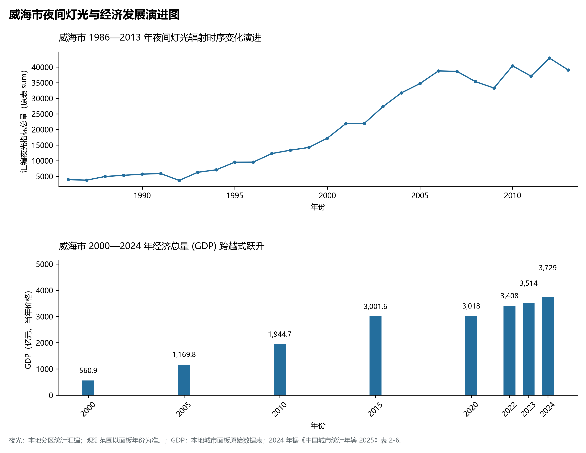

# 8.10 威海市

威海市，位于山东省，其城市功能定位与发展愿景概括为：**“千里海岸线，一幅山水画”·中韩自贸区合作示范区·中国首批沿海开放城市与精致城市典范**。2024 年常住人口 **291 万人**，常住人口城镇化率 **73.58%**，地区生产总值 **3,729 亿元**（当年价格），人均地区生产总值 **127,951 元**，三次产业构成为 **9.32 : 37 : 53.68**。

---

## 一、自然地理底盘与地貌水系机理

威海市在大地构造演化史上地处华北克拉通陆块演化关键带，构造活动剧烈，断块升降与岩浆喷发侵入历史源远流长，塑造了丘陵起伏、山水相融或平原开阔的自然地理底盘。全境地表高程最低为 **0.0 m**，最高隆起山峰或高地海拔达 **595.0 m**，地势梯级起伏与垂直微地貌分异构筑了层次鲜明的生态水文环境与战略资源承载力。

区域骨干控制性山脉与地形高程极点包括：

- **正棋山 (595m 威海最高峰)**（坐标约东经 122.020°、北纬 37.380°，高程约 595.0 m）：构成区域地形骨架与水系分水岭的关键高程控制点；
- **里口山 (国家森林公园·天然氧吧)**（坐标约东经 122.070°、北纬 37.470°，高程约 418.0 m）：构成区域地形骨架与水系分水岭的关键高程控制点；
- **成山头 (中国好望角·天尽头)**（坐标约东经 122.680°、北纬 37.400°，高程约 200.0 m）：构成区域地形骨架与水系分水岭的关键高程控制点；

水系与水文网络方面，威海市地表水资源丰富，骨干江河湖库穿流浸润：

- **母猪河 (文登威海核心淡水河流)**（流经约东经 122.000°、北纬 37.100° 水域）：对全市工农业供水、生态水系构建及防汛抗旱减灾发挥核心支撑调蓄作用；
- **乳山河 (注入黄海南部湾区)**（流经约东经 121.520°、北纬 36.850° 水域）：对全市工农业供水、生态水系构建及防汛抗旱减灾发挥核心支撑调蓄作用；
- **米山水库 (威海最大水库饮用水源)**（流经约东经 122.100°、北纬 37.250° 水域）：对全市工农业供水、生态水系构建及防汛抗旱减灾发挥核心支撑调蓄作用；
- **刘公岛海域 (威海湾天然屏障)**（流经约东经 122.180°、北纬 37.500° 水域）：对全市工农业供水、生态水系构建及防汛抗旱减灾发挥核心支撑调蓄作用；

---

## 二、行政区划沿革与城镇空间体系

威海市历史文脉积淀深厚，建置沿革久远。新中国成立以来，伴随国家现代工业化进程推进、沿海开放战略落地与新型城镇化纵深发展，形成了市辖区高效协同、县域特色支撑、产城高度融合的市辖区与县级行政单元空间组织体系：

- **威海市委市政府 (环翠区)**（驻地坐标：122.115°E, 37.505°N）；
- **文登区政府 (温泉之都与先进装备制造)**（驻地坐标：122.055°E, 37.195°N）；
- **荣成市政府 (全国百强县前列/石岛远洋渔业)**（驻地坐标：122.485°E, 37.165°N）；
- **乳山市政府 (母爱圣地与银滩滨海旅游)**（驻地坐标：121.540°E, 36.915°N）；
- **威海火炬高技术产业开发区管委会**（驻地坐标：122.050°E, 37.530°N）；

在城镇空间总体布局上，威海市紧扣《国土空间总体规划》，坚持“极核集聚、轴带贯通、组团联动、陆海协同”的战略方针，做优做精中心城区核心能级，提升县域经济特色承载能力，构筑紧凑集约、生态宜居的现代城乡空间组织体系。

---

## 三、综合立体交通网络与交通走廊

威海市地处齐鲁综合立体交通网络重要节点，依托高速铁路、骨干干线铁路、国家高速公路与沿海深水海港/内河大港/航空机场，构筑了四通八达的现代化立体综合交通运输骨架：

**主要综合客运与货运物流交通枢纽节点：**

- **威海站 (青荣城际铁路客运枢纽)**（位置坐标：122.115°E, 37.430°N）；
- **威海北站 (高新区高铁门户站)**（位置坐标：122.065°E, 37.510°N）；
- **大水泊国际机场 (4D级面向韩国直通口岸)**（位置坐标：122.235°E, 37.185°N）；
- **威海港 (客滚直航韩国仁川国际客货母港)**（位置坐标：122.200°E, 37.480°N）；

**核心干线铁路与高等级公路交通走廊：**

- **青荣城际铁路 (半岛高铁交通大干线)**（廊道控制点：122.100°E, 37.300°N）：对外快速互联互通的高速客货运通道；
- **莱荣高速铁路 (半岛南岸高速通道)**（廊道控制点：121.800°E, 36.950°N）：对外快速互联互通的高速客货运通道；
- **荣乌高速公路 (G18起点枢纽)**（廊道控制点：122.300°E, 37.350°N）：对外快速互联互通的高速客货运通道；
- **千里山海自驾旅游公路 (全长1001公里环海廊道)**（廊道控制点：122.400°E, 37.450°N）：对外快速互联互通的高速客货运通道；

---

## 四、现代产业体系与新质生产力布局

威海市坚定践行新发展理念，以绿色低碳高质量发展为主线，大力推进传统优势产业数智化改造，培育壮大战略性新兴产业集群，构建具有区域核心竞争力的现代产业新格局：

**核心先进制造业园区与高新技术创新集聚区：**

- **威高集团国家级医用高分子产业基地**（园区坐标：122.030°E, 37.540°N）：区域重大产业创新与先进制造业集群承载核心平台；
- **惠普/捷普全球最大激光打印机基地**（园区坐标：122.060°E, 37.530°N）：区域重大产业创新与先进制造业集群承载核心平台；
- **石岛国家远洋渔业基地与先进修造船产业园**（园区坐标：122.420°E, 36.900°N）：区域重大产业创新与先进制造业集群承载核心平台；
- **天润工业曲轴连杆现代化智能制造中心**（园区坐标：122.060°E, 37.210°N）：区域重大产业创新与先进制造业集群承载核心平台；

**标志性特色主题要素与领航龙头优势：**

- **“精致城市·幸福威海”高颜值人居范本**（空间坐标：122.115°E, 37.505°N）：连续多年获评最宜居城市·千里山海自驾公路全域串联名胜；
- **威高集团打破国外垄断的高端医疗耗材与器械航母**（空间坐标：122.030°E, 37.540°N）：中国企业500强·人工心脏瓣膜手术缝线留置针完全自主化；
- **全球最大激光打印机制造基地**（空间坐标：122.060°E, 37.530°N）：惠普全球生产基地·年产千万台·集聚核心配套企业超百家；
- **刘公岛与中国近代海军北洋水师摇篮**（空间坐标：122.180°E, 37.500°N）：甲午海战国殇警钟长鸣·国家级历史与国防爱国主义教育基地；

---

## 五、历史文化底蕴、名胜古迹与全域文旅地理

威海市人杰地灵、文脉昌盛，自然风光雄奇秀美，人文古迹璀璨夺目。全境汇聚了高等级风景名胜区、全国重点文物保护单位与国家非物质文化遗产代表作：

- **刘公岛国家级风景名胜区 (5A·甲午战争纪念地)**（地标坐标：122.180°E, 37.500°N）：享誉国内外的标志性风景名胜与国家级文旅高地；
- **成山头国家级风景名胜区 (4A·中国大陆最早见日出之地)**（地标坐标：122.680°E, 37.400°N）：享誉国内外的标志性风景名胜与国家级文旅高地；
- **威海华夏城景区 (5A·废弃采石场生态修复典范)**（地标坐标：122.130°E, 37.420°N）：享誉国内外的标志性风景名胜与国家级文旅高地；
- **乳山银滩旅游度假区 (天下第一滩)**（地标坐标：121.650°E, 36.850°N）：享誉国内外的标志性风景名胜与国家级文旅高地；

威海市坚持以文塑旅、以旅彰文，全面推进“文旅+生态+制造+乡村”深度融合，持续优化全域旅游产品体系与消费场景，打造高辨识度文旅品牌。

---

## 六、夜间灯光辐射与经济变化时序演进

本节夜光图的观测年份为 1986—2013 年，指标为行政区汇总值（原表 sum）。

| 年份 | 地区生产总值（亿元，当年价格） |
|:---|---:|
| 2000 年 | 560.9 |
| 2005 年 | 1,169.8 |
| 2010 年 | 1,944.7 |
| 2015 年 | 3,001.6 |
| 2020 年 | 3,018 |
| 2022 年 | 3,408 |
| 2023 年 | 3,514 |
| 2024 年 | 3,729 |

- **1996 年前后**：环翠区威海卫老港与文登老县城点状发亮；
- **2005 年前后**：火炬高新区威高打印机基地与荣成石岛港成带；

---

2024 年统计来源：《中国城市统计年鉴 2025》表 2-1、2-6、2-7（2024 年，全市）。其他年份 GDP 据本地城市面板“原始数据”表，单位为亿元、当年价格。
