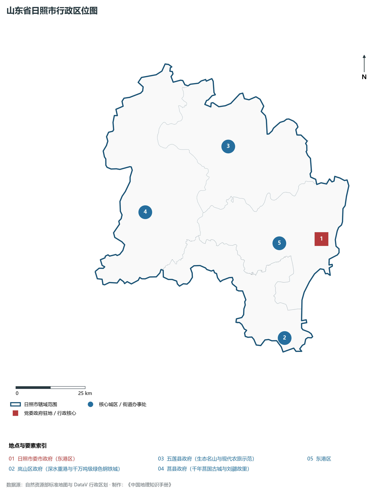
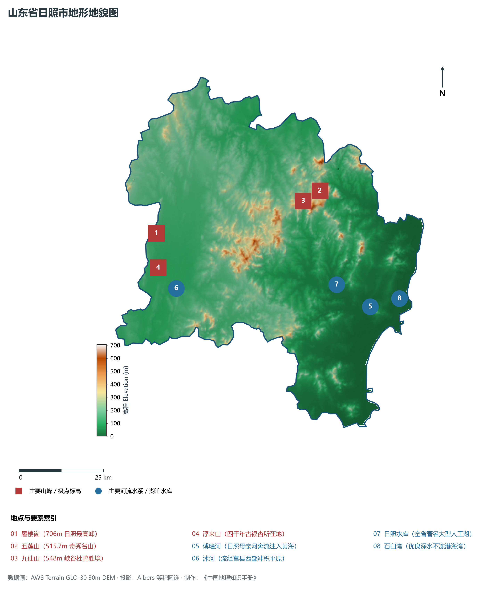
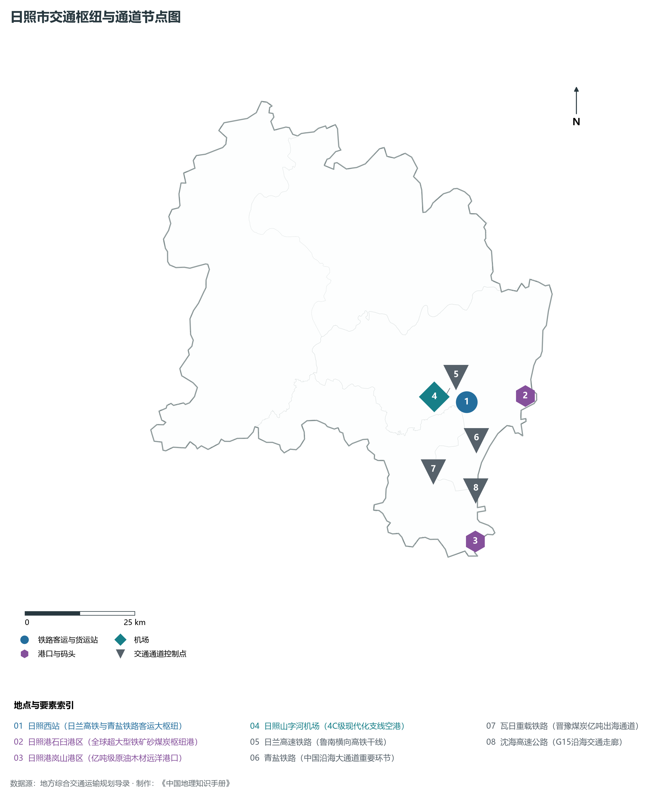
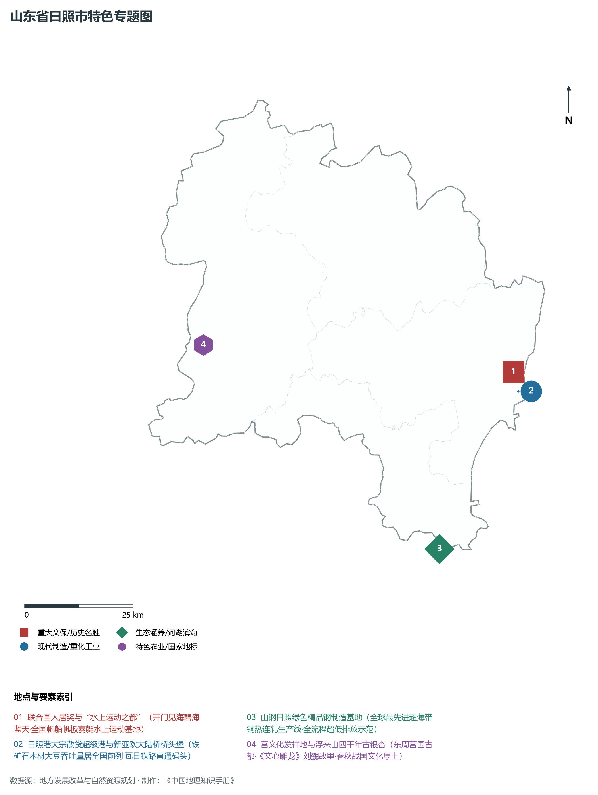
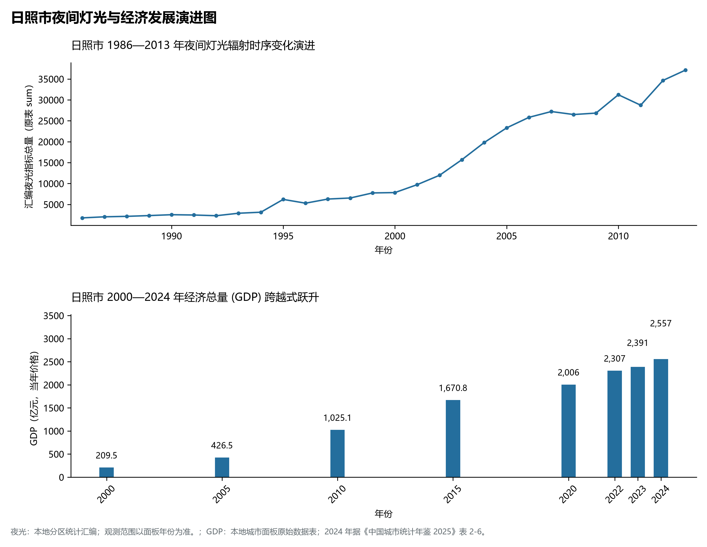

# 8.11 日照市

日照市，位于山东省，其城市功能定位与发展愿景概括为：**“水上运动之都”·新亚欧大陆桥东方桥头堡·亿吨深水大港·沿海先进钢铁与临港工业基地**。2024 年常住人口 **293 万人**，常住人口城镇化率 **64.62%**，地区生产总值 **2,557 亿元**（当年价格），人均地区生产总值 **87,013 元**，三次产业构成为 **8.57 : 43.02 : 48.4**。

---

## 一、自然地理底盘与地貌水系机理

日照市在大地构造演化史上地处华北克拉通陆块演化关键带，构造活动剧烈，断块升降与岩浆喷发侵入历史源远流长，塑造了丘陵起伏、山水相融或平原开阔的自然地理底盘。全境地表高程最低为 **0.0 m**，最高隆起山峰或高地海拔达 **706.0 m**，地势梯级起伏与垂直微地貌分异构筑了层次鲜明的生态水文环境与战略资源承载力。

区域骨干控制性山脉与地形高程极点包括：

- **屋楼崮 (706m 日照最高峰)**（坐标约东经 118.780°、北纬 35.650°，高程约 706.0 m）：构成区域地形骨架与水系分水岭的关键高程控制点；
- **五莲山 (515.7m 奇秀名山)**（坐标约东经 119.340°、北纬 35.700°，高程约 515.7 m）：构成区域地形骨架与水系分水岭的关键高程控制点；
- **九仙山 (548m 峡谷杜鹃胜境)**（坐标约东经 119.280°、北纬 35.680°，高程约 548.0 m）：构成区域地形骨架与水系分水岭的关键高程控制点；
- **浮来山 (四千年古银杏所在地)**（坐标约东经 118.770°、北纬 35.560°，高程约 298.0 m）：构成区域地形骨架与水系分水岭的关键高程控制点；

水系与水文网络方面，日照市地表水资源丰富，骨干江河湖库穿流浸润：

- **傅疃河 (日照母亲河奔流注入黄海)**（流经约东经 119.450°、北纬 35.380° 水域）：对全市工农业供水、生态水系构建及防汛抗旱减灾发挥核心支撑调蓄作用；
- **沭河 (流经莒县西部冲积平原)**（流经约东经 118.820°、北纬 35.500° 水域）：对全市工农业供水、生态水系构建及防汛抗旱减灾发挥核心支撑调蓄作用；
- **日照水库 (全省著名大型人工湖)**（流经约东经 119.350°、北纬 35.450° 水域）：对全市工农业供水、生态水系构建及防汛抗旱减灾发挥核心支撑调蓄作用；
- **石臼湾 (优良深水不冻港海湾)**（流经约东经 119.550°、北纬 35.390° 水域）：对全市工农业供水、生态水系构建及防汛抗旱减灾发挥核心支撑调蓄作用；

---

## 二、行政区划沿革与城镇空间体系

日照市历史文脉积淀深厚，建置沿革久远。新中国成立以来，伴随国家现代工业化进程推进、沿海开放战略落地与新型城镇化纵深发展，形成了市辖区高效协同、县域特色支撑、产城高度融合的市辖区与县级行政单元空间组织体系：

- **日照市委市政府 (东港区)**（驻地坐标：119.525°E, 35.415°N）；
- **岚山区政府 (深水重港与千万吨级绿色钢铁城)**（驻地坐标：119.320°E, 35.120°N）；
- **五莲县政府 (生态名山与现代农旅示范)**（驻地坐标：119.205°E, 35.750°N）；
- **莒县政府 (千年莒国古城与刘勰故里)**（驻地坐标：118.835°E, 35.580°N）；

在城镇空间总体布局上，日照市紧扣《国土空间总体规划》，坚持“极核集聚、轴带贯通、组团联动、陆海协同”的战略方针，做优做精中心城区核心能级，提升县域经济特色承载能力，构筑紧凑集约、生态宜居的现代城乡空间组织体系。

---

## 三、综合立体交通网络与交通走廊

日照市地处齐鲁综合立体交通网络重要节点，依托高速铁路、骨干干线铁路、国家高速公路与沿海深水海港/内河大港/航空机场，构筑了四通八达的现代化立体综合交通运输骨架：

**主要综合客运与货运物流交通枢纽节点：**

- **日照西站 (日兰高铁与青盐铁路客运大枢纽)**（位置坐标：119.410°E, 35.380°N）；
- **日照港石臼港区 (全球超大型铁矿砂煤炭枢纽港)**（位置坐标：119.560°E, 35.375°N）；
- **日照港岚山港区 (亿吨级原油木材远洋港口)**（位置坐标：119.380°E, 35.100°N）；
- **日照山字河机场 (4C级现代化支线空港)**（位置坐标：119.330°E, 35.400°N）；

**核心干线铁路与高等级公路交通走廊：**

- **日兰高速铁路 (鲁南横向高铁干线)**（廊道控制点：119.350°E, 35.390°N）：对外快速互联互通的高速客货运通道；
- **青盐铁路 (中国沿海大通道重要环节)**（廊道控制点：119.420°E, 35.300°N）：对外快速互联互通的高速客货运通道；
- **瓦日重载铁路 (晋豫煤炭亿吨出海通道)**（廊道控制点：119.300°E, 35.250°N）：对外快速互联互通的高速客货运通道；
- **沈海高速公路 (G15沿海交通走廊)**（廊道控制点：119.400°E, 35.200°N）：对外快速互联互通的高速客货运通道；

---

## 四、现代产业体系与新质生产力布局

日照市坚定践行新发展理念，以绿色低碳高质量发展为主线，大力推进传统优势产业数智化改造，培育壮大战略性新兴产业集群，构建具有区域核心竞争力的现代产业新格局：

**核心先进制造业园区与高新技术创新集聚区：**

- **山钢集团日照千万吨精品钢基地**（园区坐标：119.300°E, 35.080°N）：区域重大产业创新与先进制造业集群承载核心平台；
- **日照先进钢铁制造产业配套集群**（园区坐标：119.350°E, 35.120°N）：区域重大产业创新与先进制造业集群承载核心平台；
- **日照经济技术开发区 (现代汽车动力总成)**（园区坐标：119.480°E, 35.360°N）：区域重大产业创新与先进制造业集群承载核心平台；
- **中车日照车辆有限公司智能制造基地**（园区坐标：119.430°E, 35.350°N）：区域重大产业创新与先进制造业集群承载核心平台；

**标志性特色主题要素与领航龙头优势：**

- **联合国人居奖与“水上运动之都”**（空间坐标：119.555°E, 35.415°N）：开门见海碧海蓝天·全国帆船帆板赛艇水上运动基地；
- **日照港大宗散货超级港与新亚欧大陆桥桥头堡**（空间坐标：119.560°E, 35.375°N）：铁矿石木材大豆吞吐量居全国前列·瓦日铁路直通码头；
- **山钢日照绿色精品钢制造基地**（空间坐标：119.300°E, 35.080°N）：全球最先进超薄带钢热连轧生产线·全流程超低排放示范；
- **莒文化发祥地与浮来山四千年古银杏**（空间坐标：118.770°E, 35.560°N）：东周莒国古都·《文心雕龙》刘勰故里·春秋战国文化厚土；

---

## 五、历史文化底蕴、名胜古迹与全域文旅地理

日照市人杰地灵、文脉昌盛，自然风光雄奇秀美，人文古迹璀璨夺目。全境汇聚了高等级风景名胜区、全国重点文物保护单位与国家非物质文化遗产代表作：

- **万平口海滨风景区 (国家级水上运动中心)**（地标坐标：119.555°E, 35.415°N）：享誉国内外的标志性风景名胜与国家级文旅高地；
- **海滨国家森林公园 (江北第一金沙滩)**（地标坐标：119.610°E, 35.530°N）：享誉国内外的标志性风景名胜与国家级文旅高地；
- **浮来山定林寺景区 (4A·天下第一古银杏树)**（地标坐标：118.770°E, 35.560°N）：享誉国内外的标志性风景名胜与国家级文旅高地；
- **五莲山与九仙山风景区 (4A)**（地标坐标：119.330°E, 35.690°N）：享誉国内外的标志性风景名胜与国家级文旅高地；
- **莒国古城文化旅游区**（地标坐标：118.845°E, 35.585°N）：享誉国内外的标志性风景名胜与国家级文旅高地；

日照市坚持以文塑旅、以旅彰文，全面推进“文旅+生态+制造+乡村”深度融合，持续优化全域旅游产品体系与消费场景，打造高辨识度文旅品牌。

---

## 六、夜间灯光辐射与经济变化时序演进

本节夜光图的观测年份为 1986—2013 年，指标为行政区汇总值（原表 sum）。

| 年份 | 地区生产总值（亿元，当年价格） |
|:---|---:|
| 2000 年 | 209.5 |
| 2005 年 | 426.5 |
| 2010 年 | 1,025.1 |
| 2015 年 | 1,670.8 |
| 2020 年 | 2,006 |
| 2022 年 | 2,307 |
| 2023 年 | 2,391 |
| 2024 年 | 2,557 |

- **2005 年前后**：岚山港区油品化工与新亚欧大陆桥联运拉开；
- **2013 年前后**：山钢日照千万吨精品钢基地建设·沿海港产城成环；

---

2024 年统计来源：《中国城市统计年鉴 2025》表 2-1、2-6、2-7（2024 年，全市）。其他年份 GDP 据本地城市面板“原始数据”表，单位为亿元、当年价格。
