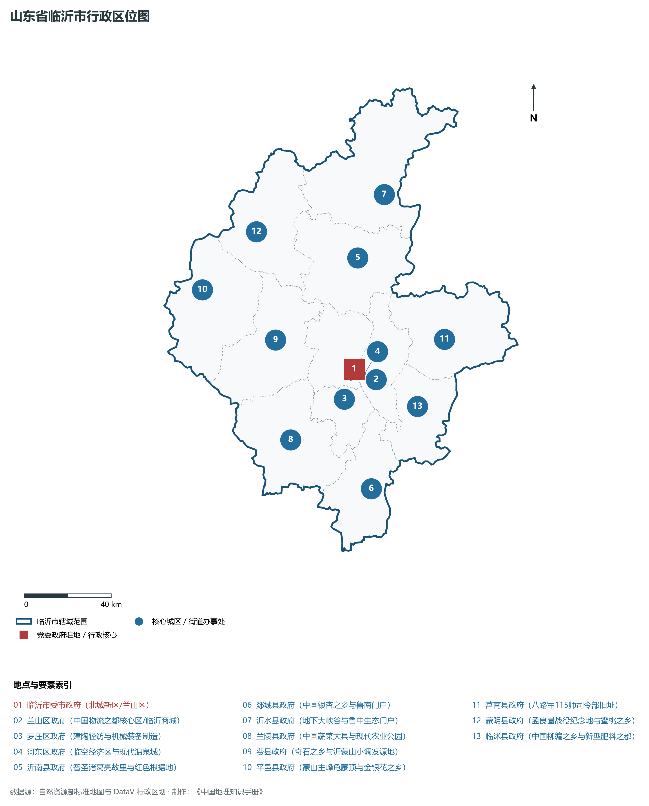
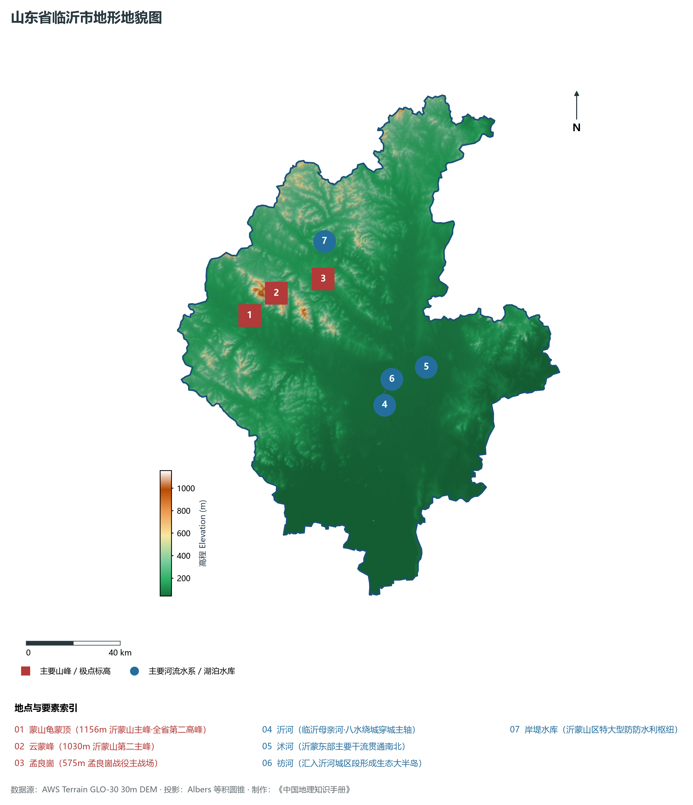
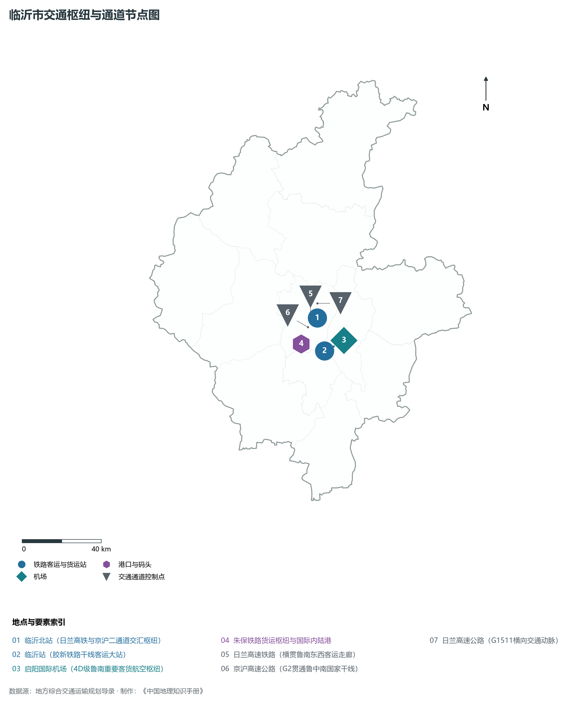
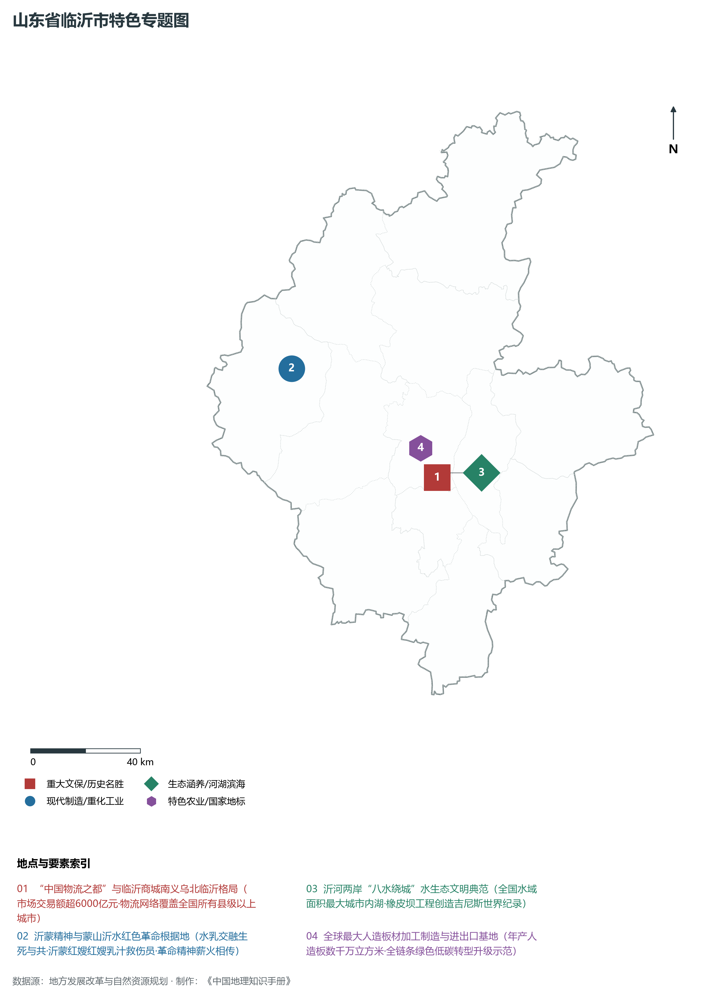
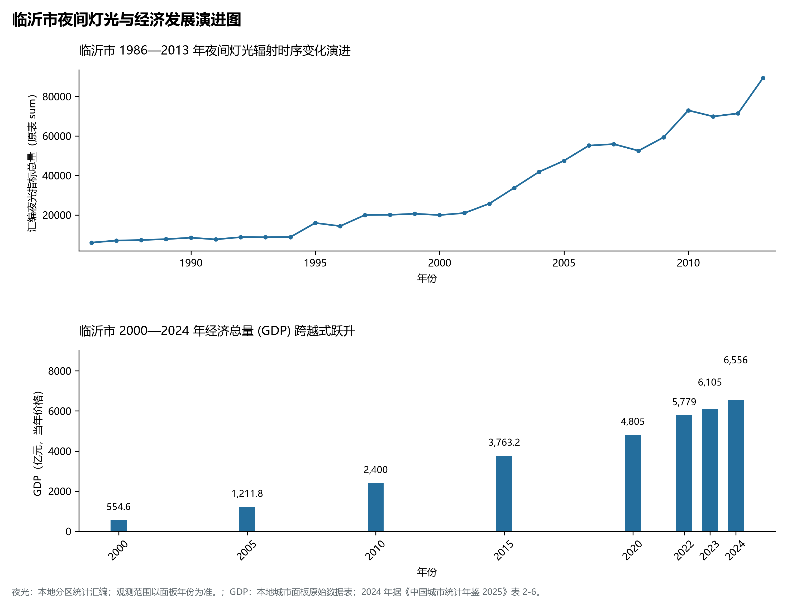

# 8.12 临沂市

临沂市，位于山东省，其城市功能定位与发展愿景概括为：**沂蒙精神发源地·“中国物流之都”·北方最大商贸批发城·国家物流枢纽与千万人口大市**。2024 年常住人口 **1,085 万人**，常住人口城镇化率 **59.27%**，地区生产总值 **6,556 亿元**（当年价格），人均地区生产总值 **60,166 元**，三次产业构成为 **8.29 : 40.5 : 51.21**。

---

## 一、自然地理底盘与地貌水系机理

临沂市在大地构造演化史上地处华北克拉通陆块演化关键带，构造活动剧烈，断块升降与岩浆喷发侵入历史源远流长，塑造了丘陵起伏、山水相融或平原开阔的自然地理底盘。全境地表高程最低为 **40.0 m**，最高隆起山峰或高地海拔达 **1156.0 m**，地势梯级起伏与垂直微地貌分异构筑了层次鲜明的生态水文环境与战略资源承载力。

区域骨干控制性山脉与地形高程极点包括：

- **蒙山龟蒙顶 (1156m 沂蒙山主峰·全省第二高峰)**（坐标约东经 117.780°、北纬 35.480°，高程约 1156.0 m）：构成区域地形骨架与水系分水岭的关键高程控制点；
- **云蒙峰 (1030m 沂蒙山第二主峰)**（坐标约东经 117.920°、北纬 35.550°，高程约 1030.0 m）：构成区域地形骨架与水系分水岭的关键高程控制点；
- **孟良崮 (575m 孟良崮战役主战场)**（坐标约东经 118.150°、北纬 35.580°，高程约 575.0 m）：构成区域地形骨架与水系分水岭的关键高程控制点；

水系与水文网络方面，临沂市地表水资源丰富，骨干江河湖库穿流浸润：

- **沂河 (临沂母亲河·八水绕城穿城主轴)**（流经约东经 118.360°、北纬 35.080° 水域）：对全市工农业供水、生态水系构建及防汛抗旱减灾发挥核心支撑调蓄作用；
- **沭河 (沂蒙东部主要干流贯通南北)**（流经约东经 118.580°、北纬 35.200° 水域）：对全市工农业供水、生态水系构建及防汛抗旱减灾发挥核心支撑调蓄作用；
- **祊河 (汇入沂河城区段形成生态大半岛)**（流经约东经 118.330°、北纬 35.090° 水域）：对全市工农业供水、生态水系构建及防汛抗旱减灾发挥核心支撑调蓄作用；
- **岸堤水库 (沂蒙山区特大型防防水利枢纽)**（流经约东经 118.180°、北纬 35.720° 水域）：对全市工农业供水、生态水系构建及防汛抗旱减灾发挥核心支撑调蓄作用；

---

## 二、行政区划沿革与城镇空间体系

临沂市历史文脉积淀深厚，建置沿革久远。新中国成立以来，伴随国家现代工业化进程推进、沿海开放战略落地与新型城镇化纵深发展，形成了市辖区高效协同、县域特色支撑、产城高度融合的市辖区与县级行政单元空间组织体系：

- **临沂市委市政府 (北城新区/兰山区)**（驻地坐标：118.355°E, 35.105°N）；
- **兰山区政府 (中国物流之都核心区/临沂商城)**（驻地坐标：118.330°E, 35.065°N）；
- **罗庄区政府 (建陶轻纺与机械装备制造)**（驻地坐标：118.285°E, 34.990°N）；
- **河东区政府 (临空经济区与现代温泉城)**（驻地坐标：118.405°E, 35.080°N）；
- **沂南县政府 (智圣诸葛亮故里与红色根据地)**（驻地坐标：118.450°E, 35.550°N）；
- **郯城县政府 (中国银杏之乡与鲁南门户)**（驻地坐标：118.360°E, 34.615°N）；
- **沂水县政府 (地下大峡谷与鲁中生态门户)**（驻地坐标：118.630°E, 35.790°N）；
- **兰陵县政府 (中国蔬菜大县与现代农业公园)**（驻地坐标：117.985°E, 34.855°N）；
- **费县政府 (奇石之乡与沂蒙山小调发源地)**（驻地坐标：117.975°E, 35.265°N）；
- **平邑县政府 (蒙山主峰龟蒙顶与金银花之乡)**（驻地坐标：117.635°E, 35.505°N）；
- **莒南县政府 (八路军115师司令部旧址)**（驻地坐标：118.835°E, 35.175°N）；
- **蒙阴县政府 (孟良崮战役纪念地与蜜桃之乡)**（驻地坐标：117.950°E, 35.710°N）；
- **临沭县政府 (中国柳编之乡与新型肥料之都)**（驻地坐标：118.650°E, 34.920°N）；

在城镇空间总体布局上，临沂市紧扣《国土空间总体规划》，坚持“极核集聚、轴带贯通、组团联动、陆海协同”的战略方针，做优做精中心城区核心能级，提升县域经济特色承载能力，构筑紧凑集约、生态宜居的现代城乡空间组织体系。

---

## 三、综合立体交通网络与交通走廊

临沂市地处齐鲁综合立体交通网络重要节点，依托高速铁路、骨干干线铁路、国家高速公路与沿海深水海港/内河大港/航空机场，构筑了四通八达的现代化立体综合交通运输骨架：

**主要综合客运与货运物流交通枢纽节点：**

- **临沂北站 (日兰高铁与京沪二通道交汇枢纽)**（位置坐标：118.340°E, 35.185°N）；
- **临沂站 (胶新铁路干线客运大站)**（位置坐标：118.355°E, 35.035°N）；
- **启阳国际机场 (4D级鲁南重要客货航空枢纽)**（位置坐标：118.410°E, 35.050°N）；
- **朱保铁路货运枢纽与国际内陆港**（位置坐标：118.230°E, 35.080°N）；

**核心干线铁路与高等级公路交通走廊：**

- **日兰高速铁路 (横贯鲁南东西客运走廊)**（廊道控制点：118.300°E, 35.180°N）：对外快速互联互通的高速客货运通道；
- **京沪高速公路 (G2贯通鲁中南国家干线)**（廊道控制点：118.280°E, 35.150°N）：对外快速互联互通的高速客货运通道；
- **日兰高速公路 (G1511横向交通动脉)**（廊道控制点：118.350°E, 35.250°N）：对外快速互联互通的高速客货运通道；

---

## 四、现代产业体系与新质生产力布局

临沂市坚定践行新发展理念，以绿色低碳高质量发展为主线，大力推进传统优势产业数智化改造，培育壮大战略性新兴产业集群，构建具有区域核心竞争力的现代产业新格局：

**核心先进制造业园区与高新技术创新集聚区：**

- **临沂商城核心批发市场群 (131处专业市场)**（园区坐标：118.310°E, 35.070°N）：区域重大产业创新与先进制造业集群承载核心平台；
- **临沂综合保税区与跨境电商产业园**（园区坐标：118.420°E, 34.980°N）：区域重大产业创新与先进制造业集群承载核心平台；
- **临沂临港绿色精品钢与不锈钢新材料基地**（园区坐标：119.000°E, 35.250°N）：区域重大产业创新与先进制造业集群承载核心平台；
- **兰山人造板材现代工业集聚区**（园区坐标：118.250°E, 35.120°N）：区域重大产业创新与先进制造业集群承载核心平台；

**标志性特色主题要素与领航龙头优势：**

- **“中国物流之都”与临沂商城南义乌北临沂格局**（空间坐标：118.310°E, 35.070°N）：市场交易额超6000亿元·物流网络覆盖全国所有县级以上城市；
- **沂蒙精神与蒙山沂水红色革命根据地**（空间坐标：117.780°E, 35.480°N）：水乳交融生死与共·沂蒙红嫂红嫂乳汁救伤员·革命精神薪火相传；
- **沂河两岸“八水绕城”水生态文明典范**（空间坐标：118.360°E, 35.080°N）：全国水域面积最大城市内湖·橡皮坝工程创造吉尼斯世界纪录；
- **全球最大人造板材加工制造与进出口基地**（空间坐标：118.250°E, 35.120°N）：年产人造板数千万立方米·全链条绿色低碳转型升级示范；

---

## 五、历史文化底蕴、名胜古迹与全域文旅地理

临沂市人杰地灵、文脉昌盛，自然风光雄奇秀美，人文古迹璀璨夺目。全境汇聚了高等级风景名胜区、全国重点文物保护单位与国家非物质文化遗产代表作：

- **沂蒙山国家级旅游景区 (5A·世界地质公园)**（地标坐标：117.780°E, 35.480°N）：享誉国内外的标志性风景名胜与国家级文旅高地；
- **孟良崮战役纪念馆 (全国红色爱国主义基地)**（地标坐标：118.160°E, 35.580°N）：享誉国内外的标志性风景名胜与国家级文旅高地；
- **银雀山汉墓竹简博物馆 (全国重点文保)**（地标坐标：118.350°E, 35.055°N）：享誉国内外的标志性风景名胜与国家级文旅高地；
- **山东地下大峡谷与地下荧光湖 (4A·沂水)**（地标坐标：118.670°E, 35.750°N）：享誉国内外的标志性风景名胜与国家级文旅高地；
- **王羲之故居与洗砚池晋代名胜**（地标坐标：118.355°E, 35.060°N）：享誉国内外的标志性风景名胜与国家级文旅高地；

临沂市坚持以文塑旅、以旅彰文，全面推进“文旅+生态+制造+乡村”深度融合，持续优化全域旅游产品体系与消费场景，打造高辨识度文旅品牌。

---

## 六、夜间灯光辐射与经济变化时序演进

本节夜光图的观测年份为 1986—2013 年，指标为行政区汇总值（原表 sum）。

| 年份 | 地区生产总值（亿元，当年价格） |
|:---|---:|
| 2000 年 | 554.6 |
| 2005 年 | 1,211.8 |
| 2010 年 | 2,400 |
| 2015 年 | 3,763.2 |
| 2020 年 | 4,805 |
| 2022 年 | 5,779 |
| 2023 年 | 6,105 |
| 2024 年 | 6,556 |

- **1996 年前后**：兰山老城与临沂批发市场群初显商贸活力；
- **2005 年前后**：北城新区沂河两岸大开发·罗庄河东工业拓展；
- **2013 年前后**：临沂商城千亿级批发市场群与国际陆港交相辉映；

---

2024 年统计来源：《中国城市统计年鉴 2025》表 2-1、2-6、2-7（2024 年，全市）。其他年份 GDP 据本地城市面板“原始数据”表，单位为亿元、当年价格。
